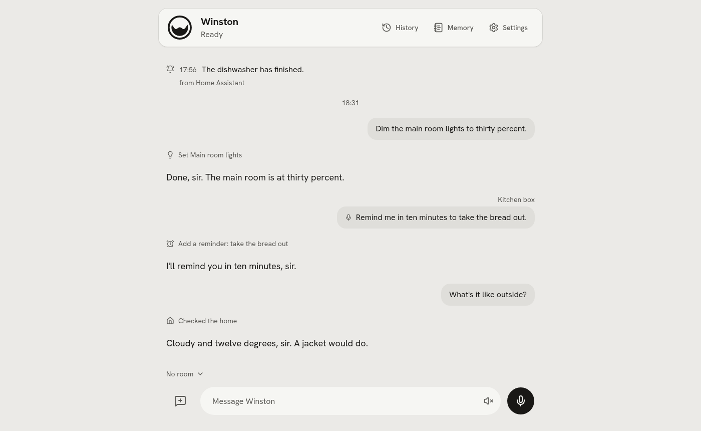

# Winston

[](LICENSE)
[](https://docs.astral.sh/uv/)
[](https://www.home-assistant.io/integrations/mcp_server/)

A self-hosted voice assistant for Home Assistant. Talk to your home; Winston answers in a natural
voice, does what you asked, and stops when you say his name over him. Everything runs on your own
machine by default, and any part can be swapped for a hosted service.

<picture>
  <source media="(prefers-color-scheme: dark)" srcset="docs/images/talk-dark.png">
  
</picture>

## Install

Needs Linux and Home Assistant. Any of the [hardware profiles](docs/hardware.md) works: a 24 GB
NVIDIA card, Ollama on any GPU or CPU, or a hosted model.

```sh
curl -fsSL https://github.com/aldinsmajlovic/winston/releases/latest/download/install.sh | sh
```

The script installs the latest release (and uv, if it is missing), then runs setup. Setup reads the
computer, picks the profile for it, asks before anything that needs root (Docker, NVIDIA's container
toolkit, Ollama) and starts Winston as a service. Open the link it prints, on this computer or a
phone: a wizard downloads his brain and voice, signs in to Home Assistant, lets you name him, and can
set up a Voice PE plugged in over USB. To read the script first, or to install from a clone, see
[setup](docs/setup.md).

## Features

- **Local first.** The language model and the voice share one GPU and speech recognition runs on the
  CPU, or everything runs on Ollama and the CPU. Each can point at a hosted API instead.
- **Fast.** About 1.3 s from the end of a plain question to his first word.
- **Controls your home** through Home Assistant's MCP server, then checks the device really changed
  and corrects himself when it did not. Home Assistant's own Assist, its app, chat and voice
  satellites, can pick him as its agent too.
- **In every room.** A [Voice Preview Edition](#works-with-home-assistant-voice-preview-edition) per
  room, and the browser, with a full-screen wall display for a tablet on the wall. Start a
  conversation at the box and finish it on the screen beside it.
- **Remembers** what you tell him, in plain Markdown you can read and edit, and writes a diary of each
  day you can ask him about.
- **Speaks up.** Announcements from Home Assistant, a word before what is on your calendar, and
  reminders reach the room you are in or your phone; in quiet hours only what you asked for.
- **Extensible.** Add a tool in one Python file or connect any MCP server. Your calendar, news,
  reminders, things to do later ("clean the kitchen when I leave"), Hevy and Spotify come built in,
  and a small server on each of your Linux computers lets him open apps, files and pages there and
  tell you how it is doing.
- **Borrows a voice.** A friend agrees out loud and talks for fifteen seconds; Winston can then speak
  as them.

## Works with Home Assistant Voice Preview Edition


Nabu Casa's [Voice Preview Edition](https://www.home-assistant.io/voice-pe/) is a small speaker
with two microphones, hardware echo cancelling, a mute switch and a jack for a better speaker.
Winston connects to it directly in place of Assist: keep the box, and it gets his brain, voice and
memory. Tested on a real one: the wake word, your request and his spoken reply, the lights, his
announcements and Spotify through its speaker. Winston's own firmware for it adds an "Okay Winston"
wake word and holding the button to talk through pauses.

Setup, with or without Home Assistant adopting the box: [Voice PE](docs/voice-pe.md).

<sub>Photo: [Home Assistant](https://www.home-assistant.io/voice-pe/), CC BY-NC-SA 4.0.</sub>

## Documentation

- **Using it:** [setup](docs/setup.md), [running](docs/running.md), [Home Assistant](docs/home-assistant.md),
  [Assist](docs/assist.md),
  [tools](docs/tools.md), [voices](docs/voices.md), [announcements](docs/announcements.md),
  [Discord](docs/discord.md), [computers](docs/computer.md)
- **Rooms:** [Voice PE satellite](docs/voice-pe.md), [rooms](docs/rooms.md)
- **Extending it:** [extensions](docs/extensions.md), [built-in extensions](docs/built-in-extensions.md)
- **How it works:** [architecture](docs/architecture.md), [hardware](docs/hardware.md),
  [decisions](docs/decisions.md)
- **Contributing:** [UI guide](docs/ui-guide.md), [identity](docs/identity.md),
  [writing docs](docs/writing-docs.md)

## Licence

Apache-2.0. See `LICENSE` and `NOTICE`. "Winston" is the name of this project; forks are welcome
under a different name.
