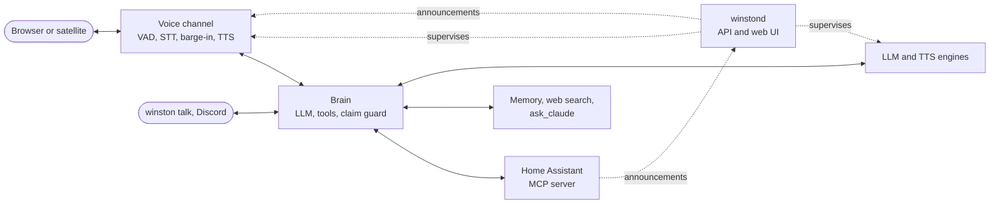

# Winston

[](LICENSE)
[](https://docs.astral.sh/uv/)
[](https://www.home-assistant.io/integrations/mcp_server/)

A self-hosted, full-duplex voice assistant for Home Assistant. Talk to your home; it answers in
a natural voice and can be interrupted. By default everything runs on your own machine; any part can
be swapped for a hosted service when that suits you better.

<picture>
  <source media="(prefers-color-scheme: dark)" srcset="docs/images/talk-dark.png">
  
</picture>

- **Local by default, cloud when you choose.** Speech recognition, the language model and the voice run
  on one GPU, or on Ollama and the CPU. The brain and the voice can each point at a hosted API instead.
- **Hands through Home Assistant.** Anything you expose, over Home Assistant's own MCP server, picked
  from your rooms on one page. After switching a light he checks it happened and says so when it did not
  ([how](docs/home-assistant.md)).
- **Interruptible and fast.** Around 1.3 s from the end of your sentence to the first spoken word
  (measured headless; barge-in timing is not measured yet).
- **A Talk page.** Type or talk to Winston in the browser and see what he heard, said and did,
  announcements included, with typed replies read aloud if you like; his logo moves as he listens, thinks and speaks. Settings sit behind it.
- **A wall dashboard.** Full screen for a tablet: tap the logo to talk, his answer in large type,
  announcements across the screen.
- **Clones a friend's voice by asking.** "Clone my friend's voice": they agree out loud, talk for fifteen
  seconds, and Winston speaks as them until you ask for his own voice back. A voice is kept only when the
  one agreeing is the one recorded. Recorded in the browser, then used anywhere, the Voice PE too.
- **Hears your names.** His name, your friends' and your rooms' are hint words, and close mishearings
  ("Winson") are corrected. Rename him in settings and everything he says about himself follows.
- **Remembers.** Tell it a fact and a fresh conversation still knows it; correct or forget it by voice,
  and a dated plan drops out after its day. Stored as Markdown in git, and shown on a Memory page where
  you can search, add, edit and forget, next to his own rules.
- **Speaks your region.** Celsius or Fahrenheit, metric or imperial, 24- or 12-hour clock, taken from Home
  Assistant unless you pick otherwise; answers from the web are converted.
- **Thinks before he touches the house.** A spoken request about a light or a device gets a moment's
  reasoning ("One moment.", about a second at medium effort) so he calls the tool instead of claiming
  he did; small talk stays fast. Home Assistant scripts become his tools, each with its own first line
  if you like ([Home Assistant](docs/home-assistant.md)).
- **Keeps listening, until told.** After each reply the Voice PE listens a few seconds more, so a
  follow-up needs no wake word; "that's all" or "stop" ends it, and a long press on its button makes it
  listen only when pressed ([Voice PE](docs/voice-pe.md#ending-a-conversation-and-button-only)).
- **Looks things up.** Small current facts through web search, hard questions handed to Claude, both
  capped per day.
- **Speaks on its own.** A Home Assistant automation says "the washing machine is done": a chime, the
  words, and you can ask a follow-up. Quiet hours send it to Discord instead.
- **Discord.** Talk to Winston in DMs from anywhere, get announcements there, have it message friends.
- **Swappable parts.** Every model is an adapter picked from a dropdown, with presets for vLLM, llama.cpp,
  Ollama, hosted APIs, a GPU voice and a CPU voice; the model list shows what is running and what is
  already downloaded. `winston check brain` compares two brains on the same
  requests.
- **Settings that fill themselves in.** Models, voices and Home Assistant entities are dropdowns read
  from the servers that know them, not text you type. Keys are pasted once and never shown again, fields
  that do not apply to your engines stay hidden, and a Restart button appears when a saved change waits.
  Voices and streaming can be heard before you save them.
- **Room satellites.** Home Assistant's Voice Preview Edition as Winston's microphone and speaker in a
  room ([setup](docs/voice-pe.md)); running on a real box since 2026-09-25, turn based, woken by "Okay Winston" with Winston's own
  firmware build.
- **Rooms.** A box and a wall panel in one room are one Winston: one conversation you can start at one and
  finish at the other, one mic at a time so they never both answer, and "the lights" means that room's
  ([rooms](docs/rooms.md)).
- **"Okay Winston".** A custom wake word in Winston's firmware for the Voice PE, with a sensitivity
  setting per box.
- **Extensions.** Add tools and background jobs in one Python file (`winston ext new NAME`), or any MCP
  server. Each runs in its own process with only its own keys, asks for what it may reach, and shows on
  an Extensions page; tools you choose are offered to Claude Code too ([extensions](docs/extensions.md)).
- **Speaking up.** Extensions give him reasons to speak; the core decides when and where: in the room
  you are in, on your phone when you are away, at your next conversation or in the morning briefing,
  never in quiet hours or mid-conversation. "I know, remind me after work" puts any of it off to when
  you get home ([speaking up](docs/extensions.md#speaking-up)).
- **Hevy, news, reminders and Spotify**, built in and off until switched on: a word when you have not
  trained for three days, breaking stories and crisis alerts for your county with a daily digest from
  feeds you pick, reminders you ask for, and Spotify on the box's speakers, by voice or from the app
  ([built-in extensions](docs/built-in-extensions.md)).

**Status: early.** Voice, Home Assistant control, the web UI with its Talk page, memory, web search, `ask_claude` and
announcements work. A Voice PE room satellite works turn based. Extensions run and speak up, and Hevy, news, reminders and Spotify are built on them (in their first week of
real use). The Discord channel is built but not yet run against
Discord. See [the plan](docs/plan.md).

## Quickstart

Needs Linux, [uv](https://docs.astral.sh/uv/), Home Assistant, and one of the
[hardware profiles](docs/hardware.md): a 24 GB NVIDIA card with Docker (a 9B or a 27B brain), Ollama on
any GPU or CPU, or a hosted model.

```sh
git clone https://github.com/aldinsmajlovic/winston && cd winston
uv sync
(cd services/tts-chatterbox && uv sync)   # GPU voice (nvidia-24gb profiles)
(cd services/tts-pocket && uv sync)       # CPU voice (ollama and hosted profiles)
uv run winston init                       # creates ./data; --list shows the profiles
```

Set your Home Assistant URL and entities in `data/config.yaml` and tokens in `data/.env`, or paste
them on the settings pages later (optional ones for web search, Claude and Discord are listed in
[tools](docs/tools.md)), then:

```sh
uv run winston up      # everything; Ctrl-C stops it
```

Talk to Winston and manage him at http://localhost:8700 (build the UI once with
`cd web && pnpm install && pnpm build`); Pipecat's own voice page is still at http://localhost:7860.

## How it fits together



## Docs

- [Running](docs/running.md): commands, the web UI, engines, logs
- [Home Assistant](docs/home-assistant.md): what he sees and does, and how the list reaches Home Assistant
- [Tools](docs/tools.md): memory, web search, `ask_claude`, messaging; keys and limits
- [Announcements](docs/announcements.md) and [Discord](docs/discord.md)
- [Architecture](docs/architecture.md): the parts and how they plug together
- [Extensions](docs/extensions.md): adding tools, jobs, entities and reasons to speak up, with the SDK;
  and the [built-in ones](docs/built-in-extensions.md): Hevy, news, reminders, Spotify
- [UI guide](docs/ui-guide.md) and [identity](docs/identity.md): how the web UI looks, Winston's logo and how it moves
- [Hardware](docs/hardware.md): profiles and measured budgets
- [Voices](docs/voices.md), the [voice benchmark](docs/voices.md#benchmark), the [Voice PE satellite](docs/voice-pe.md) and [rooms](docs/rooms.md)
- [Decisions](docs/decisions.md): what changed and why
- [Writing docs](docs/writing-docs.md): how these pages are kept

## Licence

Apache-2.0. See `LICENSE` and `NOTICE`. "Winston" is the name of this project; forks are welcome
under a different name.
