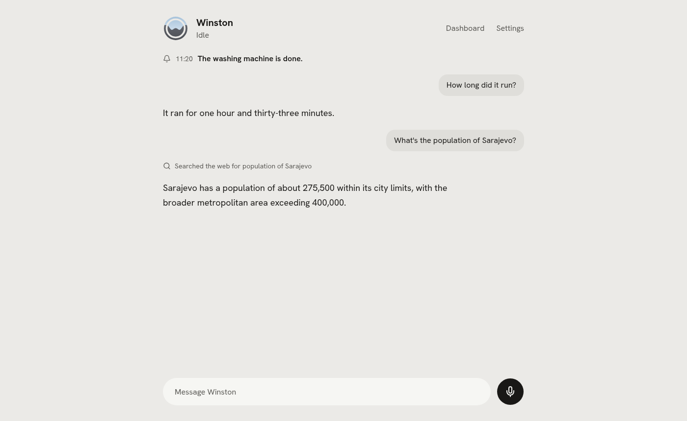

# Winston

[](LICENSE)
[](https://docs.astral.sh/uv/)
[](https://www.home-assistant.io/integrations/mcp_server/)

A self-hosted voice assistant for Home Assistant. Talk to your home; Winston answers in a natural
voice, does what you asked, and can be interrupted mid-sentence. Everything runs on your own machine
by default, and any part can be swapped for a hosted service.

<picture>
  <source media="(prefers-color-scheme: dark)" srcset="docs/images/talk-dark.png">
  
</picture>

## Features

- **Local first.** The language model and the voice share one GPU and speech recognition runs on the
  CPU, or everything runs on Ollama and the CPU. Each can point at a hosted API instead.
- **Fast.** About 1.3 s from the end of a plain question to his first word, and you can talk over him.
- **Controls your home** through Home Assistant's MCP server, then checks the device really changed
  and corrects himself when it did not.
- **Works with Home Assistant Voice Preview Edition.** Nabu Casa's speaker becomes Winston's ears and
  voice in a room, tested on a real box, on its stock firmware or on Winston's with an "Okay Winston"
  wake word. The browser adds a full-screen dashboard for a wall screen: start a conversation at the
  box and finish it on the screen beside it.
- **Remembers** what you tell him, in plain Markdown you can read and edit, and writes a diary of each
  day you can ask him about.
- **Speaks up.** Announcements from Home Assistant, a word before what is on your calendar, and
  reminders reach the room you are in or your phone; in quiet hours only what you asked for.
- **Extensible.** Add a tool in one Python file or connect any MCP server. Your calendar, news,
  reminders, things to do later ("clean the kitchen when I leave"), Hevy and Spotify come built in,
  and a small server on each of your Linux computers lets him open apps, files and pages there and
  tell you how it is doing.
- **Borrows a voice.** A friend agrees out loud and talks for fifteen seconds; Winston can then speak
  as them.

## Status

Early. Voice, Home Assistant, the web UI, memory, extensions and the Voice PE work. Not yet: talking
over him on the Voice PE, and Discord against the real Discord. Progress is in [the plan](docs/plan.md).

## Quickstart

Needs Linux, [uv](https://docs.astral.sh/uv/), Home Assistant, and one of the
[hardware profiles](docs/hardware.md): a 24 GB NVIDIA card with Docker, Ollama on any GPU or CPU, or
a hosted model.

```sh
git clone https://github.com/aldinsmajlovic/winston && cd winston
uv sync
(cd services/tts-chatterbox && uv sync)   # GPU voice (nvidia-24gb profiles)
(cd services/tts-pocket && uv sync)       # CPU voice (ollama and hosted profiles)
(cd web && pnpm install && pnpm build)    # the web UI
uv run winston init                       # creates ./data; --list shows the profiles
uv run winston up                         # everything; Ctrl-C stops it
```

Open http://localhost:8700, paste your Home Assistant URL and token in settings, and talk.
Optional keys (web search, Claude, Discord) go on the extension card or page that uses them: see
[built-in extensions](docs/built-in-extensions.md) and [Discord](docs/discord.md).

## Documentation

- **Using it:** [running](docs/running.md), [Home Assistant](docs/home-assistant.md),
  [tools](docs/tools.md), [voices](docs/voices.md), [announcements](docs/announcements.md),
  [Discord](docs/discord.md), [computers](docs/computer.md)
- **Rooms:** [Voice PE satellite](docs/voice-pe.md), [rooms](docs/rooms.md)
- **Extending it:** [extensions](docs/extensions.md), [built-in extensions](docs/built-in-extensions.md)
- **How it works:** [architecture](docs/architecture.md), [hardware](docs/hardware.md),
  [decisions](docs/decisions.md)
- **Contributing:** [UI guide](docs/ui-guide.md), [identity](docs/identity.md),
  [writing docs](docs/writing-docs.md)

## Licence

Apache-2.0. See `LICENSE` and `NOTICE`. "Winston" is the name of this project; forks are welcome
under a different name.
