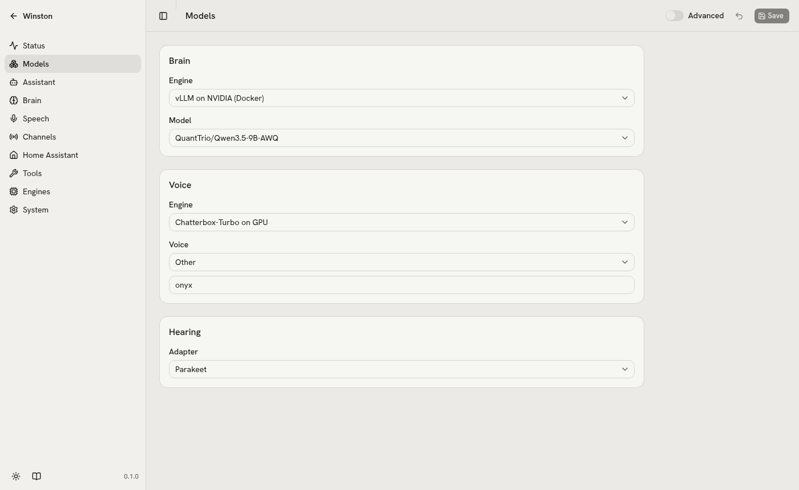
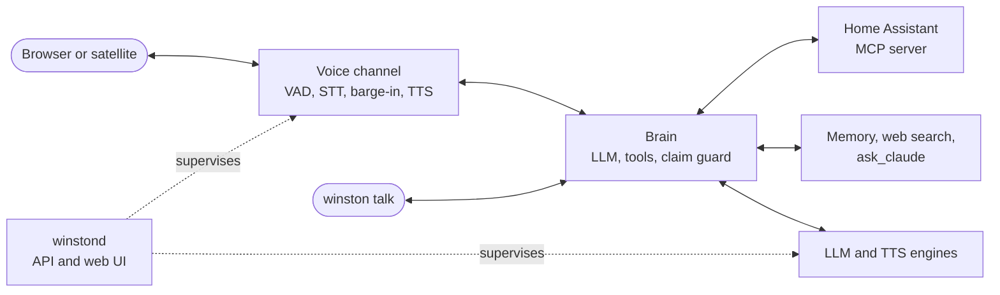

# Winston

[](LICENSE)
[](https://docs.astral.sh/uv/)
[](https://www.home-assistant.io/integrations/mcp_server/)

A self-hosted, full-duplex voice assistant for Home Assistant. Talk to your home; it answers in
a natural voice, can be interrupted, and keeps everything on your own machine.

<picture>
  <source media="(prefers-color-scheme: dark)" srcset="docs/images/models-dark.png">
  
</picture>

- **Local voice-to-voice.** Speech recognition, the language model and the voice run on one GPU, or on
  Ollama and the CPU.
- **Hands through Home Assistant.** Anything you expose, over Home Assistant's own MCP server.
- **Interruptible and fast.** Around 1.3 s from the end of your sentence to the first spoken word.
- **Remembers.** Tell it a fact and a fresh conversation still knows it; stored as Markdown in git.
- **Looks things up.** Small current facts through web search, hard questions handed to Claude, both
  capped per day.
- **Swappable parts.** Every model is an adapter picked from a dropdown, with presets for vLLM, Ollama,
  hosted APIs, a GPU voice and a CPU voice.
- **"Hey Winston".** A custom wake word model for room satellites.

**Status: early.** Voice, Home Assistant control, the web UI, memory, web search and `ask_claude` work.
Discord and Home Assistant announcements are being built; the room satellite waits for hardware. See
[the plan](docs/plan.md).

## Quickstart

Needs Linux, [uv](https://docs.astral.sh/uv/), Home Assistant, and one of the
[hardware profiles](docs/hardware.md): a 24 GB NVIDIA card with Docker, Ollama on any GPU or CPU, or a
hosted model.

```sh
git clone https://github.com/aldinsmajlovic/winston && cd winston
uv sync
(cd services/tts-chatterbox && uv sync)   # GPU voice (nvidia-24gb profile)
(cd services/tts-pocket && uv sync)       # CPU voice (ollama and hosted profiles)
uv run winston init                       # creates ./data; --list shows the profiles
```

Set your Home Assistant URL and entities in `data/config.yaml` and tokens in `data/.env`, then:

```sh
uv run winston up      # everything; Ctrl-C stops it
```

Talk at http://localhost:7860, manage it at http://localhost:8700 (build the UI once with
`cd web && pnpm install && pnpm build`).

## How it fits together



## Docs

- [Running](docs/running.md): commands, the web UI, engines, logs
- [Architecture](docs/architecture.md): the parts and how they plug together
- [Hardware](docs/hardware.md): profiles and measured budgets
- [Voices](docs/voices.md) and the [Voice PE satellite](docs/voice-pe.md)
- [Decisions](docs/decisions.md): what changed and why
- [Writing docs](docs/writing-docs.md): how these pages are kept

## Licence

Apache-2.0. See `LICENSE` and `NOTICE`. "Winston" is the name of this project; forks are welcome
under a different name.
