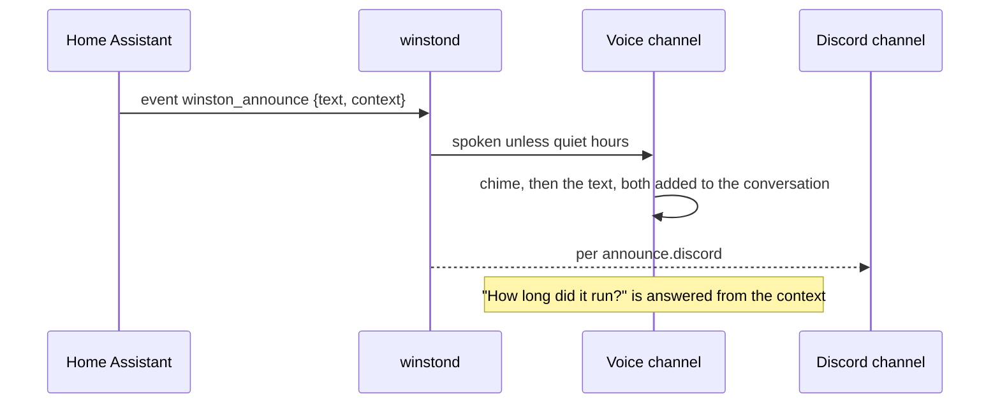
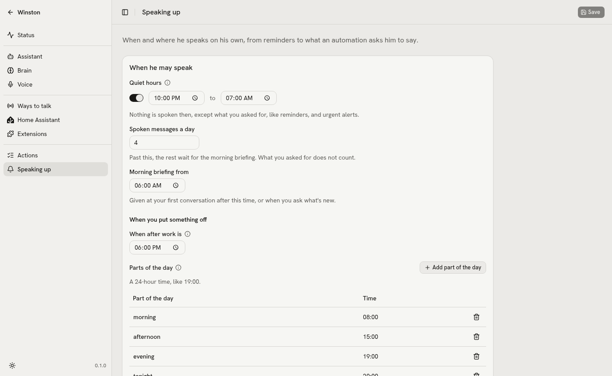

# Announcements

Winston can speak without being spoken to: a chime, then the text as given, on every connected speaker
(a Talk page or wall display while its microphone is on, and each Voice PE box). Extensions speak up the
same way, with their own rules ([speaking up](extensions.md#speaking-up)). Outside quiet hours
(`announce.quiet_hours`, default 22:00-07:00) it is spoken; `announce.discord` decides when it also goes
to Discord (`fallback`: only when nothing could speak it). You can answer: the announcement and its
`context` join the conversation, so "how long did it run?" works right after. Every announcement also
shows on the Talk page, and a typed follow-up there knows it too, even when the typed conversation
starts after it.



From a Home Assistant automation, fire an event (winstond is subscribed over HA's websocket, the one
connection its extension triggers use too, so nothing listens on the LAN; the token must belong to an
admin user to subscribe to custom events, and a refused subscription is logged with the event's name):

```yaml
actions:
  - event: winston_announce
    event_data:
      text: "The washing machine is done."
      context:
        started: "{{ as_timestamp(states.sensor.washer_state.last_changed) | timestamp_custom('%H:%M') }}"
        finished: "{{ now().strftime('%H:%M') }}"
```

From a shell: `winston announce "Dinner is ready" -c cook=oven`. From anything else:
`POST /api/announce {"text": ..., "context": {...}}`. Every announcement and where it went is in
`logs/announcements.jsonl`.

## Settings

Announcements are set on Settings, Speaking up, beside what extensions bring up.

<picture>
  <source media="(prefers-color-scheme: dark)" srcset="images/speaking-up-dark.png">
  
</picture>

- **Quiet hours** (`announce.quiet_hours`, 22:00 to 07:00), under When he may speak: nothing is spoken
  then except what you asked for, like reminders, and urgent alerts.
- **Also send to Discord** (`announce.discord`: Always, When it cannot be spoken, Never), under
  Reaching you once Discord is on.
- **From automations and apps.** Let automations make him speak (`announce.enabled`), and the action
  to paste into an automation, with Copy, and Sound before an announcement (`announce.chime`, any
  16-bit WAV, None for none). The event name (`announce.ha_event`, `winston_announce`) is config.yaml
  only; the example to paste uses it.

The rest of the page, spoken messages a day, the morning briefing, how he reaches you and what
extensions may bring up, is in [speaking up](extensions.md#speaking-up).

## Checking it

`uv run python tests/announce_voice.py` connects a WebRTC client to the running voice channel the
way a browser does, announces, and transcribes what it hears: the chime, the text word for word,
then the answer to a spoken follow-up ("How long did it run?", answered from the context).

A Voice PE box plays an announcement as it plays a reply, the chime first; after a nudge it listens
on, so an answer needs no wake word (`tests/satellite_fake.py` checks both). In the browser the mic
is always open.
