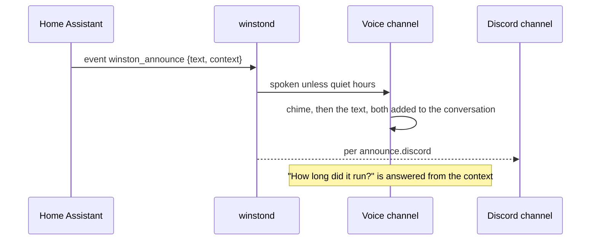

# Announcements

Winston can speak without being spoken to: a chime, then the text as given, on every connected
speaker (a browser tab on the voice page today, the Voice PE satellite later). Outside quiet hours
(`announce.quiet_hours`, default 22:00-07:00) it is spoken; `announce.discord` decides when it also
goes to Discord (`fallback`: only when nothing could speak it). You can answer: the announcement and
its `context` join the conversation, so "how long did it run?" works right after.



From a Home Assistant automation, fire an event (winstond is subscribed over HA's websocket, so
nothing listens on the LAN; the token must belong to an admin user to subscribe to custom events):

```yaml
actions:
  - event: winston_announce
    event_data:
      text: "The washing machine is done."
      context:
        started: "{{ as_timestamp(states.sensor.washer_state.last_changed) | timestamp_custom('%H:%M') }}"
        finished: "{{ now().strftime('%H:%M') }}"
```

From a shell: `winston announce "Dinner is ready" -c cook=oven`. From anything else:
`POST /api/announce {"text": ..., "context": {...}}`. Every announcement and where it went is in
`logs/announcements.jsonl`.

## Settings

Under `announce` (web UI: Channels): `enabled`, `chime` (any 16-bit WAV, empty for none),
`quiet_hours`, `discord` (always, fallback, never) and `ha_event`.

## Checking it

`uv run python tests/announce_voice.py` connects a WebRTC client to the running voice channel the
way a browser does, announces, and transcribes what it hears: the chime, the text word for word,
then the answer to a spoken follow-up ("How long did it run?", answered from the context).

Replying without the wake word needs a satellite that opens its mic after announcing; that comes
with the [Voice PE](voice-pe.md). In the browser the mic is always open.
