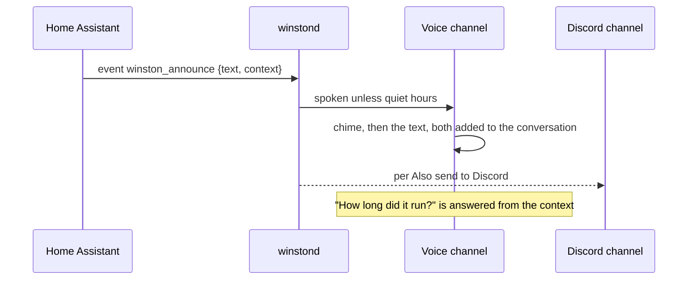
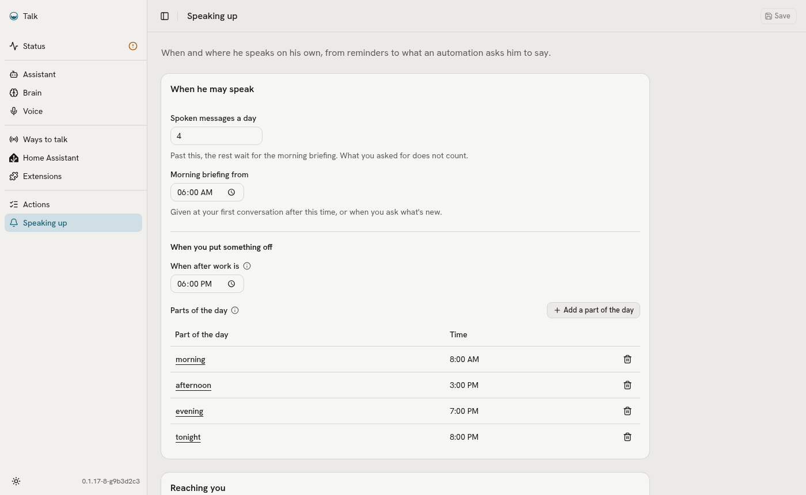

# Announcements

Winston can speak without being spoken to: a chime, then the text as given, on every connected speaker.
That is a Talk page or wall display while its microphone is on, and each Voice PE box. While Home
Assistant Assist is on, Home Assistant's own voice satellites count too, in rooms with neither
([Home Assistant Assist](assist.md#speaking-on-home-assistants-satellites)). Extensions speak up the
same way, with their own rules ([speaking up](speaking-up.md)).



- **Quiet hours.** Outside them it is spoken. Inside them nothing is, except what you asked for, like
  reminders, and urgent alerts.
- **Discord.** Also send to Discord decides when it goes there too. By default that is only when
  nothing could speak it: in quiet hours, or with no speaker connected.
- **You can answer.** The announcement and its `context` join the conversation, so "how long did it
  run?" works right after.
- **The Talk page** shows every announcement, and a typed follow-up there knows it too, even when the
  typed conversation starts after it.

Every announcement and where it went is in `logs/announcements.jsonl` in the data folder.

## Making him speak

### From a Home Assistant automation

Fire the event. winstond is subscribed over Home Assistant's websocket, the one connection its
extension triggers use too, so nothing listens on the LAN.

```yaml
actions:
  - event: winston_announce
    event_data:
      text: "The washing machine is done."
      context:
        started: "{{ as_timestamp(states.sensor.washer_state.last_changed) | timestamp_custom('%H:%M') }}"
        finished: "{{ now().strftime('%H:%M') }}"
```

The token must belong to an admin user to subscribe to custom events. A refused subscription is logged
with the event's name.

### From a shell or another app

```sh
winston announce "Dinner is ready" -c cook=oven
```

From anything else, `POST /api/announce` with `{"text": ..., "context": {...}}`.

## Settings

Announcements are set on Settings, Speaking up, beside what extensions bring up.

<picture>
  <source media="(prefers-color-scheme: dark)" srcset="images/speaking-up-dark.png">
  
</picture>

| Setting | Key | Default | What it does |
| --- | --- | --- | --- |
| Quiet hours, under When he may speak | `announce.quiet_hours` | 22:00 to 07:00 | Nothing is spoken then except what you asked for and urgent alerts; empty is never quiet |
| Also send to Discord, under Reaching you once Discord is on | `announce.discord` | When it cannot be spoken | Always, When it cannot be spoken, or Never |
| Let automations make him speak | `announce.enabled` | on | Accepts the Home Assistant event, the API and `winston announce`; beside it, the action to paste into an automation, with Copy |
| Sound before an announcement | `announce.chime` | the chime in `assets/sounds/` | Any 16-bit WAV, or None |
| Home Assistant event name | `announce.ha_event` | `winston_announce` | config.yaml only; the example to paste uses it |

The rest of the page (spoken messages a day, the morning briefing, how he reaches you and what
extensions may bring up) is in [speaking up](speaking-up.md).

## Checking it

`uv run python tests/announce_voice.py` connects a WebRTC client to the running voice channel the way a
browser does, announces, and transcribes what it hears: the chime, the text word for word, then the
answer to a spoken follow-up ("How long did it run?", answered from the context).

A Voice PE box plays an announcement as it plays a reply, the chime first. After a nudge it listens on,
so an answer needs no wake word; `tests/satellite_fake.py` checks both. In the browser the
mic is always open.
