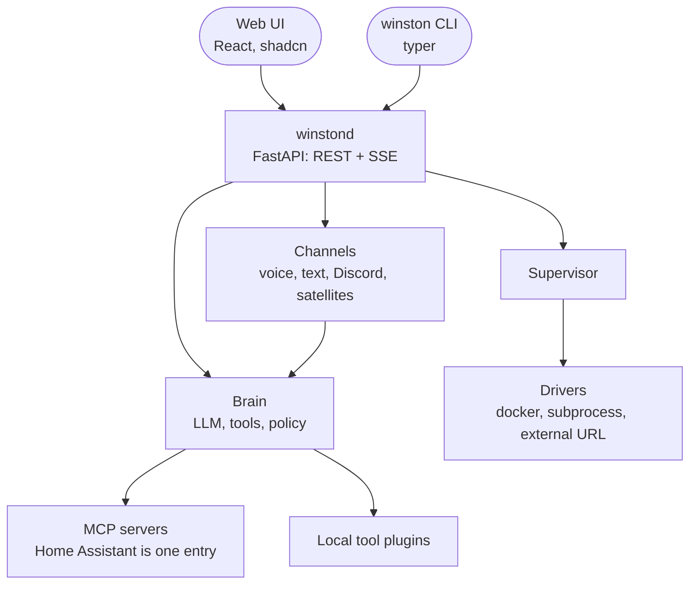

# Architecture

Winston is built so that the core stays small and everything specific to one home, one model or
one platform is a plugin or a line of config. This page is the map; `decisions.md` is the history.

## Principles

- **Core stays small; specifics are plugins or config.** The repo ships no personal data. An instance
  lives in a data directory (`config.yaml`, `.env`, `persona.md`, `memory/`, `voices/`, `logs/`).
- **Standard protocols at every seam.** LLM engines speak OpenAI-compatible HTTP, TTS engines speak the
  OpenAI speech protocol, tools speak MCP. Anything that speaks those plugs in.
- **One API, two clients.** `winstond` exposes REST and SSE. The web UI and the `winston` CLI both use it.
  Nothing exists only in the UI.
- **Typed, versioned config.** Pydantic models with defaults and a JSON Schema export. Every field carries
  its UI level (basic or advanced) and which engine a change restarts. Forms and docs come from the schema.
- **Presets over hand-written engine blocks.** `config/presets.py` names the engine and model choices per
  slot (vLLM, llama.cpp, Ollama, hosted; Chatterbox, Pocket TTS, hosted) and composes them into hardware profiles.
  The UI offers them as dropdowns, `winston init --profile` writes one, and the config stays the truth.
- **Choices come from where the truth lives.** A field names a live list in the schema (`options`);
  `api/options.py` fills it from the brain's server, Home Assistant, the data directory or a provider's
  model list, so the UI never asks for something a machine already knows.
- **Policy in code, prompt for tone.** Tool tiers (read, act, restricted), allow lists and logging are
  mechanisms, not prompt text.

## Shape



- **Engines** (`winston/engines`): heavy processes declared in config with a driver. `docker` runs the
  LLM server, `subprocess` runs the TTS venv service and the voice channel, `external` points at
  something you already run. The supervisor owns start, stop, health and restart-on-change.
- **Brain** (`winston/core`): one Pipecat LLM service plus its tools, shared by every channel. Tools come
  from MCP servers and local plugins. The persona is the system instruction. A claim guard sits after
  the LLM in every channel: a reply that claims an action or a state no tool call in that turn backs is
  retracted aloud and in the context. Remembered facts (`data/memory/`) are appended to the persona when a session
  starts; the `remember` tool adds to them.
- **Adapters** (`winston/plugins`): Pipecat services with a settings model, discovered through Python
  entry points (`winston.stt`, `winston.tts`, ...). A third-party package adds one without touching core.
- **Channels** (`winston/channels`): feed the same brain. Voice is the Pipecat pipeline with VAD,
  barge-in and latency observers; text is `winston talk`, the Discord channel (DMs) and web chat,
  which runs inside winstond for the Talk page.
- **Live feed** (`core/live.py`): what Winston hears, says and does, as events (state, user, reply
  pieces, tool calls, announcements). A `LiveObserver` in a channel's pipeline turns frames into
  events; the voice process posts them to `POST /api/live`, web chat publishes in process, and pages
  read `GET /api/live` (recent history, then new events). The browser's WebRTC offer goes through
  `/api/voice/offer` to the voice channel, so the UI needs only winstond's origin. `POST /api/speak`
  passes text to the speech server and streams its PCM back, for the Talk page's read aloud.
- **Announcements** (`core/announce.py`): winstond is the hub. Home Assistant events, the API and the
  CLI publish; channel processes subscribe to `/api/events` and deliver (chime and speech, or a DM).
  An announcement joins the conversation with its context, so replies to it work.
- **Providers** (`winston/providers`): platform helpers, currently Home Assistant's exposure allowlist.
- **Control** (`winston/api`, `winston/cli`): `winstond` and the `winston` command.

## Repository

```
src/winston/        config/ core/ engines/ plugins/ channels/ providers/ api/ cli/
services/           engines with their own environments (tts-chatterbox pins torch 2.6)
web/                the UI (Vite, React, shadcn/ui); built assets are served by winstond
assets/             bundled voice samples (CC BY 4.0)
examples/           config.yaml, persona.md, env.example; `winston init` copies them
tests/              acceptance checks against real hardware, run by `winston check`
docs/               plan, decisions, this page, running, voices, ui-guide, writing-docs; images/ holds screenshots
data/               your instance; gitignored
```

## Plugin contract

An adapter is a class with a small contract and a settings model. For STT: a static `load_model(name,
quantization)` returning a reusable model object, and a constructor taking it as `model=` so one load
serves every connection. Contracts stay tiny on purpose; that is what keeps extension cheap and
versioning sane.

## Non-goals

Multi-user auth on the voice channel, cloud hosting, telemetry of any kind.
