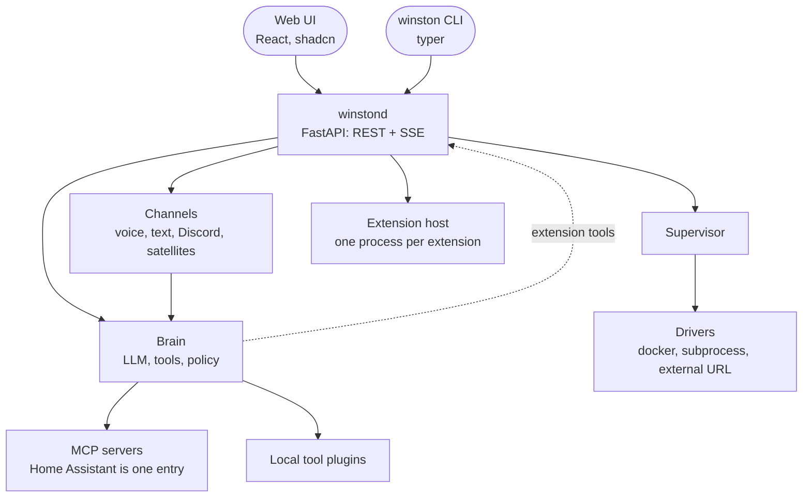

# Architecture

Winston is built so that the core stays small and everything specific to one home, one model or
one platform is a plugin or a line of config. This page is the map; `decisions.md` is the history.

## Principles

- **Core stays small; specifics are plugins or config.** The repo ships no personal data. An instance
  lives in a data directory (`config.yaml`, `.env`, `persona.md`, `memory/`, `voices/`, `logs/`).
- **Standard protocols at every seam.** LLM engines speak OpenAI-compatible HTTP, TTS engines speak the
  OpenAI speech protocol, tools speak MCP. Anything that speaks those plugs in. The one exception is
  Claude's own API (`llm.provider: anthropic`): `core/anthropic_chat.py` asks it and answers in
  OpenAI's shapes, so the rest of the brain stays one code path.
- **One API, two clients.** `winstond` exposes REST and SSE. The web UI and the `winston` CLI both use it.
  Nothing exists only in the UI.
- **Typed, versioned config.** Pydantic models with defaults and a JSON Schema export. Each field says
  whether the form draws it and what a change restarts ([config metadata](#config-metadata)). Forms
  and docs come from the schema.
- **Presets over hand-written engine blocks.** `config/presets.py` names the engine and model choices
  per slot (vLLM, llama.cpp, Ollama, hosted, Claude; Chatterbox, Pocket TTS, Qwen3-TTS, VoxCPM2, Gepard,
  Breeze TTS 2, hosted) and composes them into hardware profiles. The UI offers them as dropdowns,
  `winston init --profile` writes one, and the config stays the truth.
- **Choices come from where the truth lives.** A field names a live list in the schema (`options`).
  `api/options.py` fills it from the brain's server, Home Assistant, the data directory, a provider's
  model list or a running extension (`extension_choices`), so the UI never asks for something a
  machine already knows.
- **Policy in code, prompt for tone.** Tool tiers (read, act, restricted), allow lists and logging are
  mechanisms, not prompt text.

## Shape



- **Engines** (`winston/engines`): heavy processes from config, each with a driver: `docker` (the LLM
  server), `subprocess` (the TTS service, the voice channel) or `external` (something you already run).
  The supervisor starts, stops, checks and restarts them on a change. Before a start,
  `engines/install.py` gets what an engine lacks (its image, its service venv, the brain's model),
  sized before the first byte and shared between engines that need the same part.
- **Brain** (`winston/core`): one Pipecat LLM service and its tools, shared by every channel. See
  [the brain](#the-brain).
- **Hearing adapters** (`winston/plugins`): speech to text, found through the `winston.stt` entry point
  group, so a package adds one without touching core. `parakeet` runs in the voice process;
  `openai_transcription` sends the audio to a server run as `engines.stt` (Qwen3-ASR or a hosted one).
  See the [plugin contract](#plugin-contract).
- **Channels** (`winston/channels`): feed the same brain. Voice is the Pipecat pipeline with VAD,
  barge-in and latency observers. Text is `winston talk`, Discord DMs and the Talk page's web chat,
  which runs inside winstond. Home Assistant's Assist reaches him over Wyoming, also inside winstond
  ([Home Assistant Assist](assist.md)).
- **Home Assistant integration** (`api/ha_link.py`, `custom_components/winston`): a second port in
  winstond, reached only with a paired token, streams his rooms' states, his engines and the
  extensions' entities to Winston's integration in Home Assistant, and answers its conversation agent
  as Assist does, the reply streamed back ([Home Assistant integration](ha-integration.md)).
- **Live feed** (`core/live.py`): what Winston hears, says and does, as events (state, what you said,
  reply pieces, tool calls, announcements, and while he speaks the level of his voice as it plays,
  streamed but never kept). The voice process posts them to `POST /api/live`, web chat
  publishes in process, and pages read `GET /api/live`. The browser's voice connects through
  `/api/voice/offer` and the Talk page reads aloud through `POST /api/speak`, so the UI needs only
  winstond's origin.
- **Rooms** (`core/rooms.py`): a box and the browser sessions set to its room share one conversation,
  kept by winstond. A box that wakes holds the room's mic: a browser in that room hears silence until
  the reply has played. The room goes in each message's time stamp, so "the lights" means its lights.
  See [rooms](rooms.md).
- **Directory** (`core/directory.py`): what the names in his world mean. Each brain reads Home
  Assistant's exposed entities, areas and aliases when it starts (at most every ten minutes) and puts a
  map of the house in its prompt, so naming a device needs no lookup. See
  [understanding](understanding.md#2-directory).
- **Announcements** (`core/announce.py`): winstond is the hub. Home Assistant events, the API and the
  CLI publish; channel sessions (browser voice, each box, Discord) subscribe to `/api/events` with
  their room and deliver it, as a chime and speech or a DM. An announcement joins the conversation with
  its context, so replies to it work.
- **Extensions** (`winston/extension_host`, the SDK in `sdk/`): each extension is its own process
  that speaks MCP to winstond, plus Winston's additions for jobs, checks and settings, and calls back
  into `/api/ext/v1/` with a token scoped to its manifest. winstond starts and watches them, runs their
  schedules and Home Assistant triggers, adds their settings to the config schema, and gives every
  brain their tools. A restricted tool waits for your OK on the Talk page. See
  [extensions](extensions.md).
- **Speaking up** (`extension_host/nudges.py`, `core/speak_up.py`): winstond keeps the extensions'
  nudges in `data/state/nudges.json`, applies the rules (quiet hours, the daily limit, never
  mid-conversation, put off, dismissed, muted) and sends what is due through the announcement hub, to
  the room you are in or to your phone. The channel's brain words it after the chime. `Mentions` adds
  next-talk nudges and the briefing to your next message; `follow_up` is the one tool for answering any.
- **Providers** (`winston/providers`): platform helpers; today Home Assistant. One client
  (`HomeAssistant`) for its REST reads, websocket API, MCP tool list and the exposure allowlist, used by
  the settings pages, the state check, the sensor tool and `winston ha`. Its events arrive over one
  websocket that `extension_host/scheduler.py` keeps.
- **Shared helpers** (`core/common.py`): how names are folded and matched (case and spacing do not
  count), the tool-call log line, acting on a frame once in an observer, and reading winstond's event
  streams. Clients reach winstond at `control.url`.
- **Control** (`winston/api`, `winston/cli`): `winstond` and the `winston` command.
- **Setup** (`winston/setup.py`): `winston setup` reads the computer, runs what needs root once you
  say yes, and makes the data directory and the systemd user service; `winston update` and
  `winston uninstall` serve an install from a release. See [setup](setup.md).
  - Releases: `scripts/install.sh` installs one; `scripts/release.py` builds one, as
    `.github/workflows/release.yml` does on a tag, with its `CHANGELOG.md` entry as the notes.
  - Updates (`api/updates.py`): winstond reads the latest release every six hours or on Check now, and
    Status's Update runs `winston update`'s steps and restarts the service.
  - Setup mode (`api/setup_link.py`): until the wizard (`web/src/pages/setup.tsx`) is done, winstond
    serves another device only with the setup link's key, and starts no engine before Brain and voice.
  - Home Assistant sign-in (`providers/ha_signin.py`): found through zeroconf, its own login, then a
    long-lived token named Winston and its MCP server switched on.
  - A room box over USB (`api/room_box.py`): found by its USB id in sysfs, flashed through
    `uvx esptool`, given Wi-Fi over Improv Serial (`providers/improv.py`), then reached over its
    ESPHome API and given a key of Winston's, which Home Assistant gets too. One talk with the port at
    a time.

## The brain

### What he is told

The system prompt is the persona, flattened to one list of rules (its sections are for the
Personality page), under a title and an identity line made from `assistant.name`. When a session
starts, Winston adds what he remembers (`data/memory/`, which the `remember` tool adds to), the last
two days of the diary, and the reply language (`assistant.language`).

The diary (`core/diary.py`): after midnight the background LLM writes a few lines about each day from
the turn record. `get_diary` answers questions about older days.

### His tools

Tools come from MCP servers (Home Assistant's is one), local plugins and extensions. A Home Assistant
tool that takes a name and an area gets the area dropped when the named device is in another one
(`rooms.scoped_by_name`).

### How a reply reaches the voice

A reply filter (`core/reply.py`) sits after the LLM in every channel. It passes the reply on a
sentence at a time, drops a stray `</think>` the model sometimes writes with thinking off, and says
the answer once when the model repeats it. Each sentence waits until the next text shows up.

The voice speaks each sentence as soon as the filter passes it on (`ReplySentences`). Nothing checks
the reply's wording against the tool calls.

### When he thinks

| Request | Thinks by default | Setting |
| --- | --- | --- |
| Typed | Yes | `llm.thinking.typed`: never or always |
| Spoken, about the home: an exposed name or alias, a light word, or a verb like "turn" or "dim" | Yes, at medium effort, while deciding what to call, not while answering from the result | `llm.thinking.spoken`: never, home or always; `llm.thinking.home_effort` |
| Spoken, right after one that acted | Yes, without the line below: a tweak like "not that one" has no name or verb to spot | as above |
| Any other spoken request | No | `llm.thinking.spoken` |

While a home request thinks, he says a butler's line ("One moment.", "Let me see to that."), picked
by code and sent straight to the TTS so it covers the wait. The lines are rendered ahead, three takes
each played in turn (`voice.prerender`), so their synthesis does not share the GPU with the thinking.

## Config API

### Saving

`GET /api/config` returns the config, with its version in `ETag` (a hash of `config.yaml`).
`PATCH /api/config` takes a list of changes, each a path and a value, and applies them to the file
as it is now, so two savers keep each other's fields. A null value removes the key, so its default
applies:

```json
{"changes": [{"path": ["tts", "voice"], "value": "onyx"}]}
```

| Option | What it does |
| --- | --- |
| `If-Match: "<version>"` | A changed path that also changed on disk since that version is refused with 409 and `{detail, paths, version}`; other changes merge |
| `?dry_run=true` | Saves nothing. Reports the restarts, what Home Assistant would expose or stop exposing (`ha_plan`, or `ha_plan_error`), and which persona lines a rename would change |
| `?applied=voice` | Names a process that already runs the change (the voice channel after a live voice switch), so it is not marked for a restart |

The answer is `{saved, restarts, version}`, with `ha_apply` when the save changed Home Assistant's
list. A 422 lists `{loc, msg, type}`, with `loc` counted from the config root (`["vad", "stop_secs"]`).
The CLI saves the same way (`winston ext enable` patches one path).

### Pending restarts

A save or a new secret marks each running process in its restart list. Status shows `config_changed`
until it restarts, or until a later save puts its settings back to what it runs with. A secret's mark
stays until the restart.

What only winstond reads at start (`control`, the Home Assistant token) shows as `pending_control`
and applies at the next `winston up`.

An engine or channel a save adds starts at once; one it drops or switches off stops when the save
lands. The save's confirm says both, and names a slot whose preset changed by the preset ("Hearing:
Qwen3-ASR 0.6B on the graphics card").

### Keys

Config names variables; `data/.env` holds them.

- `GET /api/secrets` lists every variable the config names, plus `ANTHROPIC_API_KEY` and
  `CLAUDE_CODE_OAUTH_TOKEN`: set or not, the paths that name it and what restarts. Never a value.
- `PUT /api/secrets/{name}` with `{value}`, and `DELETE`, write the file (mode 600) and winstond's
  environment. Only for a name a secret field holds or defaults to, only on a loopback winstond, and
  only from a loopback client with a localhost Host header and a JSON body. Each write is logged by
  name.

### Signing in to an account

An extension's `Account` setting is a secret set by signing in (`extension_host/accounts.py`):

1. `POST /api/extensions/{id}/accounts/{field}` gives the service's sign-in address with a one-time
   state, under the same guard as the keys. `winston ext connect` makes one for a winstond that
   listens beyond this machine. The state is a file in `data/state/accounts/` (mode 600), so only this
   machine can make one.
2. The service sends the browser back to `GET /api/accounts/callback`, which takes only a loopback
   client and trades the code for a refresh token in `data/.env`. A state finishes once, within ten
   minutes of being made.
3. winstond renews the access token and hands it to the extension (`ctx.token`).
   `DELETE /api/secrets/{name}` disconnects.

## Config metadata

Each field's `json_schema_extra` tells the form what to draw (`ui(...)` and `section(...)` in
`config/schema.py`; `Field(...)` and `Secret(...)` in the SDK, see [extensions](extensions.md#settings)).

| Key | What it does |
| --- | --- |
| `restarts` | What a change restarts: engine names, `{engine}` (the engine the block belongs to) or `{brains}` (every channel that runs a brain: voice, Discord, satellite), so a new channel joins every brain setting in one place. Speech and hearing settings restart voice and satellite; web chat is rebuilt on every save |
| title, `help`, `description` | The title is the label, naming the effect. `help` is one visible line under the control, at most 140 characters; on a section or nested object, its lead line. `description` is the (i): how it works and its trade-offs |
| `placeholder` | What an empty field, picker or optional choice shows. An optional choice also gets a first item for none |
| `unit` | The suffix on a number (`"s"`, `"min"`, `"MB"`); titles carry none |
| `labels` | Words for a choice's values; on a number, names for special values, keyed by the value as text (`{"0": "Off"}`) |
| `options`, `options_query` | A live list, and what to ask it |
| `options_search` | What is typed is sent as `q`, so the server searches further; a list without `served_by` (a hosted brain) drops the search and the field's `help` |
| `icons`, `icon` | An icon per choice; one on a section's title |
| `widget` | `slider` for a value felt rather than typed, `args` for a command line (one argument per line, a repeated flag warned), `time`, `time_range`, `hint_words`. Without it a number is a number input |
| `group` | The fields of a section that share it get one heading before the first of them |
| `drivers` | On engine fields: the drivers the field applies to |
| `when` | Leaves a field out unless a condition holds: `{"engines.{slot}.driver": ["external", null]}`, any other dotted path, or `{"cmd_uses": "tts.streaming."}`. `{slot}` is the section's `slot` |
| `hidden` | Never drawn, so set in config.yaml only: a variable's name, a port, a path, a Literal with one value, or a measured timing no label could explain ([running](running.md#settings-only-in-configyaml) lists them) |
| `empty_means_off` | A cleared field is saved as `""` |
| `enabled_by` | On a section: its switch, which the form marks `section_switch`. While it is off, the form leaves the other fields out and the switch's help reads "Off. Switch it on to set it up." unless it has its own; switching it on shows them at once, before Save. Every setting of an extension that is off is marked `waits`: no "Not set" on key fields |
| `secret` | `{default, label, help, optional}` on a field that names a variable in `data/.env`: draws a field to paste the key, never the variable's name. `help` says where to get the key; an `optional` one never warns, and an extension's stays out of its `needs` |
| `key_title`, `value_title`, `key_options`, `key_options_query` | A map, drawn as a table with Add and a dialog |

`tests/schema_copy_cases.py` fails on a banned word in a title or help, a switch or key without help,
or help that runs long.

Which settings page edits which part of the config is `settingsPages` in `web/src/hooks/use-settings.ts`,
for the sidebar's dots and the Save confirm. `*` in a section matches any one key (an extension's id):

| Page | Sections |
| --- | --- |
| Status | `engines`, `logging`, `control`, `version` |
| Assistant | `assistant`, `region`, `memory`, `logging.turns` |
| Brain | `llm`, `engines.llm` |
| Voice | `tts`, `stt`, `engines.tts`, `engines.stt` |
| Ways to talk | `channels`, `vad` |
| Home Assistant | `providers` |
| Extensions | `extensions`; views of `extensions.*.tools` and `extensions.*.kinds` |
| Actions | `extensions.*.tools` |
| Speaking up | `speak_up`, `announce`, `extensions.*.kinds` |

A path belongs to the page whose matching section is longest, so `engines.llm.args` is Brain's, not
Status's, and `extensions.spotify.tools.play.tier` is Actions'; ties keep every tied page. `views` are
another page's editor shown filtered (an extension's actions and messages on its own page): their dot
lights too, and the confirm names the owner. One config object is never split across two pages.

## Repository

```
src/winston/        config/ core/ engines/ plugins/ channels/ providers/ api/ cli/ extension_host/ extensions/
sdk/                winston-sdk: the extension SDK, its own package (a uv workspace member)
services/           engines with their own environments (tts-chatterbox pins torch 2.6)
web/                the UI (Vite, React, shadcn/ui); built assets are served by winstond
assets/             bundled voice samples (CC BY 4.0)
examples/           config.yaml, persona.md, env.example; `winston init` copies them
tests/              acceptance checks against real hardware, run by `winston check`
docs/               a page per subject, plus plan and decisions; images/ holds screenshots
data/               your instance; gitignored
```

## Plugin contract

An adapter is a class with a settings model and a small contract. For speech to text:

- `load_model(stt)`, static: takes the `stt` settings and returns a reusable model object (a loaded
  model, or a client for a server), so one load serves every connection. `Hearing.load(cfg)` calls it.
- `transcribe(model, pcm, rate, hints=None)`, static: turns int16 audio into text.
- `supports_hints`: whether the engine can be told words in advance. One that can maps `hints` to its
  own setting (Whisper's initial prompt or hotwords, a cloud engine's keyterms). Parakeet cannot.

Everything else is shared. `core.hints.Hearing` corrects close misspellings of the hint words, logs
the STT line and hands the audio to the turn record, and in the voice pipeline one service for every
engine (`HearingSTT`) cuts the utterances ([voices](voices.md#hint-words)). The contract stays small
on purpose: that keeps extending cheap and versioning sane.

Extensions have their own, larger contract: [extensions](extensions.md).

## Non-goals

Multi-user auth on the voice channel, cloud hosting, telemetry of any kind.
