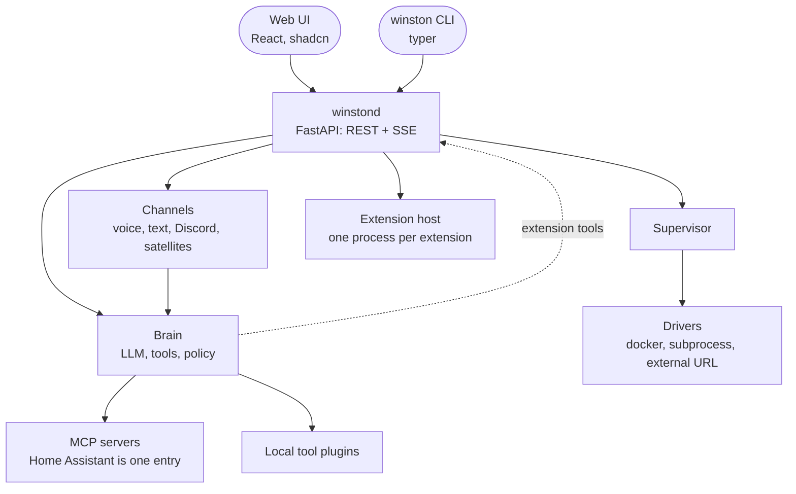

# Architecture

Winston is built so that the core stays small and everything specific to one home, one model or
one platform is a plugin or a line of config. This page is the map; `decisions.md` is the history.

## Principles

- **Core stays small; specifics are plugins or config.** The repo ships no personal data. An instance
  lives in a data directory (`config.yaml`, `.env`, `persona.md`, `memory/`, `voices/`, `logs/`).
- **Standard protocols at every seam.** LLM engines speak OpenAI-compatible HTTP, TTS engines speak the
  OpenAI speech protocol, tools speak MCP. Anything that speaks those plugs in.
- **One API, two clients.** `winstond` exposes REST and SSE. The web UI and the `winston` CLI both use it.
  Nothing exists only in the UI.
- **Typed, versioned config.** Pydantic models with defaults and a JSON Schema export. Every field carries
  its UI level (basic or advanced) and which engine a change restarts. Forms and docs come from the schema.
  Restart lists name engines, `{engine}` (the engine a block belongs to) or `{brains}`, every channel that
  runs a brain (voice, Discord, satellite), so a new channel joins every brain setting in one place.
  Speech and hearing settings restart voice and satellite; the web channel is rebuilt on every save.
- **Presets over hand-written engine blocks.** `config/presets.py` names the engine and model choices per
  slot (vLLM, llama.cpp, Ollama, hosted; Chatterbox, Pocket TTS, Qwen3-TTS, VoxCPM2, Gepard, hosted) and composes them into hardware profiles.
  The UI offers them as dropdowns, `winston init --profile` writes one, and the config stays the truth.
- **Choices come from where the truth lives.** A field names a live list in the schema (`options`);
  `api/options.py` fills it from the brain's server, Home Assistant, the data directory or a provider's
  model list, so the UI never asks for something a machine already knows.
- **Policy in code, prompt for tone.** Tool tiers (read, act, restricted), allow lists and logging are
  mechanisms, not prompt text.

## Shape



- **Engines** (`winston/engines`): heavy processes declared in config with a driver. `docker` runs the
  LLM server, `subprocess` runs the TTS venv service and the voice channel, `external` points at
  something you already run. The supervisor owns start, stop, health and restart-on-change.
- **Brain** (`winston/core`): one Pipecat LLM service plus its tools, shared by every channel. Tools come
  from MCP servers and local plugins. The persona is the system instruction, flattened to one list of rules (the file's sections are for the Memory page), under a title and an identity line made from `assistant.name`. A claim guard sits after
  the LLM in every channel. A firm claim of an action or a memory change ("I've set", "has been sent",
  "done", "noted", "I've forgotten") needs a tool call in that turn or the one before. Looser wording ("is
  now", "is still", "turning") counts only when the sentence names something he can act on: an exposed
  Home Assistant name, alias or entity id, or a light word. A passive memory change ("has been removed",
  "has been updated") counts only when no tool ran that turn. The guard passes the reply on a sentence at a time (dropping a
  stray `</think>` the model sometimes writes with thinking off, and saying the answer once when he repeats it after
  one: each sentence waits until the next text shows up) and judges each one as it finishes; the model calls tools before it speaks, so a backed claim goes straight
  through. An unbacked claim is held back and never said. When a reply drops a claim, or ends on a
  promise to act that no call kept ("Let me turn them on."), the guard asks the model once more with a
  user-role note marked "not said by the user" (at most once per user turn; such notes, like
  announcements, do not start a turn). If the retry fails too, he says a soft line instead ("Sorry, that
  didn't go through. Shall I do it now?"). Channels wait for a pending retry before closing a reply, the
  Talk page shows only what the guard let through, and every guard event is logged with what he heard,
  `retried` and `retry_backed`. Remembered facts (`data/memory/`) and the reply language (`assistant.language`) are appended to the persona when a session
  starts; the `remember` tool adds to them. Thinking is set per channel (`llm.thinking`); on the spoken
  channels, where it is off, a request about the home (an exposed name or alias, a light word, or a verb
  like "turn" or "dim") thinks anyway (`llm.thinking.home`, at `llm.thinking.home_effort`, medium by
  default), and he first says a butler's line by code ("One moment.", "Let me see to that."), pushed
  straight to the TTS so it covers the thinking. Without it the 27B sometimes said a light was on without
  calling a tool. Home Assistant tools that take a name and an area get the area dropped when the named
  device is in another one (`rooms.scoped_by_name`).
- **Adapters** (`winston/plugins`): speech to text, found through the `winston.stt` entry point group, so a
  third-party package adds one without touching core. `parakeet` runs in the voice process;
  `openai_transcription` sends the audio to a server (Qwen3-ASR in `services/stt-qwen3-asr`, a hosted one)
  that runs as `engines.stt`, as the brain and the voice run behind OpenAI-compatible HTTP.
- **Channels** (`winston/channels`): feed the same brain. Voice is the Pipecat pipeline with VAD,
  barge-in and latency observers; text is `winston talk`, the Discord channel (DMs) and web chat,
  which runs inside winstond for the Talk page.
- **Live feed** (`core/live.py`): what Winston hears, says and does, as events (state, user, reply
  pieces, tool calls, announcements). A `LiveObserver` in a channel's pipeline turns frames into
  events; the voice process posts them to `POST /api/live`, web chat publishes in process, and pages
  read `GET /api/live` (recent history, then new events). The browser's WebRTC offer goes through
  `/api/voice/offer` to the voice channel, so the UI needs only winstond's origin. `POST /api/speak`
  passes text to the speech server and streams its PCM back, for the Talk page's read aloud.
- **Rooms** (`core/rooms.py`): a box and the browser sessions set to its room share one conversation,
  which winstond keeps; each session links its own context to it before the LLM runs and after each
  reply. A box that wakes holds the room's mic, and a browser session in the room hears silence until
  its reply has played. The room goes in the time stamp of each message, so "the lights" means its
  lights. See [rooms](rooms.md).
- **Announcements** (`core/announce.py`): winstond is the hub. Home Assistant events, the API and the
  CLI publish; channel sessions (browser voice, each satellite box, Discord) subscribe to
  `/api/events` with the room they are in and deliver (chime and speech, or a DM). An announcement
  joins the conversation with its context, so replies to it work.
- **Extensions** (`winston/extension_host`, the SDK in `sdk/`): each extension is its own process that
  speaks MCP to winstond, with a Winston extension to the protocol for jobs, checks and settings, and
  calls back into winstond's `/api/ext/v1/` with a token scoped to its manifest. winstond finds,
  describes, starts and watches them, owns their schedules and Home Assistant triggers, grafts their
  settings into the config schema (so the form, key fields and field errors cover them), and hands
  every channel's brain the same list of their tools. A restricted tool waits for a confirmation on
  the Talk page. See [extensions](extensions.md).
- **Speaking up** (`extension_host/nudges.py`, `core/speak_up.py`): winstond's nudge engine keeps
  every nudge from extensions in `data/state/nudges.json`, applies the rules (quiet hours, the daily
  limit, never mid-conversation, deliveries, put off, dismissed, muted) and sends what is due through
  the announcement hub to the speakers in the room you are in, or to your phone. The channel words it
  with its own brain after the chime; `Mentions` adds next-talk nudges and the briefing to your next
  message; `follow_up` is the one tool for answers to any of them.
- **Providers** (`winston/providers`): platform helpers, currently Home Assistant: one client
  (`HomeAssistant`) for its REST reads, websocket API and MCP tool list, used by the settings pages,
  the state check, the sensor tool and `winston ha`, and the exposure allowlist. Its events (state
  changes, announcements, phone buttons) arrive over one websocket that `extension_host/scheduler.py`
  keeps, with or without extensions.
- **Shared helpers** (`core/common.py`): how names are folded and matched (rooms, an exposed entity's
  names, what was said: case and spacing do not count), the tool-call log line, acting on a frame once
  in an observer, and reading winstond's event streams. Clients reach winstond at `control.url`.
- **Control** (`winston/api`, `winston/cli`): `winstond` and the `winston` command.

## Config API

- **Safe saves.** `GET /api/config` returns the config with its version in `ETag` (a hash of
  `config.yaml`). `PATCH /api/config` takes
  `{"changes": [{"path": ["tts", "voice"], "value": "onyx"}]}` (null removes a key, so its default
  applies) and applies it to the file as it is now, so two savers keep each other's fields. With
  `If-Match: "<version>"`, a changed path that also changed on disk since that version is refused with
  409 and `{detail, paths, version}`; other changes merge. `?dry_run=true` only reports the restarts;
  `?applied=voice` names a process that already runs the change (the voice channel after a live voice
  switch), so it is not marked for a restart. It answers `{saved, restarts, version}`; a 422 lists
  `{loc, msg, type}` with `loc` counted from the config root (`["vad", "stop_secs"]`). The CLI saves the
  same way (`winston ext enable` patches one path).
- **Pending restarts.** A save or a new secret marks each running process in its restart list; the
  status shows `config_changed` until it is restarted, or until a later save puts the settings it reads
  back to what it runs with (a secret's mark stays until the restart). What only winstond reads at start (`control`
  sections, the Home Assistant token) is listed in the status as `pending_control` and applies at the
  next `winston up`. An engine or channel a save adds (picking a preset that brings an engine, a
  channel switched on) starts at once; one the config drops stops when it is restarted. The save's confirm
  says both, and a slot whose preset changed is named by the preset ("Hearing: Qwen3-ASR 0.6B on GPU").
- **Secrets.** Config names variables, `data/.env` holds them. `GET /api/secrets` lists every variable
  the config names, plus `ANTHROPIC_API_KEY` and `CLAUDE_CODE_OAUTH_TOKEN`, with set or not, the paths
  that name it and what restarts; never a value. `PUT /api/secrets/{name}` `{value}` and `DELETE` write
  the file (mode 600) and winstond's environment, only for a name a secret field holds or defaults to,
  only on a loopback winstond, from a loopback client with a localhost Host header and a JSON body.
  Each write is logged by name.

The schema tells the form what to draw (`config/schema.py` has the full list): `level`, `restarts`,
`options` (a live list), `labels`, `drivers` on engine fields, `empty_means_off` (a cleared field saves
`""`), `when` (leave the field out unless `{"engines.{slot}.driver": ["external", null]}`, any other
dotted path, or `{"cmd_uses": "tts.streaming."}` holds; `{slot}` is the section's `slot`), `enabled_by`
on a section (grey its fields while that switch is off), `hidden`, `secret` (`{default, label}`: draw a
field for the value beside the variable name), `key_title`, `value_title` and `key_options` for keyed
maps, `placeholder` (what an empty picker or optional choice shows; an optional choice gets a first
item for none), and `icon` for a section's title.

## Repository

```
src/winston/        config/ core/ engines/ plugins/ channels/ providers/ api/ cli/ extension_host/ extensions/
sdk/                winston-sdk: the extension SDK, its own package (a uv workspace member)
services/           engines with their own environments (tts-chatterbox pins torch 2.6)
web/                the UI (Vite, React, shadcn/ui); built assets are served by winstond
assets/             bundled voice samples (CC BY 4.0)
examples/           config.yaml, persona.md, env.example; `winston init` copies them
tests/              acceptance checks against real hardware, run by `winston check`
docs/               plan, decisions, this page, running, voices, ui-guide, writing-docs; images/ holds screenshots
data/               your instance; gitignored
```

## Plugin contract

An adapter is a class with a small contract and a settings model. For STT: a static `load_model(stt)`
that takes the `stt` settings and returns a reusable model object (a loaded model, or a client for a
server), so one load serves every connection; `Hearing.load(cfg)` calls it. And a static
`transcribe(model, pcm, rate, hints=None)` that turns int16 audio into text. `supports_hints` says
whether the engine can be told words in advance; one that can maps `hints` to its own setting
(Whisper's initial prompt or hotwords, a cloud engine's keyterms). Parakeet cannot. That is all an
engine does: the shared `core.hints.Hearing` corrects close misspellings of the hint words, logs the
STT line and hands the audio to the turn record, and in the voice pipeline one service for every
engine (`HearingSTT`) cuts the utterances; see [voices](voices.md#hint-words). Contracts
stay tiny on purpose; that is what keeps extension cheap and versioning sane.

Extensions have their own, larger contract: [extensions](extensions.md).

## Non-goals

Multi-user auth on the voice channel, cloud hosting, telemetry of any kind.
