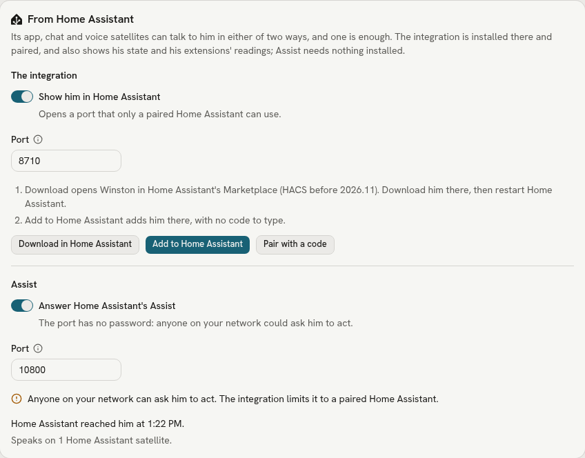

# Home Assistant Assist

Home Assistant's own Assist can use Winston as its conversation agent. Its app, its Assist chat and
its voice satellites (a stock Voice PE, for one) then reach his brain: Home Assistant keeps the wake
word, the speech recognition and its own voice, and Winston does the thinking, with his memory, his
tools and extensions, and the check that a device really changed. Nothing is installed in Home
Assistant: it talks to him over its built-in Wyoming integration.

Winston's own [Home Assistant integration](ha-integration.md) makes him a conversation agent too, with
his reply streamed as he says it, a token on its port, and his state as entities. It needs installing
in Home Assistant; Assist does not.

Winston's own voice path ([Voice PE](voice-pe.md), the Talk page) is separate and unchanged.

## Switching it on

On Settings, Ways to talk, From Home Assistant, switch on Answer Home Assistant's Assist under Assist and
save. Switched on, a warning says anyone on your network can ask him to act, and that the integration
limits it to a paired Home Assistant.
The first-run wizard offers the same switch in its Home Assistant step, once Home Assistant is
connected.

<picture>
  <source media="(prefers-color-scheme: dark)" srcset="images/from-home-assistant-dark.png">
  
</picture>

| Setting | Key | Default | What it does |
| --- | --- | --- | --- |
| Answer Home Assistant's Assist | `channels.assist.enabled` | off | Opens the port and announces him on the network |
| Port | `channels.assist.port` | 10800 | The TCP port Home Assistant connects to |

Saving applies it at once, with no restart: the port opens on every network address of this computer
and Winston announces himself over zeroconf. Switched off, the port closes and the announcement is
withdrawn.

**The port has no password.** Wyoming has none (Home Assistant's Piper and Whisper are the same), so
anyone on your network can then ask him to act, and spend any paid budget he has. That is why it is
off by default. Keep it on a network you trust.

Under the port, one line says how it stands:

| Line | Means |
| --- | --- |
| Home Assistant reached him at 14:02 | Home Assistant has added him and talked to him since Winston started |
| Not reached since Winston started | Add him in Home Assistant (below) |
| Port 10800 is in use by another program | Pick another port and save; nothing is announced until then |
| Speaks on 2 Home Assistant satellites | Satellites with an area, which can [speak for their rooms](#speaking-on-home-assistants-satellites) |

## Adding him to Home Assistant

1. In Home Assistant, open Settings, Devices and services. Winston shows under Discovered; select Add
   and confirm.
2. Not discovered? Discovery uses mDNS, which stays inside one subnet, so Home Assistant on another
   VLAN never sees him. Select Add integration, pick Wyoming Protocol, and give this computer's
   address and the port. Cannot connect means a firewall drops it: open the port to Home
   Assistant's address only, on this computer (`firewall-cmd`, `ufw`) and on the router between
   the two subnets.
3. Open Settings, Voice assistants, and edit a pipeline (or add one). Under Conversation agent, pick
   Winston.

Every device that uses that pipeline now talks to him: the app's Assist, the Assist chat in the
browser, and each satellite set to it.

## Rooms

A request from a device in an area joins that room's conversation, shared with any Winston box or
screen set to that room ([rooms](rooms.md)), and "the lights" means that room's lights. The area is
the device's own, else its satellite entity's, as Home Assistant's registry has them.

A device with no area, and a typed request from the app, get one conversation per Home Assistant
conversation, with no room. Home Assistant keeps its conversation across turns, so a follow-up
continues it; a new chat starts afresh.

Every conversation also starts fresh after the Talk page's New conversation after of quiet
(`channels.web.session_idle_mins`), and when settings are saved.

Without Home Assistant connected (no token), requests are still answered, with no room.

On the Talk page these turns show under Home Assistant Assist, with the room when there is one.

## Speaking on Home Assistant's satellites

While Assist or Winston's [integration](ha-integration.md) is on, each of Home Assistant's voice
satellites with an area speaks for its room, in Home Assistant's voice, as long as no Winston box or
screen is connected in that room. Nothing is said
twice: when the box comes back, the satellite goes quiet again.

- **Announcements** go to every connected speaker and every such satellite, and count as spoken, so
  Discord is not the fallback. Quiet hours hold for them too.
- **Nudges** go to the room you are in, as on his boxes: he words it in that room's conversation first,
  and says the plain line if that takes over 20 s. A satellite announces and stops, so answering
  "remind me later" needs the wake word.
- **A state check that fails** (the light did not come on) is said after the reply, on the satellite the
  request came from, and shown on the Talk page. A typed request from the app shows it there only.
- A satellite Home Assistant lists as unavailable (an old box's entry left enabled) is never used.
- Switched off, or with Home Assistant not connected, nothing is said on its satellites.

## What works and what does not

| Works | Does not |
| --- | --- |
| His memory, tools and extensions, as on every channel | His cloned voice: Home Assistant's own voice speaks |
| The state check after an action | Talking over him |
| A question in his reply: the satellite listens again with no wake word | Hearing the reply as it is written: it arrives whole |
| His reminders and nudges, on the satellite in your room | Home Assistant's own timers ringing on a satellite |

- **Every reply is treated as spoken**: he thinks before a home action and keeps it short, as on his
  own boxes.
- **"Prefer handling commands locally" is not offered** for him: every request goes through Winston,
  so his memory and the state check apply.
- **Home Assistant's timers** cannot ring through him (its timer tools need the device, which his
  calls do not carry). Ask for a reminder instead.
- **A failure is said.** When his brain is stopped or fails, Home Assistant says "Sorry, I could not
  reach my brain.", "Sorry, my brain ran out of memory." (this computer's, [running](running.md#status-and-errors))
  or "Sorry, something went wrong while I answered.", and the Talk page shows the error as for a typed
  message.
