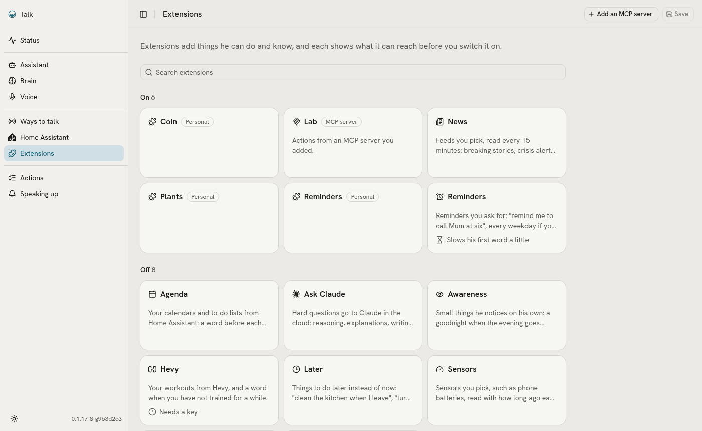
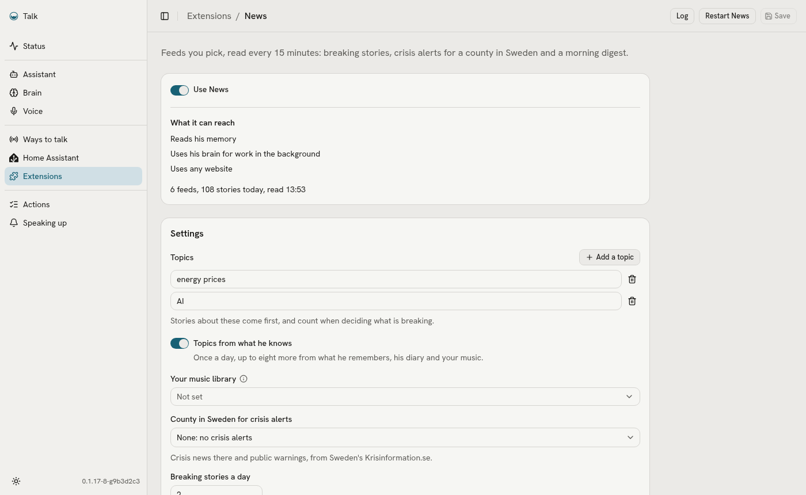

# Built-in extensions

Ten extensions come with Winston, in `src/winston/extensions/`. Each is written against the public
SDK alone ([extensions](extensions.md)), so nothing in the core knows them by name. They are off until
you switch them on, each on its own page under Extensions, or with `winston ext enable ID`.

<picture>
  <source media="(prefers-color-scheme: dark)" srcset="images/extensions-dark.png">
  
</picture>

| Extension | Speaks up | What he can do | What it can reach |
| --- | --- | --- | --- |
| [**Agenda**](#agenda) (`agenda`) | "Coming up": 30 minutes before each event or task with a due time; "Today's events" in the briefing | Read your agenda | Reads Home Assistant: the calendars and to-do lists you pick |
| [**Ask Claude**](#ask-claude) (`claude`) | Nothing | Ask Claude | Uses the internet: api.anthropic.com, through the Claude Code CLI |
| [**Awareness**](#awareness) (`awareness`) | "Goodnight": after a busy day, when the evening goes quiet | Nothing | Connects to programs on his computer: Winston, for the day's requests |
| [**Hevy**](#hevy) (`hevy`) | "Time to train": no workout for 3 days, when you are home; firmer from day 5 | Check your training | Uses the internet: api.hevyapp.com |
| [**Later**](#later) (`later`) | "Done as asked", "Could not do it" | Do something later, List what is waiting, Cancel something waiting | Can run his actions for you; knows whether you are home; reads Home Assistant |
| [**News**](#news) (`news`) | "Breaking news", "Crisis alerts", "Links you asked for", "Daily digest" | Read the news | Reads his memory; uses his brain for work in the background; uses any website (the feeds you pick) |
| [**Reminders**](#reminders) (`reminders`) | "Reminders", when you asked | Add a reminder, List reminders, Cancel a reminder | Nothing outside itself |
| [**Sensors**](#sensors) (`sensors`) | Nothing | Read sensors | Reads Home Assistant: the sensors you pick |
| [**Spotify**](spotify.md) (`spotify`) | "Music moved to another device": when Spotify takes the music the speakers were playing | Play and control music, rate it, set a sleep timer, start a party, read your library ([all 14](spotify.md#what-he-can-do)) | Controls devices in Home Assistant: your library and party light scripts; plays on your speakers; knows whether you are home (to pause when you leave); uses the internet: Spotify, ListenBrainz, MusicBrainz (its genre list, once) and GitHub (once, for the receiver) |
| [**Web search**](#web-search) (`web`) | Nothing | Search the web | Uses the internet: Gemini (generativelanguage.googleapis.com) |

Each action has a name on its page and a name for the brain, made of its extension's id and its own
name (`agenda_upcoming`); the sections below give both. Pasting a key on an extension's page writes
it to `data/.env`; the variable it is stored under is config.yaml only
([running](running.md#settings-only-in-configyaml)). Settings live under
`extensions.<id>.settings` in config.yaml.

Each has its tests beside it (`winston ext test hevy`, on made-up answers and the fake clock), run by
`winston check unit`. `tests/extensions_brain.py` checks Reminders and News with the real brain,
through the voice channel, against the real feeds.

## Agenda

Your calendars and to-do lists, read through Home Assistant, so any calendar it has works (Google
Calendar, Google Tasks, CalDAV, a local one) and it handles your accounts and repeating events.

Every 10 minutes it keeps the events from the start of today to 36 hours ahead, and the open tasks
with a due date. A task is read like an event at its due time, one due on a day only like an all-day
event, and one overdue stays until you tick it off.

| On the page | Key | Default | What it does |
| --- | --- | --- | --- |
| Calendars | `calendars` | None | The calendars he reads. Picking one lets Agenda read it, exposed to the brain or not |
| To-do lists | `lists` | None | Lists whose open tasks with a due date he reads |
| Mention events this long before | `before` | 30 min | When "Coming up" is said, in minutes ("1h30m" saved as text still loads as 90) |
| All-day events in the briefing | `all_day` | On | Birthdays, holidays and other all-day events in "Today's events" |

- **"Coming up"**: said for each timed event, the set number of minutes before its start. It is held
  until then and checked again right before it is said, so a moved or cancelled event is never said,
  and the minutes are counted when it is said.
- **It comes through.** "Coming up" is something you asked for, so it comes through quiet hours and
  the daily limit. Set its Where to Your phone, or its When to Only show it on Talk, if you would
  rather not.
- **"Today's events"**: in the morning briefing, the day's events still to come and all-day ones, with
  the tasks due today or overdue.
- **Read your agenda** (`agenda_upcoming`): today, today and tomorrow, or up to 31 days ("what's on
  this week?"), with tasks named as tasks.

### Google Calendar and Google Tasks

Add Home Assistant's own Google Calendar integration. It needs a Google Cloud project with:

1. **The Calendar API enabled.** Without it the sign-in goes through and Home Assistant then stops
   with `calendar_api_disabled`.
2. **The app published** on the Audience page, or the sign-in lapses every 7 days. Publishing asks for
   an app name, a support email, and a homepage and privacy policy link on the Branding page; for an
   app only you sign in to, any page of yours will do. Google then warns it is unverified: Advanced,
   go to it, continue.
3. **A web application OAuth client** whose redirect is `https://my.home-assistant.io/redirect/oauth`.

Home Assistant's Remote Calendar with Google's private iCal address needs no Google Cloud project,
but reads it only once a day, too seldom for "in 30 minutes".

Google Tasks are not in the Calendar API, though Google Calendar shows them. Add Home Assistant's
Google Tasks integration too, with the Tasks API enabled in the same project and the same client.
Google gives a task's day but not its time, so its tasks reach the briefing and `agenda_upcoming`,
never "Coming up". For a word at a set hour, a [reminder](#reminders) is the tool.

## Ask Claude

Hard questions go to Claude: reasoning, explanations, writing, planning, maths. It runs the Claude
Code CLI bundled with the Claude Agent SDK, in its own environment made by uv, with no tools, no
settings and an empty working directory, for one turn. So Claude sees only the question, and the
answer comes back marked as information.

**Ask Claude** (`claude_ask`) says "Let me think about that." as the call starts.

| On the page | Key | Default | What it does |
| --- | --- | --- | --- |
| Key | `key` | Not set | How it signs in (below) |
| Spending limit per day | `max_usd_per_day` | 3 USD | Past it, he says Claude's limit is reached until midnight |
| Spending limit per question | `max_usd_per_question` | 0.5 USD | A longer answer is cut off at it |
| Claude model | `model` | `claude-opus-5` | Opus is best at hard questions; Sonnet and Haiku are faster and cheaper |
| How hard Claude thinks | `effort` | Low | Low answers in a few seconds; each step up is slower and costs more |

The spending limits count the cost the SDK reports. The status line says how it signs in, and what
was spent today.

How it signs in:

- **A token** from `claude setup-token` (`sk-ant-oat...`) draws on a Claude Pro or Max plan's monthly
  Agent SDK credit. Opt in once in your Claude account.
- **An API key** (`sk-ant-api...`) is billed per question against the account's API credit, which a
  Max plan includes.
- **No key**: this machine's Claude Code login (`~/.claude/.credentials.json`).

## Awareness

Small things Winston notices on his own. No tools, no settings, no outside services.

**Goodnight.** After 21:00 (or before 06:00), when there have been at least three answered turns that
day and then 30 or more minutes of silence, Winston says goodnight.

- One per night, and a night is the evening it starts on: after midnight that evening's turns still
  count.
- A goodnight not said by 06:00 the next morning is dropped.
- It checks every 15 minutes, reading the turns from winstond's API.

## Hevy

Your workouts from [Hevy](https://www.hevyapp.com), read only. It needs Hevy Pro and its API key, from
hevy.com/settings?developer: paste it into **API key** on its page (stored in `data/.env` as
`HEVY_API_KEY`). The key is tried on save.

| On the page | Key | Default | What it does |
| --- | --- | --- | --- |
| API key | `api_key` | Not set | Your Hevy API key |
| Days without training before he mentions it | `rest_days` | 3 | When "Time to train" is first said |
| Days until he says it more firmly | `firmer_after` | 2 | Counted from when he first mentions it |

- **Every hour** it keeps a copy of the last 120 days of workouts: the first time by paging through
  them, then only what changed since the last poll. Hevy asks not to poll exactly on the hour, and it
  does not: the hour counts from when it started.
- **"Time to train"** is said when you get home. It is about the gap since your last workout, so "I
  know, I'm training tomorrow, remind me after work" follows that gap, and a workout logged meanwhile
  ends it without a word.
- **Check your training** (`hevy_get_training`): days since the last workout, workouts this week and
  month, the last workout, and for an exercise ("how was my bench press?") its sets last time and the
  best set logged.
- **Status**: the last workout. **Entities**: days since the last workout, workouts this week.
- **Hint words**: your exercise names, so "Romanian deadlift" is heard right.

## Later

Things to do later instead of now: "clean the kitchen when I leave", "turn the heater on at six",
"when the washing machine is off, play some music".

With **Do something later** (`later_add`) the brain names the exact call it would make now (one of its
own tools, with its arguments) and when. When that comes, Later makes the call, and nothing is decided
by a model then. It is built on the `tools` permission ([extensions](extensions.md#permissions)).

- **When**: a time, you leaving or getting home (the person entity under Speaking up), or a Home
  Assistant entity reaching a state (checked every minute). One waiting on leaving, arriving or a
  state is dropped after a day, so the vacuum never starts days after you asked.
- **Told**: "Done as asked" with what the tool answered, or "Could not do it" with why, on the
  speakers at home or your phone away.
- **Refused up front**: a tool he does not have, a restricted one (it waits for you to confirm it), a
  time that has passed, "when I leave" while you are away, a state the entity is already in. The same
  request twice is kept once.
- **List what is waiting** (`later_waiting`) lists what waits, and **Cancel something waiting**
  (`later_cancel`) takes one back ("cancel the kitchen").

## News

Feeds you pick, read every 15 minutes, with the same story grouped across sources by the words of its
headline and lead. A feed that keeps an ETag or a date answers "not modified". Seven days of items are
kept in a SQLite file in its folder.

<picture>
  <source media="(prefers-color-scheme: dark)" srcset="images/extensions-news-dark.png">
  
</picture>

### Feeds

Each preset is a switch under Feeds:

| Preset | Key | Default | Outlets |
| --- | --- | --- | --- |
| Sweden, in English | `sweden_en` | Off | The Local, Radio Sweden |
| Sweden, in Swedish | `sweden_sv` | Off | SVT, Ekot, DN, SvD, Aftonbladet, Expressen; he tells you in English |
| World | `world` | On | BBC, The Guardian, Al Jazeera, NPR, DW, France 24 |
| Tech | `tech` | Off | Ars Technica, The Verge, TechCrunch, Hacker News |
| Security | `security` | Off | BleepingComputer, The Hacker News, Krebs on Security, The Record, SecurityWeek, Dark Reading, The Register |
| Music | `music` | Off | Pitchfork, NME, Stereogum, Rolling Stone, Consequence, Billboard, The Guardian's music pages |

**Your feeds** (`feeds`, Add a feed) takes any RSS or Atom address, with who publishes it, a region and
a topic. A feed that is not answering shows as a warning on its page.

### Topics and settings

| On the page | Key | Default | What it does |
| --- | --- | --- | --- |
| Topics | `topics` | None | What you care about. Stories about them come first, and count when deciding what is breaking |
| Topics from what he knows | `learn_topics` | On | Once a day, up to eight more topics |
| Your music library | `music_from` | None | Spotify, or another extension with a music library, for topics from the artists you play |
| County in Sweden for crisis alerts | `county` | None | Crisis news and public warnings there, from Krisinformation.se |
| Breaking stories a day | `breaking_per_day` | 2 | The most breaking stories said in a day |
| Stories in the morning digest | `digest_size` | 5 | How many stories the digest gives |

- **A story is about a topic** when its words say so or a feed that carries it is about it. With
  "Sweden", every story from a Swedish outlet counts, in Swedish too.
- **Learned topics** are named by the background model from what he remembers about you, his diary of
  the last week and, with **Your music library** picked, the artists you play. They show under its
  status line and count like yours in ranking and in what is breaking. Only the topics you type are
  sure of a place in the digest.

### What he says

- **Breaking news**, as soon as allowed: a story three or more independent sources ran within 90
  minutes (two feeds of one publisher count once), which the background model then judges, yes or
  no, worth interrupting for given your topics. What is already there on the first read, or when a
  feed is added, is never breaking.
- **Crisis alerts**: with your county picked, Krisinformation.se's news for it, in English, and every
  VMA for it or for all of Sweden, said as they come. A VMA is urgent, so it is said in quiet hours
  too.
- **Daily digest**, in the briefing (your first conversation of the day). The background model picks
  it from the day's 25 leading stories, at most once an hour until it is said: what matters most, not
  a run of crime and accidents, never two stories about one event. Each of your topics with a story
  that day gets one, whatever the model picked. Without the model, each topic's best story comes
  first.
- **Following up**: "tell me more" gives every outlet's report. "Send me the links" sends up to three
  to your phone as buttons (Discord without a phone), as "Links you asked for".
- **Read the news** (`news_get_news`) answers from what was read, so a question never waits on the
  web: the main stories of the last day, or those about a topic ("anything about Sweden?").

Feed text is from outside: it reaches his brain only as facts marked as information, and the
background model's answer about it is a yes or a no.

## Reminders

"Remind me to call Mum at six", "every weekday at 7:30, remind me to take my vitamins", "what
reminders do I have?", "cancel the one about Mum".

- **It comes at its time.** Each time a reminder is due is a nudge of a kind you asked for, so it
  comes through quiet hours and the daily limit. It can be put off ("remind me in ten minutes"), and
  it survives a restart.
- **Repeating**: daily, weekdays or weekly. A repeating one keeps its time on the clock across
  daylight saving, and moves on once said. In a check with the 27B, "every weekday at half past
  seven" first landed on 19:30; he saw it in the answer and moved it to the morning himself.
- **Once**: the same reminder asked for twice is set once.
- **Timers** are reminders too ("set a timer for ten minutes", "cancel the timer"). Home Assistant's
  own timers ring on its voice satellites, so in a home without one its timer tools are left out.
- **Actions**: **Add a reminder** (`reminders_add`), **List reminders** (`reminders_upcoming`) and
  **Cancel a reminder** (`reminders_cancel`).
- **Entity**: the next reminder, as a timestamp.

## Sensors

Sensors you pick, such as phone batteries, with how long ago each last changed. Home Assistant's live
context has no timestamps, so without this a reading can be hours old without him knowing.

Each reading on its page (Add a reading, under Readings) has a name, a Sensor and an optional Second sensor (charging).
Picking them lets Sensors read them, exposed to the brain or not.

**Read sensors** (`sensors_get_readings`) gives "Phone: 91% (discharging), last changed 45 minutes
ago" for each, and he says how old a reading is past about 30 minutes.

## Spotify

Spotify on the speakers, through a Spotify Connect receiver of its own, so a speaker named Winston
shows up in the Spotify app. By voice: "play Daft Punk", "play my running playlist", "something
chill", "pause", "louder", "who is this?". It needs Spotify Premium.

Setting it up, what plays when you name something, mixes, controls, ratings, the sleep timer and
parties are on [its own page](spotify.md).

## Web search

Current facts the brain cannot know: populations, prices, exchange rates, results, news. Gemini with
Google Search grounding reads the pages and answers in a sentence or two, so the brain never sees raw
web text, and only the question leaves the house.

It needs a Gemini API key from aistudio.google.com (stored as `GEMINI_API_KEY`) with billing enabled;
grounding answers 429 without it. Google's paid tier includes a monthly grounding quota and does not
train on the prompts.

**Search the web** (`web_search`) says "Let me look that up." as the call starts.

| On the page | Key | Default | What it does |
| --- | --- | --- | --- |
| API key | `api_key` | Not set | Your Gemini API key |
| Searches per day | `max_per_day` | 100 | Past it, he says he cannot search until midnight |
| Gemini model | `model` | `gemini-3.5-flash-lite` | The model that searches; change it when Flash-Lite is retired. Flash answers about a second later |
| How hard Gemini thinks | `thinking` | Minimal | Each step up takes about a second longer |

## Vulnerabilities

Designed, not built yet: new vulnerabilities as they come out, and whether you have them. The design
is on [its own page](vulnerabilities.md).
