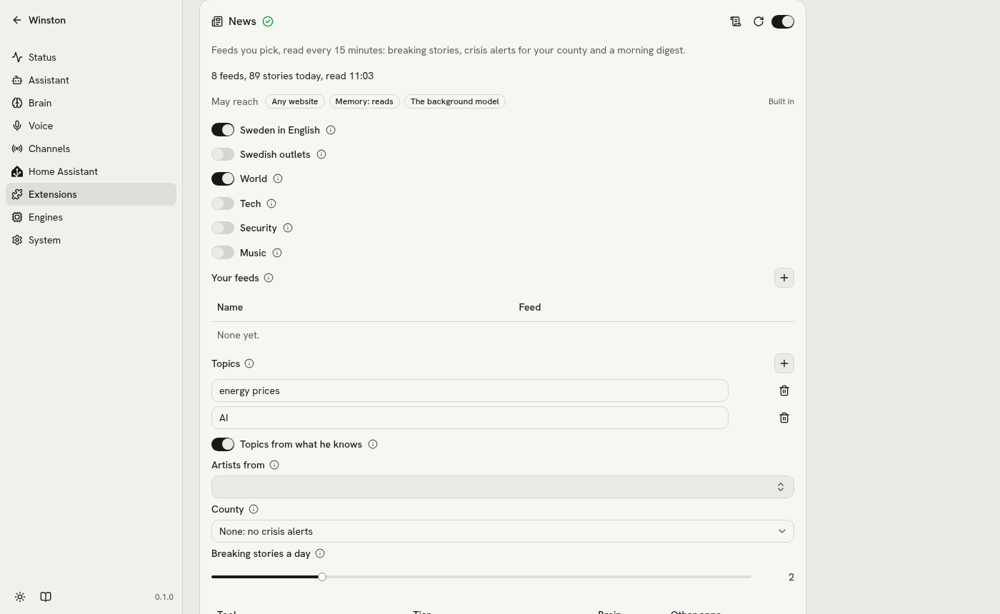

# Built-in extensions

Ten extensions come with Winston, in `src/winston/extensions/`, each written against the public
SDK alone ([extensions](extensions.md)): nothing in the core knows them by name. They are off until
you switch them on, on the Extensions page or with `winston ext enable ID`.

| Extension | Speaks up | His tools | Reaches |
| --- | --- | --- | --- |
| **Agenda** (`agenda`) | "Coming up": 30 minutes before each event; "Today's events" in the briefing | `agenda_upcoming` | Home Assistant (read: the calendars you pick) |
| **Ask Claude** (`claude`) | Nothing | `claude_ask` | Claude (api.anthropic.com), through the Claude Code CLI |
| **Awareness** (`awareness`) | "Goodnight": after a busy day, when the evening goes quiet | None | winstond (reads the day's turns) |
| **Hevy** (`hevy`) | "Time to train": no workout for 3 days, when you are home; firmer from day 5 | `hevy_get_training` | api.hevyapp.com |
| **Later** (`later`) | "Done as asked", "Could not do it" | `later_add`, `later_waiting`, `later_cancel` | The brain's tools (act), presence, Home Assistant (read) |
| **News** (`news`) | "Breaking news", "Crisis alerts", "Daily digest" | `news_get_news` | Any website (the feeds you pick), the background model, memory (read) |
| **Reminders** (`reminders`) | "Reminders", when you asked | `reminders_add`, `reminders_upcoming`, `reminders_cancel` | Nothing outside itself |
| **Sensors** (`sensors`) | Nothing | `sensors_get_readings` | Home Assistant (read: the sensors you pick) |
| **Spotify** (`spotify`) | Nothing | `spotify_play`, `spotify_feedback`, `spotify_sleep`, `spotify_party`, `spotify_pause`, `spotify_resume`, `spotify_next_track`, `spotify_previous_track`, `spotify_volume`, `spotify_now_playing` | Spotify, ListenBrainz, MusicBrainz (its genre list, once), GitHub (once, for the receiver), Home Assistant (act: your library, and party light scripts), presence (pause when you leave), the speakers |
| **Web search** (`web`) | Nothing | `web_search` | Gemini (generativelanguage.googleapis.com) |

Each has its tests beside it (`winston ext test hevy`, on made-up answers and the fake clock), run by
`winston check unit`.

## Agenda

Your calendars, read through Home Assistant, so any calendar it has works (Google Calendar, CalDAV, a
local one) and it handles your accounts and repeating events. Pick the calendars on the card; picking
one lets Agenda read it, exposed to the brain or not. Every 10 minutes it keeps the events from the
start of today to 36 hours ahead.

- **"Coming up"**: each timed event, `before` (30 minutes) its start. It is held until then and
  checked again right before it is said, so a moved or cancelled event is never said, and the minutes
  are counted when it is said. It is something you asked for, so it comes through quiet hours and the
  daily limit; set it to the phone or silent on the card if you would rather not.
- **"Today's events"**: the day's events still to come, and all-day ones (switch those off on the
  card), in the morning briefing.
- **`agenda_upcoming`**: today, today and tomorrow, or up to 31 days ("what's on this week?").

For Google Calendar, add Home Assistant's own Google Calendar integration (it needs a Google Cloud
project with the Calendar API, a published consent screen, or the sign-in lapses every 7 days, and a
web application OAuth client whose redirect is `https://my.home-assistant.io/redirect/oauth`). Its
Remote Calendar with Google's private iCal address needs no Google Cloud project, but reads it only
once a day, too seldom for "in 30 minutes".

## Ask Claude

Hard questions go to Claude: reasoning, explanations, writing, planning, maths. It runs the Claude Code
CLI bundled with the Claude Agent SDK (in its own environment, made by uv) with no tools, no settings
and an empty working directory, one turn, so Claude sees only the question, and the answer comes back
marked as information.

- **Signs in** with the card's key when one is set: a token from `claude setup-token` (`sk-ant-oat...`)
  draws on a Claude Pro or Max plan's monthly Agent SDK credit (opt in once in your Claude account),
  an API key (`sk-ant-api...`) is billed per question. With no key, this machine's Claude Code login
  (`~/.claude/.credentials.json`). The status line says which, and what was spent today.
- **Budget**: `max_usd_per_day` (3 USD), from the cost the SDK reports, and `max_usd_per_question`
  (0.5 USD, Advanced).
- **`claude_ask`**: says "Let me think about that." as the call starts. Claude Opus 5 at low effort
  (`model` and `effort` are Advanced): 4.4 s and 0.04 USD for an explanation through the brain
  on 2026-10-12.

## Awareness

Small things Winston notices on his own. No tools, no settings, no outside services.

**Goodnight.** After 21:00 (or before 06:00), when there have been at least three answered turns
today and then 30 or more minutes of silence, Winston says goodnight. One per night, expires at
06:00. Checks every 15 minutes. The nudge reads the day's turns from winstond's API.

## Hevy

Your workouts from [Hevy](https://www.hevyapp.com). Needs Hevy Pro and its API key, from
hevy.com/settings?developer: paste it into the card's key field (stored in `data/.env` as
`HEVY_API_KEY`); it is tried on save. Read only.

- **Every hour** it keeps a copy of the last 120 days of workouts: the first time by paging through
  them, then only what changed since the last poll. Hevy asks not to poll exactly on the hour, and it
  does not: the hour counts from when it started.
- **"Time to train"**: no workout for `rest_days` (3), said when you get home; after `firmer_after` (2)
  more days, firmer. It is about the gap since your last workout, so "I know, I'm training tomorrow,
  remind me after work" follows that gap, and a workout logged meanwhile ends it without a word.
- **`hevy_get_training`**: days since the last workout, workouts this week and month, the last workout,
  and for an exercise ("how was my bench press?") its sets last time and the best set logged.
- **Status**: the last workout. **Entities**: days since the last workout, workouts this week.
  **Hint words**: your exercise names, so "Romanian deadlift" is heard right.

## Later

Things to do later instead of now: "clean the kitchen when I leave", "turn the heater on at six",
"when the washing machine is off, play some music". The brain names the exact call it would make
now (one of its own tools, with its arguments) and when; when that comes, Later makes the call, and
nothing is decided by a model then. Built on the `tools` permission ([extensions](extensions.md#permissions)).

- **When**: a time, you leaving or getting home (the person entity under Speaking up), or a Home
  Assistant entity reaching a state (checked every minute). One waiting on leaving, arriving or a
  state is dropped after a day, so the vacuum never starts days after you asked.
- **Told**: "Done as asked" with what the tool answered, or "Could not do it" with why, on the
  speakers at home or your phone away.
- **Refused up front**: a tool he does not have, a restricted one (it waits for you to confirm it),
  a time that has passed, "when I leave" while you are away, a state the entity is already in. The
  same request twice is kept once.
- **`later_waiting`** lists what waits and **`later_cancel`** takes one back ("cancel the kitchen").

## News

Feeds you pick, read every 15 minutes (a feed that keeps an ETag or a date answers "not modified"),
seven days of items in a SQLite file in its folder, and the same story grouped across sources by the
words of its headline and lead.

<picture>
  <source media="(prefers-color-scheme: dark)" srcset="images/extensions-news-dark.png">
  
</picture>

- **Presets**, each a switch: Sweden in English (The Local, Radio Sweden), Swedish outlets (SVT, Ekot,
  DN, SvD, Aftonbladet, Expressen; he tells you in English), World (BBC, The Guardian, Al Jazeera, NPR,
  DW, France 24), Tech (Ars Technica, The Verge, TechCrunch, Hacker News) and Security
  (BleepingComputer, The Hacker News, Krebs on Security, The Record, SecurityWeek, Dark Reading, The
  Register). **Your feeds**: any RSS or Atom URL, with who publishes it, a region and a topic.
- **Music**, a preset that starts off: Pitchfork, NME, Stereogum, Rolling Stone, Consequence,
  Billboard and The Guardian's music pages.
- **Topics from what he knows** (on by default): once a day the background model names up to eight
  more topics from what he remembers about you, his diary of the last week and, when you pick your
  music library under **Artists from** (Spotify's `my_music`), the artists you play. They are shown in
  the card's status line and count like yours in ranking and in what is breaking; only the topics you
  type are sure of a place in the digest.
- **Topics**: what you care about; a story about any of them counts. Stories about them come first,
  and they count when deciding what is breaking. A story is about a topic when its words say so or a
  feed that carries it is about it: with "Sweden", every story from a Swedish outlet counts, in Swedish
  too.
- **Breaking news** (as soon as allowed): a story three or more independent sources ran within 90
  minutes (two feeds of one publisher count once), which the background model then judges, yes or no,
  worth interrupting for given your topics; at most `breaking_per_day` (2). What is already there on
  the first read, or when a feed is added, is never breaking.
- **Crisis alerts**: pick your county, and Krisinformation.se's news for it, in English, and every VMA
  for it or for all of Sweden are said as they come; a VMA is urgent, so it is said in quiet hours too.
- **Daily digest** (the briefing, your first conversation of the day): the background model picks it
  from the day's 25 leading stories, at most once an hour until it is said: what matters most, not a run
  of crime and accidents, never two stories about one event. Each of your topics with a story that day
  gets one, whatever the model picked; without the model, each topic's best story comes first. On
  2026-09-30 the plain ranking gave five Swedish crime and accident stories and no security story; the
  model's pick for the same day gave the government talks, a Cisco zero-day, Swedish jets in NATO's
  mission over Poland, Iran and the US, and the last US troops leaving Iraq.
- **Following up**: "tell me more" gives every outlet's report; "send me the links" sends up to three
  to your phone as buttons (Discord without a phone).
- **`news_get_news`** answers from what was read, so a question never waits on the web: the main stories
  of the last day, or those about a topic ("anything about Sweden?").

Feed text is from outside: it reaches his brain only as facts marked as information, and the
background model's answer about it is a yes or a no.

## Reminders

"Remind me to call Mum at six", "every weekday at 7:30, remind me to take my vitamins", "what reminders
do I have?", "cancel the one about Mum". Each time a reminder is due is a nudge of a kind you asked
for, so it comes at its time through quiet hours and the daily limit, can be put off ("remind me in ten
minutes"), and survives a restart. A repeating one (daily, weekdays, weekly) keeps its time on the
clock across daylight saving and moves on once said. The same reminder asked for twice is set once. A
timer is a reminder too ("set a timer for ten minutes", "cancel the timer"): Home Assistant's own timers
ring on its voice satellites, so in a home without one its timer tools are left out.
**Entity**: the next reminder, as a timestamp.

## Sensors

Sensors you pick, such as phone batteries, with how long ago each last changed: Home Assistant's live
context has no timestamps, so a reading can be hours old without him knowing. Each entry on the card
has a label, a value sensor and an optional state sensor (charging); picking them lets Sensors read
them, exposed to the brain or not.

- **`sensors_get_readings`**: "Phone: 91% (discharging), last changed 45 minutes ago" for each, and he
  says how old a reading is past about 30 minutes. 34 ms through the brain.

## Spotify

Spotify on the speakers: the box in the room you are in, and whatever is plugged into its jack. It runs
[go-librespot](https://github.com/devgianlu/go-librespot) 0.10.4, an open Spotify Connect receiver
(downloaded once from GitHub and checked against the release's checksum), so a speaker named Winston
shows up in the Spotify app. By voice: "play Daft Punk", "play my running playlist", "play Get Lucky
next", "something chill", "some jazz", "pause", "next song", "louder", "who is this?". It needs Spotify
Premium. Anything to hear goes through one tool, `spotify_play`, with what you said in its fields (a
name, its artist, a genre, a mood, artists you named as the kind you want, "next"), and the code decides
how to play it, so the brain cannot pick the wrong tool. A song asked for next goes into Spotify's queue,
after the one playing; with nothing playing it plays now. While something plays, every message he gets
says so in its stamp ("spotify: playing Oh Dove by Men I Trust"), so "who is this?" or "not this one" knows
the song, and a request to play is music only, never a light scene.

1. Switch it on. The card shows a code: open spotify.com/pair and enter it, once.
2. Under **Your library from**, pick Home Assistant's Spotify player. Your saved albums, top and
   followed artists, and liked and top songs are read from it hourly, and he plays them by name without
   a search. Your playlists come from the receiver itself, Spotify's own among them: Discover Weekly,
   your daylist (also by that word, whatever Spotify named it today) and a Blend (by that word too), plus
   Liked Songs; an empty one that is not yours (the DJ's) is left out.
3. For everything else, make an app at developer.spotify.com (Web API; Spotify wants a redirect URI,
   `http://127.0.0.1:8700/callback` will do, it is never used) and put its client ID and secret on the
   card, or in `data/.env` as `SPOTIFY_CLIENT_ID` and `SPOTIFY_CLIENT_SECRET`. Without them he plays
   from your library only, and says so.
4. For mixes, make a free account at [ListenBrainz](https://listenbrainz.org) and put the token from its
   settings page on the card, or in `data/.env` as `LISTENBRAINZ_TOKEN`. It needs the app from step 3.

**Mixes.** Ask for a mood ("something chill", "something upbeat") and he picks three to six artists
from your library that fit it; the list starts from two of them, and artists you named ("something
like Frank Ocean") always seed it. Ask for a genre ("some drum and bass") and it comes from the genre's
MusicBrainz tag alone, with artists you named: songs tagged with it, not with similar tags. A genre said
as a name ("play jazz") is a genre when MusicBrainz lists it and nothing in your library has the name.
The seeds start
ListenBrainz's [LB Radio](https://troi.readthedocs.io/en/latest/lb_radio.html) in easy mode: their
songs and songs by artists like them, a different list every time. Each song is found on Spotify by
its title and artist (one whose best match is by someone else is left out), the first plays and the
rest are queued, about 20 songs. The last eight seeds are remembered: a mix starts from artists not
used lately, else from those used longest ago, so the same chill artists take turns. An artist
MusicBrainz does not know by that name is skipped for the next, and remembered, so later mixes do not ask
about it again. A song's credits count by their first artist ("Fred again.. x Brian Eno"), "&" is "and",
and one song comes once. Songs already found on Spotify are kept in `songs.json` in the extension's
folder, so a song that comes back in a later mix costs no search (Spotify gives the app a small daily
quota). When ListenBrainz does not answer within 10 s, or Spotify is refusing searches, a mood plays
Spotify's radio from one of your artists instead, which needs no search.

**What you think of it is kept** (`spotify_feedback`). "I like this" saves the song to your Liked Songs.
"Never play this again" bans the song: it is skipped whenever it comes on, from radio, a mix or a list.
"Not Elliott Smith" keeps him out of what plays for a while: 24 hours, or until the speakers have been
quiet for an hour, whichever comes first (both on the card, Advanced); "never play Elliott Smith" bans him.
A mix leaves out who is out, and asking for one by name lifts it ("play Elliott Smith"), as does "you can
play him again". When it is not clear whether you mean the song or the artist ("this sucks"), he asks.
What played is logged (`played.jsonl` in the extension's folder), so "what was the song before this?" and
"that song from earlier" have an answer, and your artists' and playlists' names, with your own words for
them, are hint words for speech to text ("play some Daft Punk" was once heard as "Dunk").

**Bedtime and morning.** "Stop the music in 30 minutes", "turn it off in an hour" or "something to sleep
to" sets a sleep timer (`spotify_sleep`): he says good night then, the music fades out over the last 30
minutes (**Sleep fade**, Advanced) and pauses, nothing is said, and the volume goes back for the next time.
The timer is kept in the extension's store, so a restart in the middle carries on. The first music of the
day, after six hours without any (**Quiet before "first music"**), starts at 60 (**First music of the day
at**; 0 leaves it as it was): it had been left at 96. **Pause when you leave** (off until you switch it on)
pauses the music when Home Assistant's person under Speaking up leaves home.

**A mix is one list** when **Mixes go to** (Advanced) names a playlist of yours: make an empty one in
Spotify once (Winston, say). Each mix is added to its end and played from its first new song, so
what you ask for next replaces it, previous goes back within it, and the oldest songs beyond the last 60
are removed while the music plays. Without it a mix goes into Spotify's queue, which go-librespot cannot
clear: its songs follow whatever you ask for next.

**A mood plays as** (Advanced on the card): `listenbrainz`, the list above; `spotify_radio`, Spotify's
own radio from one of your artists that fit, shaped by your listening, with no searches at all; or
`both_in_turn`, one then the other, said the same way, as a blind test: which was which is logged in the
extension's store (`mood_log`, with the time, the mood and the seeds). A genre always uses ListenBrainz,
whose radio follows a tag. Without a ListenBrainz token he plays Spotify's radio from one artist that fits.
Not used: tags for moods ("chill" gave obscure free-archive songs, or drifted to unrelated tags in hard
mode), and LB Radio's `stats` and `recs`, which need your listening history on ListenBrainz.

**What plays is what you named.** Your library first: by its whole name, or by your own names for it
under **Your names for them** on the card, one per line (`🥁 = drum and bass, drums`); an emoji is also
known by its own name, so "the drum emoji" or "my drum playlist" plays 🥁. "My ..." never leaves your
library: when nothing there has the name he says so and names your playlists. From all of Spotify a song
plays only when its title is the name (numbers as words: "7 Seconds" is "Seven Seconds"), an artist only
when it is that artist; an album or a playlist only when you said "the album" or "the playlist", never a
stranger's playlist that happens to have the words. When a song and an artist share the name, your
artist's song wins, then the artist if Spotify's songs for the name are the artist's own ("Daft Punk"),
else the song ("Wonderwall" is Oasis's song, not a band called Wonderwall). A song with its artist ("One
by U2") must be by that artist; when Spotify's song of that title is someone else's, it plays that one
and says whose it is ("Big Bad John is by Jimmy Dean, not Johnny Horton"). Nothing that only carries the
words plays ("drum and bass" once played a song called "Drum and Bass Father"): he gets the nearest names
and asks, or plays a mix for a mood or a genre.

"Stop" to the box while it plays pauses Spotify and ends the conversation ([Voice PE](voice-pe.md#ending-a-conversation-and-the-button)).
Pause, resume and skip read the receiver first, so with nothing loaded he says so instead of "Playing."
When Spotify refuses the app's searches (its limit; on 2026-10-16 after a few hundred searches in an hour,
for 22 hours) he says until when, does not ask again until then, and your library still plays by name.

Spotify gives such receivers its 320 kbps stream; the box gets it as 48 kHz 16-bit stereo FLAC
([Voice PE](voice-pe.md#music)). Pause, play and skip in the app or by voice, and the box follows: a
pause stops it at once, and Spotify goes back by what the box had not played yet, so nothing is lost.

**Parties.** The `spotify_party` tool plays a track and runs a Home Assistant light show in time with it:
the lights start the instant the music does (on go-librespot's own `playing` event, not a guessed delay)
and the room is put back when it stops. Wire it to a phrase with a [shortcut](home-assistant.md): "party
time" plays a track on the speakers, the lights hit with the first beat, and when the song ends
the room returns to how it was. One party runs at a time: a new party, or any song asked for, first ends
the one going (its light script stops and its restore scene comes on), and a party also ends when its own
song does, so the next song Spotify plays does not run under a light show. It needs the extension's Home
Assistant permission set to act, and the light script and restore scene exposed to Winston.

Not Home Assistant's Spotify integration or Music Assistant: the integration is a remote for devices
that already are Spotify Connect speakers and cannot search, and the box is not one; Music Assistant
reaches a box through Home Assistant, which would take the box's microphone from Winston.

## Web search

Current facts the brain cannot know: populations, prices, exchange rates, results, news. Gemini with
Google Search grounding reads the pages and answers in a sentence or two, so the brain never sees raw
web text, and only the question leaves the house. It needs a Gemini API key from aistudio.google.com
(stored as `GEMINI_API_KEY`) with billing enabled; grounding answers 429 without it. Google's paid tier
includes a monthly grounding quota and does not train on the prompts.

- **`web_search`**: says "Let me look that up." as the call starts; at most `max_per_day` (100) a day.
  `gemini-3.5-flash-lite` at minimal thinking answers in about 1.4 s at the search model (Flash: 2.3 s,
  same answers in our test; `model` and `thinking` are Advanced). Through the brain on 2026-10-12: 1.3 s.

## Vulnerabilities

Approved 2026-10-10. Built: what it needs from the standard (below); the extension itself is not built
yet. The order is in the [plan](plan.md) (Computers and vulnerabilities track).

New vulnerabilities as they come out, and whether you have them. It never patches anything. Two
sources, both free and with no key:

- **CISA's [Known Exploited Vulnerabilities](https://www.cisa.gov/known-exploited-vulnerabilities-catalog)
  catalog** (KEV): one JSON file of bugs with evidence of being exploited. It held 1,739 on 8 October
  2026, with 21 to 43 added each month this year.
- **ENISA's [EU Vulnerability Database](https://euvd.enisa.europa.eu)** (EUVD): every new CVE, with
  its score and the vendor and product it names. In the week to 10 October, 2,787 CVEs were published,
  and 329 of them were scored 9 or more.

Stories about security are the News extension's Security preset; this is the vulnerabilities
themselves.

### What is new

- **Newly exploited**: every entry CISA adds, in the briefing: what it is, whose product, and whether
  ransomware uses it. About one a day.
- **Critical, in what you follow**: a new CVE scored 9 or more whose vendor or product is something you
  have (below) or a name on the card's Follow list ("OpenSSH", "Home Assistant", "WordPress"), in the
  briefing, at most three a day, highest score first. Following everything would be about 47 a day;
  Google alone had 26 in that week. The rest wait for the tool.
- **`vulns_recent`**: what was newly exploited and newly critical in the last days (7 unless asked),
  all of it or about one vendor or product. "Any new vulnerabilities?", "what got exploited this
  week?", "anything new about Chrome?".

Both kinds are pushed, one nudge per CVE, and expire after three days, as news goes stale. A CVE you
have is said as one you have (below), never twice.

### What you have

What you own comes from where it is already known:

- **Home Assistant's devices**: the maker, model and firmware of every device it knows, exposed or not
  (needs the new `devices` permission, below).
- **Your computers**: each computer server you pick, through its `security_updates`
  ([computers](computer.md)).
- **Anything else**: a list on the card, each entry a name, a vendor, a product and optionally a
  version, for what neither knows (a router with no Home Assistant integration, a NAS, a phone).

An exploited CVE (in the catalog) matches what you have in one of two ways:

- **Sure**: it is among the CVE ids of a computer's waiting updates. You have it, and the update that
  fixes it is waiting. Level 2.
- **Likely**: the catalog's vendor is the device's maker (compared without Inc, Ltd, GmbH and the
  like), and the background model, given the catalog entry and the device's maker, model and firmware,
  says yes, this is that product. Level 1. The catalog gives no versions, so a likely match can be one
  you already patched; a device's likely match ends when its firmware changes.

Word matching alone is not enough: in the 8 October catalog, 389 of the 1,739 entries are Microsoft's,
and products read "Multiple Products" (Apple), "Multiple Routers" (TP-Link, Netgear) or "Kernel"
(Linux). So a computer's CVE ids win where its package tool gives them, and elsewhere the model judges
the product. Computers whose tool gives no ids (Ubuntu's apt, Arch, macOS, Homebrew, winget) are
matched like devices, by their OS and their waiting updates. A critical CVE that is not (yet)
exploited is news, not a match: it reaches you through the Follow kind above.

- **"Exploited, and you have it"**: a checked kind, one nudge per CVE and thing, so it ends by itself
  when the update is installed (the CVE leaves the computer's list), and "that's not mine" dismisses it
  for good. Sure matches at the next talk, likely ones in the briefing; changeable per level on the
  card. What is already in the catalog when you switch it on is listed by the tool but not said, unless
  it is a sure match.
- **`vulns_to_patch`**: everything you have with a match, sure ones first: the thing, the CVE, what it
  is (the catalog's name and description), CISA's required action, when it was listed, whether it is
  known to be used by ransomware, and for a computer the waiting update that fixes it. "Anything I need
  to patch?", "is the router affected by anything?".

### How it runs

- **Every 6 hours** it reads the catalog, asking with If-Modified-Since, so an unchanged catalog costs
  one 304, and EUVD's search for CVEs published since its last read and scored 9 or more, a hundred
  at a time. Every hour it reads each picked computer's `security_updates`, and each day Home
  Assistant's devices. It keeps 14 days of new CVEs in its folder, and both tools answer from what was
  read, so a question never waits on the web.
- **Status**: the catalog's date, and how many sure and likely matches. **Entity**: the number of
  exploited vulnerabilities you have.
- EUVD's API is young, and its documentation page needs a browser to read. If it stops answering, the
  Follow kind says so on the card and the rest works on.

```toml
permissions = { network = ["www.cisa.gov", "euvdservices.enisa.europa.eu"], devices = true, llm = true }
```

Nothing about what you have or follow leaves the house: the catalog is downloaded whole, the search
asks only for a date and a score, and the matching happens here, by the background model where it
judges, which is the local brain unless you picked a cloud one. Text from the catalog and EUVD is from
outside: it reaches his brain only as facts marked as information, and the model's answer about it is
a yes or a no.

### What this needs from the standard

Two additions, each for any extension, not for this one. Built 2026-10-10 and in
[extensions](extensions.md) (permissions, settings and `ctx`).

1. **`devices = true`**, and `ctx.devices()`: every device in Home Assistant's device registry, as
   `Device(id, name, manufacturer, model, model_id, sw_version, hw_version, area, service)`, `service`
   being true for what Home Assistant lists as a service (an add-on, Home Assistant itself). It is not part of
   `home_assistant = "read"`, which is scoped on purpose to exposed and picked entities and reads their
   states (least privilege, plan §6 rule 5). An inventory needs every device, exposed or not (routers,
   cameras and storage are rarely exposed to a voice assistant), and none of their states. Network
   addresses, serial numbers and integration ids stay out: nothing that matches a vulnerability needs
   them. A firmware update reminder, a battery list or a warranty tracker would use the same
   permission. winstond already reads the registry for the map of the house.
2. **Picking another extension's tool in settings**: `Extensions(tool="security_updates")`, a picker of
   the extensions and MCP servers that are switched on and have a read tool of that name. Picking one is
   consent for this extension to call that tool through `ctx.ext(id).call(...)`, as picking an entity is
   consent to use it. `ctx.ext` then reaches an MCP server's read tools too (today only an SDK
   extension's), by the tier you set on that server's card. The manifest's `extensions = [...]` cannot
   do this: it names ids fixed when the extension is written, and computers get their names when you
   add them. A backup monitor over each computer's `logs`, or a disk-space nudge over each `status`,
   would use the same picker.

## With his brain

Checked with the 27B through the voice channel's brain (`tests/extensions_brain.py`, Reminders and
News against the real feeds): "Remind me to call Mum at six" set it for 18:00 and he said so; "every
weekday at half past seven" first landed on 19:30, which he saw in the answer and moved to the
morning himself; the reminders were listed, and "cancel the one about Mum" cancelled that one; "what's
in the news?" and "anything about Sweden?" were answered in English from `news_get_news`, the second
with the topic Sweden.
