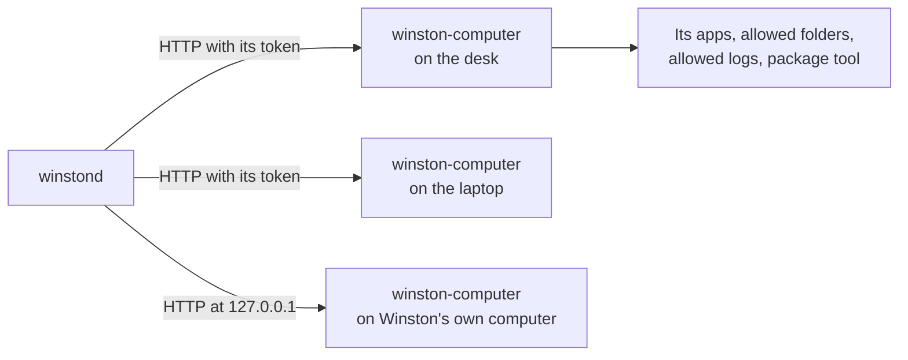
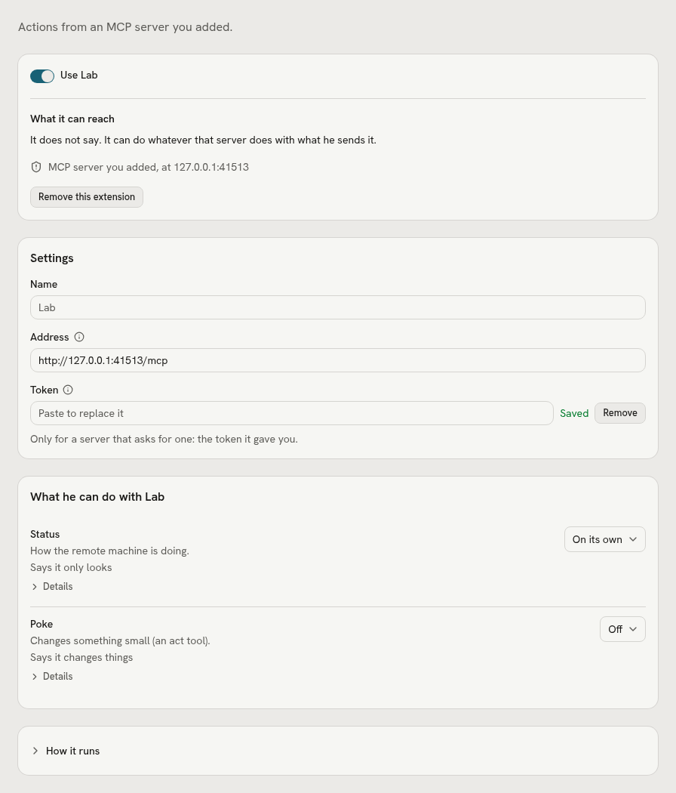

# Computers

Winston can open things on your computers, say how they are doing, read the logs you allow, and list
the updates they are waiting for. Each computer runs a small MCP server, `winston-computer`, from the
`computer/` package beside `sdk/`. It runs on Linux; Windows is next, in the
[plan](plan.md) (Computers and vulnerabilities track).

Winston adds the server like any other MCP server, as a tools-only extension
([extensions](extensions.md#where-extensions-come-from)), so nothing in the core knows what a computer
is. Any other MCP client (Claude Desktop, Claude Code) can use the same server.

It is an MCP server, not an SDK extension, because an extension runs where winstond runs, and most
computers are not that machine. The computer Winston runs on gets the same server, reached the same
way.



## What he can do

| Tool | Says it | Does | Never |
| --- | --- | --- | --- |
| `open` | changes things (act) | Opens an installed app from the computer's own list, a web address (http or https) in the default browser, or a file from a folder you allow, in its default app | Passes arguments to an app; opens any other kind of address; opens a file outside the allowed folders, or anything that runs as a program (executables, scripts, installers, shortcuts, `.desktop` files) |
| `status` | only looks (read) | Name, OS, uptime, load, memory, disks, and temperatures and battery where the OS gives them; on Linux, failed services; how many updates are waiting and whether a restart is needed | |
| `logs` | only looks (read) | The last lines of a log source you allow (at most 200), since a time, optionally only lines with a word | Reads a source that is not in its settings |
| `security_updates` | only looks (read) | One plain line ("485 updates waiting; this system does not say which are for security."), every CVE id the waiting updates fix where the tool names them, and the 30 updates that matter most, security first; or only those with a name in them ("is there an update for Firefox?") | Installs anything |

Each tool reaches the brain as `<id>_<tool>`, where the id is the name you give the computer when you
add it: `desk_open`, `laptop_status`.

The server also says what it is, as its MCP `instructions`, which Winston puts in his prompt with the
extensions' notes. It names only what its settings allow: "desk: The user's computer desk (Fedora
Linux 44). It opens its apps, web addresses and files from Documents and Downloads; says how it is
doing; reads its backup and ssh logs; lists the updates it is waiting for."

Things to say:

- "Open Spotify on the desk."
- "Open the budget spreadsheet."
- "How is the laptop doing?"
- "Any errors from the backup today?"
- "Does the desk need updates?"

### How `open` picks

- When it is unsure (two apps match "code", three files match "budget"), it opens nothing and answers
  with the candidates, so he asks which.
- An app is matched by its name first ("terminal" is the app called Terminal, not every terminal),
  then by part of its name, then by its generic name and keywords ("web browser"). A near miss is
  offered, never opened.
- A refusal comes back in plain words, which he says.

Logs and update lists are outside text, and a log line can carry words an attacker chose. The server
marks those tools `openWorldHint`, so winstond wraps their results as information, never instructions
(plan §6 rule 3).

### Left out on purpose

- **A shell.** Every command would have to be restricted, so each would wait for a button. That makes
  it useless by voice, and it is the most dangerous thing a voice assistant could hold.
- **Power and programs.** No shutdown, restart, sleep, killing a program or installing updates.
  Waking a computer is Wake on LAN, which is in Home Assistant core. For power buttons and sensors in
  Home Assistant with no code, [LNXlink](https://github.com/bkbilly/lnxlink) (Linux) and
  [HASS.Agent](https://github.com/hass-agent/HASS.Agent) (Windows) both work, and both are maintained.
- **The screen.** No reading it, typing or clicking.
- **Root or administrator.** It runs as you, in your desktop session, and needs neither.

## Adding a computer

### On the computer

1. Install the server and write its settings file, with nothing allowed yet:

   ```sh
   uv tool install "git+https://github.com/aldinsmajlovic/winston#subdirectory=computer"
   winston-computer init
   ```

2. Allow what he may reach and set `listen` for HTTP, in its [settings](#settings-on-that-computer).
3. Make a token. It is printed once, and only its hash is kept:

   ```sh
   winston-computer token
   ```

4. Start it with your desktop session, and try one tool here, as Winston would call it:

   ```sh
   winston-computer service install
   winston-computer call status
   ```

`service install` writes a systemd user unit tied to the graphical session (`KillMode=process`), so
the server keeps running when Winston restarts, and what it opens keeps running when the server
restarts. `winston-computer service remove` takes it out.

It warns when your session does not start `graphical-session.target`, or does not pass its display to
systemd. A bare compositor needs this for the display:

```sh
dbus-update-activation-environment --systemd WAYLAND_DISPLAY DISPLAY XDG_CURRENT_DESKTOP
```

The macOS LaunchAgent and the Windows logon task come with those systems.

### In Winston

1. On the Extensions page, Add an MCP server.
2. Name it after the computer (`Desk`, so its actions are `desk_...`), choose An address under How it
   starts, give `http://<computer>:8711/mcp` and paste the token.
3. It goes into the draft switched on with no action on yet, and its page opens. Under What he can do
   with it, give each of the four actions a Permission: On its own, Asks you first or Off.
4. Save starts it.

<picture>
  <source media="(prefers-color-scheme: dark)" srcset="images/extensions-mcp-dark.png">
  
</picture>

A server that is not built in is never trusted on its own word. The rows say what it claims ("Says
it changes things" for `open`, "Says it only looks" for the rest), and nothing runs until you choose.

The page writes:

```yaml
extensions:
  desk:
    enabled: true
    mcp: {title: Desk, url: "http://192.0.2.10:8711/mcp", token_env: DESK_MCP_TOKEN}
    tools: {open: {enabled: true}, status: {enabled: true}, logs: {enabled: true}, security_updates: {enabled: true}}
```

When winstond listens beyond this machine (`control.host` other than loopback), the page cannot save
keys, this token included. Put it in `data/.env` under the variable its page names
(`DESK_MCP_TOKEN=...`), then press Restart on its page.

The computer Winston runs on is added the same way, at `http://127.0.0.1:8711/mcp`, so every computer
is set up alike. `winston-computer serve` speaks stdio too, for other MCP clients. Winston does not
use it: a process winstond starts gets only the variables named in its `env`, not your desktop
session's, so `open` could not open a window.

## Settings, on that computer

One file on the computer, never in Winston's config: `config.toml` in the OS's config folder.

| System | Folder |
| --- | --- |
| Linux | `~/.config/winston-computer/` |
| macOS | `~/Library/Application Support/winston-computer/` |
| Windows | `%APPDATA%\winston-computer\` |

`winston-computer init` writes it with nothing allowed and `listen = "127.0.0.1:8711"`. The server
reads it when it starts, so restart it after a change:

```sh
systemctl --user restart winston-computer
```

```toml
folders = ["~/Documents", "~/Downloads"]   # files open from these and below, nowhere else
listen = "0.0.0.0:8711"                    # for HTTP; leave out to serve stdio only
allow_from = ["192.0.2.20"]                # who may connect; empty: anyone with the token

[logs]
backup = { journal = "restic-backup.service" }    # a system unit
sync = { user_journal = "syncthing.service" }      # one of your user units
web = { file = "/var/log/nginx/error.log" }        # a file, its last 512 KB
```

| Key | What it does |
| --- | --- |
| `folders` | Files open from these folders and below, nowhere else. `open`'s description names them (Documents, Downloads), so "open the budget in my documents" finds them |
| `listen` | The address and port for HTTP. Left out, the server speaks stdio only |
| `allow_from` | The addresses that may connect. Empty, anyone with the token may |
| `[logs]` | Log sources, each a name you choose and where it reads: `journal` (a system unit), `user_journal` (one of your user units) or `file` (its last 512 KB) |

The brain sees only the log sources' names (they are the `logs` tool's choices), never the paths or
units behind them. With no logs allowed there is no `logs` tool. `since` applies to journal logs; a
file is read from its end.

## Per system

Linux works now and Windows is next. macOS has the same four tools and the same settings file in the
design below, and comes when someone contributes it and tests it on a Mac.

| | Linux | macOS | Windows |
| --- | --- | --- | --- |
| Apps | Desktop entries in the XDG data folders (packages, Flatpak, Snap), shown ones only, started with `gio launch` (or `gtk-launch`) | App bundles in `/Applications`, `/System/Applications`, `~/Applications`, started with `open -a` | Start menu apps (`Get-StartApps`), started with `explorer shell:AppsFolder\<id>` |
| Addresses and files | `xdg-open` (or `gio open`), so the desktop's default browser and apps | `open` | The default app for the file type |
| Logs | journald units (system units need your user in a group that may read the journal, such as `systemd-journal`), files | Files | Files |
| Status | psutil 7, `systemctl --failed` for the system and your user; a battery only when it powers the computer (a wireless mouse's is left out) | psutil 7 | psutil 7 |

### Security updates

They come from the package tool the computer has. The Linux rows are built; dnf4 (RHEL 9, Rocky,
Alma) is not yet.

| Package tool | Read with | CVE ids |
| --- | --- | --- |
| pacman (Arch) | `checkupdates` (pacman-contrib, which needs `fakeroot`), else `pacman -Qu` as of the last sync; `arch-audit -u --json` when installed | Only where Arch's security tracker has them, and it seldom adds any now |
| apt (Debian) | `apt list --upgradable` (a `-security` suite marks security), and `debsecan --only-fixed` when installed | With debsecan |
| apt (Ubuntu) | `apt list --upgradable` (the `-security` pocket marks security) | No |
| dnf5 (Fedora) | `dnf check-upgrade`, and `dnf advisory info --security --json` for which are security | Where an advisory's references name one; Fedora's often do not (`--with-cve` finds none, since they reference Bugzilla) |
| zypper (openSUSE, SLE) | `zypper --xmlout list-updates` and `list-patches`, each patch's category read from it (`--category` is not applied to the list) | Yes, from the security patches |
| macOS | `softwareupdate --list` | No |
| Homebrew | `brew outdated --json` | No, and nothing marks security |
| Windows Update | The Windows Update Agent's search for updates not installed | Yes (`CveIDs`) |
| winget | `winget upgrade` | No |

- The answer is kept for an hour, and read again in the background every six hours so `status` can
  count it.
- None of it needs root: it asks only what the package tool tells any user, and `checkupdates` uses
  its own copy of pacman's database.
- Where a list is only as fresh as the system's own refresh (apt's timer, `pacman -Qu`), the answer's
  note says so.
- The server fetches no vulnerability data itself. Matching updates against exploited bugs is the
  [vulnerabilities extension](built-in-extensions.md#vulnerabilities)'s job.
- Ubuntu gets no CVE ids from OSV, since that would send the list of installed packages out of the
  house.

## Security

- **The token.** Every HTTP request carries it as `Authorization: Bearer`. A missing or wrong one is
  refused with 401 before MCP sees the request, and an address not in `allow_from` with 403. It is
  compared in constant time, and only its hash is on disk, read on each request, so
  `winston-computer token` replaces it at once.
- **Plain HTTP on your own network**, as Home Assistant's own token travels on most home setups. On a
  network you do not trust, reach the computer through a VPN (WireGuard, Tailscale) or a reverse proxy
  with HTTPS.
- **Addresses** are http and https only, opened by the default browser. A web page or a log line can
  try to talk him into opening a link; to confirm each `open` with a button, set its Permission to
  Asks you first. With guests over, [lockdown](lockdown.md) makes every `open` asked near a room box
  wait for your phone.
- **Files** are resolved to their real path (through symlinks) and refused outside the allowed
  folders. Nothing that runs as a program is opened, even from inside them.
- **Every call** is in Winston's tool log. The server keeps its own, `calls.log` in
  `~/.local/state/winston-computer/`: what was asked, when, from which address (or stdio), and whether
  it was refused.

## The token in Winston

The token is part of the extension standard, for every HTTP MCP server: Home Assistant's own MCP
server and most self-hosted ones take a bearer token the same way.

- `token_env` names a variable in `data/.env`, as `providers.home_assistant.token_env` does.
- winstond sends its value as `Authorization: Bearer` on every request.
- The Add an MCP server dialog and the server's page have a Token field for it, saved through the
  secrets API like every other key, so the token is never in `config.yaml` and never shown back.

[Extensions](extensions.md#where-extensions-come-from) has the rest. MCP's OAuth sign-in, for servers
with an authorization server behind them, waits for the first one someone wants to add (sign-in with
OAuth is already designed for extensions, see [versions](extensions.md#versions)).

## Built on

- MCP 2026-07-28 over stdio and Streamable HTTP (stateless in this version; the old HTTP with SSE
  transport is deprecated), with the Python SDK `mcp` 2.3.
- The server checks its token itself rather than through the SDK's `AuthSettings`, which expect an
  OAuth authorization server.
- psutil 7 for status.
- Its tests are `computer/tests/cases.py`, in `winston check unit`, on recordings of each package
  tool. `computer/tests/containers.sh` runs the real package tools in a container per distribution.

Later, each only adds: Windows' event logs (and macOS's unified log) as log sources, and Flatpak and
Snap updates.
