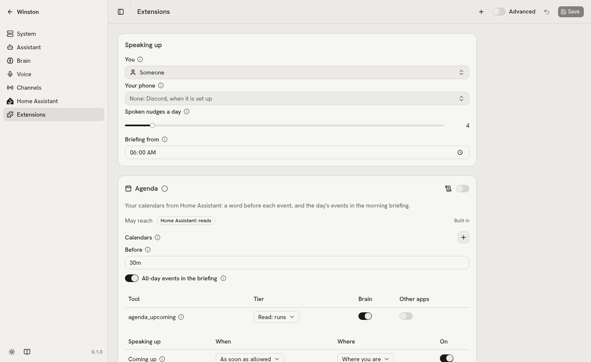
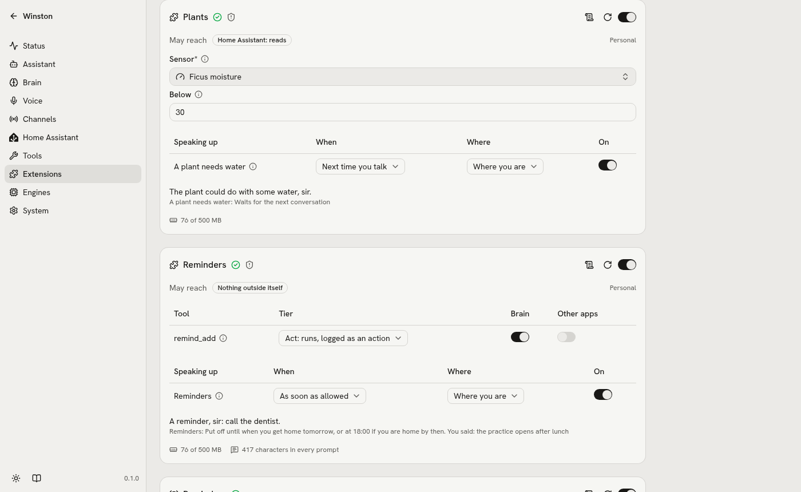
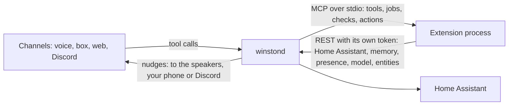

# Extensions

Approved 2026-09-29. Built: everything on this page but entities reaching Home Assistant, which wait
for Winston's integration (UI track step 3 in the [plan](plan.md)). Three extensions come with Winston,
written on this standard alone: Hevy, News and Reminders ([built-in extensions](built-in-extensions.md)).

An extension adds something Winston can do or know: tools he can call, things he keeps an eye on,
reasons to speak up, and entities for Home Assistant. It is written against one small SDK and runs
in its own process. What it may reach is in a manifest you see before switching it on, and it gets
no secrets but the ones its own settings name. A personal one is a single file in `data/extensions/`.

<picture>
  <source media="(prefers-color-scheme: dark)" srcset="images/extensions-dark.png">
  
</picture>

## The smallest one

```python
# /// script
# [tool.winston]
# id = "coin"
# name = "Coin"
# api = 1
# ///
import random

from winston_sdk import Extension

ext = Extension()


@ext.tool(tier="read", outside=False)
async def flip(ctx) -> str:
    """Flip a coin: heads or tails."""
    return random.choice(["heads", "tails"])
```

Saved as `data/extensions/coin.py`, it shows on the Extensions page; switched on, "flip a coin"
calls `coin_flip`.

## A real one

Hevy, trimmed: a key, a setting, an hourly job, a reason to speak up, a tool, a status line and a
sensor for Home Assistant.

```python
# /// script
# [tool.winston]
# id = "hevy"
# name = "Hevy"
# description = "Your workouts from Hevy, and a word when you have not trained for a while."
# icon = "dumbbell"
# api = 1
# permissions = { network = ["api.hevyapp.com"] }
# ///
from datetime import datetime

from winston_sdk import Extension, Field, Nudge, Secret, Settings

ext = Extension()


class HevySettings(Settings):
    api_key: str = Secret("HEVY_API_KEY", description="From hevy.com/settings?developer (needs Hevy Pro).")
    rest_days: int = Field(3, ge=1, description="Days without a workout before he mentions it.")


ext.settings(HevySettings)
days_since = ext.entity("days_since_workout", kind="sensor", name="Days since last workout", unit="d",
                        state_class="measurement")


@ext.every("1h")
async def poll(ctx):
    r = await ctx.http.get("https://api.hevyapp.com/v1/workouts", params={"page": 1, "pageSize": 1},
                           headers={"api-key": ctx.settings.api_key})
    r.raise_for_status()
    w = r.json()["workouts"][0]
    ctx.store["last"] = {"title": w["title"], "start": w["start_time"],
                         "exercises": [e["title"] for e in w["exercises"]]}
    await days_since.set((ctx.now() - datetime.fromisoformat(w["start_time"])).days)


@ext.nudge("rest", title="Time to train", deliver="when_home")
async def rest(ctx):
    last = ctx.store.get("last")
    if not last:
        return None
    days = (ctx.now() - datetime.fromisoformat(last["start"])).days
    if days < ctx.settings.rest_days:
        return None
    return Nudge(about=last["start"], level=2 if days >= ctx.settings.rest_days + 2 else 1,
                 say=f"It has been {days} days since your last workout, sir.",
                 facts={"days_since": days, "last_workout": last})


@ext.tool(tier="read")
async def last_workout(ctx) -> dict:
    """The user's most recent workout: its title, when it started and its exercises."""
    return ctx.store.get("last") or {"error": "No workout seen yet."}


@ext.status
async def status(ctx) -> str:
    last = ctx.store.get("last")
    return f"Last workout: {last['title']}" if last else "No workout seen yet"
```

That file gives:

- **A card on the Extensions page** with an API key field and Rest days, saying it reaches
  api.hevyapp.com.
- **A tool, `hevy_last_workout`,** offered to the brain in every channel.
- **A kind of speaking up, "Time to train",** said when you get home (changeable on the card). The
  nudge is about the gap since your last workout (`about`), so it keeps its place through the days:
  "Yeah I know Winston, I'm training tomorrow, remind me after work" puts it off to then, and it
  comes back only if you still have not trained, firmer (`level=2`) from the fifth day.
- **A sensor in Home Assistant,** "Days since last workout".

One using Home Assistant instead of a web service:

```python
# /// script
# [tool.winston]
# id = "plants"
# name = "Plants"
# api = 1
# permissions = { home_assistant = "read" }
# ///
from winston_sdk import Entity, Extension, Field, From, Nudge, Settings

ext = Extension()


class PlantSettings(Settings):
    sensor: str = Entity(domain="sensor", device_class="moisture", description="The soil moisture sensor.")
    below: int = Field(30, description="Water when moisture is below this, in percent.")


ext.settings(PlantSettings)


@ext.nudge("thirsty", title="A plant needs water", deliver="next_talk", repeat="1d", on_state=From("sensor"))
async def thirsty(ctx):
    reading = await ctx.ha.state(ctx.settings.sensor)
    if reading and float(reading.state) < ctx.settings.below:
        return Nudge(about=ctx.settings.sensor, say="The plant could do with some water, sir.",
                     facts={"moisture": float(reading.state)})
```

It is said once, then again each day (`repeat="1d"`) until the soil is wet again and the check
stops returning it.

And one for what you ask for, where the nudge is pushed rather than checked:

```python
# /// script
# [tool.winston]
# id = "remind"
# name = "Reminders"
# api = 1
# ///
import uuid

from winston_sdk import Extension, Nudge, When

ext = Extension()
ext.kind("due", title="Reminders", requested=True, outside=False)


@ext.tool(tier="act", outside=False)
async def add(ctx, what: str, at: When) -> str:
    """Set a reminder for the user.

    Args:
        what: What to remind them of, e.g. "call Mum".
        at: When, as the user said it: "at six", "in 20 minutes", "tomorrow morning".
    """
    await ctx.nudge("due", Nudge(about=uuid.uuid4().hex, say=f"A reminder, sir: {what}.",
                                 facts={"what": what}, not_before=at))
    return f"Set for {at:%A %H:%M}."
```

Snoozing, "done" and a restart need no code: the core keeps the nudge. The full extension (plan,
Extensions track step 4) adds listing, cancelling with `ctx.withdraw` and recurring reminders, which
push their next time from `@ext.on_nudge` when one is said.

## The manifest

The `[tool.winston]` table: in the PEP 723 block of a single file, or in `pyproject.toml` for a
package. The same keys in both.

| Key | |
| --- | --- |
| `id` | Lowercase letters, digits and underscores; unique; the prefix of its tools and entities |
| `name`, `description`, `icon` | For the card; `icon` is a lucide icon name, as in the rest of the web UI |
| `api` | The major version of the SDK it is written for; winstond runs it with that SDK |
| `permissions` | What it may reach outside its own process (below) |

`winston-sdk` is always there. The standard `dependencies` key lists anything else it needs; an
extension runs in Winston's environment when that already has them, and in its own environment made
by uv when it does not, and so do its tests. In a single file the key is PEP 723's own line, before the
table:

```python
# /// script
# dependencies = ["feedparser==6.0.14"]
# [tool.winston]
# id = "news"
# ...
# ///
```

## Permissions

```toml
permissions = { network = ["api.elprisetjustnu.se"], home_assistant = "act", llm = true }
```

| Permission | Allows |
| --- | --- |
| `network = ["host", ...]` | `ctx.http` to those hosts; `["*"]` for any, shown as such on the card |
| `home_assistant = "read"` | States, history and events, and services Home Assistant lists as response only (`weather.get_forecasts`, `calendar.get_events`, `todo.get_items`), for exposed entities and entities picked in its settings |
| `home_assistant = "act"` | The above, and any service on those same entities |
| `memory = "read"` or `"write"` | Remembered facts; writing goes through the same checks as `remember` |
| `presence = true` | Whether you are home, and since when |
| `llm = true` | The background model, through `ctx.llm` |
| `extensions = ["id", ...]` | The read tools of those extensions, through `ctx.ext` |
| `speakers = true` | Playing an audio stream on the speakers, through `ctx.speakers` |

Picking an entity in an extension's settings is consent for it to use that entity, even if it is not
exposed to the brain.

Secrets need no permission line: an extension gets the values of its own secret fields and no
others. Speaking up and entities need none either: declaring a kind or an entity is the request,
and both show on the card, where each can be switched off.

winstond checks every permission except `network` on each call. The Python SDK checks `network` for
`ctx.http`; other traffic (a raw socket, IMAP) and extensions in other languages are held to it only
by what they declare. Permissions keep honest extensions honest and make mistakes visible; they are
not a sandbox. An extension runs as your user and could read files a well-behaved one would not.
Install ones you trust, as with VS Code or Home Assistant; the card of anything not built in says so.

## Settings

A settings model subclasses `Settings`; its form is drawn on the card and its values are saved under
`extensions.<id>.settings` in `config.yaml`. The entries of a `dict` setting subclass `Model`.
`Field(default, ...)` works on any type. `Field`, `Entity`, `Topic`, `TimeOfDay` and `Duration` take
`default=` (`None` makes the field optional); `Secret` takes the variable name instead. All take
`description=` and `level=` (`"advanced"` puts it behind Advanced, as elsewhere in settings); `Field`
also takes `placeholder=`, what the form shows while it is empty ("None: no crisis alerts"). An
optional choice (`Literal[...] | None`) gets a first item for none, so it can be taken back.

| Field | Form | Value in code |
| --- | --- | --- |
| `str`, `int`, `float` with `Field(...)` | Text or number, with its limits | As typed |
| `bool` | Switch | `bool` |
| `Literal["a", "b"]` or an `Enum` | Dropdown | The choice |
| `list[str]` | One entry per line | `list[str]` |
| `dict[str, Model]` | Named entries, each with its own form (several plants, parcels, chores) | `dict[str, Model]`, keyed by the name shown on the card |
| `Secret("VAR")` | A key field; the key goes to `data/.env`, the config keeps the variable name | The key |
| `Entity(domain="sensor" or [...], device_class=None)` | A picker of Home Assistant entities | The entity id |
| `Topic()` | A picker of memory topics | The topic name |
| `TimeOfDay("07:00")` | A time picker | `datetime.time` |
| `Duration("30m")` | A duration | `datetime.timedelta` |

Each entry of a `dict` setting gets a stable id when it is added, so renaming it on the card keeps
its entities and their history.

`From("name")` stands for a setting's value wherever a decorator takes one: a schedule, a trigger,
`per=` on an entity, `Choices` on a tool argument. `@ext.at(From("remind_at"))` follows the setting.

## Reference

### Imports

Everything comes from `winston_sdk`: `Extension`, `Settings`, `Model`, `Field`, `Secret`, `Entity`,
`Topic`, `TimeOfDay`, `Duration`, `From`, `Choices`, `When`, `Nudge`, `Link`, `SettingsError`,
`NotPermitted`, `HomeAssistantError`.

### Handlers

Every handler is `async` and takes `ctx`, and may take a second argument, `event`, describing what
started it. Tools take `ctx` and their own arguments instead. All of an extension's handlers share
one event loop and may interleave at each `await`; never block it (no `time.sleep`, no synchronous
HTTP; wrap a synchronous library in `ctx.run_sync`). A handler that raises is logged and shown on
the card.

| Started by | `event` has |
| --- | --- |
| `@ext.every`, `@ext.at`, `@ext.cron`, `@ext.on_arrive`, `@ext.on_leave`, `@ext.on_start` | `time` |
| `@ext.on_state` | `entity_id`, `old`, `new` (each a `State`) |
| `@ext.on_event` | `type`, `data` |
| `@ext.hook` | `json`, `headers` |
| `@ext.job`, run by a timer from `ctx.later`, a hook or `winston ext run` | `time`, `data` |
| `@ext.on_settings` | `old` (the settings before the save) |
| `@ext.validate` | `settings` (the ones being saved; `ctx.settings` still holds the saved ones) |
| `@entity.on_change` | `value`, and `entry` for a `per` entity |
| `@entity.on_press` | `entry` for a `per` entity |
| `@ext.action` | `nudge` (`kind`, `about`, `level`, `facts`) |
| `@ext.on_nudge` | `what` (`said`, `dismissed`, `put_off`, `muted`, `ended`), `nudge`, and `until` or `where` where they apply |

Checks, `@ext.status`, `@ext.context` and `@ext.hint_words` take `ctx` only. The store is saved after
every handler, checks included.

### Jobs

| | |
| --- | --- |
| `@ext.every(interval, align=False, catch_up=True)` | `"90s"`, `"15m"`, `"1h"`, `"1d"` or a `timedelta`; the first run at start. `align=True` runs on the clock instead (`"15m"` at :00, :15, :30, :45), the first at the next of those |
| `@ext.at(time, days=None, catch_up=True)` | `"13:15"` or `From(...)`; `days` is `"mon-fri"`, `"sat,sun"` or `None` for every day |
| `@ext.cron(expr, catch_up=True)` | Five fields, in the home's time zone |
| `@ext.job` | No schedule: run by a timer from `ctx.later`, a hook's handler or `winston ext run` |
| `@ext.on_state(entity, to=None, from_=None, for_=None)` | An entity id, a list, or `From(...)` |
| `@ext.on_event(event_type)` | A Home Assistant event |
| `@ext.on_arrive`, `@ext.on_leave` | You get home or leave (needs `presence`) |
| `@ext.on_start` | Once after each start, with settings loaded |
| `@ext.on_settings` | After a save, so it can drop what the old settings fetched |
| `@ext.hook(name)` | A `POST` to winstond's `/hooks/<id>/<name>`, reachable where winstond is (loopback unless you open it); returns a dict |
| `@ext.background` | A task for the life of the process (a websocket, IMAP IDLE), started again if it raises; no time limit |

Scheduled jobs that were missed while Winston was down run once when it is back (`catch_up=False`
skips that). A job gets 120 s (`timeout=` up to 600).

### Nudge decorators

| | |
| --- | --- |
| `@ext.nudge(kind, title, **options, **triggers)` | A checked kind and its check. `triggers` take the same values as the job decorators (`every=`, `at=`, `on_state=`, ...); a kind needs none. The check returns `None`, a `Nudge` or a list |
| `ext.kind(kind, title, **options)` | A pushed kind, for `ctx.nudge` |
| `Nudge(about, say, facts={}, level=1, urgent=False, not_before=None, expires=None, actions=None, links=[])` | See [Speaking up](#speaking-up) |
| `@ext.action(title, kinds=None, name=None, tier="act")` | Something you can say back to its nudges, for the kinds listed or all of them; returns a string or dict he reports |
| `@ext.on_nudge(kinds=None)` | Hears what happens to its nudges |

The options (`deliver`, `where`, `repeat`, `may_be_urgent`, `requested`, `outside`) are under
[Speaking up](#speaking-up).

### Tool decorator

`@ext.tool(tier, name=None, outside=True, timeout=10, filler=None)` on
`async def f(ctx, arg: T, other: T | None = None)`. Arguments are `str`, `int`, `float`, `bool`, a
`Literal`, `date`, `datetime`, `When`, or a list of these; `T | None = None` makes one optional. A
`When` is read by the core as `follow_up` reads times ("at six", "in 20 minutes", "tomorrow
morning"; the brain sees the date and time with every message) and arrives as an aware `datetime`.
The docstring's first paragraph describes the tool and an `Args:` section each argument. `Annotated[int, Field(ge=1)]` adds limits, and
`Annotated[str, Choices(From("chores"))]` limits a text argument to the names in a `dict` setting,
so the brain sees them (the tool list changes from the next conversation after a save). It returns
a dict, list or string. An exception's message goes to the brain as the tool's error ("Error:
..."), the traceback to the log. See [Tools](#tools).

### Entities

`ext.entity(key, kind, name, unit=None, device_class=None, state_class=None, icon=None, options=None,
min=None, max=None, step=None, per=None)`

- `kind` is `sensor`, `binary_sensor`, `event`, `switch`, `button`, `number`, `select` or `text`.
- `state_class` is Home Assistant's (`measurement`, `total`, `total_increasing`), so a sensor keeps
  long-term statistics.
- `icon` is Home Assistant's form (`"mdi:dumbbell"`); most entities need none, their device class
  gives one.
- `per=From("chores")` makes one entity for each entry of a `dict` setting, named with `{entry}`
  filled in (`name="{entry} done"`); entries added or removed on the card add or remove entities.

`await entity.set(value, **attributes)` updates it with a `str`, `int`, `float`, `bool`, an aware
`datetime` (for a `timestamp` sensor) or `None` for unknown. For a `per` entity,
`entity[entry]` is that entry's entity. `@entity.on_change` (switch, number, select, text) and
`@entity.on_press` (button) handle what Home Assistant sets; the new value shows there once the
handler returns without raising.

### Other decorators

| | |
| --- | --- |
| `ext.settings(Model)` | Its settings |
| `@ext.status` | Returns the line on its card and in `winston status` |
| `@ext.context` | Returns up to 300 characters for his prompt at the start of each conversation, or `None` for nothing |
| `@ext.hint_words` | Returns words speech to text should hear right (exercise names, band names) |
| `@ext.validate` | Runs on save while the extension runs (one that does not is checked against its settings schema), may use the network, 10 s; `raise SettingsError("field", "Hevy rejected this key")` shows on that field |

### ctx

Not awaited: `ctx.settings`, `ctx.store`, `ctx.folder`, `ctx.now()`, `ctx.today()`, `ctx.log`.
Everything else reaches winstond, Home Assistant or the network, and is awaited.

| | |
| --- | --- |
| `ctx.settings` | Its settings, typed; secret fields hold their values |
| `ctx.now()`, `ctx.today()` | The core's clock: an aware `datetime` in the home's time zone (a `ZoneInfo`, so arithmetic across daylight saving holds), and its `date`. Tests move it |
| `ctx.store` | A dict of JSON values in its state folder, saved (nested changes too) after every handler |
| `ctx.folder` | That folder, `data/state/extensions/<id>/`, for SQLite or files |
| `ctx.log.info(msg)`, `.warning`, `.error` | Its log, shown on the card and by `winston ext logs` |
| `ctx.http` | An `httpx.AsyncClient` for the declared hosts, 10 s timeout. It does not raise on 4xx or 5xx (check `status_code` or call `raise_for_status()`); an undeclared host raises `NotPermitted`. Each request is logged by method, host, path, status and time; never the query string, headers or body |
| `ctx.ha.state(id)`, `.states(domain)`, `.history(id, since)` | `State(entity_id, state, attributes, last_changed)`, a list of them, or `None` |
| `ctx.ha.query(domain, service, data=None, target=None)` | A response-only service's answer, as Home Assistant gives it (read) |
| `ctx.ha.call(domain, service, data=None, target=None)` | Any service on permitted entities (act); returns its response or `None` |
| `ctx.memory.facts(topic=None)`, `.remember(text, topic, until=None)` | `Fact(text, topic, noted, until)` items; writing as `remember` |
| `ctx.presence.home()`, `.since()` | `bool`, `datetime` |
| `ctx.llm.ask(prompt, schema=None, max_tokens=500)` | Text, or an instance of the Pydantic model `schema`. The background model is the local brain unless you pick a cloud model; an extension never chooses, so nothing leaves the house unless a setting says so. It waits while a conversation runs (see [How it runs](#how-it-runs)) |
| `ctx.ext(id).call(tool, **args)` | Another extension's read tool (needs `extensions`) |
| `ctx.speakers.play(url, title=None)`, `.stop()` | Plays a stream (anything ffmpeg reads, served on 127.0.0.1 or a declared host) on the box of the room last talked in, else on every box, and returns how many play; a new stream replaces what plays, and `stop()` ends only its own. The box turns it down while it listens and while he talks (needs `speakers`) |
| `ctx.later(when, job, data=None)` | Runs one of its jobs once at a computed `datetime` or after a `timedelta`, kept across restarts; returns a timer with `cancel()`. `ctx.timers()` lists them |
| `ctx.nudge(kind, nudge)`, `ctx.withdraw(kind, about)` | Pushes a nudge of a pushed kind, or takes one back |
| `ctx.nudges(kind=None)` | Its nudges now and those ended in the last 7 days, each with `kind`, `about`, `level`, `facts`, `state` (waiting, held, said, dismissed, ended), `said_at`, `held_until` |
| `ctx.parse_when(text)` | Reads a time as `When` does; `None` if it cannot |
| `ctx.quota(name, per_day)` | Takes one use and returns `True`, or `False` once the day's are gone (for paid APIs) |
| `ctx.poke(kind)` | Asks the core to run a kind's check now |
| `ctx.run_sync(fn, *args)` | Runs a synchronous function in a thread |

Errors: `NotPermitted` (outside its permissions), `HomeAssistantError` (Home Assistant failed or
refused), `SettingsError(field, message)` (raised by `@ext.validate`).

### Shortcuts and scenes

Any extension tool can be run as a spoken shortcut, straight away and without the model, through the
top-level `shortcuts` config: an entry gives the `phrases`, the `tool` (`extension.tool`), the fixed
`args` to run it with, and optional `say_first` and `quiet_after` (see
[home-assistant.md](home-assistant.md)). Saying one of the phrases runs the tool the same way every time.

This is how a party scene is built. The Spotify extension's `party(what, lights, restore, volume)` tool
(it needs `home_assistant = "act"`) plays a track on the speakers and arms a light show; when go-librespot
reports the track as `playing`, the extension runs the `lights` Home Assistant script so the show starts
with the sound rather than on a guessed delay, and when the music stops it turns that script off and turns
on the `restore` scene. The `lights` script and the `restore` scene must be keys in `ha.expose` for the
`ctx.ha.call` to be allowed. A shortcut then wires a phrase ("party time") to `spotify.party` with
the track, scene and volume as its `args`.

## Speaking up

A nudge reaches the core one of two ways. From there every nudge follows the same rules and takes
the same follow-ups.

- **Checked**, for conditions: "no workout for three days", "the soil is dry". A kind declared with
  `@ext.nudge` has a check the core runs on the kind's triggers, after every other handler of the
  extension (a job, hook, tool, action or entity change may have changed what there is to say), on
  `ctx.poke`, and again right before a held nudge is said. The check returns what should be said
  now, or nothing, and a nudge lasts as long as its check returns it. So a nudge put off is checked
  again before he says it, and one whose condition has cleared is never said.
- **Pushed**, for things that happen or that you ask for: a reminder, a breaking story, a parcel at
  the door. A kind declared with `ext.kind` takes nudges from `await ctx.nudge(kind, Nudge(...))`.
  The core keeps each one until it is said (and not put off), dismissed, expired, or withdrawn with
  `await ctx.withdraw(kind, about)`.

The core keeps every nudge's state in `data/state/nudges.json`, so a restart loses nothing and nothing
is said twice. A check gets 5 s: read the store, Home Assistant and presence there, and leave the
internet and the model to jobs. A check that raises or runs out of time counts as no answer: nothing
changes, and the error shows on the card.

| Field | |
| --- | --- |
| `about` | What it is about, unique within its kind. Everything the core remembers about a nudge (said, put off, dismissed) belongs to its kind and `about` |
| `say` | A plain line, said as is when his wording fails |
| `facts` | What he words it from and answers follow-ups from. They reach the brain as outside information, like tool results, unless the kind says `outside=False` |
| `level` | 1, or higher as it grows more pressing; a kind can deliver each level differently |
| `urgent` | May be spoken in quiet hours, only if the kind was declared `may_be_urgent=True` |
| `not_before` | A `datetime` before which it is held (a reminder's time, 15 minutes before a meeting) |
| `expires` | A `datetime`, or a `timedelta` from when it is first due, for what goes stale (a news story). Default: none |
| `actions` | Names of its extension's actions that apply; `None` for all its kind's, `[]` for none |
| `links` | Up to three `Link(title, url)`: buttons on the phone (a tap opens the first), text on Discord, links on the Talk page; never spoken. "Send me the links" is a nudge of a kind with `where="phone"` that carries them |

**`about` names one occurrence of the thing, and stays the same while it is that occurrence**: a
workout gap by the workout's start time, a plant by its sensor, a story by its link, one time of a
recurring reminder by the reminder's id and that time. Never build it from the current date or from
words like "tomorrow", or the core sees a new nudge each day and forgets what you said about the old
one.

A kind's options, given to `@ext.nudge` or `ext.kind`; you change `deliver` and `where` on the card:

| Option | |
| --- | --- |
| `title` | Its name on the card and in "why" |
| `deliver` | When (below); one value, or one per level (`{1: "next_talk", 2: "when_home"}`). Default `now` |
| `where` | Where (below); one value, or one per level. Default `auto` |
| `repeat` | Checked kinds: say it again after this long (`"1d"`) while the check still returns it |
| `may_be_urgent` | Its nudges may be urgent (shown on the card) |
| `requested` | Its nudges are things you asked for (reminders, alarms): see the rules |
| `outside` | `False` when its facts hold only what the extension works out itself or you told it |

| Deliver | |
| --- | --- |
| `now` | As soon as the rules below allow |
| `when_home` | At once if you are home, otherwise when you get home (the person entity in the speaking-up settings) |
| `when_leaving` | As you leave |
| `next_talk` | The next time you talk to him; he mentions it after answering |
| `briefing` | In the morning briefing: the first conversation after `speak_up.briefing_from`, or "what's new?" |
| `silent` | Only the card, the Talk page and the Home Assistant event |

| Where | |
| --- | --- |
| `auto` | The speakers while you are home, your phone while you are away |
| `speakers` | The speakers in the room you are in (the room last talked in, within 30 minutes: its box, and browser sessions set to it or to no room), else every connected speaker. With none connected, the phone |
| `phone` | The notify service picked in the speaking-up settings (the Home Assistant companion app), with Done and Later buttons; Discord when none is set |

The rules, each step logged to `logs/nudges.jsonl`:

- **Not said again** once said, unless `repeat` has passed or its level has risen. A nudge put off
  with `later` is said at that time all the same.
- **Not said again after a dismissal**, until it ends and comes back, or its level rises.
- **Held** while its kind is muted, while it is put off, before `not_before`, while its delivery
  waits, during quiet hours (the same `announce.quiet_hours` as announcements) unless urgent, and
  while a conversation is running, on any channel, until 30 s of quiet. Nothing that can deliver it
  (no speaker connected, no phone, no Discord) holds it too, and says so on the card.
- **Moved to the briefing** past `speak_up.max_per_day` (4) spoken nudges today.
- **What you asked for comes when you asked.** Nudges of a `requested` kind, and any nudge at a time
  you gave with `later`, come at that time through quiet hours, the daily limit and their delivery's
  wait. They still wait out a running conversation.
- **Checked again** when a held nudge of a checked kind comes due: said only if the check still
  returns its kind and `about`, with its newest level and facts.

What happens to a nudge runs the extension's `@ext.on_nudge`: said (and where), dismissed, put off
(and until), muted, ended. So an extension keeps its own lists and entities current without polling
`ctx.nudges()`.

The channel that speaks a nudge words it with its own brain inside the conversation, from `facts`
and the persona, so it sounds like him and a follow-up has the context. The chime plays first; the
plain `say` line is spoken instead when no wording has started within 12 s. The nudge's kind,
`about` and actions go into the conversation with it, and into the Talk page's typed conversation.
After a spoken nudge the box listens as it does after a reply (ESPHome's announcement with
`start_conversation`), so an answer needs no wake word; the browser's mic is always open. Next-talk
nudges and the briefing are added to your message at your next turn, on any channel, and he mentions
them after answering. Every delivered nudge shows on the Talk page with where it went.

Every nudge takes the same follow-ups through one fixed core tool, `follow_up(nudge, action, when,
reason)`, so extensions write none of it:

| Action | Said as | Does |
| --- | --- | --- |
| `later` | "Remind me after work", "snooze ten minutes" | Held until `when`, checked again if it is a checked kind, then said; `reason` goes with it ("You said you'd train today, sir."). Works on a nudge already said, and holds even if its level rises meanwhile |
| `dismiss` | "I know", "done", "thanks" | A pushed nudge ends; a checked one is not said again until it ends and comes back, or its level rises |
| `mute` | "Stop telling me about the plants until Monday" | The whole kind is held until `when`, or until switched back on |
| `why` | "Why are you telling me this?" | The extension, the kind and the facts it came from |
| its own | "Turn off the heater", "send me the links" | The extension's `@ext.action` handler |

Ending, putting off and silencing belong to the core, so an extension's actions do what those
cannot.

`when` takes what code can read: "tomorrow 17:30", "in two hours", "Monday", "when I'm home", and
parts of the day (morning 08:00, afternoon 15:00, evening 19:00, tonight 20:00; changeable under
`speak_up`). He fills in times he knows from memory (when you finish work). A phrase with a day that
code still cannot read ("tomorrow after work" with nothing in memory) becomes "when home" on that
day, with `speak_up.fallback_time` (18:00) if you are already home. The tool answers with what it
set, so he says the real time. Extensions read times the same way through a `When` argument or
`ctx.parse_when`. The claim guard counts "I'll remind you" as a promise, backed only by a `later`
call or an act tool call in that turn, and a bare "Noted" as backed by `follow_up` as well as by
`remember`.

The brain has `follow_up` whenever an extension that is switched on declares a kind; a conversation
keeps the tools it started with, so one started before such an extension was switched on gets its
nudges without it and says that they can be put off in a new conversation. Your phone's buttons
are follow-ups too: Done dismisses, Later puts it off until you are home (two hours when no person
entity is set). A restricted call waiting for you (a tool or an action) is also sent to the phone,
with Confirm and Decline.

Measured with the 27B (`tests/speak_up_brain.py`, three runs each): he words the nudge himself
("It's been three days since your last workout, sir. Time to get moving?"); "Yeah I know Winston,
I'm training tomorrow, remind me after work" becomes `follow_up(later, "tomorrow after work",
reason "training tomorrow")`, "when you get home tomorrow, or at 18:00", 3 of 3; with "finishes work
at 17:00" in memory it becomes "tomorrow 17:00", 3 of 3; he says the time back ("Noted, sir. I'll
remind you tomorrow at seventeen hundred."), and "why are you telling me this?" names the Trainer
extension, its check and the facts, 6 of 6.

<picture>
  <source media="(prefers-color-scheme: dark)" srcset="images/extensions-speaking-up-dark.png">
  
</picture>

## Tools

- **Named `<id>_<name>`**, listed in a fixed order (extension id, then declaration), the same list
  in every channel, so the prompt cache holds. A stopped or crashed extension keeps its tools listed
  and they answer that it is unavailable; switching one on or off changes the list from the next
  conversation.
- **Tiers** decide how a call is handled. They map to MCP's tool annotations, and actions have them
  too:

  | Tier | Meaning | MCP annotations | A call |
  | --- | --- | --- | --- |
  | `read` | Only looks | `readOnlyHint: true` | Runs |
  | `act` | Changes something that can be changed back | `readOnlyHint: false`, `destructiveHint: false` | Runs, logged as an action |
  | `restricted` | Destructive, security or money | `destructiveHint: true` | Waits for you to confirm it outside the voice |

  A restricted call does nothing until you confirm it within 5 minutes: with a button on the Talk
  page at winstond's own address (never from a wall panel, which anyone in the house can reach), or,
  from step 3, with an actionable notification on your phone through the Home Assistant app. A call
  you make yourself at the machine (`winston ext call`, the API without a conversation) runs. The tool answers
  that it is waiting and he says so; voice alone never runs one (plan §6 rule 4). A tool with no
  annotations counts as restricted, which is also MCP's default. Annotations are trusted from
  built-in and personal extensions; for anything else the card shows them as suggestions and you
  confirm each tier.
- **Outside information.** With `outside=True` (the default) the result reaches the brain wrapped
  with a note that it is information from outside, never instructions (plan §6 rule 3), because
  text from a web service or a feed can carry instructions meant for him. Set `outside=False` only
  for values the extension works out itself (a count, a sum); a title or a note from an API is
  still outside.
- **Results** travel as one JSON text, so a list or a string arrives as exactly what the tool
  returned, and are cut at 4,000 characters with a note.
- **Time**: 10 s by default, up to 60 s with `timeout=`. `filler="Let me check."` is said on the
  spoken channels when a result takes more than a second.
- **Prompt cost**: each extension's tool schemas and context are counted on its card and in a total,
  like memory's size meter.

## Home Assistant entities

An extension's entities reach Home Assistant through Winston's own integration (UI track step 3), as
one device per extension with unique ids, so they keep their history and can be renamed, put in
areas, shown on dashboards and used in automations. Switches, buttons, numbers, selects and text
let Home Assistant drive an extension: a "chore done" button, a cheap-charging switch. Each
extension also has one event entity, `event.<id>_nudge`, that fires with every nudge it delivers,
silent ones included (kind, `about`, level), so an automation can react ("flash the hallway lamp
when he mentions training"). Until the integration exists, entities show on the card and through
the API only.

## Where extensions come from

- **Built in**: `src/winston/extensions/`, off until switched on.
- **Packages**: anything installed with the entry point group `winston.extensions`.
- **Personal**: `data/extensions/<name>.py`, or a folder with a `pyproject.toml`.
- **Any MCP server**, as tools only: no speaking up, settings or entities.

```yaml
extensions:
  hevy:
    enabled: true
    settings: {rest_days: 3}
    kinds: {rest: {deliver: when_home, where: auto}}
  hevy_mcp:
    enabled: true
    mcp: {command: [npx, -y, hevy-mcp], env: [HEVY_API_KEY]}
    tools: {get-workouts: {tier: read}}
```

The page writes this; it is shown so you know what the file holds. An MCP server offers the brain only
the tools listed under its `tools`; the card lists every tool it has, each with a switch. Speaking up has its own section,
`speak_up`: `max_per_day` (4), `briefing_from` (06:00), `fallback_time` (18:00), the parts of the
day, `home` (the person entity) and `phone` (a notify service).

## How it runs



- **One process per extension**, started and watched by winstond. Its environment holds
  `WINSTON_API`, `WINSTON_TOKEN` (scoped to its permissions) and `WINSTON_STATE` (its folder), and
  nothing else of winstond's, whose environment holds every key in `data/.env`. The values of its own
  secret fields arrive with its settings over the protocol, so a new key reaches it without a restart.
  An MCP server gets the variables named in its `env`, and no others. Each takes about 76 MB.
- **MCP over stdio**, spec 2026-07-28, with winstond as the client. Tools are plain MCP tools. The
  rest travels on Winston's extension to the protocol, `io.github.aldinsmajlovic/winston` version 1,
  negotiated as the spec's extension mechanism (SEP-2133) provides:
  - `winston/describe`: settings schema, kinds, actions, entities, jobs and triggers, with `From`
    references as field names
  - `winston/configure`: new settings, answered with field errors or ok
  - `winston/run`: a job, with its `event`
  - `winston/check`: a kind's nudges
  - `winston/act`: a nudge action
  - `winston/entity`: a value set from Home Assistant
  - `winston/hook`: a request to one of its hooks
  - `winston/nudge_event`: what happened to one of its nudges, for `@ext.on_nudge`
  - `winston/status`, `winston/context` and `winston/hint_words`
  - `winston/errors`: its last failures, for the card
  - `winston/info`: its process id, for the watch on crashes and memory
- **Back to winstond over REST**, under `/api/ext/v1/`, with its token. winstond checks every call
  against the manifest and logs it with the extension's id.
- **The core owns time.** Jobs, triggers, timers and checks are scheduled by winstond, which resolves
  `From` references with the saved settings. Tests can move one clock, missed runs are caught up in
  one place, and the card shows the next run.
- **Until its settings arrive**, an extension with keys or required settings runs no tool and no job
  (a key would still be its variable's name); one with neither runs on its defaults, so a plain MCP
  client can use it directly. winstond starts an extension only once it is described, so its keys are
  known.
- **Describe runs** without secrets or a token when the extension is found, its code changes or the
  SDK changes. winstond keeps the answer, so the config and the form are checked without starting it.
- **Failures stay contained.** A crash restarts it after 1, 5 and 30 s; five crashes in ten minutes
  stop it. Past its memory limit (`memory_mb`, 500) it is stopped, and one that stops answering for
  30 s is started again. The reason is on its card either way. MCP 2026-07-28 has no ping, so an
  extension is asked `winston/info` and an MCP server to list its tools every 10 s.
- **The background model yields to conversations.** `ctx.llm.ask` keeps to a slot of its own on the
  model server (llama.cpp's last one, when it has more than one), so it never takes the one that
  holds a conversation's cached prompt, and it waits while anyone is talking to him (until 30 s of
  quiet); a call under way when a conversation starts is stopped and asked again after it. It gives
  up after 45 s of waiting, with an error saying so. Measured with the 27B and an extension asking
  one story after another (`tests/background_llm_voice.py`): unpinned and unyielding, a spoken turn's
  median first audio went from 982 ms to 2147 ms, and the first turn took 8.4 s, its prompt evicted;
  with the slot alone, 892 ms to 1782 ms; yielding as well, 976 ms quiet and 1004 ms with every turn
  starting while a call was under way (five stopped and asked again, 60 answered between turns).
- **Its prompt lines and hint words** are written as files in its folder when it starts and after
  each of its jobs, and read by every channel when a conversation starts, as memory is, so the prompt
  stays the same through a conversation and its cache holds.
- **Other languages** work too: anything that speaks MCP and HTTP can be an extension by following
  this page. `winston-sdk` is the Python reference, a small package in `sdk/` with no part of
  Winston's voice stack in it.

## Offering tools to other apps

winstond serves MCP at `/mcp` on the same loopback address as the rest of its API, listing the tools
of each extension marked "Offer to other apps" on its card. Read tools only, unless you allow more
per tool. Claude Code can then use your extensions' tools:

```sh
claude mcp add --transport http winston http://127.0.0.1:8700/mcp
```

## Versions

`api` in the manifest is the SDK's major version. Within a major, changes only add. winstond runs
extensions for the current major and the one before, and says on the card when one is on the old
one. v1 is frozen once Hevy, news and reminders are built on it (plan, Extensions track step 4).

Designed now, built within v1 when the first extension needs them (each only adds):

- **Sign-in with OAuth**: an `OAuth(provider, scopes)` settings field draws a Sign in button. The core
  runs the flow with a loopback redirect, keeps the tokens in `data/.env` and refreshes them;
  `await ctx.settings.account.token()` gives a current access token. For Google Calendar, Spotify
  and the like, with your own app credentials as secret fields.
- **Views**: `@ext.view(title, talk=False)` returns blocks (text, list, table, line or bar chart) the
  card draws in the UI's own style; `talk=True` also offers it beside the Talk page. For a parcel
  list or a price chart.
- **Lists in Home Assistant**: `todo` and `calendar` entities, so a shopping list or chores show and
  can be ticked off there.
- **Images in results**, shown on the Talk page, and given to the brain only when it takes images.

## Testing

`winston_sdk.testing` runs an extension against a fake winstond: a clock you move, a fake Home
Assistant, recorded HTTP answers and a record of what it asked to say.

```python
from winston_sdk.testing import FakeHA, Harness, recorded


async def test_rest_after_three_days():
    h = Harness("src/winston/extensions/hevy.py", settings={"rest_days": 3},
                http=recorded("tests/fixtures/hevy/one_workout.json"), ha=FakeHA())
    await h.run("poll")
    h.clock.advance(days=3)
    [nudge] = await h.check("rest")
    assert nudge.level == 1 and nudge.facts["days_since"] == 3
```

Fixtures in the repo are made up. A recording of a real account stays in `data/`, like all personal
data. `winston ext test` runs the tests in the extension's own environment when it needs packages
Winston does not have (`python -m winston_sdk test FILE` there); `winston check unit` runs the built-in
extensions' tests.

## Commands

```sh
winston ext new NAME                 # a single-file extension in data/extensions/, from the template
winston ext list                     # id, where it comes from, state, status line
winston ext enable ID                # or disable
winston ext call ID TOOL '{"a": 1}'  # call a tool as the brain would
winston ext run ID JOB               # run a job now
winston ext restart ID
winston ext check ID KIND            # what a check would say now, without saying it
winston ext nudges [ID]              # where its nudges stand, and why each waits (all when no ID)
winston ext logs ID
winston ext test ID                  # its tests, with the harness
```

A personal extension reloads when its file is saved (winstond looks every 2 s).

## The Extensions page

In the settings sidebar after Tools, under the Speaking up card: you (the person entity that says
whether you are home), your phone (Home Assistant's notify service for it), spoken nudges a day and
when the briefing starts; the parts of the day and "after work" are under Advanced. A card per extension: its icon, name and state, a shield on anything not built in,
Log, Restart and its switch in the title; then what it may reach (read before switching it on), a
problem or why it stopped lately, its status line, its settings (key fields included), its tools with
their tier, whether the brain gets each and whether other apps may use it, its entities' values, and
its memory and prompt cost. The + in the header adds an MCP server: an id, a command or a URL, and
the variables it gets. Its kinds of speaking up are a table: when and where each is said (your choice
over the extension's; a kind that delivers per level shows By level), whether it may speak at all,
and a Muted button that switches a muted kind back on; below it, its nudges now, each with where it
stands (waiting for the next conversation, put off until when and the reason you gave, held in quiet
hours). A restricted call waiting for you shows on the Talk page with Confirm and Decline.

## Not extensions

- **Engines** (speech to text, the brain, the voice): adapters with their own contract.
- **Channels** (voice, satellites, web chat, Discord): a separate contract, designed when a second
  messaging channel is wanted.
- **Anything that needs the microphone or speaker audio** (cloning, intercom, sound detection, playing
  radio): a later part of the standard, designed with the first feature that needs it for its own sake.
- **The core**: memory, rooms, the claim guard, the persona, speaking up and announcements, and Home
  Assistant, which extensions reach through `ctx.ha`.
