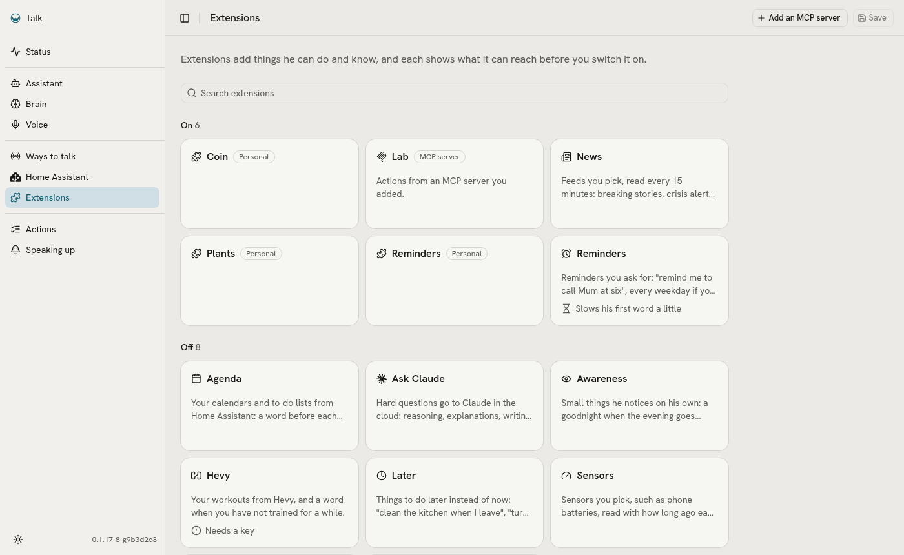
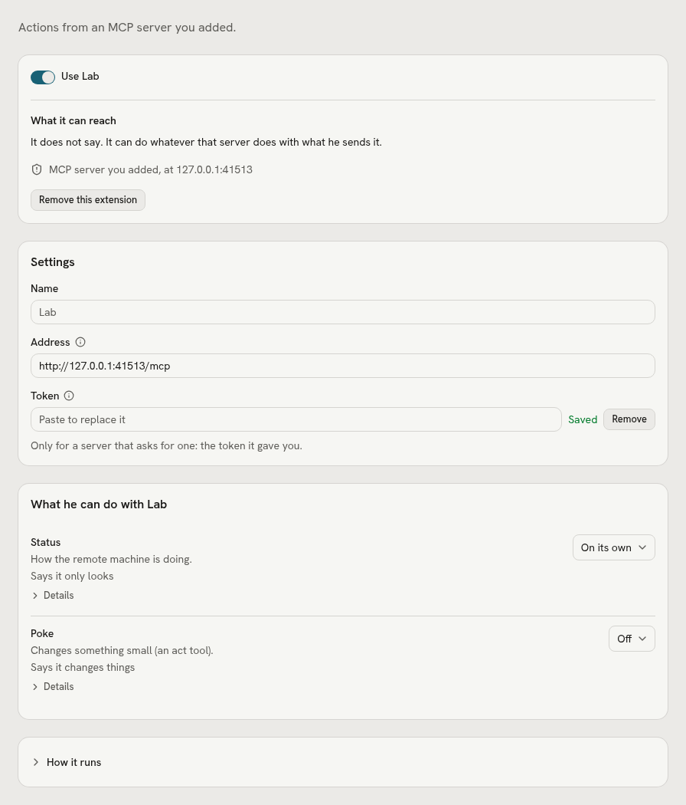
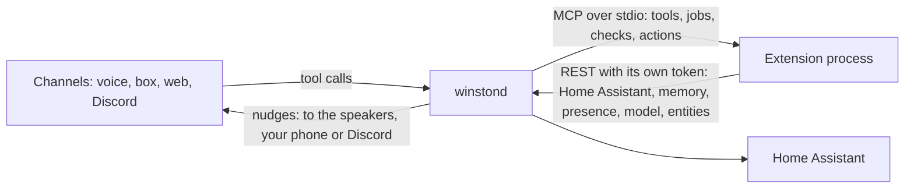
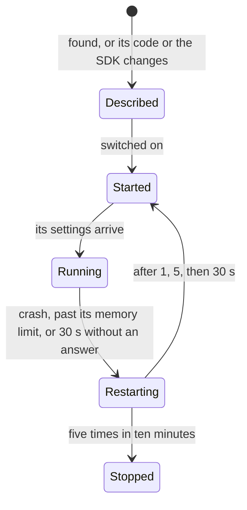
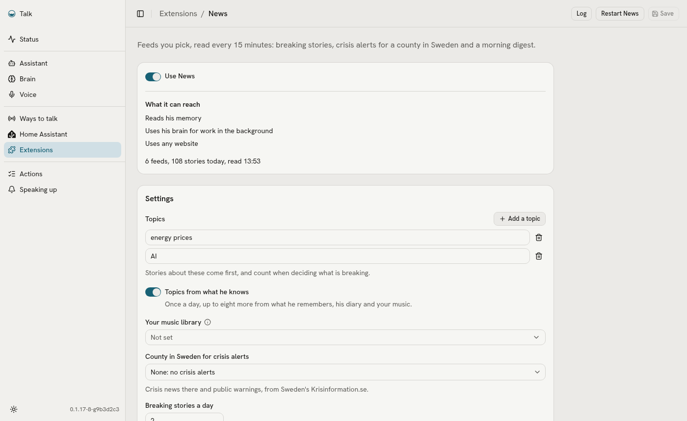
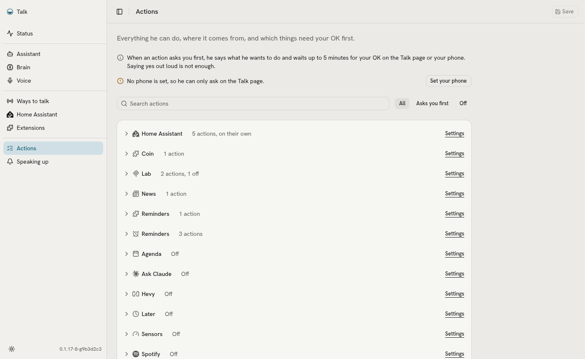

# Extensions

An extension adds something Winston can do or know: tools he can call, things he keeps an eye on,
reasons to speak up, and entities for Home Assistant. This page is the standard and how to write one.
The [SDK reference](extension-sdk.md) lists every settings helper, decorator and `ctx` call,
[speaking up](speaking-up.md) covers nudges, and the ten that come with Winston are in
[built-in extensions](built-in-extensions.md).

An extension is written against one small SDK and runs in its own process. What it can reach is in
its manifest, shown in words on its page before you switch it on, and it gets no secrets but the ones
its own settings name. A personal one is a single file in `data/extensions/`.

<picture>
  <source media="(prefers-color-scheme: dark)" srcset="images/extensions-dark.png">
  
</picture>

## The smallest one

```python
# /// script
# [tool.winston]
# id = "coin"
# name = "Coin"
# api = 1
# ///
import random

from winston_sdk import Extension

ext = Extension()


@ext.tool(tier="read", outside=False)
async def flip(ctx) -> str:
    """Flip a coin: heads or tails."""
    return random.choice(["heads", "tails"])
```

Saved as `data/extensions/coin.py`, it shows on the Extensions page. Switched on, "flip a coin"
calls `coin_flip`. `winston ext new NAME` starts one from the template.

## A real one

Hevy, trimmed: a key, a setting, an hourly job, a reason to speak up, a tool, a status line and a
sensor for Home Assistant.

```python
# /// script
# [tool.winston]
# id = "hevy"
# name = "Hevy"
# description = "Your workouts from Hevy, and a word when you have not trained for a while."
# icon = "dumbbell"
# api = 1
# permissions = { network = ["api.hevyapp.com"] }
# ///
from datetime import datetime

from winston_sdk import Extension, Field, Nudge, Secret, Settings

ext = Extension()


class HevySettings(Settings):
    api_key: str = Secret("HEVY_API_KEY", label="API key", help="From hevy.com/settings?developer; it needs Hevy Pro.")
    rest_days: int = Field(3, ge=1, title="Days without training before he mentions it")


ext.settings(HevySettings)
days_since = ext.entity("days_since_workout", kind="sensor", name="Days since last workout", unit="d",
                        state_class="measurement")


@ext.every("1h")
async def poll(ctx):
    r = await ctx.http.get("https://api.hevyapp.com/v1/workouts", params={"page": 1, "pageSize": 1},
                           headers={"api-key": ctx.settings.api_key})
    r.raise_for_status()
    w = r.json()["workouts"][0]
    ctx.store["last"] = {"title": w["title"], "start": w["start_time"],
                         "exercises": [e["title"] for e in w["exercises"]]}
    await days_since.set((ctx.now() - datetime.fromisoformat(w["start_time"])).days)


@ext.nudge("rest", title="Time to train", deliver="when_home",
           description="Says so when you have not trained for the days you set.")
async def rest(ctx):
    last = ctx.store.get("last")
    if not last:
        return None
    days = (ctx.now() - datetime.fromisoformat(last["start"])).days
    if days < ctx.settings.rest_days:
        return None
    return Nudge(about=last["start"], level=2 if days >= ctx.settings.rest_days + 2 else 1,
                 say=f"It has been {days} days since your last workout, sir.",
                 facts={"days_since": days, "last_workout": last})


@ext.tool(tier="read", title="Last workout", summary="Reads your most recent workout from Hevy.")
async def last_workout(ctx) -> dict:
    """The user's most recent workout: its title, when it started and its exercises."""
    return ctx.store.get("last") or {"error": "No workout seen yet."}


@ext.status
async def status(ctx) -> str:
    last = ctx.store.get("last")
    return f"Last workout: {last['title']}" if last else "No workout seen yet"
```

That file gives:

- **A page under Extensions** with an API key field and "Days without training before he mentions
  it". Its What it can reach says "Uses the internet: api.hevyapp.com".
- **An action, "Last workout",** offered to the brain in every channel as `hevy_last_workout`.
- **A kind of speaking up, "Time to train",** said when you get home (changeable on its page and on
  Speaking up).
- **A sensor in Home Assistant,** "Days since last workout".

The nudge is about the gap since your last workout (`about`), so it keeps its place through the
days. "Yeah I know Winston, I'm training tomorrow, remind me after work" puts it off to then. It
comes back only if you still have not trained, and firmer (`level=2`) from the fifth day.

### One that reads Home Assistant

```python
# /// script
# [tool.winston]
# id = "plants"
# name = "Plants"
# api = 1
# permissions = { home_assistant = "read" }
# ///
from winston_sdk import Entity, Extension, Field, From, Nudge, Settings

ext = Extension()


class PlantSettings(Settings):
    sensor: str = Entity(domain="sensor", device_class="moisture", description="The soil moisture sensor.")
    below: int = Field(30, description="Water when moisture is below this, in percent.")


ext.settings(PlantSettings)


@ext.nudge("thirsty", title="A plant needs water", deliver="next_talk", repeat="1d", on_state=From("sensor"))
async def thirsty(ctx):
    reading = await ctx.ha.state(ctx.settings.sensor)
    if reading and float(reading.state) < ctx.settings.below:
        return Nudge(about=ctx.settings.sensor, say="The plant could do with some water, sir.",
                     facts={"moisture": float(reading.state)})
```

It is said once, then again each day (`repeat="1d"`) until the soil is wet again and the check
stops returning it.

### One for what you ask for

Here the nudge is pushed rather than checked:

```python
# /// script
# [tool.winston]
# id = "remind"
# name = "Reminders"
# api = 1
# ///
import uuid

from winston_sdk import Extension, Nudge, When

ext = Extension()
ext.kind("due", title="Reminders", requested=True, outside=False)


@ext.tool(tier="act", outside=False)
async def add(ctx, what: str, at: When) -> str:
    """Set a reminder for the user.

    Args:
        what: What to remind them of, e.g. "call Mum".
        at: When, as the user said it: "at six", "in 20 minutes", "tomorrow morning".
    """
    await ctx.nudge("due", Nudge(about=uuid.uuid4().hex, say=f"A reminder, sir: {what}.",
                                 facts={"what": what}, not_before=at))
    return f"Set for {at:%A %H:%M}."
```

Snoozing, "done" and a restart need no code: the core keeps the nudge. The built-in
[Reminders](built-in-extensions.md#reminders) adds listing, cancelling with `ctx.withdraw` and
recurring reminders, which push their next time from `@ext.on_nudge` when one is said.

## The manifest

The `[tool.winston]` table goes in the PEP 723 block of a single file, or in `pyproject.toml` for a
package. The keys are the same in both.

| Key | What it is |
| --- | --- |
| `id` | Lowercase letters, digits and underscores; unique; the prefix of its tools and entities |
| `name`, `description` | For its tile and page |
| `icon` | A lucide icon name, as in the rest of the web UI. For an extension of a maker's service, its logo from [Simple Icons](https://simpleicons.org) as `simple-icons:<slug>` (`simple-icons:spotify`). A name it does not know gives the puzzle piece |
| `api` | The major version of the SDK it is written for; winstond runs it with that SDK |
| `permissions` | What it may reach outside its own process ([below](#permissions)) |

`winston-sdk` is always there. The standard `dependencies` key lists anything else it needs. An
extension runs in Winston's environment when that already has them, and otherwise in its own
environment made by uv; so do its tests. In a single file the key is PEP 723's own line, before the
table:

```python
# /// script
# dependencies = ["feedparser==6.0.14"]
# [tool.winston]
# id = "news"
# ...
# ///
```

## Permissions

```toml
permissions = { network = ["api.elprisetjustnu.se"], home_assistant = "act", llm = true }
```

| Permission | Allows | What it can reach, on its page |
| --- | --- | --- |
| `network = ["host", ...]` | `ctx.http` to those hosts; `["*"]` for any | "Uses the internet: api.example.com and 2 more" (Show addresses lists them), "Uses any website", or for this computer alone "Connects to programs on this computer" |
| `home_assistant = "read"` | States, history and events, and services Home Assistant lists as response only (`weather.get_forecasts`, `calendar.get_events`, `todo.get_items`), for exposed entities and entities picked in its settings | "Reads Home Assistant" |
| `home_assistant = "act"` | The above, and any service on those same entities | "Controls devices in Home Assistant" |
| `memory = "read"` or `"write"` | Remembered facts and his diary; writing goes through the same checks as `remember` | "Reads his memory", "Reads and adds to his memory" |
| `presence = true` | Whether you are home, and since when | "Knows whether you are home" |
| `llm = true` | The background model, through `ctx.llm` | "Uses his brain for work in the background" |
| `extensions = ["id", ...]` | The read tools of those extensions, through `ctx.ext` | "Uses actions of News and Spotify" |
| `speakers = true` | Playing an audio stream on the speakers, through `ctx.speakers` | "Plays on your speakers" |
| `devices = true` | Every device in Home Assistant's registry, exposed or not, through `ctx.devices()`: name, maker, model, firmware and area; no states, network addresses, serial numbers or integration ids | "Sees the list of your devices" |
| `tools = "read"` or `"act"` | The brain's own tools (Home Assistant's and the other extensions'), through `ctx.tools`: read ones, or read and act ones. Never a restricted one | "Can use his read-only actions", "Can run his actions for you" |

Its page lists what it can change first, then what it reads, then where it connects. One with no
permissions says it reaches nothing outside itself. The phrases live in `extension_host/api.py`, and
a case test fails on a permission without one.

### Consent by picking

Picking an entity in an extension's settings is consent for it to use that entity, even if it is not
exposed to the brain. Picking an extension or MCP server in an `Extensions(tool=...)` setting is
consent for it to call that one's read tool of that name, as if it were listed under `extensions`.

### Why `tools` and `devices` are separate

`tools` is for an extension that acts for you later or on a trigger, as Later does. It runs a call
the brain chose, by the brain's own tool names and tiers, so it can do no more than the brain could
in a conversation. A restricted tool waits for you to confirm it outside the voice, so no extension
runs one. Every call goes to the tool-call log with the channel `extension:<id>`.

`devices` is apart from `home_assistant` because the two read different things. `home_assistant`
reads the states of exposed and picked entities (least privilege, plan §6 rule 5). An inventory (a
vulnerability check, a firmware or battery list) needs every device, exposed or not, and none of
their states.

### What needs no permission

Secrets need no permission line: an extension gets the values of its own secret fields and no
others. Speaking up and entities need none either: declaring a kind or an entity is the request, and
both show on its page, where each can be switched off.

### What permissions do not do

winstond checks every permission except `network` on each call. The SDK checks `network` for
`ctx.http`; other traffic (a raw socket, IMAP) is held to it only by what the extension declares. An
MCP server has no manifest and no permissions: it gets only the variables named in its `env`, and
over HTTP its token (`token_env`).

Permissions keep honest extensions honest and make mistakes visible; they are not a sandbox. An
extension runs as your user and could read files a well-behaved one would not. Install ones you
trust, as with VS Code or Home Assistant. The page of anything not built in says where it comes from
and that it runs as you on his computer.

## Settings

A settings model subclasses `Settings`. Its page draws it with the same form as the rest of settings
([config metadata](architecture.md#config-metadata)), and its values are saved under
`extensions.<id>.settings` in `config.yaml`. The entries of a `dict` setting subclass `Model`.

The field types, the parameters for labels and help, keys, accounts and lists the extension supplies
are in the [SDK reference](extension-sdk.md#settings).

## Speaking up

An extension speaks up through nudges, which the core keeps, times and words. How to write one, the
rules that hold it back and how you answer it are on [speaking up](speaking-up.md).

## Tools

### Names and the tool list

Each tool is named `<id>_<name>` and listed in a fixed order (extension id, then declaration), the
same list in every channel, so the prompt cache holds. A stopped or crashed extension keeps its tools
listed, and they answer that it is unavailable.

Switching an extension on or off, or changing a tool's description or arguments, starts a new
conversation with the new list at the next turn. What was said carries over.

### Tiers

Tiers decide how a call is handled. They map to MCP's tool annotations, and actions have them too:

| Tier | Meaning | MCP annotations | A call |
| --- | --- | --- | --- |
| `read` | Only looks | `readOnlyHint: true` | Runs |
| `act` | Changes something that can be changed back | `readOnlyHint: false`, `destructiveHint: false` | Runs, logged as an action |
| `restricted` | Destructive, security or money | `destructiveHint: true` | Waits for you to confirm it outside the voice |

A tool with no annotations counts as restricted, which is also MCP's default.

A restricted call does nothing until you confirm it within 5 minutes: with a button on the Talk page
at winstond's own address (never from a wall panel, which anyone in the house can reach), or with an
actionable notification on your phone through the Home Assistant app. The tool answers that it is
waiting and he says so; voice alone never runs one (plan §6 rule 4). A call you make yourself at the
machine (`winston ext call`, the API without a conversation) runs.

### Permission per action

You change a tool's handling per action, on its page and on Actions: On its own (read and act),
Asks you first (restricted) or Off. The source's own choice is marked "(default)".

- Read is never a choice, so an action that changes things cannot quietly be marked as only looking.
  A saved `read` shows as On its own.
- Choosing On its own for one the source marked restricted asks first.
- Your choice is saved under `extensions.<id>.tools.<name>` (`tier`, `enabled`), only where it
  differs.
- Under the summary, "Only looks" or "Changes things" says what the source declared, with "uses the
  internet" after it when the extension reaches the internet ("Only looks, uses the internet" for Ask
  Claude and Search the web). Built-in and
  personal extensions are trusted on it. For an MCP server or a package it reads "Says it only
  looks", "Says it changes things" or "Not marked safe" (restricted: an MCP tool with no hints or one
  marked destructive).
- An MCP server's actions are off until you choose.

### What people see

`title` and `summary` on `@ext.tool` are what people read: on its page, on Actions, in the
Extensions search and in the line on Talk. Without a title its name is put in words ("next_track" is
"Next track"). An MCP server's tool takes MCP's own `title` (or `annotations.title`) and the first
sentence of its description.

The docstring is written for the brain. It shows only for an MCP server's or a package's tools, in a
closed Details under the summary: "Name he sees" and "What he is told".

On Talk and History a call is one line with the extension's icon, the tool's title and the call's
first text argument: "Search the web: population of Sarajevo" while it runs, "Searched the web:
population of Sarajevo" once done, or "Couldn't search the web" when it failed. A title is a verb
phrase ("Add a reminder"); one led by a verb Winston does not know (`_REGULAR` and `_IRREGULAR` in
`core/live.py`) stays as it is when done.

### Outside information

With `outside=True` (the default) the result reaches the brain wrapped with a note that it is
information from outside, never instructions (plan §6 rule 3), because text from a web service or a
feed can carry instructions meant for him. Set `outside=False` only for values the extension works
out itself (a count, a sum). A title or a note from an API is still outside.

### Results, time and prompt cost

| | |
| --- | --- |
| Results | Travel as one JSON text, so a list or a string arrives as exactly what the tool returned. Cut at 4,000 characters, with a note |
| Time | 10 s by default, up to 60 s with `timeout=` |
| Filler | `filler="Let me check."` is said on the spoken channels when a result takes more than `filler_after` seconds (1). `filler_after=0` says it as the call starts, for a tool that is always slow (a web search) |
| Prompt cost | Each extension's tool schemas and context are counted on its page, and for the extensions that are on in a total under the tiles, like memory's size meter. From 1,000 characters its tile says it slows his first word a little, from 5,000 noticeably |

### Running a tool from a phrase

Any extension tool can be run as a spoken shortcut, straight away and without the model, through the
top-level `shortcuts` config ([Home Assistant](home-assistant.md)). Saying one of its phrases runs
the tool the same way every time. An entry gives:

- `phrases`: what you say
- `tool`: `extension.tool`
- `args`: the fixed arguments to run it with
- `say_first` and `quiet_after`: optional

A tool with `shortcut_only=True` is not offered to the model at all, so his prompt does not carry
its description.

This is how a party scene is built. The Spotify extension's `party(what, lights, restore, volume)`
tool (it needs `home_assistant = "act"`) plays a track on the speakers and arms a light show:

1. When go-librespot reports the track as `playing`, the extension runs the `lights` Home Assistant
   script, so the show starts with the sound rather than on a guessed delay.
2. When the music stops, it turns that script off and turns on the `restore` scene.

The `lights` script and the `restore` scene must be keys in `ha.expose` for the `ctx.ha.call` to be
allowed. A shortcut then wires a phrase ("party time") to `spotify.party`, with the track, scene and
volume as its `args`.

## Home Assistant entities

An extension's entities reach Home Assistant through [Winston's integration](ha-integration.md), as
one device per extension with unique ids. So they keep their history and can be renamed, put in areas,
shown on dashboards and used in automations. Without the integration they show under Readings on its
page and through the API only; the Readings card's Show in Home Assistant switch keeps one out.

- Switches, buttons, numbers, selects and text let Home Assistant drive an extension: a "chore done"
  button, a cheap-charging switch.
- Each extension also has one event entity, `event.<id>_nudge`, that fires with every nudge it
  delivers, silent ones included (kind, `about`, level). An automation can react to it ("flash the
  hallway lamp when he mentions training").

## Where extensions come from

- **Built in**: `src/winston/extensions/`, off until switched on.
- **Packages**: anything installed with the entry point group `winston.extensions`.
- **Personal**: `data/extensions/<name>.py`, or a folder with a `pyproject.toml`.
- **Any MCP server**, as tools only: no speaking up, settings or entities. Its `instructions` are its
  line in the prompt.

The Extensions page writes their config, with only what differs from each source's own choices. It
looks like this:

```yaml
extensions:
  hevy:
    enabled: true
    settings: {rest_days: 3}
    kinds: {rest: {where: phone}}
  hevy_mcp:
    enabled: true
    mcp: {title: Hevy, command: [npx, -y, hevy-mcp], env: [HEVY_API_KEY]}
    tools: {get-workouts: {enabled: true}}
  lab:
    enabled: true
    mcp: {url: "http://192.0.2.10:8711/mcp", token_env: LAB_MCP_TOKEN}
    tools: {status: {enabled: true}}
```

### MCP servers

- **Tools**: the brain is offered only the tools listed under its `tools`. Its page lists every
  action it has, each with its Permission, Off until you choose.
- **Keys**: one started by a command gets only the keys named in its `env` (Keys it needs).
- **Token**: one over HTTP that wants a token gets it from the variable `token_env` names, sent as
  `Authorization: Bearer` on every request. Its page has a Token field for it, saved to `data/.env`
  like any key, so the token is never in `config.yaml` or shown back. It is read again at each
  connect, so a token saved after the server was added reaches it on the next try.
- **A missing or refused token** is said on its page ("it wants a token (401)").

<picture>
  <source media="(prefers-color-scheme: dark)" srcset="images/extensions-mcp-dark.png">
  
</picture>

## How it runs



### One process each

Each extension is one process, started and watched by winstond, at about 76 MB. Its environment
holds `WINSTON_API`, `WINSTON_TOKEN` (scoped to its permissions) and `WINSTON_STATE` (its folder),
and nothing else of winstond's, whose environment holds every key in `data/.env`. The values of its
own secret fields arrive with its settings over the protocol, so a new key reaches it without a
restart.

An MCP server gets the variables named in its `env`, and no others; over HTTP, its token is sent with
each request instead.

### From found to running



- **Described.** `python -m winston_sdk describe` gives its settings schema, kinds, actions, entities,
  jobs and triggers, with `From` references as field names. It runs without secrets or a token.
  winstond keeps the answer, so the config and the form are checked without starting it, and it
  starts an extension only once it is described, so its keys are known.
- **Until its settings arrive**, an extension with keys or required settings runs no tool and no job
  (a key would still be its variable's name). One with neither runs on its defaults, so a plain MCP
  client can use it directly.
- **Watched.** MCP 2026-07-28 has no ping, so every 10 s an extension is asked `winston/info` and an
  MCP server to list its tools. Past its memory limit (Computer memory limit on its page, `memory_mb`, 500) it
  is stopped and started again like a crash.
- **Why it stopped** is on its page in words. Settings that did not load name the setting ("its
  settings did not load: Speaker: not set"), and the error as raised is in its Log. While it runs
  again its page says since when. After ten minutes running cleanly, why it stopped lately is no
  longer shown.
- **Reloads.** An extension reloads when its file is saved (winstond looks every 2 s), a built-in one
  too, so editing one's code restarts it on a running Winston.

### The protocol

MCP over stdio, spec 2026-07-28, with winstond as the client. Tools are plain MCP tools. The rest
travels on Winston's extension to the protocol, `io.github.aldinsmajlovic/winston` version 1,
negotiated as the spec's extension mechanism (SEP-2133) provides. A missing or mistyped param is
refused with its name. One a method does not take is ignored, so winstond can add params within a
version.

| Method | Carries |
| --- | --- |
| `winston/configure` | New settings, answered with field errors or ok |
| `winston/run` | A job, with its `event` |
| `winston/check` | A kind's nudges |
| `winston/act` | A nudge action |
| `winston/entity` | A value set from Home Assistant |
| `winston/hook` | A request to one of its hooks |
| `winston/nudge_event` | What happened to one of its nudges, for `@ext.on_nudge` |
| `winston/status`, `winston/context`, `winston/hint_words` | Its status line, prompt line and hint words |
| `winston/choices` | One of its `@ext.choices` lists, for a picker in its settings |
| `winston/info` | Its process id, for the watch on crashes and memory |

Back to winstond it calls REST under `/api/ext/v1/`, with its token. winstond checks every call
against the manifest and logs it with the extension's id.

### The core owns time

Jobs, triggers, timers and checks are scheduled by winstond, which resolves `From` references with
the saved settings. Tests can move one clock, missed runs are caught up in one place, and its page
shows the next run.

### The background model yields to conversations

`ctx.llm.ask` keeps to a slot of its own on the model server (llama.cpp's last one, when it has more
than one), so it never takes the one that holds a conversation's cached prompt.

- It waits while anyone is talking to him, until 30 s of quiet. A call under way when a conversation
  starts is stopped and asked again after it.
- Right after winstond starts the model, it also waits for it to load.
- It gives up after 45 s of waiting, with an error saying so.

### Prompt lines and hint words

An extension's prompt lines and hint words are written as files in its folder when it starts and
after each of its jobs. Every channel reads them when a conversation starts, as memory is, so the
prompt stays the same through a conversation and its cache holds.

An MCP server's prompt line is its own `instructions` (MCP's word for what a server is and offers),
written when it connects, cut at 300 characters and marked as information like the rest.

### Other languages

Other languages join as an MCP server, with tools only. Everything else on this page needs
`winston-sdk`, a small Python package in `sdk/` with no part of Winston's voice stack in it: winstond
reads an extension's manifest from Python and describes it by running it under the SDK. The protocol
above is what an SDK in another language would speak; none exists yet.

## Offering tools to other apps

winstond serves MCP at `/mcp` on the same loopback address as the rest of its API. It lists the
actions you tick under Share with other AI apps on the Actions page, shown while an extension is on,
with the address to copy.

- None are shared until you tick them.
- An action that is Off for him cannot be shared.
- One that asks you first still waits for your OK.

Claude Code can then use your extensions' tools:

```sh
claude mcp add --transport http winston http://127.0.0.1:8700/mcp
```

## Versions

`api` in the manifest is the SDK's major version. Within a major, changes only add. winstond runs
extensions for the current major and the one before, and once there is a second major will say on
its page when one is on the old one. v1 is frozen once Hevy, News and Reminders have had their week
of real use on it (Extensions track step 4 in the [plan](plan.md)).

Designed, and built within v1 when the first extension needs them (each only adds):

- **Views**: `@ext.view(title, talk=False)` returns blocks (text, list, table, line or bar chart) the
  page draws in the UI's own style; `talk=True` also offers it beside the Talk page. For a parcel
  list or a price chart.
- **Lists in Home Assistant**: `todo` and `calendar` entities, so a shopping list or chores show and
  can be ticked off there.
- **Images in results**, shown on the Talk page, and given to the brain only when it takes images.

## Testing

`winston_sdk.testing` runs an extension against a fake winstond:

```python
from winston_sdk.testing import FakeHA, Harness, recorded


async def test_rest_after_three_days():
    h = Harness("src/winston/extensions/hevy.py", settings={"rest_days": 3},
                http=recorded("tests/fixtures/hevy/one_workout.json"), ha=FakeHA())
    await h.run("poll")
    h.clock.advance(days=3)
    [nudge] = await h.check("rest")
    assert nudge.level == 1 and nudge.facts["days_since"] == 3
```

| Fake | How to give it |
| --- | --- |
| A clock you move | `h.clock.advance(...)` |
| Home Assistant | `FakeHA(states, services, devices)` |
| HTTP answers | `recorded(...)` from a fixture |
| The other extensions it calls | `others={"desk": {"status": {...}}}`, refused unless listed or picked in its settings |
| Remembered facts and diary entries | `facts=[...]`, `diary={"2026-10-10": "..."}` |
| The brain's tools | `tools={"HassTurnOn": {"tier": "act", "answer": "..."}}`, each call in `h.tool_calls` |
| Connected accounts | `accounts={"account": "a-token"}`: that field is true and `ctx.token` gives the token |

It also records what the extension asked to say.

- `await h.status()` is its status line, and `await h.status_parts()` the line with its warning and
  note.
- `await h.choices("playlists")` is what an `@ext.choices` list gives the form.
- `background=False` leaves its `@ext.background` tasks unstarted (a receiver it runs, a websocket),
  so a test calls what they would instead.

Fixtures in the repo are made up. A recording of a real account stays in `data/`, like all personal
data. `winston ext test` runs the tests in the extension's own environment when it needs packages
Winston does not have (`python -m winston_sdk test FILE` there). `winston check unit` runs the
built-in extensions' tests.

## Commands

```sh
winston ext new NAME                 # a single-file extension in data/extensions/, from the template
winston ext list                     # id, where it comes from, state, status line
winston ext enable ID                # or disable
winston ext call ID TOOL '{"a": 1}'  # call a tool as the brain would
winston ext run ID JOB               # run a job now
winston ext restart ID
winston ext connect ID [FIELD]       # sign in to its Account setting from this machine (as Connect does)
winston ext check ID KIND            # what a check would say now, without saying it
winston ext nudges [ID]              # where its nudges stand, and why each waits (all when no ID)
winston ext logs ID
winston ext test ID                  # its tests, with the harness
```

## The Extensions and Actions pages

### Extensions

**Extensions** (`/extensions`, in the settings sidebar after Home Assistant) is a store: a search over
names, descriptions and action titles, then every extension as a tile under Needs you, On and Off.
Under the tiles, how many characters the extensions that are on add to every request.

A tile shows:

- its icon and name, and where it comes from beside the name when it is not built in ("MCP server",
  "Package", "Personal")
- two lines of its description
- a dot while it has unsaved edits
- a word only when there is something to say: "Needs a key"; for one that is on, "Not running" or
  "Stopped" with why; "Slows his first word a little" for one that adds 1,000 characters or more to
  every request ("noticeably" from 5,000)

An MCP server without a name is shown by its id in words, in capitals when it is one or two letters
("PC").

**Add an MCP server** asks for a name (its id, and its actions' prefix, come from it), how it starts
(a command on his computer or an address), the keys a command needs by the name it reads each one
by, and for an address an optional token. It goes into the draft switched on with every action off,
and its page opens.

### An extension's page

<picture>
  <source media="(prefers-color-scheme: dark)" srcset="images/extensions-news-dark.png">
  
</picture>

A tile opens the extension's own page (`/extensions/ID`), under the breadcrumb Extensions / its name,
with Log and "Restart <its name>" ("Start <its name>" while it is stopped) in the header. It is
switched on there and not on its tile, so what it can reach is in view first. Sections with nothing
to show are left out:

| Section | What it holds |
| --- | --- |
| The top card | Its switch ("Use News"), which starts or stops it when you save, with What it can reach under it; where it comes from when it is not built in; its status line; and what is wrong, in words: why it stopped lately, a key it needs, something it ran that failed today. An MCP server or a personal extension also has Remove this extension |
| What it can reach, in the top card | Its [permissions](#permissions) in words. An MCP server declares none, so it says what that means: one Winston starts runs as you and can do anything you can; one at an address can do whatever that server does with what he sends it |
| Settings | Its settings form, keys included. For an MCP server: its name (empty, its id in words), start command or address, the keys it needs and its token |
| What he can do with News (its name) | Its actions, each with its title, summary, "Only looks" or "Changes things", and its [Permission](#permission-per-action) |
| When it speaks up | Its kinds of message, each with its description, When and Where ([speaking up](speaking-up.md#kinds-and-their-options)). A muted kind shows "Muted until ..." with Unmute. Then what it brought up recently, each with its day and where it stands ("Said on the speakers", "Said in a conversation, then you dismissed it", "Not said: quiet hours", "Held: quiet hours", "Put off until ...") |
| Readings | Its entities' values |
| How it runs, folded closed as on Brain and Voice (a refused save in it opens it) | When it runs next, what it adds to every request and what that does to his first word (from "too few to notice" to "noticeably"), its memory against its limit while it runs, and the Computer memory limit field. An MCP server at an address runs elsewhere, so its page has no Memory limit |

### Actions

<picture>
  <source media="(prefers-color-scheme: dark)" srcset="images/actions-dark.png">
  
</picture>

**Actions** (`/actions`) lists everything he can do, from every source, top to bottom:

1. A line on what asking first means: he says what he wants to do and waits up to 5 minutes for your
   OK on the Talk page or your phone; saying yes out loud is not enough. A warning shows while no
   phone is set.
2. A search and a filter (All, Asks you first, Off).
3. Each source's actions, folded under its name with a count ("14 actions, 2 ask you first"). Home
   Assistant's are listed with no Permission choice: they run on their own, and what he can reach
   there is the devices you share ([Home Assistant](home-assistant.md)). An extension that is off has
   its actions greyed, and each group links to its page.
4. Share with other AI apps ([offering tools to other apps](#offering-tools-to-other-apps)), while an
   extension is on: the address, and each extension that is on as a closed fold with how many of its
   actions are shared.

A restricted call waiting for you shows on the Talk page with Confirm and Decline.

## Not extensions

- **Engines** (speech to text, the brain, the voice): adapters with their own contract.
- **Channels** (voice, satellites, web chat, Discord): a separate contract, designed when a second
  messaging channel is wanted.
- **Anything that needs the microphone or speaker audio** (cloning, intercom, sound detection, playing
  radio): a later part of the standard, designed with the first feature that needs it for its own sake.
- **The core**: memory, rooms, the persona, speaking up and announcements, and Home Assistant, which
  extensions reach through `ctx.ha`.
