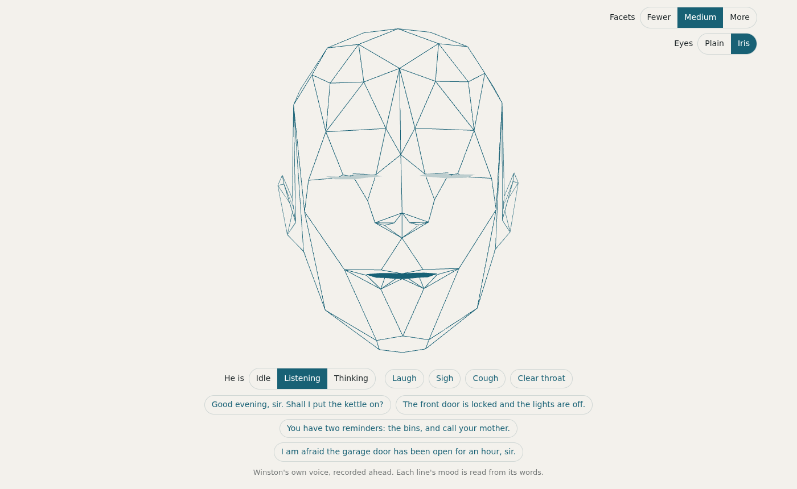

# Face

A low-poly wireframe head that speaks with his voice, for a wall tablet. It is a demo page with lines
recorded ahead; it is not wired to Winston yet ([plan](plan.md), signature features).

<picture>
  <source media="(prefers-color-scheme: dark)" srcset="images/face-dark.png">
  
</picture>

## Try it

```
python3 -m http.server -d services/face/page 8790
```

Open `http://localhost:8790`. The lines play in the Pocket voice `george`; three.js loads from a CDN.

## What moves it

| Part | Driven by |
| --- | --- |
| Mouth | The line's audio: wav2arkit_cpu turned it into the 52 ARKit face shapes, 30 a second, baked by `arkit.py` |
| Brows and nods while he speaks | The line's pitch and loudness, baked with it: pitch 1.5 semitones above the line's usual lifts the brows, loudness peaks dip the head |
| His state | The Idle, Listening and Thinking buttons, and Speaking while a line plays: an expression, a head pose, where he looks |
| Mood | Words in the line: warm, concerned, dry, or none, held faintly under the mouth |
| Sounds | Laugh, Sigh, Cough and Clear throat: timed poses, silent, since Pocket cannot make the sounds |
| Always | Head drift, breathing, blinks, a breath in before each line, and glances: the eyes jump to a target, the head follows part of the way, the eyes hold it as the head moves |

## Add a line

1. Record it with the Pocket voice server and trim its lead silence to 0.1 s:
   ```
   curl -s localhost:8880/v1/audio/speech -H 'content-type: application/json' \
     -d '{"input": "Dinner is served.", "voice": "george", "response_format": "wav", "stream": false}' -o raw.wav
   ffmpeg -i raw.wav -af silenceremove=start_periods=1:start_threshold=-40dB,adelay=100 services/face/page/line-5.wav
   ```
2. Bake its curves. The model is [wav2arkit_cpu](https://huggingface.co/myned-ai/wav2arkit_cpu)
   (Apache-2.0, about 400 MB, not in the repository); download its folder first.
   ```
   uv run services/face/arkit.py path/to/wav2arkit_cpu services/face/page services/face/page/line-5.wav
   ```
3. Add a button with `data-clip="line-5"` to the lines in `index.html`.

## The head

`face.json` holds three heads of 160, 260 and 420 triangles (the Facets choice), built by `head.mjs` from
three.js's `examples/models/gltf/facecap.glb`. It keeps the 52 shapes on every kept point, and the
points the mouth and lids need.

```
cd services/face && npm install && node head.mjs path/to/facecap.glb page/face.json
```

three.js credits the model to Face Cap by Bannaflak and states no licence for it.

## Settings

Constants near the top of the script in `index.html`:

| Name | Default | What it does |
| --- | --- | --- |
| `IRIS` | 0.5 | The iris's radius, against the eye's height |
| `LID` | 0.1 | How far the upper lids rest lowered, with irises |
| `RAISE` | 0.22 | How high the iris sits; the white shows below it |
| `FOLLOW` | 0.3 | Of a look, how much the head turns; the eyes do the rest |
| `EYE_RANGE` | 0.5 | Radians of look at the iris's full reach |
| `BLINK_GAP` | per state | The least gap between blinks and the average extra |
| `BROW`, `NOD` | 0.45, 0.045 | How far the voice's emphasis lifts the brows and dips the head |
| `STATES`, `MOODS`, `GESTURES` | | The expressions, head poses and timed sounds |
