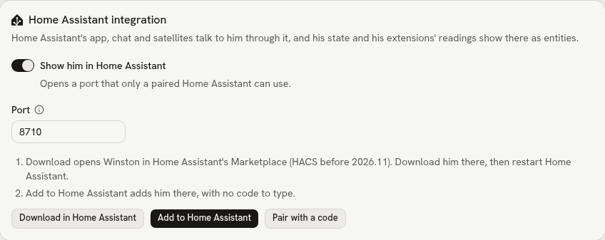

# Home Assistant integration

Winston's integration for Home Assistant does two things:

- **He becomes a conversation agent there.** Home Assistant's app, its Assist chat and its voice
  satellites talk to his brain, with his memory, tools and extensions. His reply streams back as he
  says it, so a satellite starts speaking before he has finished.
- **His state shows as entities.** What he is doing in each room, his engines, and what his extensions
  read. They keep their history, can be put in areas and on dashboards, and can start automations.
  Buttons and switches an extension declares work from Home Assistant too.

Winston and Home Assistant meet in three ways:

| Page | Direction |
| --- | --- |
| [Home Assistant](home-assistant.md) | Winston controls the devices on his list |
| This page | Home Assistant talks to him and sees his state, through his integration |
| [Home Assistant Assist](assist.md) | Home Assistant talks to him over Wyoming, with nothing to install there |

The integration and Assist both make him a conversation agent. Pick the integration unless you want
nothing installed in Home Assistant: it streams his replies, has a token where Wyoming has none, and
brings his entities.

## Adding him

<picture>
  <source media="(prefers-color-scheme: dark)" srcset="images/ha-integration-dark.png">
  
</picture>

The card is on Ways to talk, and in the setup wizard's Home Assistant step once Home Assistant is
connected. Switch on Show him in Home Assistant, then:

1. **Download in Home Assistant** opens Winston in Home Assistant's Marketplace (HACS before 2026.11),
   ready to download. Download him, then restart Home Assistant.
2. **Add to Home Assistant** adds him there from here: Winston runs Home Assistant's own Add
   integration flow with his token there, his address and a fresh code. Nothing to type.

Each button saves first, since the port opens on save.

| Setting | Key | Default | What it does |
| --- | --- | --- | --- |
| Show him in Home Assistant | `channels.ha_integration.enabled` | off | Opens the port and announces him |
| Port | `channels.ha_integration.port` | 8710 | The TCP port the integration connects to |

Saving applies it at once, with no restart.

| Add to Home Assistant says | Means |
| --- | --- |
| Home Assistant does not have Winston's integration yet | Step 1 is not done, or Home Assistant was not restarted |
| Home Assistant could not reach this computer at ..., port ... | A firewall drops the port: open it to Home Assistant's address only, on this computer and on the router between the subnets, as for [Assist](assist.md#adding-him-to-home-assistant) |
| Winston's account in Home Assistant is not an administrator's | Adding integrations needs one: pair with a code instead |

### Pairing with a code

When Winston is not connected to Home Assistant, or its account is not an administrator's:

1. Download Winston in Home Assistant's Marketplace or HACS by hand: add
   `https://github.com/aldinsmajlovic/winston` as a custom repository of type Integration, download
   Winston, and restart Home Assistant. It is not in the store's default list yet.
2. On the card, select Pair (Pair with a code). A six-digit code shows for ten minutes.
3. In Home Assistant, open Settings, Devices and services. Winston shows under Discovered: add him and
   type the code. Not discovered? Discovery stays inside one subnet, so on another VLAN select Add
   integration, pick Winston, and give this computer's address, the port and the code.

### Using him as the agent

In Home Assistant, open Settings, Voice assistants, and edit a pipeline (or add one). Under
Conversation agent, pick Winston. Every device on that pipeline now talks to him: the app's Assist,
the Assist chat in the browser, and each satellite set to it.

## Talking to him

A request answers as through [Assist](assist.md): the same conversations, rooms and Talk page lines.

- **Rooms.** A request from a device in an area joins that room's conversation, and "the lights"
  means that room's lights. The integration reads the area in Home Assistant (the device's, else its
  satellite entity's) and sends its name, so this works even when Winston is not connected to Home
  Assistant himself.
- **Conversations.** A request with no area gets one conversation per Home Assistant conversation, so a
  follow-up continues it.
- **Follow-ups.** A reply that asks something keeps a satellite listening, without the wake word.
- **His own words on its satellites.** Each satellite with an area speaks his announcements, nudges and
  corrections for its room while no Winston box or screen is connected there, as with
  [Assist](assist.md#speaking-on-home-assistants-satellites). This uses Winston's own connection to Home
  Assistant.
- **Failures are said.** His brain unreachable, Winston out of reach, or the pairing forgotten: the
  satellite says so instead of staying silent. A forgotten pairing also asks to pair again.

## What shows up

One device for Winston, and one for each extension that declares entities, linked to his.

| Entity | Example | What it is |
| --- | --- | --- |
| Conversation agent | `conversation.winston` | Pick it in a voice assistant pipeline |
| One per room box | `sensor.winston_kitchen_state` | idle, listening, thinking or speaking |
| One per engine and channel | `binary_sensor.winston_brain` | Up or down (diagnostic) |
| Announcement | `event.winston_announcement` | Fires with every announcement, with its `text` |
| An extension's nudges | `event.hevy_nudge` | Fires with every nudge it delivers, silent ones too: `kind`, `level`, `where`, `text` |
| An extension's own | `sensor.hevy_days_since_last_workout` | Whatever it declares, below |

Entity ids come from the names, so a renamed entity keeps its history: the unique ids are this
Winston's instance id (`data/instance`) and the extension's own keys.

## Extensions' entities

An extension declares them in its code (see the [SDK](extension-sdk.md#entities)); each kind becomes the
Home Assistant entity of the same name.

| Kind | In Home Assistant |
| --- | --- |
| `sensor`, `binary_sensor` | Shows what the extension sets, with its unit, device class and state class |
| `event` | Fires each time the extension sets it; the value is the event type when it is one of its options |
| `switch`, `number`, `select`, `text` | Setting it runs the extension's `on_change`; the new value shows once that returns |
| `button` | Pressing it runs the extension's `on_press` |

When a handler fails, Home Assistant shows its error and the value stays as it was.

An entity per entry (`per=From("chores")`) comes and goes with the entries on the extension's page.

Each extension's Readings card has a Show in Home Assistant switch, on by default. Off removes its
device from Home Assistant.

## While Winston is away

When winstond stops or the network drops, every entity shows as unavailable. The integration retries
within 30 s, and the entities come back with their latest values.

## Updates

The integration has Winston's version and comes with each Winston release (`winston-ha.zip`). The
Marketplace or HACS offers it whenever Winston has a new release; update both together. An integration
newer than its Winston says "This Winston is too old to answer here. Update him." when asked something.

## Safety

- **Home Assistant gets its own token.** The pairing code gives it a token that winstond keeps in
  `data/.env` as `WINSTON_HA_TOKEN`. The port answers nothing without it, except a pairing attempt.
- **The token reaches only this.** The port serves the integration's four routes: pairing, the
  stream, setting an extension's entity, and asking him something. Winston's settings and the rest of his API stay on
  their own port, which listens on this computer only by default.
- **A code works once, for ten minutes.** Five wrong tries void it.
- **Forget Home Assistant** on the card ends the stream and refuses the token at once. Home
  Assistant then asks to pair again, with a new code.

## How it talks

For anyone changing either side. winstond's side is `src/winston/api/ha_link.py`; Home Assistant's is
`custom_components/winston`.

| Route | What it does |
| --- | --- |
| `POST /pair {code}` | Gives `{token, instance, name}` |
| `GET /stream` | Server-sent events: a `snapshot` of everything shown, whole, at the start and whenever it changes; an `event` for each announcement and nudge |
| `POST /set {extension, key, entry, value, press}` | Runs the extension's handler |
| `POST /converse {text, conversation_id, device_id, satellite_id, area}` | Asks him, as Assist does: lines of JSON, `{"text"}` for each piece of the reply as he says it, then `{"done", "text", "continue"}` or `{"error"}` (what to say instead) |

Discovery is zeroconf, `_winston._tcp.local.`, with the instance id in its properties.

Checks:

| Check | Covers |
| --- | --- |
| `tests/ha_link_cases.py` | winstond's side: adding from here against the fake Home Assistant, pairing, the stream, handlers, publishing, asking him, unpairing (part of `winston check unit`) |
| `tests/ha_integration` | The integration in Home Assistant's own test kit, in its own venv: `cd tests/ha_integration && uv run pytest` |
| `tests/update_cases.py` | The release stamps the integration's version and HACS installs its zip |
| `.github/workflows/ha-integration.yml` | Those tests, Home Assistant's `hassfest` and the store's check, on every change to the integration |
