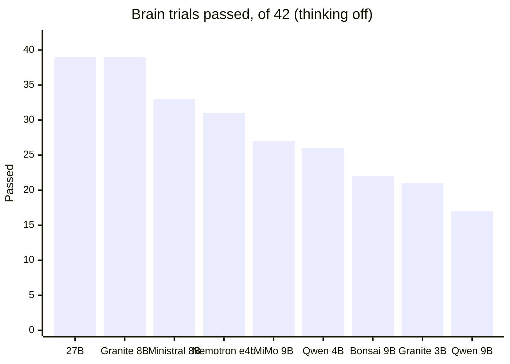

# Hardware and profiles

Winston's reference box is one NVIDIA card with 24 GB, but nothing in the core assumes it. Every
heavy part is an engine chosen in config, and a profile is one ready-made choice per slot for a
class of hardware. Pick one with `winston init --profile NAME` (`winston init --list` prints the
table below), or switch any slot later on the Brain and Voice pages.

| Profile | Needs | Brain | Voice | Hearing |
|---|---|---|---|---|
| `nvidia-24gb` (default) | NVIDIA card with 24 GB, Docker with the NVIDIA container toolkit | llama.cpp in Docker, Qwen3.8-27B GGUF at 4 bits | Breeze TTS 2 on the GPU, voice cloning from a clip | Fluid Speech Pro on the CPU |
| `nvidia-16gb` | NVIDIA card with 14 GB or more, Ollama | Ollama, `granite4.2:8b` | Breeze TTS 2 on the GPU | Fluid Speech Pro on the CPU |
| `nvidia-12gb` | NVIDIA card with 12 GB, Ollama | Ollama, `granite4.2:8b` | Chatterbox-Turbo on the GPU | Fluid Speech Pro on the CPU |
| `ollama` | Ollama installed; any GPU, Apple silicon or a CPU | Ollama, `granite4.2:8b` | Pocket TTS on the CPU | Fluid Speech Pro on the CPU |
| `nvidia-8gb` | NVIDIA card with 8 GB or less, Ollama | Ollama, `qwen3.5:4b` | Pocket TTS on the CPU | Fluid Speech Pro on the CPU |
| `hosted` | Internet and an API key | Any OpenAI-compatible endpoint | Pocket TTS on the CPU | Fluid Speech Pro on the CPU |

In every profile, hearing (Fluid Speech Pro, a retrained Parakeet TDT 0.6B v3, through ONNX), voice activity, turn taking and the
wake word run on the CPU. Home control never leaves the LAN; the hosted profile sends only the
conversation text to the model provider.

## Choosing

`winston setup` picks for you from the largest NVIDIA card ([sizing by the card](#sizing-by-the-card));
without one it starts from `ollama`, sized to the AMD card or, without a card, the computer's memory
([without an NVIDIA card](#without-an-nvidia-card)).

- **NVIDIA with 24 GB:** `nvidia-24gb`, what the reference box runs
  ([below](#recommended-on-a-24-gb-card)). Breeze's weights are for non-commercial use only; for
  anything else pick Chatterbox-Turbo on the Voice page. For a brain that sees images, pick vLLM
  (Qwen3.5-9B) on the Brain page: it got fewer requests right than the 27B.
- **A smaller card, AMD, Apple silicon, or no GPU:** `ollama`. Ollama handles the hardware itself.
  Any model that `ollama show` lists with the `tools` capability works; the tags on its Ollama
  page can leave it out (Granite 4.2 has none). The default, `granite4.2:8b`, fits a 12 GB card;
  on less than about 8 GB free, pick `qwen3.5:4b` (3.4 GB). How they compare:
  [comparing brains](#comparing-brains).
- **AMD, for llama.cpp:** pick llama.cpp on AMD (Docker) on the Brain page: the same brain through
  Vulkan. Not yet tried on an AMD card; Ollama is the tried way there.
- **A brain you already run on another computer** (Ollama, vLLM, llama.cpp or any OpenAI-compatible
  server): any profile, then A server on your network under Runs on. See
  [a server on your network](#a-server-on-your-network).
- **No local model:** `hosted`. Put the key in `data/.env` as `LLM_API_KEY`, set `llm.model` to
  the name your provider uses, and check the base URL. Thinking control is `none`, since hosted
  APIs have their own switches.

Mixing is normal. A brain that fills the whole card (Qwen3.6-35B-A3B at 4 bits takes 24 to 25 GB,
the 27B through vLLM 19.5 GB) needs Pocket TTS on the CPU: pick the brain's preset on the Brain page
and the Pocket preset on the Voice page.

Two engines on one card must both fit at start. vLLM asks for its whole share up front and fails if
another process holds it, and Ollama keeps its last model loaded for five minutes after a request. So
before vLLM starts again after trying Ollama, wait those minutes or run `ollama stop`. The other way
round, an Ollama model that finds the card full runs half on the CPU, at about 3 s a tool call
instead of under 1 s.

## Sizing by the card

The brain comes first. The best brain under 24 GB is Granite 4.2 8B (54 of 54 brain trials), and the
next step up, the 27B, needs a 24 GB card. So a card between the two keeps Granite and spends the rest
on a better voice, rather than squeezing in a bigger brain. Below Granite's size, the brain is Qwen3.5
4B and the voice goes to the CPU.

Each pick's peak graphics memory with the brain and voice working at once, on the RTX 3090 on
25 November, without the desktop's 0.2 GB:

| Brain (16K context) | Alone | With Chatterbox-Turbo | With Breeze TTS 2 |
| --- | --- | --- | --- |
| `qwen3.5:4b` | 4.1 GB | 7.4 GB | 9.4 GB |
| `granite4.2:8b` | 6.6 GB | 9.9 GB | 11.9 GB |

Alone, Chatterbox peaked at 3.4 GB and Breeze at 5.3 GB. `ollama ps` reports less than the card
holds (3.4 GB for the 4B), so these are from `nvidia-smi`.

Setup adds 1.5 GB to each, for a desktop on the same card and for spikes, and picks the first that
fits the largest card:

| Card | Profile | Needs |
| --- | --- | --- |
| 24 GB | `nvidia-24gb` | 27B and Breeze |
| 14 GB or more (16 and 20 GB cards) | `nvidia-16gb` | 11.9 + 1.5 GB |
| 12 GB | `nvidia-12gb` | 9.9 + 1.5 GB |
| 10 and 11 GB | `ollama` | 6.6 + 1.5 GB |
| 8 GB or less | `nvidia-8gb` | the 4B, Pocket on the CPU |

On an 8 GB card Granite would need all but 1.4 GB, so the 4B is the safe pick there; Qwen 4B with
Chatterbox (7.4 GB) leaves too little too. None of these has yet been checked on a card of that size.

### Context, filled last

How much one conversation holds is `llm.context`, in tokens. His instructions and tools take 10.5K,
and an exchange about 510 (the news alone about 1,300), so 16K holds about a dozen exchanges. Past
that he starts a fresh conversation. 16K is the floor.

After the brain and voice are picked, setup grows the context in 4K steps while the card stays under
90%, up to 128K. Each brain's memory by context, measured the same way:

| Brain | 16K | 32K | 64K |
| --- | --- | --- | --- |
| `qwen3.5:4b` | 4.1 GB | 4.5 GB | 5.5 GB |
| `granite4.2:8b` | 6.6 GB | 8.0 GB | 10.8 GB |
| Qwen3.8-27B (huihui) | 16.9 GB | 18.2 GB | 20.8 GB |

Between and past these, a straight line. A brain not in the table is estimated from its weights plus
1.5 GB, and 85 MB per 1K of context. vLLM takes its share of the card at any context: its `--gpu-memory-utilization` (70% in the preset), as the
model search reads it.

So an 8 GB card gets 112K, a 12 GB card 20K, a 16 GB card 40K and a 24 GB card 16K. The numbers live
in `src/winston/config/memory.py`; the memory bar in the wizard and on the Brain and Voice pages reads
the same ones ([web UI](web-ui.md#graphics-memory)).

### Without an NVIDIA card

| Part | AMD card | No graphics card |
| --- | --- | --- |
| Brain | Ollama, on the card (ROCm or Vulkan, Ollama's choice). llama.cpp on AMD, untried. | Ollama, on the processor |
| Voice | Pocket, on the processor | Pocket |
| Hearing | Fluid Speech Pro or Parakeet, on the processor | The same |
| Memory bar | The AMD card's, read from the kernel's files | The computer's memory |

The other voices, Qwen3-ASR hearing and vLLM need NVIDIA's CUDA. Setup picks `ollama` either way. It
keeps Granite 4.2 8B when it fits under 90% of the memory at 16K, else Qwen3.5 4B, then fills the
context the same way.

On the processor, measured as each process's resident memory while working (25 November):

| Part | 16K | 32K | 64K |
| --- | --- | --- | --- |
| `qwen3.5:4b` | 3.7 GB | 3.9 GB | 4.5 GB |
| `granite4.2:8b` | 6.4 GB | 7.7 GB | 10.4 GB |
| Pocket, speaking | 0.9 GB | | |
| Fluid Speech Pro / Parakeet | 0.9 / 1.1 GB | | |

So an 8 GB computer gets Qwen3.5 4B with 28K once the system's 1.5 GB is counted, and a 16 GB one
Granite. An AMD card does not say which program holds what, so while his engines run the bar leaves
other programs out and says so.

## Recommended on a 24 GB card

What the reference box (an RTX 3090) runs, each slot measured against what fits beside the other two:

| Slot | Pick | VRAM | Instead of | Why |
|---|---|---|---|---|
| Brain | Qwen3.8-27B at 4 bits on llama.cpp (`unsloth/Qwen3.8-27B-GGUF:UD-Q4_K_S`), MTP drafting, 16K context per conversation, thinking only before a home action | 17 GB | Qwen3.5-9B on vLLM | More requests right ([comparing brains](#comparing-brains)), at about the same speed. No vision. |
| Voice | Breeze TTS 2 (Voice preset `breeze2`) | 5.4 GB | Chatterbox-Turbo, streamed (4 GB) | Won 9 of 10 blind pairs; first sound in 0.18 s against 0.45 s ([voice benchmarks](voice-benchmarks.md#breeze-tts-2-as-the-voice-10-october)) |
| Hearing | Fluid Speech Pro (retrained Parakeet v3), int8, on the CPU | none | Qwen3-ASR 0.6B (2.2 GB) | Qwen3-ASR hears better but does not fit beside Breeze |

With all three, the card sits at 22.9 of 24.6 GB. On a Voice PE box, from the end of speech to the
first sound: 1.3 s for a plain question, 2.4 s when he uses a tool, and 2.3 s to confirm a home
request (medians).

This is the `nvidia-24gb` profile. Installing it clones Breeze's inference code at a pinned commit
and installs its packages. Breeze's weights are for research and non-commercial use only.

The reference box also runs huihui-ai's abliterated build of the same 27B (refusals removed, MTP
layer kept): the same brain trials and speed, for 0.25 GB more.

**With 2 GB more** (a 32 GB card, or a second GPU for hearing), add Qwen3-ASR 0.6B. It hears hint
words and speech over background talk much better than Parakeet, for 0.09 s more per request
([voices](voices.md#hearing-engines)); it has not been measured against Fluid Speech Pro.

Every voice's memory, first sound and word errors, side by side: [picking a voice](voices.md#picking-a-voice).

## Comparing brains

`winston check brain` sends the requests in `data/trials/brain.yaml` (the template is
`examples/trials/brain.yaml`) through the text channel with thinking off, as over voice, each in a
fresh conversation. A case passes when every expected tool was called and no forbidden one was. Lights
the cases touch are put back.

A case with a `nudge` adds a made-up briefing to its first request, the way a real one arrives, and
checks how he answers it: put off, dismissed, or left alone while you ask for something else. No real
nudge is touched.

1. Run `winston check brain` (or `uv run python tests/brain_trials.py --runs 3` for spread).
2. Switch the brain on the Brain page.
3. Run it again and compare. Each run is saved in `data/logs/brain_trials/`.

On the reference box, the same 14 requests three times each, with thinking off:

| Model | Engine | Passed, thinking off | Passed, thinking on | First reply text, off / on | VRAM (context) |
|---|---|---|---|---|---|
| Qwen3.8-27B, 4 bits (abliterated) | llama.cpp | 39 of 42 | | 0.79 s | 17.3 GB (32K) |
| `granite4.1:8b` (the Ollama preset until 24 November) | Ollama | 39 of 42 | no thinking mode | 0.80 s | 8.0 GB (16K) |
| `ministral-3:8b` | Ollama | 33 of 42 | no thinking mode | 0.53 s | 8.3 GB (16K) |
| `nemotron-3.5-bolt:e4b` | Ollama | 31 of 42 | 10 of 14 | 0.08 s (see below) / 4.46 s | 8.4 GB (32K) |
| `mimo-v2.6:9b` | Ollama | 27 of 42 | 12 of 14 | 0.33 / 1.21 s | 7.1 GB (16K) |
| `qwen3.5:4b` | Ollama | 26 of 42 | 11 of 14 | 0.52 / 1.84 s | 5.0 GB (32K) |
| `bonsai-2:9b` | Ollama | 22 of 42 | 13 of 14 | 0.32 / 1.84 s | 4.2 GB (16K) |
| `granite4.1:3b` | Ollama | 21 of 42 | no thinking mode | 0.48 s | 5.1 GB (32K) |
| `qwen3.5:9b` | Ollama | 17 of 42 | 14 of 14 | 0.32 / 2.24 s | 7.1 GB (16K) |

The thinking-on column is one round of 14, so it is a first look, not a ranking. Each Ollama model
had the RTX 3090 to itself. No Qwen newer than 3.5 comes below 27B. This list was taken from Ollama's search for models
tagged `tools`, which misses models whose page has no tags; those are in the table below.

On 24 November, with the four nudge cases added (18 requests, three times each, so 54), the models
the first list missed, and `granite4.1:8b` and `qwen3.5:4b` again on the same day. The 4B did far
better than on 23 November (26 of 42); what changed between the runs is not known. Its four
failures here are the nudge it should mention (three) and a missing sensor value (one):

| Model | Passed, thinking off | Passed, thinking on (one round) | First reply text, off / on | VRAM (16K) |
|---|---|---|---|---|
| `granite4.2:8b` (the Ollama preset) | 54 of 54 | 17 of 18 | 1.04 / 11.6 s | 6.8 GB |
| `gemma4:12b` | 51 of 54 | 14 of 18 | 0.63 / 3.49 s | not measured |
| `qwen3.5:4b` | 50 of 54 | 17 of 18 | 0.60 / 1.31 s | 3.4 GB |
| `granite4.1:8b` | 46 of 54 | no thinking mode | 0.74 s | 6.8 GB |
| `granite4.2:3b` | 44 of 54 | 14 of 18 | 0.86 / 10.9 s | 3.0 GB |
| `lfm2.5:8b` | 40 of 54 | 14 of 18 | 0.11 / 0.12 s (replies done in 2.55 / 3.56 s) | 5.4 GB |
| `gemma4:e4b` | 39 of 54 | 16 of 18 | 0.31 / 2.66 s | not measured |
| `nemotron-3-nano:4b` | 6 of 54 | 12 of 18 | 0.27 / 2.61 s | 3.0 GB |

VRAM is what `ollama ps` reported; for Gemma 4 it reported under 1.3 GB, which cannot hold the
weights, so it is left out. `bonsai-2:27b` was not run: its download fails on a leftover partial
file only root can remove.

The default profile's brain, Qwen3.5-9B AWQ on vLLM, was compared with the 27B on an earlier version
of the same requests: 36 of 42 against 42 of 42, first reply text in 0.87 s against 0.94 s, 15.6 GB
against 17.2 GB. vLLM starts in about 3 minutes, llama.cpp in 10 s once downloaded. On the reference
box the 27B writes 60 to 90 tokens a second with MTP drafting, 44 without.

### How they fail

- **Replying as if done, with no tool called:** the Qwen 9B and Bonsai with thinking off, on nearly
  every light request and follow-up; the Qwen 4B 4 times. With thinking on, both 9Bs stop doing it,
  which is why they gain the most from it.
- **Trying what he should decline:** asked to lock or unlock a door, Granite (both sizes), Nemotron
  and the Qwen 4B tried, every time. That home has no lock, so nothing happened. These are Granite
  8B's only misses, and leaving the lock wording out of the tools did not stop it.
- **The clock:** every model but Granite answered the time from the turn's time stamp instead of the
  clock tool, a soft miss. These are the 27B's only misses.
- **Ministral** used the wrong tool for a light asked for by name. **Granite 3B** gave an empty reply
  for the weather and answered a recent event from memory instead of searching. **Nemotron** says
  "There you go, sir" before its tool call runs, sometimes before an action that then fails, which is
  why its first reply text comes so early.

## Notes per engine

| Engine | Part | Runs on | Pick it for |
| --- | --- | --- | --- |
| [vLLM](#vllm) | Brain | NVIDIA, in Docker | The fastest tool calls, and images |
| [llama.cpp](#llamacpp) | Brain | NVIDIA, in Docker | The 27B, fast, and a start in seconds |
| [Ollama](#ollama) | Brain | Any GPU, Apple silicon or a CPU | A small card, AMD, a Mac, or no GPU |
| [A server on your network](#a-server-on-your-network) | Brain | Another computer you run it on | A brain you already have, not run twice |
| [Chatterbox-Turbo](#chatterbox-turbo) | Voice | NVIDIA | A cloned voice that starts quickly |
| [Pocket TTS](#pocket-tts) | Voice | CPU | No GPU to spare |
| [Hosted speech](#hosted-speech) | Voice | A provider, with a key | No local voice at all |

### vLLM

- A start takes about 3 minutes.
- Before the first start Winston downloads the weights into `~/.cache/huggingface`. The Brain page
  and Status show how far it has come.
- The preset's tool call and reasoning parsers are for Qwen models. Another model family needs its
  own; `vllm serve --help` lists them.

### llama.cpp

- Runs the official `server-cuda` image, pinned to one release in the preset. The AMD preset runs the
  same release's `server-vulkan` image and passes the card in with Devices (`/dev/dri`), in How it runs.
- The model is a Hugging Face repo and quant, such as `unsloth/Qwen3.8-27B-GGUF:UD-Q4_K_S`. Before
  the first start Winston downloads that quant into `~/.cache/huggingface`, the same cache vLLM uses.
- Holds two conversations at once, each with `llm.context` (16K by default, the Brain page's slider).
- Drafts with the model's own MTP layer, which is where most of its speed comes from. That needs a
  GGUF that keeps the layer. For one that does not, remove `--spec-type draft-mtp` and
  `--spec-draft-n-max 2` in How it runs.
- Thinking is switched the same way as on vLLM.
- Reading Winston's prompt cold takes the 27B several seconds, so Winston reads it ahead: see Ready
  before the first question in [web UI](web-ui.md#ready-before-the-first-question).

The pinned image leaks host memory, a few GB over a couple of hundred requests (llama.cpp #31392,
open). Restarting the brain frees it.

### Ollama

- Winston talks to it over its OpenAI API at `/v1` and switches thinking per request, which the
  preset sets up.
- Ollama gives a card under 24 GB only 4K of context, and Winston's prompt is about 11K tokens. So
  when the brain starts, Winston makes a copy of the model with a 16K context (`granite4.2:8b-16k`
  for `granite4.2:8b`, at `llm.context`) and talks to that. The copy uses the same files and no extra disk, and it is
  made for a model you pulled yourself too.
- The Brain page lists the model, not the copy.

### A server on your network

For a brain that already runs on another computer, so it is not run twice. Pick A server on your
network under Runs on, then on the card:

| Field | What to put |
| --- | --- |
| API address | The server's, with `/v1`: `http://192.168.1.10:8000/v1` for vLLM or llama.cpp, `http://192.168.1.10:11434/v1` for Ollama |
| Model | One the server lists, under Running |
| How thinking is switched | Chat template for vLLM and llama.cpp, Reasoning effort for Ollama, No switch when it has none |
| API key | Only if the server asks for one; otherwise none is sent |

- **One address.** Winston checks the server at the API address without `/v1` (`/v1/models`), so
  Status says when it is down. A server that wants a key and answers 401 counts as up.
- **An Ollama there is still Ollama** (port 11434): Winston pulls the model on it and makes the 16K
  copy there, as [above](#ollama).
- **On the server's side,** it listens on the network, not only on itself: `--host 0.0.0.0` for
  vLLM and llama.cpp, `OLLAMA_HOST=0.0.0.0` for Ollama. It needs a context of at least 16K: his
  prompt is about 11K tokens, and llama.cpp divides `-c` between its `-np` slots.
- **Not downloaded by Winston** on vLLM or llama.cpp there: put the model on that server yourself.

### Chatterbox-Turbo

- NVIDIA only. Its own venv, `services/tts-chatterbox`, since it pins torch 2.6.
- Clones any clip under `data/voices`. Six VCTK voices (CC BY 4.0) come with it.
- Winston's server streams it, so the first sound comes in about half a second, however long the
  sentence. The joins between chunks can sound a little choppy; Stream speech and Chunk length on
  the Voice page change that ([voices](voices.md#trying-a-voice-before-saving)).

### Pocket TTS

- Kyutai's 100M model: MIT code, CC BY 4.0 weights. Its own venv, `services/tts-pocket`, with a
  CPU-only torch.
- Streams as it speaks. Its 26 built-in voices work as they are.
- Uses four CPU threads; change `--threads` in How it runs.

To clone from a clip (the same clips Chatterbox uses):

1. Accept the terms at https://huggingface.co/kyutai/pocket-tts.
2. Run `uvx hf auth login` once.

### Hosted speech

- Any server that speaks OpenAI's speech API, with its key as `TTS_API_KEY`.
- The preset is OpenRouter with ElevenLabs Flash v2.5 ([voices](voices.md#hosted-voice)).
- The Voice list is empty, since there is no local server to ask: type the voice's name.

## What is not covered

vLLM on AMD (ROCm images exist, untested here), llama.cpp on AMD (offered, untried), Windows, and a brain smaller than 4B. The hearing's
INT8 ONNX build wants a few CPU cores; on a Raspberry Pi class satellite the plan keeps hearing on
the brain box, not the satellite.
