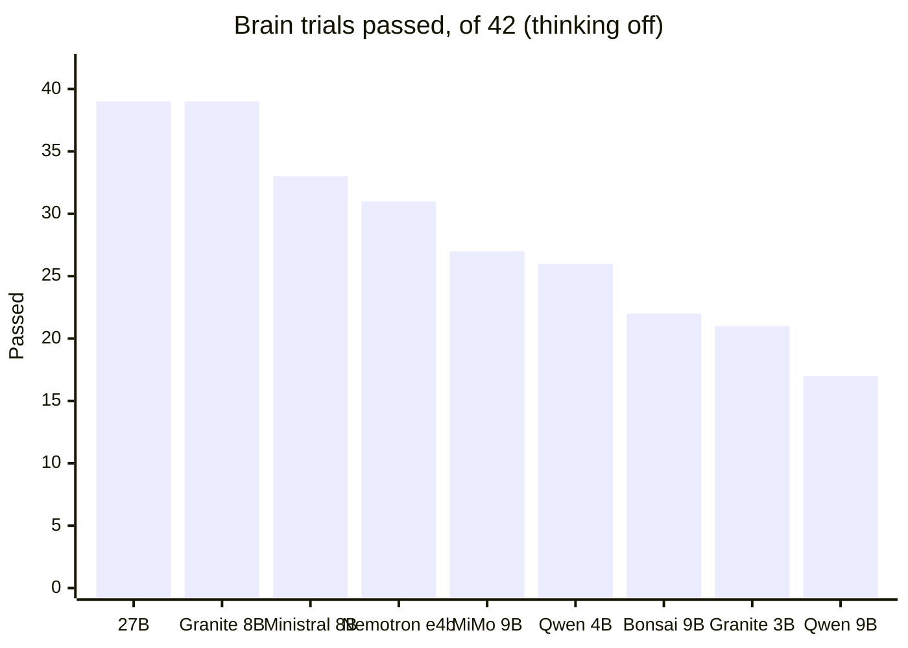

# Hardware and profiles

Winston's reference box is one NVIDIA card with 24 GB, but nothing in the core assumes it. Every
heavy part is an engine chosen in config, and a profile is one ready-made choice per slot for a
class of hardware. Pick one with `winston init --profile NAME` (`winston init --list` prints the
table below), or switch any slot later on the Brain and Voice pages.

| Profile | Needs | Brain | Voice | Hearing |
|---|---|---|---|---|
| `nvidia-24gb` (default) | NVIDIA card with 24 GB, Docker with the NVIDIA container toolkit | vLLM in Docker, Qwen3.5-9B AWQ | Chatterbox-Turbo on the GPU, voice cloning from a clip | Parakeet on the CPU |
| `nvidia-24gb-27b` | The same | llama.cpp in Docker, Qwen3.8-27B GGUF at 4 bits | Chatterbox-Turbo on the GPU | Parakeet on the CPU |
| `ollama` | Ollama installed; any GPU, Apple silicon or a CPU | Ollama, `granite4.1:8b` | Pocket TTS on the CPU | Parakeet on the CPU |
| `hosted` | Internet and an API key | Any OpenAI-compatible endpoint | Pocket TTS on the CPU | Parakeet on the CPU |

In every profile, hearing (Parakeet TDT 0.6B v3 through ONNX), voice activity, turn taking and the
wake word run on the CPU. Home control never leaves the LAN; the hosted profile sends only the
conversation text to the model provider.

## Choosing

- **NVIDIA with 24 GB, where multi-part requests matter more than vision:** `nvidia-24gb-27b`.
- **NVIDIA with 16 GB or more:** `nvidia-24gb`. Below 24 GB, lower `--gpu-memory-utilization` in
  the vLLM arguments or pick a smaller model; the Chatterbox server needs about 4 GB next to it.
- **A smaller card, AMD, Apple silicon, or no GPU:** `ollama`. Ollama handles the hardware itself.
  Any model whose Ollama page lists `tools` works. The default, `granite4.1:8b`, fits a 12 GB card;
  on less than about 8 GB free, pick `qwen3.5:4b`. Expect fewer requests right than on the 24 GB
  profiles ([comparing brains](#comparing-brains)).
- **No local model:** `hosted`. Put the key in `data/.env` as `LLM_API_KEY`, set `llm.model` to
  the name your provider uses, and check the base URL. Thinking control is `none`, since hosted
  APIs have their own switches.

Mixing is normal. A brain that fills the whole card (Qwen3.6-35B-A3B at 4 bits takes 24 to 25 GB,
the 27B through vLLM 19.5 GB) needs Pocket TTS on the CPU: pick the brain's preset on the Brain page
and the Pocket preset on the Voice page.

Two engines on one card must both fit at start. vLLM asks for its whole share up front and fails if
another process holds it, and Ollama keeps its last model loaded for five minutes after a request. So
before vLLM starts again after trying Ollama, wait those minutes or run `ollama stop`. The other way
round, an Ollama model that finds the card full runs half on the CPU, at about 3 s a tool call
instead of under 1 s.

## Recommended on a 24 GB card

What the reference box (an RTX 3090) runs, each slot measured against what fits beside the other two:

| Slot | Pick | VRAM | Instead of | Why |
|---|---|---|---|---|
| Brain | Qwen3.8-27B at 4 bits on llama.cpp (`unsloth/Qwen3.8-27B-GGUF:UD-Q4_K_S`), MTP drafting, 32K context, thinking only before a home action | 17 GB | Qwen3.5-9B on vLLM | More requests right ([comparing brains](#comparing-brains)), at about the same speed. No vision. |
| Voice | Breeze TTS 2 (Voice preset `breeze2`) | 5.4 GB | Chatterbox-Turbo, streamed (4 GB) | Won 9 of 10 blind pairs; first sound in 0.18 s against 0.45 s ([voice benchmarks](voice-benchmarks.md#breeze-tts-2-as-the-voice-10-october)) |
| Hearing | Parakeet TDT 0.6B v3, int8, on the CPU | none | Qwen3-ASR 0.6B (2.2 GB) | Qwen3-ASR hears better but does not fit beside Breeze |

With all three, the card sits at 22.9 of 24.6 GB. On a Voice PE box, from the end of speech to the
first sound: 1.3 s for a plain question, 2.4 s when he uses a tool, and 2.3 s to confirm a home
request (medians).

No profile sets this up, since Breeze's weights are for research and non-commercial use only:

1. Start from `nvidia-24gb-27b`.
2. Clone Breeze's inference code with the command at the top of `services/tts-breeze2/server.py`.
3. Pick Breeze TTS 2 on the Voice page, which installs its packages.

The reference box also runs huihui-ai's abliterated build of the same 27B (refusals removed, MTP
layer kept): the same brain trials and speed, for 0.25 GB more.

**With 2 GB more** (a 32 GB card, or a second GPU for hearing), add Qwen3-ASR 0.6B. It hears hint
words and speech over background talk much better than Parakeet, for 0.09 s more per request
([voices](voices.md#hearing-engines)).

Every voice's memory, first sound and word errors, side by side: [picking a voice](voices.md#picking-a-voice).

## Comparing brains

`winston check brain` sends the requests in `data/trials/brain.yaml` (the template is
`examples/trials/brain.yaml`) through the text channel with thinking off, as over voice, each in a
fresh conversation. A case passes when every expected tool was called and no forbidden one was. Lights
the cases touch are put back.

1. Run `winston check brain` (or `uv run python tests/brain_trials.py --runs 3` for spread).
2. Switch the brain on the Brain page.
3. Run it again and compare. Each run is saved in `data/logs/brain_trials/`.

On the reference box, the same 14 requests three times each, with thinking off:

| Model | Engine | Passed, thinking off | Passed, thinking on | First reply text, off / on | VRAM (context) |
|---|---|---|---|---|---|
| Qwen3.8-27B, 4 bits (abliterated) | llama.cpp | 39 of 42 | | 0.79 s | 17.3 GB (32K) |
| `granite4.1:8b` (the Ollama preset) | Ollama | 39 of 42 | no thinking mode | 0.80 s | 8.0 GB (16K) |
| `ministral-3:8b` | Ollama | 33 of 42 | no thinking mode | 0.53 s | 8.3 GB (16K) |
| `nemotron-3.5-bolt:e4b` | Ollama | 31 of 42 | 10 of 14 | 0.08 s (see below) / 4.46 s | 8.4 GB (32K) |
| `mimo-v2.6:9b` | Ollama | 27 of 42 | 12 of 14 | 0.33 / 1.21 s | 7.1 GB (16K) |
| `qwen3.5:4b` | Ollama | 26 of 42 | 11 of 14 | 0.52 / 1.84 s | 5.0 GB (32K) |
| `bonsai-2:9b` | Ollama | 22 of 42 | 13 of 14 | 0.32 / 1.84 s | 4.2 GB (16K) |
| `granite4.1:3b` | Ollama | 21 of 42 | no thinking mode | 0.48 s | 5.1 GB (32K) |
| `qwen3.5:9b` | Ollama | 17 of 42 | 14 of 14 | 0.32 / 2.24 s | 7.1 GB (16K) |

The thinking-on column is one round of 14, so it is a first look, not a ranking. Each Ollama model
had the RTX 3090 to itself. No Qwen newer than 3.5 comes below 27B; the others are the newest models
of their size on Ollama with tool support.

The default profile's brain, Qwen3.5-9B AWQ on vLLM, was compared with the 27B on an earlier version
of the same requests: 36 of 42 against 42 of 42, first reply text in 0.87 s against 0.94 s, 15.6 GB
against 17.2 GB. vLLM starts in about 3 minutes, llama.cpp in 10 s once downloaded. On the reference
box the 27B writes 60 to 90 tokens a second with MTP drafting, 44 without.

### How they fail

- **Replying as if done, with no tool called:** the Qwen 9B and Bonsai with thinking off, on nearly
  every light request and follow-up; the Qwen 4B 4 times. With thinking on, both 9Bs stop doing it,
  which is why they gain the most from it.
- **Trying what he should decline:** asked to lock or unlock a door, Granite (both sizes), Nemotron
  and the Qwen 4B tried, every time. That home has no lock, so nothing happened. These are Granite
  8B's only misses, and leaving the lock wording out of the tools did not stop it.
- **The clock:** every model but Granite answered the time from the turn's time stamp instead of the
  clock tool, a soft miss. These are the 27B's only misses.
- **Ministral** used the wrong tool for a light asked for by name. **Granite 3B** gave an empty reply
  for the weather and answered a recent event from memory instead of searching. **Nemotron** says
  "There you go, sir" before its tool call runs, sometimes before an action that then fails, which is
  why its first reply text comes so early.

## Notes per engine

| Engine | Part | Runs on | Pick it for |
| --- | --- | --- | --- |
| [vLLM](#vllm) | Brain | NVIDIA, in Docker | The fastest tool calls, and images |
| [llama.cpp](#llamacpp) | Brain | NVIDIA, in Docker | The 27B, fast, and a start in seconds |
| [Ollama](#ollama) | Brain | Any GPU, Apple silicon or a CPU | A small card, AMD, a Mac, or no GPU |
| [Chatterbox-Turbo](#chatterbox-turbo) | Voice | NVIDIA | A cloned voice that starts quickly |
| [Pocket TTS](#pocket-tts) | Voice | CPU | No GPU to spare |
| [Hosted speech](#hosted-speech) | Voice | A provider, with a key | No local voice at all |

### vLLM

- A start takes about 3 minutes.
- Before the first start Winston downloads the weights into `~/.cache/huggingface`. The Brain page
  and Status show how far it has come.
- The preset's tool call and reasoning parsers are for Qwen models. Another model family needs its
  own; `vllm serve --help` lists them.

### llama.cpp

- Runs the official `server-cuda` image, pinned to one release in the preset.
- The model is a Hugging Face repo and quant, such as `unsloth/Qwen3.8-27B-GGUF:UD-Q4_K_S`. Before
  the first start Winston downloads that quant into `~/.cache/huggingface`, the same cache vLLM uses.
- Holds two conversations at once, with 16K of context each.
- Drafts with the model's own MTP layer, which is where most of its speed comes from. That needs a
  GGUF that keeps the layer. For one that does not, remove `--spec-type draft-mtp` and
  `--spec-draft-n-max 2` in How it runs.
- Thinking is switched the same way as on vLLM.
- Reading Winston's prompt cold takes the 27B several seconds, so Winston reads it ahead: see Ready
  before the first question in [web UI](web-ui.md#ready-before-the-first-question).

The pinned image leaks host memory, a few GB over a couple of hundred requests (llama.cpp #31392,
open). Restarting the brain frees it.

### Ollama

- Winston talks to it over its OpenAI API at `/v1` and switches thinking per request, which the
  preset sets up.
- Ollama gives a card under 24 GB only 4K of context, and Winston's prompt is about 11K tokens. So
  when the brain starts, Winston makes a copy of the model with a 16K context (`granite4.1:8b-16k`
  for `granite4.1:8b`) and talks to that. The copy uses the same files and no extra disk, and it is
  made for a model you pulled yourself too.
- The Brain page lists the model, not the copy.

### Chatterbox-Turbo

- NVIDIA only. Its own venv, `services/tts-chatterbox`, since it pins torch 2.6.
- Clones any clip under `data/voices`. Six VCTK voices (CC BY 4.0) come with it.
- Winston's server streams it, so the first sound comes in about half a second, however long the
  sentence. The joins between chunks can sound a little choppy; Stream speech and Chunk length on
  the Voice page change that ([voices](voices.md#trying-a-voice-before-saving)).

### Pocket TTS

- Kyutai's 100M model: MIT code, CC BY 4.0 weights. Its own venv, `services/tts-pocket`, with a
  CPU-only torch.
- Streams as it speaks. Its 26 built-in voices work as they are.
- Uses four CPU threads; change `--threads` in How it runs.

To clone from a clip (the same clips Chatterbox uses):

1. Accept the terms at https://huggingface.co/kyutai/pocket-tts.
2. Run `uvx hf auth login` once.

### Hosted speech

- Any server that speaks OpenAI's speech API, with its key as `TTS_API_KEY`.
- The preset is OpenRouter with ElevenLabs Flash v2.5 ([voices](voices.md#hosted-voice)).
- The Voice list is empty, since there is no local server to ask: type the voice's name.

## What is not covered

vLLM on AMD (ROCm images exist, untested here), Windows, and a brain smaller than 4B. Parakeet's
INT8 ONNX build wants a few CPU cores; on a Raspberry Pi class satellite the plan keeps hearing on
the brain box, not the satellite.
