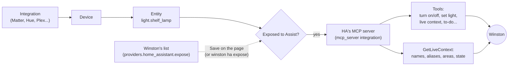
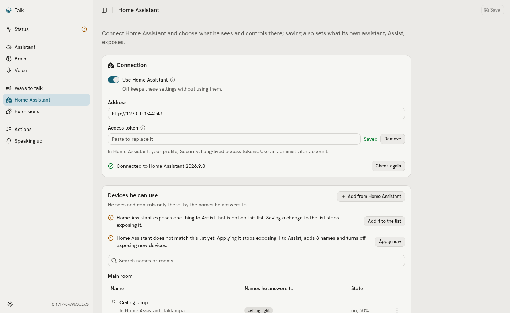
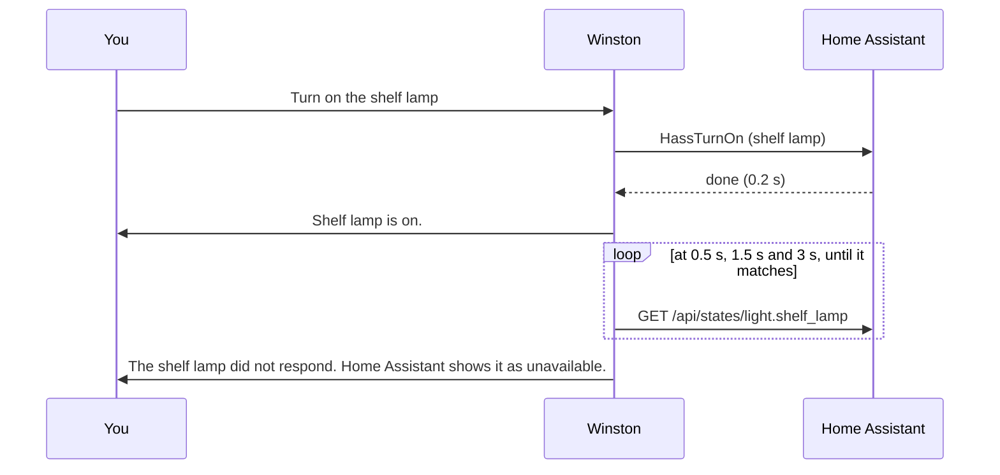

# Home Assistant

Winston sees and controls only what is on his list (Devices he can use on the Home Assistant page,
`providers.home_assistant.expose`). Home Assistant's own MCP server turns that list into his tools and
his picture of the home.

The other way round, Home Assistant's own Assist (its app, its chat and its voice satellites) can use
him as its conversation agent: see [Home Assistant Assist](assist.md). And Winston's integration shows
his state and his extensions' readings as entities there: see [Home Assistant integration](ha-integration.md).

## From a device to what he sees and does



- Only entities exposed to Assist reach the MCP server, and Winston's list decides which those are.
  Anything else exposed in Home Assistant shows on the page as exposed beyond the list, and the next
  save that changes the list stops exposing it.
- The tools depend on what is exposed: an exposed light brings "Set brightness and colour", a to-do
  list brings the to-do tools. A channel reads the tool list when it starts, so saving the list marks
  the brain channels for a restart.
- Every word of the tools is in his prompt, so they are cut to what the home has, read when the
  channel starts: no `floor` without floors, only the device classes of exposed entities, no `domain`
  that allows one value, and no lock wording without an exposed lock.
- The satellite tools (an announcement, timers) act through one of Home Assistant's own voice
  satellites. In a home with none they are left out.
- An exposed script becomes a tool of its own ([scripts and shortcuts](#scripts-and-shortcuts)).
- He learns names only from GetLiveContext: each entity's name, its aliases, its area and its state.

## Scripts and shortcuts

An exposed script is a tool of its own, described by the script's description, so a scene with
several steps (lamps one after another, music) is one call.

### Writing a script he can run

Do:

- Say in the description when to run it and when not: "Lights only, no music. Only when one of its
  names is said."
- Give it the phrases people say as aliases. An alias in what was said also makes a spoken request
  think first.
- Add what speech recognition makes of a phrase as one more alias ("moving night" for "movie night").
- Use a [shortcut](#say-first-stay-quiet-and-shortcuts) for a phrase that should set the whole scene,
  song and all.

Don't:

- Put moods, genres or example requests in the description or the aliases. They pull in requests to
  play that mood: a light scene that names romance runs on "play something romantic".
- Name the requests it should not take ("play something romantic is music"): naming them pulls them
  in too.

### Say first, stay quiet and shortcuts

Each entry on the list has these in its edit dialog on the Home Assistant page:

| On the page | Key | For | What it does |
| --- | --- | --- | --- |
| Say first | `say_first` | Scripts and scenes | Said the moment a spoken request names it, in place of "One moment." ("Movie night it is.") |
| Stay quiet when it works | `quiet_after` | Scripts and scenes | Once it has worked he says nothing more and the box does not listen on, so music is not talked over. A failure is still reported. Holds only when its name is all that was said: a request that also asks for music runs the scene and stops there |
| Run it as soon as you say its name | `shortcut` | Scripts | Saying only one of its names ("Okay Winston, movie night") runs it without the model, the same every time, twice in a row too. Fillers before it ("uh, can you") and a place or "for me" after it ("movie night in the living room") still count as only the name, in Swedish and German too ("filmkväll i vardagsrummet, tack") |

### A shortcut to any tool

The top-level `shortcuts` list in config.yaml runs any tool from a phrase, not only a Home Assistant
script. Saying just one of the phrases runs the tool straight away, without the model.

| Key | What it is |
| --- | --- |
| `phrases` | What you say to run it |
| `tool` | An extension tool as `extension.tool` (`spotify.party`), a script as `script.name`, or one of his own tools by name (`start_over`) |
| `args` | The fixed arguments it runs with |
| `say_first`, `quiet_after` | As in the table above |

This is how a party works: one phrase plays music on his own speakers and runs a light show (the
Spotify `party` tool in [built-in extensions](built-in-extensions.md#spotify)), which a script alone
could not do, since it cannot reach the speakers.

## Aliases matter more than rooms

Home Assistant matches a spoken name to an entity by its name or an exact alias. A request that names
a device is targeted by that name, not by room: a group light has no area of its own, and a misheard
room name is not an area at all. A request that names nothing ("turn off the lights") goes to the room
you are in ([rooms](rooms.md#what-a-room-does)). Give each entity the names people actually
say, short forms included ("phone", "the lights"): they are what makes a request land.

Home Assistant's own names stay as they are, since they are the household's (often Swedish) names.
Winston never renames an entity. The name on his list is what you call it, and it is saved to Home
Assistant as one more alias.

On Winston's side an entity on the list answers to its name there, its aliases and its object id as
words (`light.shelf_lamp` is "shelf lamp"), whatever the case or spacing. Those names make a spoken
request think first, make a loose claim about it ("the shelf lamp is now on") need a tool call, name a
shortcut, and keep a named device's own area; the state check also matches Home Assistant's friendly
names.

## A vacuum

A vacuum on his list brings Home Assistant's start, return to base and clean an area. Cleaning a
room needs its integration to support Home Assistant's clean area (Matter, Roborock, Ecovacs and some
custom integrations do) and its rooms mapped to areas, in the vacuum's entity settings under "Map
vacuum segments to areas". The map of the house names the areas it is mapped to ("cleans Kitchen"),
so "clean the kitchen" works with nothing else in the kitchen on his list; a room left unmapped is
not offered. Keep vacuums out of the brain trials: a trial makes the real call, and only lights are
put back afterwards.

## What Save does

A save that changes the list or the kinds shared whole, or switches Use Home Assistant back on,
applies the list to Home Assistant before the channels reload, so they see the new tools:

1. Turns off Home Assistant's "expose new entities" for Assist, so nothing new appears on its own.
2. Exposes every listed entity and everything of the kinds shared whole (`expose_domains`, by default
   people, weather and to-do lists), and un-exposes the rest.
3. Adds the name and aliases from the list as aliases in Home Assistant.
4. Removes aliases that an earlier version of the list had and the saved one does not. Aliases someone
   added in Home Assistant itself are never removed (unless the list once named them too).

The Save confirm says what that will do before it happens, from a dry run (`ha_plan` in the answer to
`PATCH /api/config?dry_run=true`): "Home Assistant: exposes 3, stops exposing 41 to Assist (Hall lamp,
Porch light and 39 more), adds 2 names, turns off exposing new devices", or that it could not preview
it, and why. The toast afterwards says what Home Assistant got.

The first save, the one that connects Home Assistant, applies nothing: with no address saved before,
connecting never un-exposes anything. Devices he can use then shows what Home Assistant already
exposes, with Add them to the list.

- An entity id Home Assistant does not know is skipped and reported, and the rest still applies.
- If Home Assistant is away or slow (5 s), the save still succeeds and the page says Home Assistant
  does not match the list yet. Apply now there (it asks first and names what stops being exposed),
  `POST /api/providers/home_assistant/apply` or `winston ha expose` applies the saved list later.
- Writing needs an admin token. With a non-admin token the page still reads states, without areas or
  aliases.

```sh
uv run winston ha expose --list   # what a save would change, and what is exposed now
uv run winston ha expose          # apply the saved list (adds and exposes; removes no aliases)
```

## The page

<picture>
  <source media="(prefers-color-scheme: dark)" srcset="images/home-assistant-dark.png">
  
</picture>

### Connecting

Until an address is saved with its token (a new install has the example's address and no token), the
page is one card, Connect Home Assistant. Meanwhile Status lists it under Set up next ("Not connected
yet" on its row), not as a fault, and Talk does not say he can use it; a token that stops working, or a
Home Assistant that stops answering, is under Needs you and marks Settings. It offers three ways in:

1. Each Home Assistant found on the network, with Sign in.
2. The Address, with Sign in to Home Assistant under it.
3. The Access token, to paste instead.

Signing in checks that Home Assistant answers at the address, then opens its own login in a new tab
(a dead address is said here instead). Back from it, Winston has his own long-lived token there,
named Winston, saved for him and never shown. An administrator's sign-in also switches on the Model
Context Protocol Server when it is off ([setup](setup.md#the-steps) has the whole sequence).

A pasted token is checked before anything is saved (`POST /api/providers/home_assistant/check`, which
uses the token for the check only and never keeps it): "Reachable: Home Assistant 2026.9.3" and "Token
accepted", or "Token refused" or "Can't reach Home Assistant at this address". Until a token is saved
he answers without the home, and his log says why.

### Connection

- **Use Home Assistant**, **Address** and **Access token**. Off keeps the settings without using them.
- The MCP server path (`mcp_path`) and the token's variable (`token_env`) are config.yaml only
  ([running](running.md#settings-only-in-configyaml)).
- Its line says "Connected to Home Assistant 2026.9.3", with Check again to read it all again. It
  warns only when the Model Context Protocol Server integration is not loaded (he then has no actions
  there) or the token is not an administrator's (rooms and names cannot be read).
- While the address or token is being changed, the setup card's checks stand in for it.

### Devices he can use

The list, grouped by room and sorted by name; search finds names and rooms. Each row has:

- the name he answers to, with Home Assistant's own name (or its device) muted under it when that
  differs;
- the other names he answers to, the list's solid and Home Assistant's outlined;
- its state ("Last run 11 Oct" for buttons and scripts), and a menu with Edit and Remove;
- a badge only when something is not right: Waiting for Save, Not in Home Assistant, Not exposed yet
  or Names not added yet.

Lines above the list name the exceptions: what Home Assistant exposes to Assist that is not on the
list (Add them to the list), what applying the saved list would still change (Apply now), and listed
devices Home Assistant no longer has. Under the list, "Also shared by kind, every one of them" names
the kinds shared whole with their counts, and Change edits them.

### Adding devices

Add from Home Assistant opens the picker: Home Assistant's entities by room, with search and a type
filter that starts at All and counts each type.

- In a room, what Home Assistant cannot reach now comes last. A room where it can reach nothing comes
  after the others, and entities with no room come at the end.
- Its own settings and diagnostics, and what it hides, stay behind a "Show 87 hidden (settings and
  diagnostics)" tick.
- Tick several and add them at once. Add by entity ID takes one the list does not show.
- An added entity takes its name from Home Assistant. Its aliases there keep working and show
  outlined and read-only ("From Home Assistant: kept. Edit them there."). They stay out of the list,
  so taking it off the list later never removes them.

### What he can do there

Home Assistant's own actions, listed without a Permission choice: they follow what is shared above
and run without asking you first. One Home Assistant action switches lamps and locks alike, so a
permission per action could not protect a lock. To keep him away from a device, leave it off the list.

A script's row shows its description (without the aliases Home Assistant adds to it), or says it has
none, so he may not know when to use it ([writing a script he can run](#writing-a-script-he-can-run)).
Check it worked closes the card (below).

## Checking after an action

Home Assistant answers "done" about 0.2 s after a call whether or not the bulb acted. So Winston answers
first and checks afterwards: his reply does not wait for the check, and when a device did not do what
he said, he corrects himself in a sentence of his own.



- **What is checked.** Turn on, turn off and set a light (brightness and colour temperature), for lights,
  switches, fans and input booleans. A light group is checked member by member. Brightness counts as
  reached within 3 of 255, colour temperature within 100 K.
- **What he says.** Short sentences made by code, never by the model, with the name from his list:
  "The ceiling lamp is still off.", "The ceiling lamp is at thirty percent, not fifty.", "Two of the
  lights are at fifty percent; the shelf lamp did not respond." Nothing when every target matches, and
  nothing when Home Assistant could not be read.
- **When.** After his reply has finished, never over it, and never while you speak or while his answer
  to what you just said is on its way. On the browser voice channel and a Voice PE box it is spoken
  like an announcement without the chime (on the box, in the same reply); on the Talk page, Discord
  and `winston talk` it arrives as a message of its own.
- **Follow-ups.** The correction goes into the conversation as his own words, so "try again" works.
- **Not said** when you interrupted him after the action, or when a newer action already targeted the
  same device (that one has its own check).
- **Logged.** Every check is a line in `logs/tool_calls.jsonl` with event `verify` (entity, expected,
  observed, ms); every correction is a `correction` line.

Settings are under Check it worked, at the end of What he can do there on the Home Assistant page:

| On the page | Key (`providers.home_assistant.verify`) | Default | What it does |
| --- | --- | --- | --- |
| Check the device after he acts | `enabled` | On | Reads the device's state after he acts |
| Give up after | `wait_secs` | 3 s | How long a device has to show the change before he says it did not. Raise it if he says a slow device did not respond when it did |
