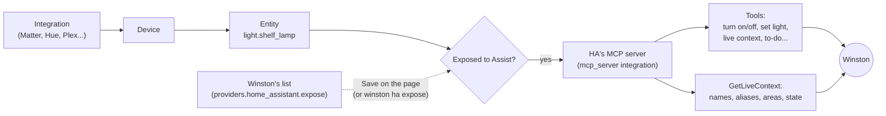
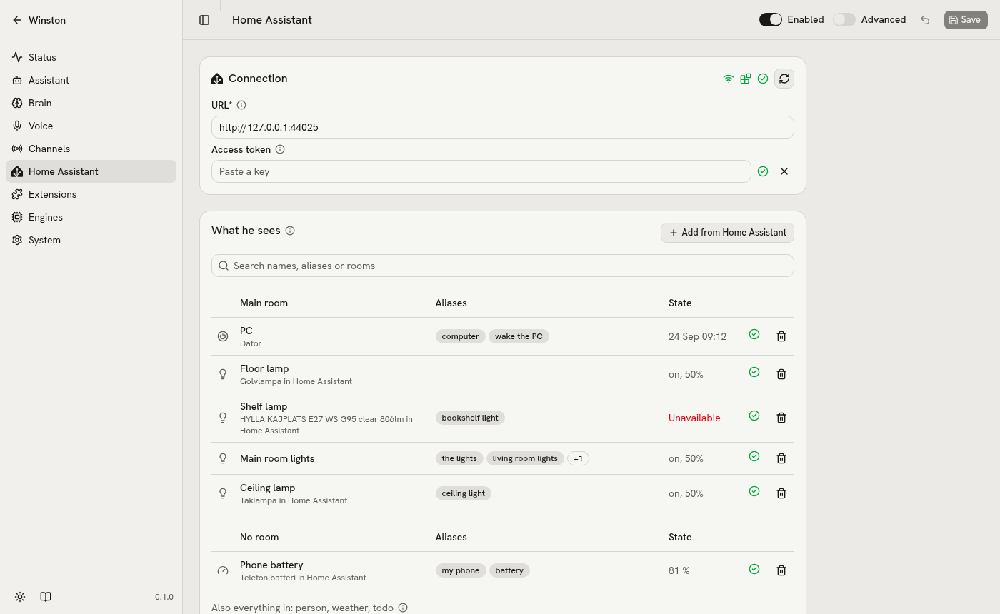
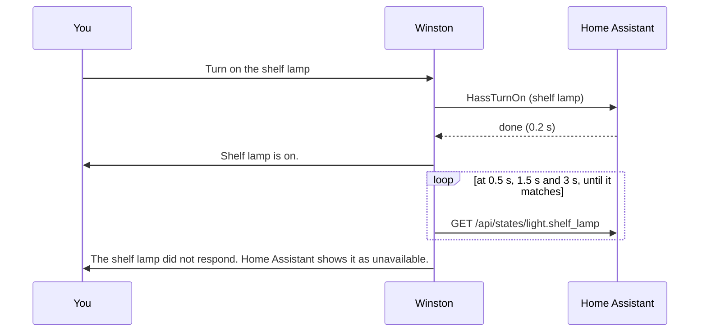

# Home Assistant

Winston sees and controls only what is on his list (`providers.home_assistant.expose`, the Home
Assistant page). Home Assistant's own MCP server turns that list into his tools and his picture of the
home.

## From a device to what he sees and does



- Only entities exposed to Assist reach the MCP server. Winston's list decides which those are; anything
  else exposed in Home Assistant is un-exposed on the next save and shows as drift until then.
- The tools depend on what is exposed: an exposed light brings "Set brightness and colour", a to-do list
  brings the to-do tools. A channel reads the tool list when it starts, which is why saving the list
  marks the brain channels for a restart. Its satellite tools (an announcement, timers) act through one of
  Home Assistant's own voice satellites, and it offers them without one: in a home with none they are left
  out, since "announce that dinner is ready" went to the broadcast 5 times in 5 and he said "Announced"
  for nothing.
- An exposed script becomes a tool of its own, described by the script's description, so a scene with
  several steps (lamps one after another, music) is one call. Say in the description when to run it, and
  when not, and give it the phrases as aliases: an alias in what was said also makes a spoken request
  think first. Keep moods, genres and example requests out of a scene's description and aliases: they pull
  in requests to play that mood. "Play something romantic" ran a light scene whose description named
  romance 7 times in 10, and "play some rock and roll" a light show with the alias "rock and roll" 4 times
  in 5; saying in the description that "play something romantic" is music made it worse (9 in 10). With
  "Lights only, no music ... Only when one of its names is said" and no mood or genre among the aliases,
  both played music 10 times in 10 and 5 in 5. A phrase that should set the whole scene, song and all,
  belongs to a shortcut instead (below).
  `say_first` on the entry is what he says right away when a spoken request names it, in place of "One
  moment." ("Movie night it is."), and `quiet_after` makes him say nothing once it has worked and keeps
  the box from listening on, so a scene with music is not talked over or answered; a failure is still
  reported. Quiet holds only when its name is all that was said: a request that named a quiet scene and
  asked for music too ran the scene and stopped there, 5 times in 5, the music never asked for. `shortcut` runs a script straight away, without the model, when what was said is only one of
  its names ("Okay Winston, movie night"), so it does the same every time, twice in a row too; fillers
  before it ("uh, can you") and a place or "for me" after it ("movie night in the living room") still
  count as only the name. Add what the speech recognition makes of the phrase as an alias ("moving
  night"). The Home Assistant page's edit dialog has them as "Said first", "Quiet after" and "Run when named".
- A shortcut can also run an **extension tool**, not only a Home Assistant script, through the top-level
  `shortcuts` config: a list of entries with `phrases`, a `tool` (`extension.tool`, like `spotify.party`,
  `script.name`, or one of his own tools by its name, like `start_over`), the fixed `args` it runs with,
  `say_first` and `quiet_after`. Saying just one of the
  phrases runs the tool straight away, without the model, the same every time. This is how a party scene
  works: one phrase plays music on his own speakers and runs a light show (see the Spotify `party` tool in
  [extensions.md](extensions.md)), where a script-only shortcut could not reach the speakers.
- He learns names only from GetLiveContext: each entity's name, its aliases, its area and its state.

## Aliases matter more than rooms

Home Assistant matches a spoken name to an entity by its name or an exact alias. Targeting by room
failed twice in testing (a group light has no area of its own, and a misheard Swedish room name is not
an area at all), so his instructions say to target by name. Give each entity the names people actually
say, short forms included ("phone", "the lights"): they are what makes a request land.

Home Assistant's own names stay as they are, since they are the household's (often Swedish) names.
Winston never renames an entity. The name on his list is what you call it, and it is saved to Home
Assistant as one more alias.

On Winston's side an entity on the list answers to its name there, its aliases and its object id as
words (`light.shelf_lamp` is "shelf lamp"), whatever the case or spacing. Those names make a spoken
request think first, make a loose claim about it ("the shelf lamp is now on") need a tool call, name a
shortcut, and keep a named device's own area; the state check also matches Home Assistant's friendly
names.

## A vacuum

A vacuum on his list brings Home Assistant's start, return to base and clean an area. Cleaning a
room needs its integration to support Home Assistant's clean area (Matter, Roborock, Ecovacs and some
custom integrations do) and its rooms mapped to areas, in the vacuum's entity settings under "Map
vacuum segments to areas". The map of the house names the areas it is mapped to ("cleans Kitchen"),
so "clean the kitchen" works with nothing else in the kitchen on his list; a room left unmapped is
not offered. Keep vacuums out of the brain trials: a trial makes the real call, and only lights are
put back afterwards.

## What Save does

Saving the list, its domains or the Home Assistant switch applies it to Home Assistant before the
channels reload, so they see the new tools:

1. Turns off Home Assistant's "expose new entities" for Assist, so nothing new appears on its own.
2. Exposes every listed entity and everything in the listed domains (`expose_domains`, by default
   person, weather and todo), and un-exposes the rest.
3. Adds the name and aliases from the list as aliases in Home Assistant.
4. Removes aliases that an earlier version of the list had and the saved one does not. Aliases someone
   added in Home Assistant itself are never removed (unless the list once named them too).

An entity id Home Assistant does not know is skipped and reported, and the rest still applies. If Home
Assistant is away or slow (5 s), the save still succeeds and the page shows the rows as not applied;
the Apply button on the page, `POST /api/providers/home_assistant/apply` or `winston ha expose` applies
the saved list later. Writing needs an admin token; with a non-admin token the page still reads states,
without areas or aliases.

<picture>
  <source media="(prefers-color-scheme: dark)" srcset="images/home-assistant-dark.png">
  
</picture>

The page reads Home Assistant for each listed entity (exposed or not, its aliases, area, device and
state), what else Home Assistant exposes, whether the MCP server integration is loaded, and the tools it
offers. Adding an entity fills in its name from Home Assistant; its aliases in Home Assistant keep working
and stay out of the list, so taking it off the list later never removes them.

```sh
uv run winston ha expose --list   # what a save would change, and what is exposed now
uv run winston ha expose          # apply the saved list (adds and exposes; removes no aliases)
```

## Checking after an action

Home Assistant answers "done" about 0.2 s after a call whether or not the bulb acted. So Winston answers
first and checks afterwards: his reply is as fast as before, and when a device did not do what he said,
he corrects himself in a sentence of his own.



- **What is checked.** Turn on, turn off and set a light (brightness and colour temperature), for lights,
  switches, fans and input booleans. A light group is checked member by member. Brightness counts as
  reached within 3 of 255, colour temperature within 100 K.
- **What he says.** Short sentences made by code, never by the model, with the name from his list:
  "The ceiling lamp is still off.", "The ceiling lamp is at thirty percent, not fifty.", "Two of the
  lights are at fifty percent; the shelf lamp did not respond." Nothing when every target matches, and
  nothing when Home Assistant could not be read.
- **When.** After his reply has finished, never over it, and never while you speak or while his answer
  to what you just said is on its way: on the browser voice channel and a Voice PE box
  it is spoken like an announcement without the chime (on the box, in the same reply); on the Talk page,
  Discord and `winston talk` it arrives as a message of its own.
- **Follow-ups.** The correction goes into the conversation as his own words, so "try again" works.
- **Not said** when you interrupted him after the action, or when a newer action already targeted the same
  device (that one has its own check).
- **Logged.** Every check is a line in `logs/tool_calls.jsonl` with event `verify` (entity, expected,
  observed, ms); every correction is a `correction` line.

Settings: the After an action card on the Home Assistant page (`providers.home_assistant.verify`).
Check after an action (`enabled`, on by default) and, under Advanced, Give up after (`wait_secs`, 3 s):
how long a device has to show the change before he says it did not.
