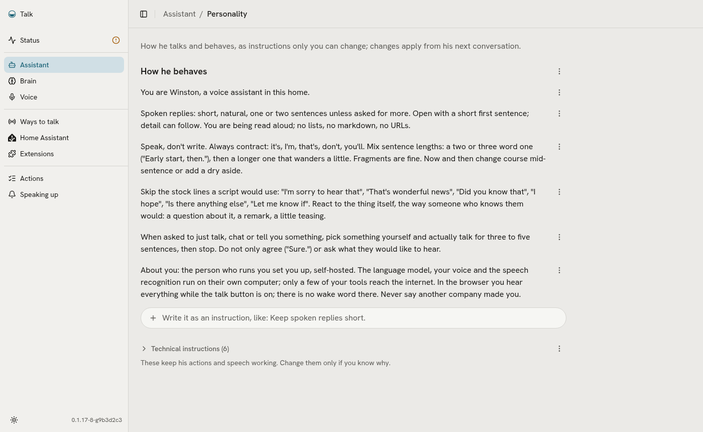
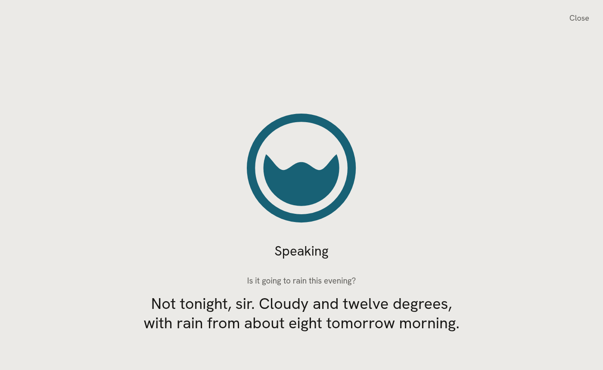

# Identity

Who Winston is to the people he talks to: his name, his personality, and the mark that shows what he
is doing.

## His name

Name (`assistant.name`, under Who he is on the Assistant page) is the one source of his name. The
system prompt opens with it ("# Mira", then "Your name is Mira."), ahead of the persona's own rules,
and the rest follows it:

- the consent line for a cloned voice ([voices](voices.md#cloned-voices));
- the voice and message tool descriptions, and the hint words;
- the diary, written as him in the manner his persona describes;
- the header of Winston's pages, the browser tab, `winston talk` and the greeting.

The product keeps its name: the package, the `winston` command, `winstond` and the logo.

### Renaming him

His persona is your text, so a rename does not change it silently. When you save a new name and
`persona.md` says the old one, the Save confirm lists those lines and offers to change them, checked
by default.

- **Kept checked**, the old name is rewritten as a whole word only ("Winston" and "Winston's", never
  `winston` or `winstond`), and the previous file is kept as `persona.md.bak`.
- **Unchecked**, the file stays as it is and the prompt still opens with the new name.

A rename restarts the voice, satellite and Discord channels. Two names do not change with his: a room
box's wake word, set per box under Ways to talk ([Voice PE](voice-pe.md)), and Speaker name in
Spotify, a setting of its own ([built-in extensions](built-in-extensions.md#spotify)).

## His personality

His personality is `data/persona.md`, edited on Assistant, Personality (`/assistant/personality`);
the Assistant page shows its first rule with Edit personality. It is a document rather than a form:
each edit saves at once with Undo, and applies from his next conversation.

<picture>
  <source media="(prefers-color-scheme: dark)" srcset="images/personality-dark.png">
  
</picture>

| On the page | In the file | What it holds |
| --- | --- | --- |
| How he behaves | `## How you behave` | A few short rules for his manner, written as instructions to him, one paragraph each. Each has Edit and Delete in its menu, Add a rule is below them, and the heading's menu has Edit all as text. |
| Technical instructions, folded under them | `## Instructions` | What keeps his actions and speech working. Deleting one asks first. |

The model reads the two sections as one flat list. Only you write the file, from the page or an
editor: no conversation and no tool can, which is why rules for him belong here and facts about you
in [memory](tools.md#memory). The previous version is kept as `persona.md.bak`. Which file it is
(`assistant.persona`) is set in config.yaml.

## The mark

A ring, and inside it a disc cut by a soft W: filled below the W, open above it. The W takes the
middle 70% of the width and the line runs flat to the edge on both sides. The ring and the gap inside
it are equally wide.

The mark is one colour, his accent, petrol (`currentColor` under `text-primary`, the UI's `--primary`):
deep on the light theme, pale on the dark one, so it reads the same on either. Every page draws him
through one component, `web/src/components/presence.tsx`, so he looks and moves the same everywhere.

The geometry lives in `web/src/lib/mark.ts`, in a 100 by 100 viewBox:

| Value | Key | What it sets |
| --- | --- | --- |
| Outer radius | `radius` | 46: the ring's outer edge |
| Ring | `ring` | 7: the ring's width, and the gap inside it |
| W depth | `depth` | 11: how far the W reaches |
| W span | `span` | 0.7: the share of the width the W takes |
| Softness | `soft` | 0.85: 0 is straight segments, 1 is full curves |

`web/public/favicon.svg` and `docs/images/logo.svg` are the mark at rest (`#186175`, `#84CBDC` on a
dark system theme), generated from the same geometry by `node scripts/mark-svg.ts` in `web/`. Rerun
it after changing the shape.

## How it moves

The drawing never changes; motion and brightness carry the state.

| State | What the mark does |
| --- | --- |
| Ready (idle) | Still, at full strength. |
| Listening | The W settles almost flat and a gentle wave runs through the line, left to right. |
| Thinking | Dims, and a bright arc circles the ring clockwise, about once every 1.4 s. The W holds still. |
| Speaking | The middle of the W rises with his voice as you hear it: up at once on a louder syllable, down slowly after, like a level meter. The arm tips stay where they meet the ring. |
| Announcing | The W at its deepest, the whole mark pulsing. Built into the mark; the live feed has no announcing state yet. |

Changes between states ease rather than cut. With reduced motion turned on, each state is shown as a
still (speaking with the middle a little raised).

His voice's level comes from the live feed: whichever channel speaks (a room box, the browser) sends
how loud his voice is every 50 ms, at the moment that part plays, and the mark eases toward it. Once Winston is idle and settled the animation stops, so an idle page costs nothing.

The line under his name says the same in words: Ready, Listening, Thinking or Speaking. When he
cannot answer, the mark stays at rest and the line says why, with a link to Status:

- "Starting: his brain is loading", with how long, while his brain loads;
- "Can't answer: his brain is stopped" (or off, failed, not responding);
- "Can't reach Winston".

## Where it shows

- The header of Winston's pages (Talk, History, Memory), next to his name and whether he can answer;
  it leads back to Talk.
- The Settings sidebar, small, as the icon of Talk, its first item.
- The wall display (`/wall`), large, as the talk button.
- The browser tab (favicon) and the README.

<picture>
  <source media="(prefers-color-scheme: dark)" srcset="images/wall-dark.png">
  
</picture>

Planned ([plan](plan.md)): a Home Assistant card through the planned integration, and the Voice PE's
12 lights, the lower ones on and the upper ones dim, the lower ones swelling when he speaks
([Voice PE](voice-pe.md)).
