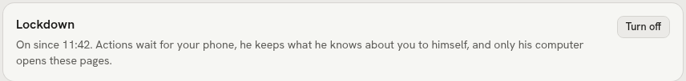

# Lockdown

A mode for evenings when people you do not trust are over. While it is on, nothing said near a room
box changes anything until you confirm it on your phone, and he keeps what he knows about you to
himself. He needs no idea of who is speaking: while it is on, nobody speaking is trusted.

<picture>
  <source media="(prefers-color-scheme: dark)" srcset="images/status-lockdown-dark.png">
  
</picture>

## What it does

In a guarded conversation (below), while it is on:

- **Actions wait for your phone.** An action that does not only look runs nowhere until you confirm
  it: Home Assistant's, extensions' and [computers'](computer.md) alike. It becomes a confirmation
  like an action set to Asks you first ([tiers](extensions.md#tiers)): Confirm and Decline on your
  phone and on the Talk page at his computer, gone after five minutes. He says it "needs your
  confirmation first, on your phone, within five minutes. Nothing has happened yet." Once you confirm,
  Winston runs it and the outcome shows on the Talk page.
- **What only looks still runs**: an extension's action marked Only looks, and Home Assistant's reads
  (`GetLiveContext`, `HassGetState`, `GetDateTime`). Its scripts wait whatever their name, and so does
  reading its to-do lists.
- **He keeps what he knows about you to himself.** His prompt has no remembered facts, no diary and
  none of the lines extensions' jobs wrote; an MCP server's fixed notes stay. An extension action that
  may read his memory waits for your phone like an action.
- **His own tools that change your data or reach people are refused**: `remember`, `forget`,
  `send_message`, `clone_voice`, `use_voice`, `follow_up` and `get_diary` answer "Not available right
  now. Nothing has happened." `start_over`, `mark_mistake` and `lockdown` run. A Home Assistant script
  or extension tool named like one of his own is not offered, and the log names it: rename it.
- **He volunteers nothing.** A message he would say on the speakers goes to your phone instead, and
  what he would mention in the next conversation waits until lockdown is off.
- **Only his computer opens these pages.** Any other device, a wall panel included, gets "Winston is
  locked down" (the API answers 403), and a page already open there stops updating within 15 s. His
  computer is a browser on it at localhost or 127.0.0.1, or at the address Winston listens on when you
  typed one; a reverse proxy, even on the same machine, is another device. Your phone's Confirm and
  Decline keep working, since they come back through Home Assistant.
- **Guests stay out of your diary.** What guarded conversations said while it was on is left out of
  the nightly entry.

It survives a restart: the state is `data/lockdown.json`, and a file there that cannot be read counts
as on. Each change is a line in `logs/lockdown.jsonl`, and each confirmed action one in the tool log
with the channel `confirmed:<where it was asked>`.

## Guarded and trusted conversations

A conversation is guarded when a guarded place takes part in it, and then it is guarded for everyone
in it.

| Where | While locked down |
| --- | --- |
| Room boxes and the Talk page microphone | Guarded |
| Home Assistant's Assist, and the integration's conversation agent | Guarded |
| A room's conversation: its box, Talk pages set to the room, Discord after `/room` | Guarded, for every channel in it |
| The Talk page on another device | Closed |
| The Talk page at his computer, not in a room | Trusted |
| A Discord DM, not in a room (only your own user ID reaches him there) | Trusted |
| `winston talk` | Trusted |
| A call with no conversation (`winston ext call`, the API at his computer) | Trusted |

Turning lockdown on or off starts every room's conversation afresh and restarts the Talk page
microphone, so nothing said before carries into the guests' evening, and his memory is back the
moment it is off. While it is on, a guarded conversation gets none of what he said on his own, an
announcement or a nudge from before included.

## Turning it on and off

Anyone can turn it on; only you can turn it off.

| From | On | Off |
| --- | --- | --- |
| By asking him ("lock down", "lockdown off"): at a box, on the Talk page, on Discord or in `winston talk` | At once | Asks your phone: "Lockdown: turn off? Asked on a room box." Until you confirm, it stays on |
| Turn on and Turn off, on the Lockdown card on Status | At once | At once |
| `winston lockdown on`, `winston lockdown off` | At once | At once |

```sh
uv run winston lockdown on     # lockdown on since 20:14 (by cli)
uv run winston lockdown        # whether it is on
uv run winston lockdown off
```

`winston status` adds a line while it is on.

## The phone notification

Each held action reaches the phone picked as Your phone on [Speaking up](speaking-up.md), through the
Home Assistant companion app, with Confirm and Decline: "Lockdown: Turn on: Kitchen light? Asked on
a room box." It names what will run and what it was given, cut to 150 characters; an extension's
action goes by the extension and the action ("Lockdown: Desk: Open: example.com?" for a computer
named Desk). The word Lockdown tells you why your phone buzzed for a lamp.

With no phone picked, or Home Assistant out of reach, nothing arrives. Turn it off at his computer
(`winston lockdown off`, or the card on Status) and confirm what waits on the Talk page there. If even
the CLI is locked out (for example `control.host` set to a name that resolves to 127.0.1.1), delete
`data/lockdown.json` on the machine.

## What it does not protect

- **Reads other than memory and the diary.** The house, the weather, the time and web search keep
  answering anyone. A read you consider private can be set to Asks you first on Actions; that holds
  whether or not lockdown is on.
- **Settings while it is off.** A page open to your network stays as open as it is; the Web address
  card on Status warns about it.
- **A device named with the wrong room.** A held Home Assistant action keeps the words he gave. The
  correction that normally keeps a named device in its own room is not applied, so such a call fails
  once you confirm it, and the outcome says so.
- **You, near a room box.** It does not know your voice: what you say there waits for your phone too.
  A Discord DM or `winston talk` is trusted.
