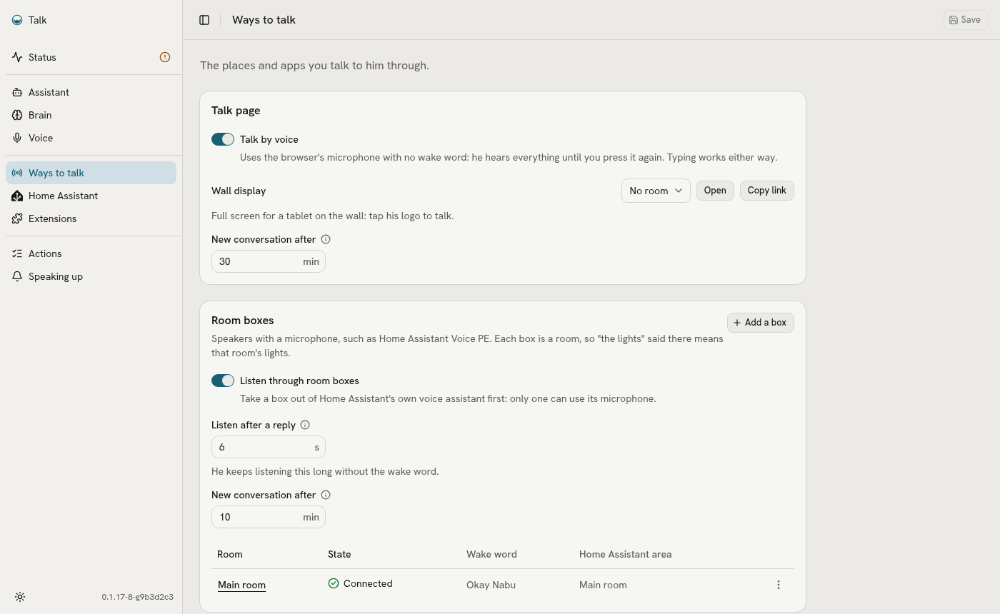

# Rooms

A room is where a [Voice PE box](voice-pe.md) and a screen (the wall display on a tablet, the Talk page
on a laptop) are together. In a room they are one Winston: one conversation, one microphone at a time,
and "the lights" means that room's lights. A screen with no room is a Winston of its own.

## Putting a box or a screen in a room

- **A box** is added in Settings, Ways to talk, Room boxes, with Add a box. Its room is the box's key in
  `config.yaml`; [Voice PE](voice-pe.md#setting-one-up) has the rest of the setup.
- **A screen** gets its room from its address, `/wall?room=main room` (a wall tablet's bookmark), or
  from the room picker on the line above the Talk page's message field. The browser remembers it.
- **Discord** has no room until you type `/room` in the DM, and it clears after an hour without a
  message ([Discord](discord.md#saying-which-room-you-are-in)).

<picture>
  <source media="(prefers-color-scheme: dark)" srcset="images/ways-to-talk-dark.png">
  
</picture>

### A box's fields

| Field | Key | What it is |
| --- | --- | --- |
| Room | the box's key | The room's name, like "main room" |
| Address | `host` | The box's IP address or `.local` name |
| Encryption key | `key_env` | Only for a box Home Assistant adopted. Kept on his computer under a variable of the room's own, `VOICE_PE_KEY_MAIN_ROOM`, so two boxes never share one |
| Wake word | `wake_word` | See [the wake word](voice-pe.md#the-wake-word) |
| Home Assistant area | `area` | The room's name in Home Assistant, for "turn off the lights". Unset, the room's own name is used. The field lists Home Assistant's areas (`/api/options/ha_areas`) |

```yaml
channels:
  satellite:
    devices:
      main room: {host: 192.168.1.50, wake_word: okay_winston, area: Main Room}
```

### Rooms for screens

- **Names match** without regard to case or spacing.
- **The picker offers** the boxes' rooms and Home Assistant's areas, and says what each choice shares.
- **A room with no box** works too, for a wall tablet in a room of its own: "the lights" there means
  the Home Assistant area of the room's name.
- **A Home Assistant satellite** (with [Assist](assist.md) on) is in the room of its area in Home
  Assistant: the box's room whose area that is, else the area's own name. Requests from it join that
  room's conversation, and it speaks for the room while no box or screen is connected there.
- **The Wall display row** on the Talk page card, in Ways to talk, opens the wall display for any room,
  a box's or a Home Assistant area: pick it, then Open, or Copy link for the tablet.

### Whether a box is there

Each box on Room boxes shows whether it is there now, with the same icons as Status:

| State | Means |
| --- | --- |
| Connected | The box is talking to Winston |
| Offline since 14:02 | It went away then |
| Never connected | Not since Winston started |
| Off | Listen through room boxes is off |

A box's menu has Edit, Open wall display, Copy wall display link and Remove. Removing one asks first,
and he stops listening there when you save.

## What a room does

- **One conversation.** A request started at the box can be continued at the screen and the other way
  round: "Okay Winston, what's the capital of Norway?" at the box, then "How many people live there?"
  at the wall display. Typed messages on the Talk page join it too.
- **Starting over.** The room's conversation starts fresh after New conversation after on Room boxes
  (`channels.satellite.session_idle_mins`, 10 min) without a message. Say "start over" or "new
  conversation" anywhere in the room, or press New conversation left of the Talk page's text field, to
  end it sooner, for the box and every screen in the room. What he remembers stays. Without a room,
  saying it starts over that one conversation, and the button the household's typed one.
- **One microphone at a time.** When the box wakes, a screen in the room stops listening until the box's
  reply has played, plus 4 s while the box listens again without the wake word, then for as long as it
  does. The screen shows "Microphone paused while the main room box has it". So the screen neither
  answers the request said to the box nor takes his voice from the box's speaker for a turn.
- **A wake word on its own is the box's.** People pause after "Okay Winston" to see the box light up.
  A screen in a room ignores a bare wake word ("okay", "ok", "hey" or "hi" and his name, or a box's own
  wake word), because it often hears it before the box has said it woke. A screen needs no wake word,
  so just talk to it. If the box misses the wake word, say it again.
- **Room-scoped actions.** "Turn off the lights" means the room's lights, while "turn on the kitchen
  lights" still means the kitchen. A device named by its name keeps its own room: when the model sends a
  name with this room as the area and the device is elsewhere (the window lamps in the Living Room,
  asked from the Main Room), the area is dropped before Home Assistant sees the call, which it would
  refuse.

```mermaid
sequenceDiagram
  participant You
  participant Box as Voice PE
  participant Screen as Wall display
  participant W as winstond
  You->>Box: "Okay Winston, ..."
  Box->>W: holds the room's mic
  W-->>Screen: mic paused
  Box->>W: your request and his reply join the room
  W-->>Screen: mic back after the reply has played
  You->>Screen: "How many people live there?"
  Screen->>W: takes in the box's turn first
```

## How it works

winstond keeps each room's conversation (`core/rooms.py`). Every session in a room (the box's, a
browser's voice session, the Talk page's typed one) keeps its own context and links it to the room.
Before the model runs, the session takes in what the others said since and hands over the new user
message; after each reply it hands over the reply. A question from another session with no answer yet
(a tab closed mid-reply) waits until an answer follows it, so the model never answers it in place of
yours.

- **The mic.** The box holds the room's mic with a lease it renews every 5 s during its turn. A browser
  session follows the room's mic and turns its microphone into silence while the box has it.
- **The stamp.** Each message the model sees starts with the time, the room, and what extensions say is
  going on now (`ctx.ongoing`), read fresh each message: `[09:30, room: Main Room; spotify: playing Oh
  Dove by Men I Trust]`. So "who is this?" or "not this one" in a new conversation knows the song. The
  stamp stays in the history, so the cached prompt does not change.
- **Server slots.** With llama.cpp running more than one slot, each session keeps to one
  (`server_slot` in `core/brain.py`): spoken sessions (the box, a browser's voice) the first, and typed
  ones, checks, trials and background calls the last. Unpinned, llama.cpp would give a request the slot
  whose prompt shares the most with it, and a check could take the box's slot and make his next request
  wait while his conversation is read again.
- **Tools.** A session keeps the tools it started with. When an extension's tools change (one switched
  on or off, or a tool's description or arguments), its next turn starts a new session with them, and
  the room's conversation carries over.

| Endpoint | What |
| --- | --- |
| `GET /api/rooms` | The boxes' rooms and any room a screen is in: who has the mic, screens, messages, whether its box is connected and since when |
| `PUT /api/rooms/{room}/box` | `{connected}`: the satellite channel reports a box connecting or going away. When the channel stops, its boxes count as gone |
| `POST /api/rooms/{room}/sync` | A session hands over its new messages and takes in the others' |
| `POST /api/rooms/{room}/mic` | `{by, secs}`: hold the mic for secs; 0 lets go |
| `GET /api/rooms/{room}/mic` | Who has the mic, now and on every change (server-sent events) |
| `POST /api/chat/start-over` | `{room}`: a new conversation for the room's box and screens; with no room, the household's typed one |

The live feed carries the mic too, as `mic` events with `room` and `held_by`.

## How it is checked

| Check | What it covers |
| --- | --- |
| `tests/rooms_voice.py` | Headless, against `winston up`: a fake Voice PE and a WebRTC browser session in one room hear "Okay Winston, what's the capital of Norway?", the box's reply played into the browser's mic as it streams. The box answers, the browser takes no turn, and "How many people live there?" at the browser is answered about Oslo |
| `tests/room_trials.py` | With the room in the stamp, "turn off the lights" and "dim the lights to 30 percent" go to the room's lights and "turn on the kitchen lights" to the kitchen. Without a room, "turn off the lights" meant every light, 4 of 4 |
| `tests/rooms_cases.py` | No hardware: one conversation across sessions, the idle reset, starting over, the mic lease, the room in the stamp, and a named device keeping its own room |

Results and what is still to check on real hardware are in [the plan](plan.md#m3-next-steps-added-2026-09-25-in-this-order).
