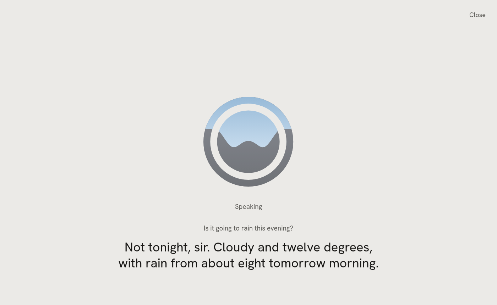

# Running Winston

One command runs everything: `winston up` starts the engines from `data/config.yaml`, waits for them
to be healthy, starts the voice channel and serves the control API. Ctrl-C stops all of it.

```sh
uv run winston init            # once: creates data/ from the examples (--profile ollama | hosted; --list)
uv run winston up              # engines + voice channel + API on :8700
uv run winston status          # health of every engine, GPU memory
uv run winston restart tts     # one engine or the voice channel
uv run winston down            # stop engines and channel; winstond keeps serving
uv run winston talk            # text chat, same brain and tools
uv run winston ha expose       # apply the Home Assistant list (Save on the page does it too); --list shows the plan
uv run winston check           # unit (no hardware), ui, then the m0, m1, m2 acceptance checks on real hardware
uv run winston check unit      # the no-hardware checks, each file run even when one fails; FAILED names each
uv run winston check ui        # the UI smoke test in Chromium on a throwaway winstond (needs pnpm build)
uv run winston check brain     # the configured brain on the trial requests: tool calls and speed
uv run winston check clone     # clone a synthetic friend's voice headless and switch back (about 90 s)
uv run winston ext list        # extensions: on or off, running or not, their status line
uv run winston ext new NAME    # a single-file extension in data/extensions/, with a test beside it
uv run winston ext test NAME   # its tests, no winstond needed; then `winston ext enable NAME`
uv run winston ext call ID TOOL '{"arg": 1}'   # a tool as the brain would call it; also run, logs, restart, disable
uv run winston ext check ID KIND  # what a kind's check would say now, saying nothing
uv run winston ext nudges [ID]    # where nudges stand and why each waits; every step is in logs/nudges.jsonl
uv run winston turns [--day DAY]  # the turn record: each spoken turn, heard, done and said (logging.turns)
uv run winston turns mark ID KIND # mark one as a mistake (misheard, not_addressed, wrong_action, too_slow); unmark, marked
uv run winston check turns [--with FILE]  # the marked turns replayed through this setup or a candidate, scored
```

`.venv/bin/python tests/satellite_fake.py` runs the satellite channel against a fake Voice PE on
localhost: wake, request, streamed reply, a follow-up without the wake word, silence.

`uv run python tests/rooms_voice.py` puts that fake box and a headless browser session in one room
against the running `winston up` and checks he answers once and the conversation carries across
([rooms](rooms.md)); `uv run python tests/room_trials.py` checks "the lights" in a room means that
room's. Both leave the house alone: the box's actions are stubbed, and the browser session is only
asked questions.

`.venv/bin/python tests/conversations.py [name ...]` talks to the voice pipeline headless in eighteen
scripted conversations (vague requests, things he cannot do, Swedish, talking over him, prompt
injection, a promise he might not keep and more) and prints each transcript: what speech-to-text heard,
tool calls, what he said and time to first audio. Actions are stubbed and the tool log goes to the temp
dir, so the house and `data/` are untouched. It judges
nothing; read the transcripts.

`uv run python tests/extensions_voice.py` measures spoken turns against the running engines while an
extension misbehaves (blocks its loop, grows past its memory limit, crashes), in a throwaway winstond:
2026-09-29, median first audio 892 ms with it quiet and 967 ms while it misbehaved 44 times.
`uv run python tests/extensions_demo.py` serves the docs' example extensions and an MCP server on
:8790 against the fake Home Assistant, for looking at the Extensions page; neither touches `data/`.
`uv run python tests/turns_demo.py` serves a made-up turn record on :8791, for looking at the History
page and its marks; it does not touch `data/` either.

Logs: engine subprocesses write to `data/logs/<engine>.log`; each extension to
`data/logs/extensions/<id>.log` (what it printed, every failure with its traceback), and keeps its state
in `data/state/extensions/<id>/`; every step of speaking up (a nudge held, said, put off, and why) to
`data/logs/nudges.jsonl`, with the nudges themselves in `data/state/nudges.json`; the LLM container to
`docker logs winston-llm`; every tool call to `data/logs/tool_calls.jsonl`. The voice and satellite channels write
one line per spoken turn, once his reply is over, to `data/logs/latency.jsonl` (`logging.latency`; empty
turns it off): time from the end of your speech to the transcript (`stt_ms`), the first token
(`first_token_ms`) and the first audio (`first_audio_ms`), and the names of the tools the turn called;
no words, no audio. A request that never reached him (nothing heard, "that's all") gets no line. The
times are the turn record's. With `logging.turns.enabled` (Keep recordings of what you say, on
Assistant; off by default) they also keep each spoken turn whole in `data/turns/<day>/`: its audio
and what was heard, done and said, for 14 days (`logging.turns.keep_days`); `uv run winston turns`
lists a day ([understanding](understanding.md#1-turn-record-and-marks)).

## Status and errors

`winston status` shows each engine and channel as healthy, starting, unhealthy (running, health check
failing), stopped or error; the Status page says Running, Starting, Not responding, Stopped or Failed.
An error says why, and stays until you start or stop that engine again:

- A channel whose variables are not set is not started: Discord without `DISCORD_BOT_TOKEN` shows
  `DISCORD_BOT_TOKEN empty in data/.env` (or `missing from`), naming the variables, never their values.
  The satellite channel checks each box's `key_env` the same way. Discord with Your Discord user ID
  empty (and no older `allowed_user_env` variable) shows `Your Discord user ID is not set: add it on
  Ways to talk, Discord`.
- A process that exits on its own, during startup or later, shows its exit code and the last line of
  its log, say `exited with code 1: discord.errors.LoginFailure: Improper token has been passed.`
  The full log is `data/logs/<name>.log`.
- A process with no health check (Discord) counts as up only after it has run for 2 seconds.
- An engine that does not answer its health check within `startup_timeout` says so: one Winston runs
  adds that a first start may still be downloading, so raise Startup time limit under How it runs; an
  external server, that nothing answered at its Address. A channel says only that it was not ready.

`winston status` prints an error's reason on the line under it. In the UI, Log shows the end of an
engine's or channel's log (`GET /api/engines/{name}/log?lines=200`): the log file of a process, the
container's log for Docker, nothing for an external server. It is on Status, in How it runs at the
bottom of the Brain and Voice slot cards (on the card's state line while the engine is not running),
and on a custom engine's page.

Off means off: a save that removes an engine, switches its Start with Winston off, or switches a
channel off (or leaves the room boxes with no box) stops it right away, and its confirm says so
("Discord: stops now"). One the save adds or switches on starts.

## Web UI

<picture>
  <source media="(prefers-color-scheme: dark)" srcset="images/talk-dark.png">
  
</picture>

`winston up` serves the UI at http://localhost:8700 once `web/dist` exists. The home page is the
Talk page: everything Winston hears, says and does on any channel, each action as one line, a divider
for each new conversation and why it started, and what he brought up on his own as one line with
the time, what he said and from whom. Lines from another place say where ("Kitchen box", "Discord").
Under his name a line says whether he can answer: Ready, Listening, Thinking, Speaking, Starting,
or Can't answer with a link to Status. History, Memory and Settings are at the top right; Settings
carries a warning mark while something needs you.

- **Talk and type.** Type and press Enter, or press the round button to talk: it connects the
  browser's mic to the voice channel through winstond, with no wake word, so he hears everything until
  you press it again.
- **Read aloud.** The speaker icon in the message field reads typed replies aloud in Winston's voice,
  a sentence at a time as the reply streams in (off by default, remembered per browser); spoken turns
  already are.
- **New conversation** is the round button left of the field. Typed messages form one conversation
  that starts fresh after `channels.web.session_idle_mins` (30) and after a settings save.
- **The line above the field** holds the room picker, which puts this browser in a room with a Voice
  PE box: one conversation and one mic for both ([rooms](rooms.md)). At its right it says what matters
  now, such as "Microphone paused while the Kitchen box has it".
- **Its settings** are on Ways to talk, Talk page: Talk by voice (off leaves typing, and the page says
  the microphone is off), the Wall display row, and New conversation after for the typed conversation.
  How long he waits in silence before answering in the browser is config.yaml only
  ([below](#settings-only-in-configyaml)): raise `vad.unfinished_stop_secs` if he cuts you off
  mid-sentence.
- **Other devices.** Browsers only give the mic to `localhost` or HTTPS, so talking from another
  device needs HTTPS on the LAN.
- **Not an archive.** The page keeps the last few hundred events while winstond runs; the tool log is
  the record.

History, at `/history` (`/turns` and `/diary` lead there), shows the spoken requests kept while
recordings are on, one day at a time under his diary entry for it, or only the ones marked as
mistakes ([understanding](understanding.md#1-turn-record-and-marks)).

<picture>
  <source media="(prefers-color-scheme: dark)" srcset="images/wall-dark.png">
  
</picture>

The wall display, at http://localhost:8700/wall (`/dashboard` leads there, keeping its room), is the
same feed full screen for a wall tablet; `/wall?room=main room` puts it in a room, a box's or
a Home Assistant area ([rooms](rooms.md)). Its link is made once per tablet in Settings, Ways to talk: the Wall display row on
the Talk page card takes a room, then Open or Copy link. Tap the logo to talk and again to hang up. Its
room shows at the top left and Close at the top right. The line under the logo follows his state ("Tap
to talk", or why he cannot answer); what you said and his answer show while he is busy and for 20
seconds after. What he says aloud on his own (an announcement, a message on the speakers) takes the
screen for a minute, until you tap it or until you answer it. The page asks the browser to keep the
screen on, which like the mic only works on `localhost` or HTTPS. To show it in Home Assistant, add a
Webpage card pointing at the wall display's address; if Home Assistant itself is on HTTPS, the browser
blocks a plain `http://` page inside it, so Winston needs HTTPS too.

<picture>
  <source media="(prefers-color-scheme: dark)" srcset="images/status-dark.png">
  
</picture>

Settings opens on Status. The sidebar groups the pages: Status; Assistant, Brain and Voice; Ways to
talk, Home Assistant and Extensions; Actions and Speaking up. The theme and the version are at its
foot. Status has, from the top:

- **Needs you**, only when something does: an engine or channel that failed or stopped responding,
  with Log, Restart and a link to its page; an extension that needs a key or is on but not running, with a link to it;
  Home Assistant set up but out of reach. Saved settings that wait for a restart are said once, in the
  header, with one Restart.
- **Set up next**, only while one applies: connect Home Assistant, choose the devices he may use, add
  a room box.
- **His parts**: Brain, Speaking, Hearing, Talk page microphone, Room boxes, Discord, Home Assistant and
  Extensions. Each row says what runs it ("2 boxes, 1 connected"; the brain's model by its own name,
  "Qwen3.8-27B", without its maker, file format or quantization, which the Brain page shows whole), its
  state in words with how long ("Running, up 15 min", "Starting, 40 s of about 2 min"), and the reason
  under it when it is not running. Its command is Restart while it runs, Start while it does not, Turn on for one switched
  off (a draft change, for Save) and Set up for Discord; its menu has Stop and Log; the row opens the
  page that sets it up. Stop and Restart say what stops and for how long ("Stop the brain? He cannot
  answer anywhere until it starts again, about 24 s.").
- **Graphics memory**: "23.4 of 24.0 GB in use" and the card's name. The brain and the voices share
  it; one that does not fit will not start. Above 90% the bar is in the warning colour and the card
  says "Nearly full: a bigger model or voice will not fit."
- **Custom engines**, once there is one: servers Winston starts and keeps running, which nothing uses
  until a setting points at their address. Each row opens its page at `/status/engines/<name>`, which
  shows how it runs open.
- **Web address**: Who can open this page, This computer only or Every device on your network
  (`control.host`). Open to the network, a warning says anyone on it can control him (and your home,
  once Home Assistant is set up), and a line says keys cannot be pasted on these pages then. It takes
  effect when Winston restarts. API reference opens `/docs`.

Start all (while something is stopped), Stop all (while something runs) and Add a custom engine, which
asks a name and how it runs, are commands in the header; Stop all asks first.

<picture>
  <source media="(prefers-color-scheme: dark)" srcset="images/brain-dark.png">
  
</picture>

Brain picks what runs the brain under Runs on, from presets (vLLM, llama.cpp, Ollama, hosted), each with
a line on what it is good at, and what it needs where its name does not say, and the model from three
lists: Running, what the brain's server reports; Downloaded, what the chosen engine can load from the
Hugging Face cache on this machine; and Suggested, the presets' models for that engine, not downloaded
yet. Picking a preset rewrites the engine block and the settings that go with it, and asks first when
you had edited that block. How it runs, closed at the bottom of the What runs his brain card, holds
the engine block (Runs as, Start with Winston, port, image, arguments and the rest), its state with
Log and Restart while it runs, Reset to the preset while the block differs from the preset, the API
address while Winston runs the engine, and How thinking is switched; a problem with the engine shows
above it, never folded away. Think before answering and How he picks his words (temperature, top-p,
presence penalty and the longest reply, for when your model's page recommends other values) are cards
of their own. Voice does the same for speaking and hearing ([voices](voices.md)).

The settings pages are drawn from the config schema: a label that says what the setting does, a line
under it where the label cannot say it all, and an (i) beside it for the background. There are no
view modes: a setting is on its page, or, for what nobody sets by hand, only in config.yaml
([below](#settings-only-in-configyaml)).

Anything a machine already knows is a searchable dropdown filled from `/api/options/{name}`, and a
typed value still works when the list is empty. A list that cannot be fetched (no token yet, the
server down) leaves a plain text box with the reason in a line under it.

| Field | Filled from |
| --- | --- |
| Brain model | Running: the brain's server (`/models`), following an unsaved base URL. Downloaded: the Hugging Face cache the engine reads, with each model's size on disk. Suggested: the presets' models for that engine |
| Voice | clips in `data/voices/`, your cloned voices and the TTS server's built-in voices |
| Speech-to-text model | the models onnx-asr knows, downloaded ones marked |
| Home Assistant entities, sensors, domains | Home Assistant's states, with each entity's name, state and an icon for its type |
| Your Discord user ID, contacts | the members of the bot's servers, a pasted id looked up ([Discord](discord.md)) |
| Sound before an announcement | None, and the sounds in `assets/sounds/` and `data/sounds/` |
| Who can open this page | This computer only, Every device on your network |

A field that does not apply is not shown: an API key only for a hosted brain or voice, the Streaming
settings only when the speech engine's command uses them, engine fields only for their driver. A
feature that is switched off (a channel, memory, announcements) keeps its fields visible and editable
at full contrast; its switch's line says they wait until it is on, and its keys do not warn. Keys are
never shown: a key field says Saved or Not set, takes a pasted key that Save writes to `data/.env`,
and Remove deletes the stored one at once, after asking; the variable it is stored under is
config.yaml only, and a key refused while the page is open to your network names it.
Maps (Discord contacts, an engine's environment and volumes) are tables with Add, a dialog per entry
and trash with Undo. A card about something that runs (the Talk page, Room boxes, Discord) shows its
state in its title while it is not running. The Home Assistant page checks the address and token
before anything is saved ([Home Assistant](home-assistant.md#the-page)).

Edits are one draft across all pages until saved or discarded; a dot in the sidebar marks each page
with unsaved edits, and closing the tab asks first. Save sends only the changed fields
(`PATCH /api/config` with the version the edits started from). Its confirm lists the changes by page,
then what the save starts, stops and restarts, with roughly how long each takes, a model download, and
what Home Assistant would change; its title says it ("Save and start the room boxes and restart the
brain?"). It asks when something starts, stops or restarts, or the edits reach past the current page.
Pasted keys are written after the config. If something else saved one of the same fields meanwhile (a
voice switched by asking), nothing is overwritten: the page reloads, keeps your edits on top, names
the field in a message, and you save again. A field the server refuses is marked where it is.
Discard asks when edits reach past the current page, offering that page alone. On a phone, Discard and
Save sit in a bar along the bottom while there are unsaved changes.

Downloaded is read from the disk, never the Hub: the host side of the engine's huggingface volume,
else `HF_HOME`, else `~/.cache/huggingface`. llama.cpp and Ollama list each GGUF quant as
`repo:quant` (a split file is one quant, listed once every part is there); Ollama's entries are `hf.co/repo:quant`, as Ollama pulls its
own copy. vLLM lists safetensors repos with a language model config. A model the engine cannot load
is greyed with the reason ("vLLM only"); speech models (Chatterbox, Parakeet, Pocket TTS, a model card
tagged text-to-speech) are left out. When Save changes the brain's model to one that is neither
running nor downloaded, the confirm says the restart downloads it first, size unknown, and may take
many minutes; the brain is offline until the download ends.

While a saved change waits for a restart, every settings page says so beside Save ("Waiting for a
restart: the brain, about 24 s"; the icon lists each part and its cost) with a Restart button that
restarts only those. What only winstond reads (the web address, announcements, Home Assistant) says it
takes effect when Winston restarts, the next `winston up`, and has no button.

Build it once (Node 22 or newer, pnpm):

```sh
cd web && pnpm install && pnpm build   # guardrails, lint, type check, bundle into web/dist
```

`pnpm dev` runs Vite on :5173 with `/api` proxied to :8700. `pnpm api` regenerates the typed client
from `winston api schema` after the API changes.

`pnpm smoke` (or `winston check ui`) tests the built pages with Playwright in the system Chromium
(`/usr/bin/chromium`, or set `CHROMIUM`). It copies `config.yaml` and `persona.md` to a temp directory
with fake keys, every engine and channel off, Home Assistant pointed at a fake one (`tests/fake_ha.py`),
every other address pointed nowhere and every port moved to a free one, so nothing reaches the running
brain, voice server, channels, MCP servers or Spotify receiver. It starts a throwaway
`winston up --no-start` on a free port and deletes it all afterwards. It checks that every settings page loads with
nothing to save; that every page fits a 390 px phone with every How it runs open, without sideways
scroll or a card's content wider than the card; that a rename survives a reload; that a pasted key
shows as Saved and never comes back from the server, and an MCP server's token lands in `data/.env`
alone; that a hosted-only field is left out for a local engine; that a refused save opens the How it
runs that holds the field; that Status lists the custom engines and who can open the page; that Save
only leaves a Restart button; and the Brain, Voice, Home Assistant, Memory, History and Talk
pages' own cases.

## Settings only in config.yaml

The settings pages leave out what nobody needs to set by hand: ports, folders and files, timings
measured on real requests, and the variable each key is stored under. To change one, edit
`config.yaml` (`winston config path` prints where), then restart Winston.

| Setting | Default | What it is |
| --- | --- | --- |
| `assistant.persona` | `persona.md` | The file in the data folder his personality is read from; its words are edited on Assistant, Personality |
| `stt.quantization` | `int8` | Parakeet's precision: int8 is faster on the CPU at no audible cost, empty is full precision ([voices](voices.md#hearing-engines)) |
| `tts.streaming.first_secs` | 0.96 s | The first chunk of streamed speech; shorter starts sooner, below about 0.9 s the second can arrive late |
| `tts.streaming.lookahead_secs` | 0.32 s | Audio held back at the end of each chunk until what follows is known; shorter than the first chunk |
| `vad.stop_secs` | 0.3 s | Silence before he answers on the Talk page |
| `vad.unfinished_stop_secs` | 2.5 s | Added when what you said sounds unfinished; raise it if he cuts you off in the browser |
| `channels.voice.host`, `channels.voice.port` | `127.0.0.1`, 7860 | Where the browser's voice is received; winstond passes the browser's connection to it. 7860 is also Gradio's default |
| `channels.satellite.http_port` | 8702 | The port room boxes fetch his replies from ([Voice PE](voice-pe.md#the-network)) |
| `channels.satellite.public_host` | found from the route to each box | This computer's address as the boxes reach it, for a VPN, Docker or several network interfaces |
| `channels.satellite.devices.<room>.port` | 6053 | The box's ESPHome API port |
| `channels.satellite.end_silence_secs` | 0.8 s | Silence that ends a request that sounds finished |
| `channels.satellite.unfinished_silence_secs` | 2.5 s | Silence that ends one that does not; raise it if he cuts you off mid-thought |
| `channels.satellite.chat_silence_secs` | 1.5 s | Silence that ends a finished sentence in answer to a reply that only talked |
| `channels.satellite.barge_in_secs` | 0 (off) | Talking over him on a room box, with `barge_in_volume` (0.6), `barge_in_gain_db` (30) and `barge_in_grace_secs` (3 s) ([Voice PE](voice-pe.md#ending-a-conversation-and-the-button)) |
| `providers.home_assistant.mcp_path` | `/api/mcp` | Home Assistant's MCP server path; a proxy's prefix goes in the address |
| `memory.dir` | `memory` | The memory folder, in the data folder |
| `announce.ha_event` | `winston_announce` | The event an automation fires to make him speak; the example on Speaking up uses it |
| `logging.turns.dir` | `turns` | The recordings folder, in the data folder |
| `logging.tool_calls` | `logs/tool_calls.jsonl` | Every action with its arguments and result, in the data folder |
| `logging.latency` | `logs/latency.jsonl` | Each spoken request's timings; empty turns it off |
| `control.port` | 8700 | The port of these pages and the API; when it is taken the pages cannot load to fix it |
| `extensions.spotify.settings.api_port`, `stream_port` | 3678, 3679 | The Spotify receiver's API and the audio the speakers fetch, both on 127.0.0.1 |

Pasting a key on its page writes the variable's name for you; set one by hand to share a key or to
keep an older name:

| Key | Setting | Variable in `data/.env` |
| --- | --- | --- |
| A hosted brain's, voice's or hearing's API key | `llm.api_key_env`, `tts.api_key_env`, `stt.api_key_env` | `LLM_API_KEY`, `TTS_API_KEY`, `STT_API_KEY` |
| Discord bot token | `channels.discord.token_env` | `DISCORD_BOT_TOKEN` |
| Your Discord user ID, for older setups | `channels.discord.allowed_user_env` | `DISCORD_ALLOWED_USER_ID`, read while Your Discord user ID is empty |
| A room box's encryption key | `channels.satellite.devices.<room>.key_env` | `VOICE_PE_KEY_<ROOM>` |
| Home Assistant access token | `providers.home_assistant.token_env` | `HA_TOKEN` |
| An MCP server's token | `extensions.<id>.mcp.token_env` | `<ID>_MCP_TOKEN` |
| Web search, Ask Claude, Hevy | `extensions.web.settings.api_key`, `extensions.claude.settings.key`, `extensions.hevy.settings.api_key` | `GEMINI_API_KEY`, `CLAUDE_CODE_OAUTH_TOKEN`, `HEVY_API_KEY` |
| Spotify's keys | `extensions.spotify.settings.client_id`, `client_secret`, `listenbrainz_token` | `SPOTIFY_CLIENT_ID`, `SPOTIFY_CLIENT_SECRET`, `LISTENBRAINZ_TOKEN` |

Not listed: `version`, which Winston sets; `llm.provider`, `stt.provider`, `tts.provider` and
`vad.provider`, which have one value or follow Runs on; and `stt.hint_words_removed`, which Names he
should hear right writes.

## Engines

Declared under `engines:` in config with a driver:

- `docker`: image, args, env, volumes, gpu. Used for the vLLM and llama.cpp servers. With Docker's
  `--gpus` path broken by a stale CDI spec on some hosts, set `runtime: nvidia` explicitly. The
  container carries a label with a hash of its engine block; `winston up` replaces a running
  `winston-<name>` container whose label does not match, so a swapped engine never silently keeps
  the old one. Before it starts one, the host side of each volume is made as you, and `hub/` in a
  Hugging Face cache volume: the container runs as root, and a folder it made would be root's, which a
  voice running on the host then cannot download its model into.
- `subprocess`: cmd and cwd, with `{data}` and `{repo}` expanding. Used for the Chatterbox TTS server,
  which has its own venv because it pins torch 2.6.
- `external`: a URL you already run; Winston only health-checks it.

In args and cmd, `{model}` stands for `llm.model` and `{section.field}` for any other config value,
so a server's own options can be ordinary settings: the Chatterbox command passes
`--chunk-secs {tts.streaming.chunk_secs}` and friends, and changing the setting restarts the engine
with the new value.

## Exposure

Home Assistant's Assist exposure is a strict allowlist under `providers.home_assistant.expose`, with the
names people actually say as aliases. Saving it on the Home Assistant page applies it: exposes the list,
un-exposes anything else, adds aliases (never renaming Home Assistant's own entities) and turns off HA's
auto-expose. The Save confirm says what will change there first, and the save that first connects Home
Assistant changes nothing. `winston ha expose` does the same from the shell and `--list` prints the
plan. The model sees exactly that list. Details in [Home Assistant](home-assistant.md).

## Announcements, Discord, tools, extensions

Winston speaking on its own is in [announcements](announcements.md), the Discord channel in
[discord](discord.md), memory and `send_message` in [tools](tools.md), and web search, Ask Claude and
watched sensors in [built-in extensions](built-in-extensions.md).
Extensions, and the Extensions page under Settings, are in [extensions](extensions.md): each runs as
its own process, gets only its own keys, and its tools reach every channel's brain. What each action
may do on its own is set on Actions. An action ticked under Share with other AI apps (on Actions
while an extension is on, with the address to copy) is also offered to MCP apps on this computer, such
as Claude Code, at http://127.0.0.1:8700/mcp.

## Memory of what was measured

