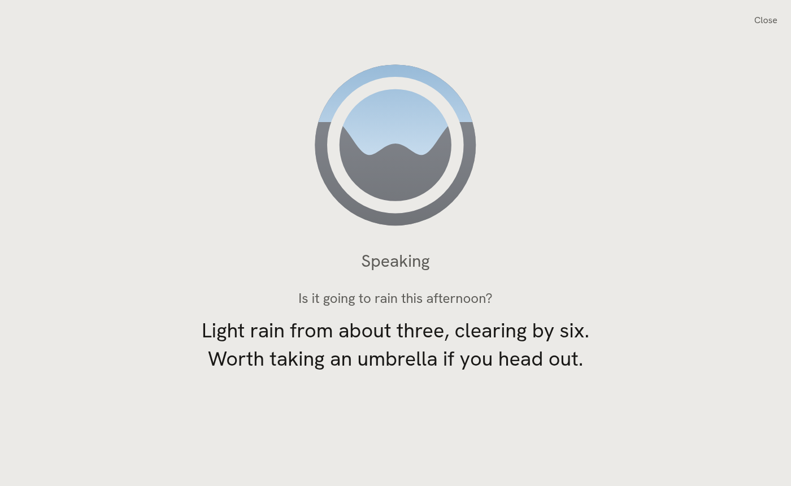
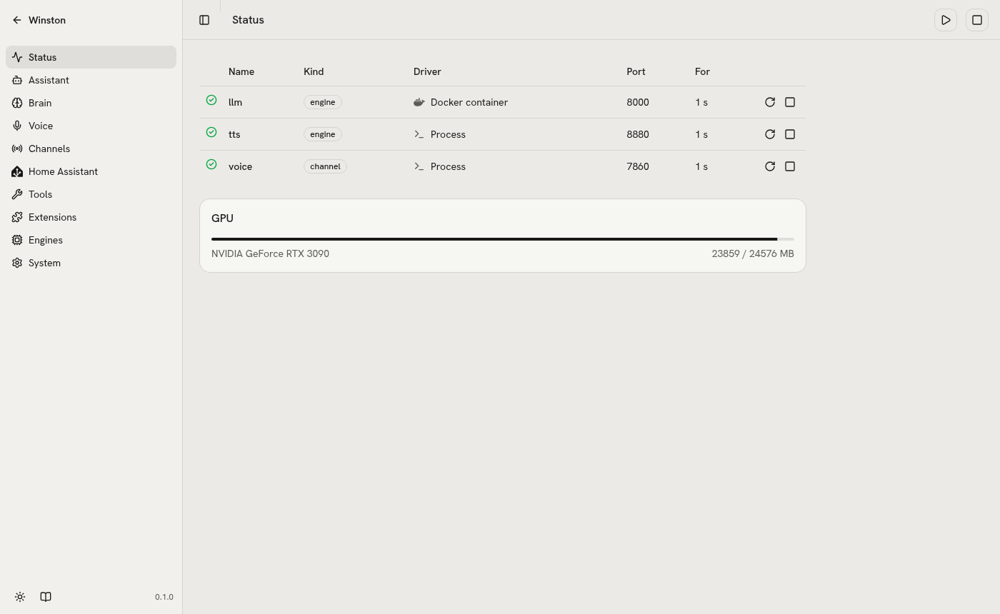
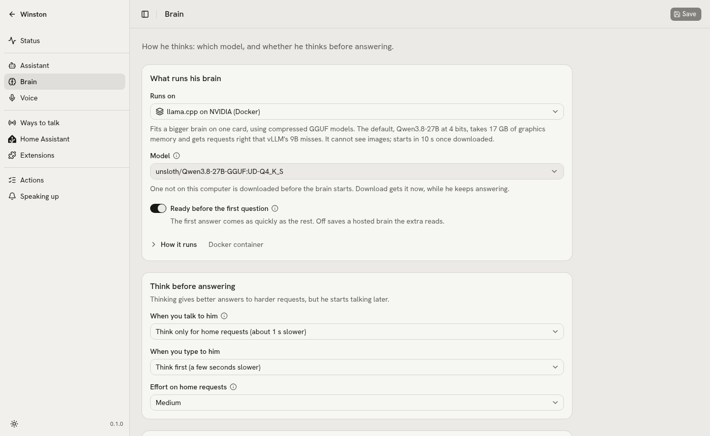

# Running Winston

One command runs everything: `winston up` starts the engines from `data/config.yaml`, waits for them
to be healthy, starts the voice channel and serves the control API. Ctrl-C stops all of it.

```sh
uv run winston init            # once: creates data/ from the examples (--profile ollama | hosted; --list)
uv run winston up              # engines + voice channel + API on :8700
uv run winston status          # health of every engine, GPU memory
uv run winston restart tts     # one engine or the voice channel
uv run winston down            # stop engines and channel; winstond keeps serving
uv run winston talk            # text chat, same brain and tools
uv run winston ha expose       # apply the Home Assistant list (Save on the page does it too); --list shows the plan
uv run winston check           # unit (no hardware), ui, then the m0, m1, m2 acceptance checks on real hardware
uv run winston check ui        # the settings smoke test in Chromium on a throwaway winstond (needs pnpm build)
uv run winston check brain     # the configured brain on the trial requests: tool calls and speed
uv run winston check clone     # clone a synthetic friend's voice headless and switch back (about 90 s)
uv run winston ext list        # extensions: on or off, running or not, their status line
uv run winston ext new NAME    # a single-file extension in data/extensions/, with a test beside it
uv run winston ext test NAME   # its tests, no winstond needed; then `winston ext enable NAME`
uv run winston ext call ID TOOL '{"arg": 1}'   # a tool as the brain would call it; also run, logs, restart, disable
uv run winston ext check ID KIND  # what a kind's check would say now, saying nothing
uv run winston ext nudges [ID]    # where nudges stand and why each waits; every step is in logs/nudges.jsonl
```

`.venv/bin/python tests/satellite_fake.py` runs the satellite channel against a fake Voice PE on
localhost: wake, request, streamed reply, a follow-up without the wake word, silence.

`uv run python tests/rooms_voice.py` puts that fake box and a headless browser session in one room
against the running `winston up` and checks he answers once and the conversation carries across
([rooms](rooms.md)); `uv run python tests/room_trials.py` checks "the lights" in a room means that
room's. Both leave the house alone: the box's actions are stubbed, and the browser session is only
asked questions.

`.venv/bin/python tests/conversations.py [name ...]` talks to the voice pipeline headless in eighteen
scripted conversations (vague requests, things he cannot do, Swedish, talking over him, prompt
injection, the claim guard's retry and more) and prints each transcript: what speech-to-text heard,
tool calls, what he said (a failed retry's soft line included) and time to first audio. Actions are
stubbed and the guard's records go to the temp dir, so the house and `data/` are untouched. It judges
nothing; read the transcripts.

`uv run python tests/extensions_voice.py` measures spoken turns against the running engines while an
extension misbehaves (blocks its loop, grows past its memory limit, crashes), in a throwaway winstond:
2026-09-29, median first audio 892 ms with it quiet and 967 ms while it misbehaved 44 times.
`uv run python tests/extensions_demo.py` serves the docs' example extensions and an MCP server on
:8790 against the fake Home Assistant, for looking at the Extensions page; neither touches `data/`.

Logs: engine subprocesses write to `data/logs/<engine>.log`; each extension to
`data/logs/extensions/<id>.log` (what it printed, every failure with its traceback), and keeps its state
in `data/state/extensions/<id>/`; every step of speaking up (a nudge held, said, put off, and why) to
`data/logs/nudges.jsonl`, with the nudges themselves in `data/state/nudges.json`; the LLM container to
`docker logs winston-llm`; every tool call to `data/logs/tool_calls.jsonl`. The voice and satellite channels write
one line per spoken turn to `data/logs/latency.jsonl` (`logging.latency`; empty turns it off): time
from the end of your speech to the transcript (`stt_ms`), the first token (`first_token_ms`) and the
first audio (`first_audio_ms`), and the tools the turn called.

## Status and errors

`winston status` and the Status page show each engine and channel as healthy, starting, unhealthy
(running, health check failing), stopped or error. An error says why, and stays until you start or
stop that engine again:

- A channel whose variables are not set is not started: Discord without `DISCORD_BOT_TOKEN` shows
  `DISCORD_BOT_TOKEN empty in data/.env` (or `missing from`), naming the variables, never their values.
  The satellite channel checks each box's `key_env` the same way.
- A process that exits on its own, during startup or later, shows its exit code and the last line of
  its log, say `exited with code 1: discord.errors.LoginFailure: Improper token has been passed.`
  The full log is `data/logs/<name>.log`.
- A process with no health check (Discord) counts as up only after it has run for 2 seconds.
- An engine that does not answer its health check within `startup_timeout` says so.

`winston status` prints an error's reason on the line under it.

## Web UI

<picture>
  <source media="(prefers-color-scheme: dark)" srcset="images/talk-dark.png">
  
</picture>

`winston up` serves the UI at http://localhost:8700 once `web/dist` exists. The home page is the
Talk page: everything Winston hears, says and does on any channel (typed here, spoken through the
talk button or the voice page), each tool call as one line, and announcements. Type and press Enter,
or press the round button to talk; it connects the browser's mic to the voice channel through
winstond, and press it again to hang up. The speaker button at the top reads typed replies aloud in
Winston's voice through the browser, a sentence at a time as the reply streams in (off by default,
remembered per browser); spoken turns already are. Typed messages form one conversation that starts fresh
after `channels.web.session_idle_mins` (30) and after a settings save. The room picker beside it puts
this browser in a room with a Voice PE box: one conversation and one mic for both ([rooms](rooms.md)). Browsers only give the mic to
`localhost` or HTTPS, so talking from another device needs HTTPS on the LAN. The page keeps the last
few hundred events while winstond runs; it is not a transcript archive (the tool log is the record).

<picture>
  <source media="(prefers-color-scheme: dark)" srcset="images/dashboard-dark.png">
  
</picture>

Dashboard mode, at http://localhost:8700/dashboard (the Dashboard link on the Talk page), is the
same feed full screen for a wall tablet; `/dashboard?room=main room` puts it in a box's room
([rooms](rooms.md)). Tap the logo to talk and again to hang up. The line under it
follows his state; what you said and his answer show while he is busy and for 20 seconds after. An
announcement takes the screen for a minute, until you tap it or until you answer it. The page asks the browser to keep
the screen on, which like the mic only works on `localhost` or HTTPS. To show it in Home Assistant,
add a Webpage card pointing at the dashboard URL; if Home Assistant itself is on HTTPS, the browser
blocks a plain `http://` page inside it, so Winston needs HTTPS too.

<picture>
  <source media="(prefers-color-scheme: dark)" srcset="images/status-dark.png">
  
</picture>

Settings is the link at the top right. Status lists every engine and channel with how it runs, icon
actions and the GPU; hover a state icon for its detail (an error's reason). A changed icon in its
header lists what only the next `winston up` applies.
Brain picks the engine from presets (vLLM, llama.cpp, Ollama, hosted) and the model from two lists:
Running, what the brain's server reports, and Downloaded, what the chosen engine can load from the
Hugging Face cache on this machine; Voice does the same for speaking (voices from `data/voices/` and the TTS server) and
hearing, and for Chatterbox has Streaming: on or off and the chunk length, longer being smoother. Picking a preset rewrites the engine block and the settings that go with it. The other
pages are generated from the config schema: basic fields first, Advanced behind a toggle, and an (i)
beside each label that explains the field (and, for an engine, what the chosen preset needs).

<picture>
  <source media="(prefers-color-scheme: dark)" srcset="images/brain-dark.png">
  
</picture>

Anything a machine already knows is a searchable dropdown filled from `/api/options/{name}`, and a
typed value still works when the list is empty. A list that cannot be fetched (no token yet, the
server down) leaves a plain text box with a warning icon; hover it for the reason.

| Field | Filled from |
| --- | --- |
| Brain model | Running: the brain's server (`/models`), following an unsaved base URL. Downloaded: the Hugging Face cache the engine reads, with each model's size on disk |
| Voice | clips in `data/voices/` and the TTS server's built-in voices |
| Speech-to-text model | the models onnx-asr knows, downloaded ones marked |
| Web search and Claude models | the Gemini API; the Anthropic API when `ANTHROPIC_API_KEY` is set, else a built-in list |
| Home Assistant entities, sensors, domains | Home Assistant's states, with each entity's name, state and an icon for its type |
| Your Discord user id, contacts | the members of the bot's servers, a pasted id looked up ([Discord](discord.md)) |
| Discord user id variable (older configs) | the names in `data/.env`, with an icon for set or empty; values never leave winstond |
| Persona, chime | `*.md` in the data directory, sounds in `assets/sounds/` and `data/sounds/` |

A field that does not apply is not shown: an API key only for a hosted brain or voice, the Streaming
settings only when the speech engine's command uses them, engine fields only for their driver. A
feature that is switched off (a channel, a tool, memory, announcements) keeps its fields visible and
editable but greyed. Keys are never shown: a key field says Set or Not set with an icon, takes a
pasted key that Save writes to `data/.env`, and its x removes the stored one; the variable name it is
stored under is Advanced. Maps (Discord contacts, an engine's environment and volumes) are tables with
an Add icon, a dialog per entry and trash with Undo. Channel cards show the channel's state icon from
the Status page.

Home Assistant shows whether it answers at the URL with the token. Adding a sensor on the Tools
page fills its label from Home Assistant and finds its state sensor (`_level` to `_state`).

Edits are one draft across all pages until saved or discarded; a dot in the sidebar marks each page
with unsaved edits, and closing the tab asks first. Save sends only the changed fields
(`PATCH /api/config` with the version the edits started from). When it confirms, it lists the changes
by page and what they restart with roughly how long each takes; it asks when something restarts or
the edits reach past the current page. Pasted keys are written after the config. If something else
saved one of the same fields meanwhile (a voice switched by asking), nothing is overwritten: the page
reloads, keeps your edits on top, names the field in a message, and you save again. A field the
server refuses is marked where it is. Discard asks when edits reach past the current page, offering
that page alone.

Downloaded is read from the disk, never the Hub: the host side of the engine's huggingface volume,
else `HF_HOME`, else `~/.cache/huggingface`. llama.cpp and Ollama list each GGUF quant as
`repo:quant` (a split file is one quant, listed once every part is there); Ollama's entries are `hf.co/repo:quant`, as Ollama pulls its
own copy. vLLM lists safetensors repos with a language model config. A model the engine cannot load
is greyed with the reason ("vLLM only"); speech models (Chatterbox, Parakeet, Pocket TTS, a model card
tagged text-to-speech) are left out. When Save changes the brain's model to one that is neither
running nor downloaded, the confirm says the restart downloads it first, size unknown, and may take
many minutes; the brain is offline until the download ends.

While a saved change waits for a restart, every settings page shows the changed icon beside Save
(hover it for each engine or channel and its cost) and a Restart button that restarts only those.
What only winstond reads (Control, announcements, Home Assistant) shows the icon with "Applies on the
next winston up" and no button.

Build it once (Node 22 or newer, pnpm):

```sh
cd web && pnpm install && pnpm build   # guardrails, lint, type check, bundle into web/dist
```

`pnpm dev` runs Vite on :5173 with `/api` proxied to :8700. `pnpm api` regenerates the typed client
from `winston api schema` after the API changes.

`pnpm smoke` (or `winston check ui`) tests the built settings pages with Playwright in the system
Chromium (`/usr/bin/chromium`, or set `CHROMIUM`). It copies `config.yaml` and `persona.md` to a temp
directory with fake keys, every engine and channel off and Home Assistant pointed nowhere, starts a
throwaway `winston up --no-start` on a free port, and deletes it all afterwards. It checks that every
settings page loads, an edit survives a reload, a pasted key shows as Set and never comes back from the
server, a hosted-only field is left out for a local engine, and Save only leaves a Restart button.

## Engines

Declared under `engines:` in config with a driver:

- `docker`: image, args, env, volumes, gpu. Used for the vLLM and llama.cpp servers. With Docker's
  `--gpus` path broken by a stale CDI spec on some hosts, set `runtime: nvidia` explicitly. The
  container carries a label with a hash of its engine block; `winston up` replaces a running
  `winston-<name>` container whose label does not match, so a swapped engine never silently keeps
  the old one.
- `subprocess`: cmd and cwd, with `{data}` and `{repo}` expanding. Used for the Chatterbox TTS server,
  which has its own venv because it pins torch 2.6.
- `external`: a URL you already run; Winston only health-checks it.

In args and cmd, `{model}` stands for `llm.model` and `{section.field}` for any other config value,
so a server's own options can be ordinary settings: the Chatterbox command passes
`--chunk-secs {tts.streaming.chunk_secs}` and friends, and changing the setting restarts the engine
with the new value.

## Exposure

Home Assistant's Assist exposure is a strict allowlist under `providers.home_assistant.expose`, with the
names people actually say as aliases. Saving it on the Home Assistant page applies it: exposes the list,
un-exposes anything else, adds aliases (never renaming Home Assistant's own entities) and turns off HA's
auto-expose. `winston ha expose` does the same from the shell and `--list` prints the plan. The model sees
exactly that list. Details in [Home Assistant](home-assistant.md).

## Announcements, Discord, tools, extensions

Winston speaking on its own is in [announcements](announcements.md), the Discord channel in
[discord](discord.md), and memory, web search, `ask_claude` and `send_message` in [tools](tools.md).
Extensions, and the Extensions page under Settings, are in [extensions](extensions.md): each runs as
its own process, gets only its own keys, and its tools reach every channel's brain; one marked "Offer
to other apps" is also listed for Claude Code at http://127.0.0.1:8700/mcp.

## Memory of what was measured

