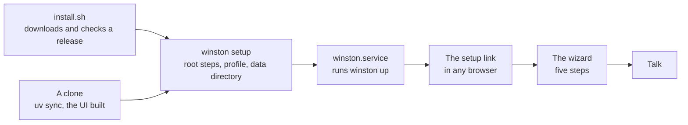
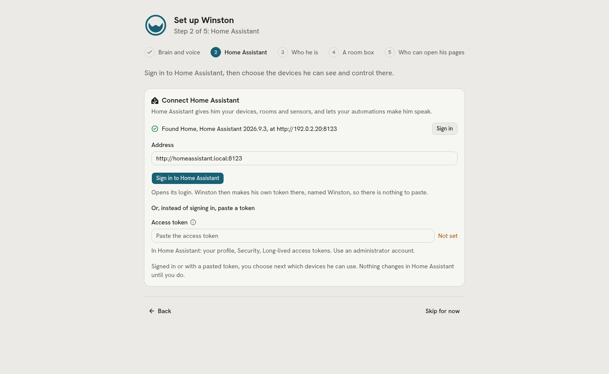

# Setup

One command installs Winston on a Linux computer, and a wizard on his page does the rest the first
time it opens: the brain and voice for your hardware, Home Assistant, who he is, and a room box.

To develop on Winston, install [from a clone](#from-a-clone) instead. Where the track stands is in
the [plan](plan.md) (Setup track).



## Install

### With the install script

1. Run the script:

   ```sh
   curl -fsSL https://github.com/aldinsmajlovic/winston/releases/latest/download/install.sh | sh
   ```

   Or download it and read it first:

   ```sh
   curl -fsSLO https://github.com/aldinsmajlovic/winston/releases/latest/download/install.sh
   less install.sh && sh install.sh
   ```

2. The script does only what has to happen before Python is there:
   1. Downloads the release's `SHA256SUMS` and its tarball, checks the tarball and unpacks it into
      `~/.local/share/winston-app/<version>`. A tarball that does not match stops the install with
      nothing unpacked.
   2. Installs uv into `~/.local/bin` if it is missing, through uv's own installer at a pinned version
      (0.10.6).
   3. Runs `uv sync` there, points `~/.local/share/winston-app/current` at it and links `winston` into
      `~/.local/bin`.
3. It then starts [`winston setup`](#what-winston-setup-does), which carries on from there.

| Option | What it does |
| --- | --- |
| Arguments after `sh -s --` | Passed on to `winston setup`, as in `curl ... \| sh -s -- --yes --profile hosted` |
| `WINSTON_VERSION=0.2.0` | Installs that release instead of the latest |
| `WINSTON_RELEASES` | Downloads from somewhere other than GitHub (the checks use it) |

- The code stays out of the data directory, so a backup of `~/.local/share/winston` holds only what
  is yours.
- The script's body is one function, called on its last line, so a download cut short runs nothing.

### From a clone

```sh
git clone https://github.com/aldinsmajlovic/winston && cd winston
uv sync
(cd web && pnpm install && pnpm build)
uv run winston setup
```

From a clone, setup uses `./data` as the data directory. Developing stays the same: `uv sync`,
`pnpm build`, `uv run winston up`.

### What `winston setup` does

It reads the computer and says what it found: the distribution, the graphics card and its driver,
Docker and its runtimes, Ollama, free disk where the downloads land, the serial group, lingering and
IPv6. Then:

1. Picks the profile for the hardware ([below](#picking-for-your-hardware)) and creates the data
   directory, `~/.local/share/winston`, as `winston init` does. An existing one is kept with its config.
2. Runs what needs root for that config, each command shown first and run only on yes
   ([below](#what-needs-root)).
3. Installs a systemd user service, `winston.service`, that runs `winston up`, and starts it. Without
   systemd (a container, say) there is no service, and it says to run `winston up`.
4. Says where to open him: the [setup link](#the-setup-link) for a new data directory, else this
   computer's address, and the network's when Who can open this page allows it.

Run it again and it does only what is still missing: a step skipped, or the `docker` group after
logging in again. Until the wizard is done, each run prints a new setup link.

Setup does not install the engines (brain, voice, hearing). The wizard does, with sizes and progress
([Winston installs his engines](#winston-installs-his-engines)).

| Flag | What it does |
| --- | --- |
| `--yes` | Answers yes to everything, the root steps too, for scripts and tests |
| `--profile NAME` | Skips the pick (`winston init --list` names the profiles) |

## What needs root

Each part is shown with the exact commands for the distribution, run with `sudo` on yes, and skipped
on no with what then will not work.

| Part | When | What it runs |
| --- | --- | --- |
| Docker | An NVIDIA profile, and Docker is missing | The distribution's own package (`docker.io` on Debian and Ubuntu, `moby-engine` on Fedora, `docker` on openSUSE and Arch), enabled and started |
| Docker started | Docker is there but not running | `systemctl enable --now docker` |
| Your user in the `docker` group | Docker is there and you cannot reach it | `usermod -aG docker`. It takes effect at your next login, so setup asks you to log out and in and run it again, and carries on where it stopped |
| NVIDIA container toolkit | An NVIDIA profile, and `docker info` lists no `nvidia` runtime | NVIDIA's package (from NVIDIA's repository; Arch has its own), `nvidia-ctk runtime configure --runtime=docker`, Docker restarted |
| Ollama | The Ollama profile, and Ollama is missing | Ollama's own install script |
| Your user in the serial group | Not in it yet | `usermod -aG dialout` (`uucp` on Arch, the group made if missing), so a Voice PE on USB can be set up. The service has it after a restart of the computer |
| Lingering | With systemd | `loginctl enable-linger`, so the service runs without you logged in |
| IPv4 first | IPv6 addresses sort first and never connect, as behind a VPN that drops IPv6 | `precedence ::ffff:0:0/96 100` in `/etc/gai.conf`, so nothing waits out an IPv6 address before trying IPv4 |

Graphics drivers are never installed. Without `nvidia-smi` on an NVIDIA card, setup says so, links
the distribution's guide and offers the Ollama or hosted profile.

## Picking for your hardware

| Found | Profile |
| --- | --- |
| NVIDIA with 24 GB or more | `nvidia-24gb-27b` |
| A smaller NVIDIA card, another GPU, or none | `ollama` |
| No usable local model, or your choice | `hosted` |

Free disk is read where the downloads land (the Hugging Face cache and Docker's root) and shown
against what the pick needs. Every pick can be changed in the wizard, and on the settings pages later.
[Hardware](hardware.md) says what each profile runs.

## Winston installs his engines

What an engine needs is read from its config:

- A Docker engine: its image.
- A `services/` command: its venv.
- The brain: its model. That is the quant's GGUF files for llama.cpp, the safetensors and the small
  files beside them for vLLM, or an Ollama model.

Sizes come before the first byte: from the registry's manifest, the Hub's file list or Ollama's
registry. A venv's size is measured once and kept beside its lock (`tool.winston.installed-gb` in the
service's `pyproject.toml`).

Picking something not installed, on the Brain and Voice pages or in the wizard, shows what it needs:
"Needs 16.4 GB downloaded before it can run: the model (16.4 GB). 210 GB free." with Download. Then
it shows the progress per part, or why it failed with Try again.

- It downloads in winstond, so it carries on with the page closed, and the engine that runs now keeps
  running.
- A cut download picks up where it was.
- A saved engine that still lacks something gets it when it starts, and says Installing on Status,
  not Failed. One that does not fit is not started.

A voice's own weights are not sized first, since its library chooses the files (Pocket loads a 0.2 GB
model from an 18 GB repo). The server fetches them on its first start, and the supervisor waits while
the cache grows, saying "downloading, 1.2 GB so far".

## The first run

### The setup link

When `winston setup` makes a new data directory, Winston starts in setup mode. Until the wizard is
done, winstond listens on the network and serves the wizard to anyone with the setup link, and to this
computer without it:

```
Open http://192.168.1.20:8700/setup?key=7f3k-q9xm-2bvd from any device here,
or http://localhost:8700/setup on this computer.
```

- Without the key, a request from another address is refused, page or API, with a line saying to open
  the setup link.
- Opening the link sets a cookie with the key, so the rest of the wizard needs nothing in the address,
  and the page takes the key out of the address bar.
- The key is twelve letters and digits (no 0, 1, i, l or o). Only its hash is kept, in
  `data/state/setup.json`, and it works until setup ends.
- `winston setup link`, or running `winston setup` again, makes a new key, and the old one stops
  working.
- A device holding the key counts as this computer for pasting keys (a hosted brain's), which is
  otherwise refused from another address.

winstond opens itself to the network for setup only when Who can open this page (`control.host`) is
this computer and no `--host` was given. When the wizard ends, the page follows Who can open this page
again. Its last step asks, and the answer applies at once: with This computer only, another address is
refused from Finish on, and from Winston's next start he listens on this computer alone.

### While setup is under way

Until Brain and voice is done, winstond starts none of his engines, since starting one downloads what
it lacks. Nothing is downloaded before you have seen the picks and their sizes. Status says "Setup is
not finished." with Continue setup, and Talk says his brain is stopped.

### The steps

The wizard is its own page, `/setup`: his logo, "Set up" and his name, "Step 1 of 5: Brain and voice",
and the steps, with a check for each one done and "(skipped)" for each one skipped. Under them is the
step, with Skip for now and its own button at the bottom.

Each step can be skipped and picked up later. A skipped one stays in Set up next on Status ("Brain
and voice: skipped during setup." with Set it up) after the wizard ends.

| Step | What it asks | What it does |
| --- | --- | --- |
| [1. Brain and voice](#1-brain-and-voice) | The brain and the voice engines, preselected for your hardware | Saves a changed pick and starts the engines, which download what they lack |
| [2. Home Assistant](#2-home-assistant) | Sign in to Home Assistant or paste a token, then the devices he may use and whether Assist may use him | Makes him his own token there, switches its MCP server on for an administrator, saves the device list |
| [3. Who he is](#3-who-he-is) | His name, reply language, personality and voice | Saves them, his name in his personality too if you say so |
| [4. A room box](#4-a-room-box) | A Voice PE on USB-C, its Wi-Fi and its room | Flashes Winston's firmware, gives it Wi-Fi, adds it as a room box |
| [5. Done](#5-done) | Who can open this page from now on | Ends setup mode and opens Talk |

#### 1. Brain and voice

<picture>
  <source media="(prefers-color-scheme: dark)" srcset="images/setup-dark.png">
  
</picture>

The profile's picks, preselected, on the cards of the Brain and Voice pages: Runs on, the brain's
model and its own settings, and each one's size against the free space, with Download.

- **Download and continue** saves a changed pick and confirms the sizes ("24.2 GB in all. Brain: its
  Docker image (2.6 GB) and the model (15.4 GB). Speaking: its Python packages (6.3 GB).").
- It then starts the engines. Each downloads what it lacks and then runs, with its progress on its
  card and on Status, while you go on with the next steps.
- With nothing to download, the button is Continue.

The voice itself is picked in [Who he is](#3-who-he-is).

#### 2. Home Assistant

<picture>
  <source media="(prefers-color-scheme: dark)" srcset="images/setup-home-assistant-dark.png">
  
</picture>

The step draws the [Home Assistant page](home-assistant.md)'s own cards. Until it is connected, the
only button is Skip for now, and Connect Home Assistant offers:

- Each Home Assistant found on the network, with Sign in ("Found Home, Home Assistant 2026.9.3, at
  http://192.168.1.5:8123"). It is found from its `_home-assistant._tcp` announcement and the address
  it gives there, else at `homeassistant.local` where the system resolves it. mDNS does not cross from
  one network to another, so for a Home Assistant on another subnet you type the address.
- The address, with Sign in to Home Assistant under it.
- The access token to paste instead.

Signing in:

1. Sign in opens Home Assistant's own login. This page's address is the client id it sends the
   browser back to.
2. Back from it, winstond trades the code for a session and makes a long-lived token named Winston on
   that account, for ten years, as Home Assistant's own page does. A token made by an earlier sign-in
   is replaced, since Home Assistant takes a name once.
3. When the account is an administrator's, it switches on Home Assistant's Model Context Protocol
   Server with Assist if it is off.
4. It drops the sign-in's own session, and saves the token in `data/.env` and the address in the
   config, without applying the device list, as a first connect does. The token is in no log, page or
   API answer.

The step then says "Signed in as Sam. He has his own token there now, named Winston." and that it
switched the MCP server on. For an account that is not an administrator's, it says what will not work:
rooms and names, the device list, switching the MCP server on. A sign-in that does not finish says
why.

Then come the devices he can use, as on the Home Assistant page, and the Home Assistant Assist switch
from Ways to talk, off by default ([Home Assistant Assist](assist.md)). Continue saves both (the list is
applied in Home Assistant) and goes on.

#### 3. Who he is

<picture>
  <source media="(prefers-color-scheme: dark)" srcset="images/setup-who-dark.png">
  
</picture>

- **His name and reply language**, as on the Assistant page.
- **His personality**, as on its own page. It is the same document: each rule edited, deleted or
  added saves at once, with Undo.
- **His voice**, as on the Voice page, with Hear this voice beside it and Your voices under it. The
  voices are the bundled clips, the speech server's own, and those he cloned when asked. Your voices
  says how: tell him "clone my voice" on the Talk page, and the person agrees out loud first.

Until speaking runs, the step says why a voice cannot be heard yet: "Speaking is still installing (its
Python packages, 0.4 of 1.0 GB). You can hear a voice once it runs.", "Speaking is starting.", or that
speaking is off or not running.

Its button saves. A new name goes through the same confirm as on the Assistant page, which offers to
change his name in his personality too.

#### 4. A room box

<picture>
  <source media="(prefers-color-scheme: dark)" srcset="images/setup-box-dark.png">
  
</picture>

1. **Plug a Voice PE into this computer with USB-C.** Until one is there the step says "Waiting for a
   Voice PE on USB-C." and looks again every 2 s. Winston finds it by its USB id (Espressif's
   303a:1001, read from sysfs) and asks it over Improv Serial what it runs ("Found a Voice PE on
   /dev/ttyACM0, running Home Assistant Voice PE 25.10.0.").
2. **Put Winston's firmware on it.** Winston downloads the firmware of the release he came from
   ("Okay Winston", see [Voice PE](voice-pe.md#winstons-firmware-okay-winston)) and checks it against
   the release's `SHA256SUMS`: a file that does not match is refused before anything is written. He
   writes it with esptool through `uvx`, erasing the whole flash, and shows the progress ("Writing the
   firmware, 42%"). A box already on Winston's firmware offers Continue, or Flash again.
3. **Pick its Wi-Fi.** The networks the box sees, strongest first, or Another network by name, and its
   password. Only 2.4 GHz networks show, which the step says. A box just flashed finishes its first scan
   about 8 s after it starts, so the step asks again for up to 15 s while it sees none. The password
   goes to the box over the cable and nowhere else: it is not kept, logged or sent back. A wrong one
   says "The box could not join Home. Check the password." and is tried again without a new flash.
4. **Winston checks he reaches it.** The box prints its address in its log once it has joined, and
   Winston checks he reaches its ESPHome API there (port 6053). When he cannot, as from another
   network, the step says so ("The box joined Home at 192.168.1.50, but this computer cannot reach it
   there (port 6053).") and nothing is saved. A box that still has a key from Home Assistant, because
   it was not flashed, is said to need a flash.
5. **Choose its room** and Home Assistant area. When his name is not Winston, also pick a stock wake
   word (Okay Nabu, Hey Jarvis or Hey Mycroft), since the box knows Okay Winston and those three.
6. **Add the box and continue** saves it as a room box and switches the room boxes on, through the
   same confirm as Ways to talk.

A box Home Assistant had adopted loses its key with the flash and would come back as a new device
there. The step says so, with Disable it in Home Assistant, on by default; enable its ESPHome entry
again for a stock firmware update. When Home Assistant does not disable the entry, the step says why
and to disable it there by hand, and Continue goes on with the box saved.

When something is in the way:

- **This computer's user may not open the port yet** (not in the serial group). The step says so
  before anything is downloaded: run `winston setup` again, then restart this computer. Logging out
  and in is not enough, since the service runs under systemd's user manager, which lingers past a
  logout with the groups it started with.
- **The box is unplugged midway.** The step says the box does not answer.
- **One talk with the port at a time.** The page's look at the box waits while esptool writes.

#### 5. Done

- Who can open this page from now on, as on Status, with the same warning when it is the whole network.
- What was skipped.
- **Finish** saves, ends setup mode and opens Talk.

From another device that only this computer may open afterwards, the step says so before Finish, and
after it that he is opened on the computer he runs on.

## Updating and removing

### Updating

```sh
winston update          # the latest release
winston update 0.2.0    # that release
```

1. It reads the release's `SHA256SUMS`, downloads its tarball and checks it.
2. It unpacks it beside the current one and runs `uv sync` there (quick, from uv's cache).
3. It moves `current` to it in one step and restarts the service if it is running.

The data directory is never touched. The release before stays for going back, `winston update 0.1.0`,
with nothing downloaded; older ones are removed. In a clone, `winston update` says to `git pull`
instead.

### Removing

```sh
winston uninstall          # the service and the code
winston uninstall --data   # the data directory too
```

It names what it removes and asks first (`--yes` does not): the service (stopped and disabled), the
code and the `winston` link, and with `--data` the data directory. It stops if Winston still answers
outside the service. In a clone only the service goes.

Then it lists what it leaves, with sizes and how to remove each:

- the data directory
- the engines' Docker images
- the brain's Ollama model
- the Hugging Face cache (his models and any other program's)
- uv's cache and its Python
- what setup ran as root

## Releases

A tag `v*` makes CI (`.github/workflows/release.yml`) build the release:

| File | What it is |
| --- | --- |
| `winston-<version>.tar.gz` | The files git tracks, the UI already built, the tag's version stamped in |
| `voice-pe-winston-<version>.factory.bin` | Winston's Voice PE firmware, built with ESPHome 2026.9.1, the version `services/voice-pe` pins |
| `install.sh` | The [install script](#with-the-install-script) |
| `SHA256SUMS` | The checksums the script, `winston update` and the wizard check against |

So installing needs neither Node nor a 30 minute firmware compile. Each file has GitHub's build
attestation:

```sh
gh attestation verify winston-0.2.0.tar.gz --repo aldinsmajlovic/winston
```

The tag is the version. One with a hyphen (`v0.2.0-rc.1`) is a pre-release, which `latest` skips.

To build the same files here (the firmware only when `--firmware` names ESPHome's
`firmware.factory.bin`):

```sh
python3 scripts/release.py 0.2.0 dist
```
