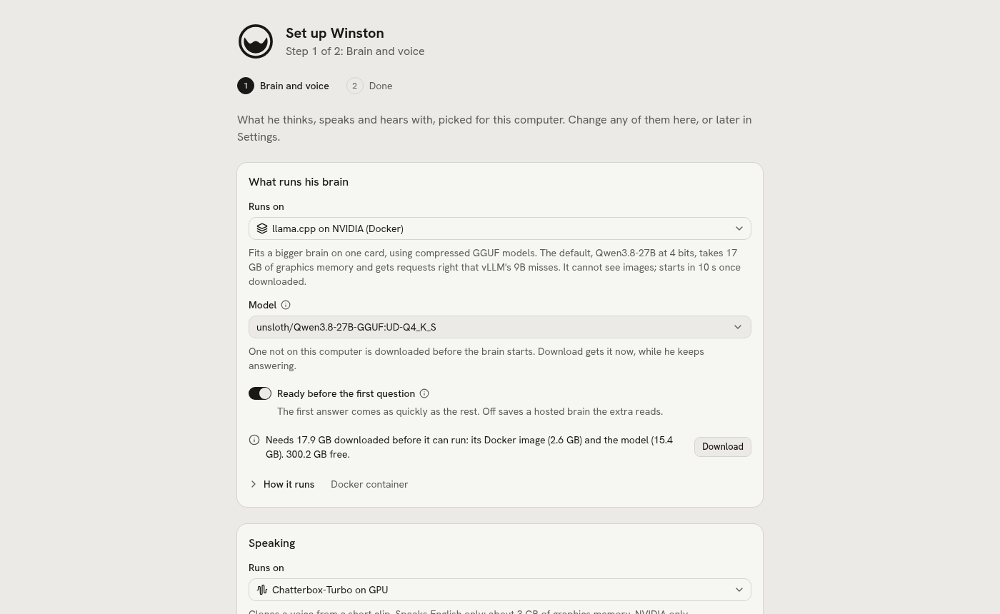
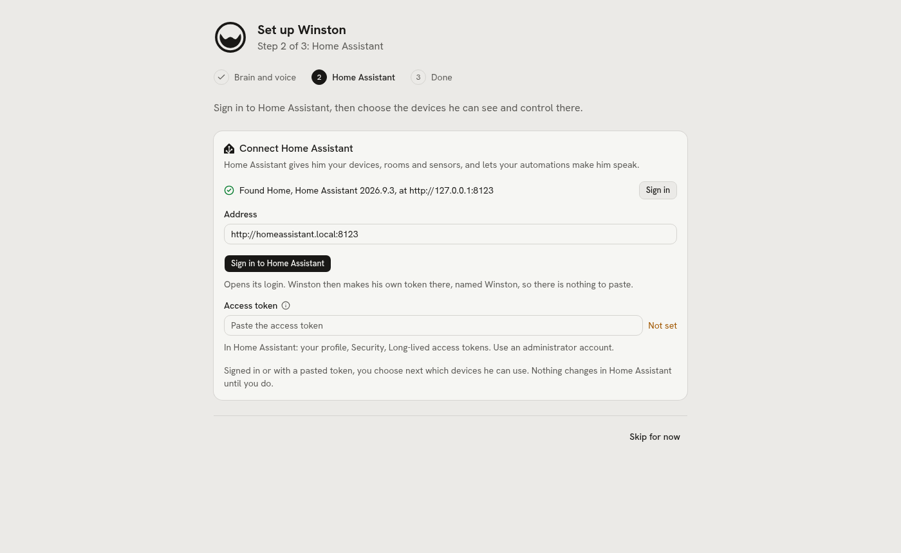

# Setup

Approved 2026-10-23. Built so far: Winston installing his engines, `winston setup`, the install script,
the release build, `winston update` and `winston uninstall`, setup mode with its link, and the wizard's
frame with its Brain and voice and Home Assistant steps. Its other steps come next, in the order and with the checks in the
[plan](plan.md) (Setup track). Until the first release, the way in is the README's Quickstart, or
`uv run winston setup` in a clone.

One command installs Winston on a Linux computer, and a wizard on his page does the rest the first
time it opens: Home Assistant, the brain and voice for your hardware, who he is, and a room box.

## Install

```sh
curl --proto '=https' -fsSL https://github.com/aldinsmajlovic/winston/releases/latest/download/install.sh | sh
```

Or read it first:

```sh
curl --proto '=https' -fsSLO https://github.com/aldinsmajlovic/winston/releases/latest/download/install.sh
less install.sh && sh install.sh
```

`install.sh` does only what has to happen before Python is there, then hands over to `winston setup`:

1. Downloads the release's `SHA256SUMS` and its tarball, checks the tarball and unpacks it into
   `~/.local/share/winston-app/<version>`. A tarball that does not match stops the install with nothing
   unpacked.
2. Installs uv into `~/.local/bin` if it is missing, through uv's own installer at a pinned version
   (0.10.6).
3. Runs `uv sync` there, points `~/.local/share/winston-app/current` at it, links `winston` into
   `~/.local/bin` and starts `winston setup` with the script's arguments
   (`curl ... | sh -s -- --yes --profile hosted`).

The code stays out of the data directory, so a backup of `~/.local/share/winston` holds only what is
yours. `WINSTON_VERSION=0.2.0` installs that release instead of the latest, and `WINSTON_RELEASES`
downloads from somewhere other than GitHub (the checks use it). The script's body is one function,
called on its last line, so a download cut short runs nothing.

`winston setup` reads the computer (the distribution, the graphics card and its driver, Docker and
its runtimes, Ollama, free disk where the downloads land, the serial group, lingering, IPv6), says what
it found, and then:

1. Picks the profile for the hardware and creates the data directory (`~/.local/share/winston`, as
   `winston init` does). An existing one is kept with its config.
2. Runs what needs root for that config, each command shown first and run only on yes
   ([below](#what-needs-root)).
3. Installs a systemd user service, `winston.service`, that runs `winston up`, and starts it. Without
   systemd (a container, say) there is no service and it says to run `winston up`.
4. Says where to open him: for a new data directory, the setup link ([below](#the-first-run)), else
   this computer's address, and the network's when Who can open this page allows it.

Run it again and it does only what is still missing: a step skipped, or the `docker` group after
logging in again. Until the wizard is done, each run prints a new setup link.

The engines (brain, voice, hearing) are not installed by setup. The wizard does it, with sizes and
progress, the same way the settings pages do later; until then each gets what it lacks when the
service first starts it.

`--yes` answers yes to everything and `--profile NAME` skips the pick, for scripts and tests.

## What needs root

Shown with the exact commands for the distribution, run with `sudo` on yes, skipped on no with what
then will not work:

| Part | When | What it runs |
| --- | --- | --- |
| Docker | An NVIDIA profile, and Docker is missing | The distribution's own package (`docker.io` on Debian and Ubuntu, `moby-engine` on Fedora, `docker` on openSUSE and Arch), enabled and started |
| Docker started | Docker is there but not running | `systemctl enable --now docker` |
| Your user in the `docker` group | Docker is there and you cannot reach it | `usermod -aG docker`; it takes effect at your next login, so setup asks you to log out and in and run it again, and carries on where it stopped |
| NVIDIA container toolkit | An NVIDIA profile, and `docker info` lists no `nvidia` runtime | NVIDIA's package (from NVIDIA's repository; Arch has its own), `nvidia-ctk runtime configure --runtime=docker`, Docker restarted |
| Ollama | The Ollama profile, and Ollama is missing | Ollama's own install script |
| Your user in the serial group | Not in it yet | `usermod -aG dialout` (`uucp` on Arch, the group made if missing), so a Voice PE on USB can be set up |
| Lingering | With systemd | `loginctl enable-linger`, so the service runs without you logged in |
| IPv4 first | IPv6 addresses sort first and never connect, as behind a VPN that drops IPv6 | `precedence ::ffff:0:0/96 100` in `/etc/gai.conf`, so nothing waits out an IPv6 address before trying IPv4 |

Graphics drivers are never installed. Without `nvidia-smi` on an NVIDIA card, setup says so, links
the distribution's guide and offers the Ollama or hosted profile.

## Picking for your hardware

| Found | Profile |
| --- | --- |
| NVIDIA with 24 GB or more | `nvidia-24gb-27b` |
| A smaller NVIDIA card, another GPU, or none | `ollama` (a profile per smaller card size comes later, measured like the 24 GB one) |
| No usable local model, or your choice | `hosted` |

Free disk is read where the downloads land (the Hugging Face cache and Docker's root) and shown
against what the pick needs. Every pick can be changed in the wizard and on the settings pages later.

## Winston installs his engines

What an engine needs is read from its config: a Docker engine's image, a `services/` command's venv,
and for the brain its model (the quant's GGUF files for llama.cpp, the safetensors and the small files
beside them for vLLM, an Ollama model). Sizes come before the first byte: the registry's manifest, the
Hub's file list, Ollama's registry; a venv's size is measured once and kept beside its lock
(`tool.winston.installed-gb` in the service's `pyproject.toml`). Picking something not here, on the
Brain and Voice pages and later in the wizard, shows "Needs 16.4 GB downloaded before it can run: the
model (16.4 GB). 210 GB free." with Download, then the progress per part, or why it failed with Try
again. It downloads in winstond, so it carries on with the page closed, the engine that runs now keeps
running, and a cut download picks up where it was. A saved engine that still lacks something gets it
when it starts, and says Installing on Status, not Failed. One that does not fit is not started.

A voice's own weights are not sized first: its library chooses the files (Pocket loads a 0.2 GB model
from an 18 GB repo), so the server fetches them on its first start, and the supervisor waits while the
cache grows, saying "downloading, 1.2 GB so far".

This replaces the `uv sync` per voice in the Quickstart and the "raise Startup time limit" a first
download needed.

## The first run

`winston setup` making a new data directory starts setup mode. Until the wizard is done, winstond
listens on the network and serves the wizard to anyone with the setup link, and to this computer
without it:

```
Open http://192.168.1.20:8700/setup?key=7f3k-q9xm-2bvd from any device here,
or http://localhost:8700/setup on this computer.
```

Without the key, a request from another address is refused, page or API, with a line saying to open
the setup link. Opening the link sets a cookie with the key, so the rest of the wizard needs nothing in
the address, and the page takes the key out of the address bar. The key is twelve letters and digits
(no 0, 1, i, l or o), kept only as its hash in `data/state/setup.json`, works until setup ends, and
`winston setup link` (or running `winston setup` again) makes a new one, which the old one stops
working for. A device holding it counts as this computer for pasting keys (a hosted brain's), which
is otherwise refused from another address. winstond opens itself to the network for setup only when
Who can open this page (`control.host`) is this computer and no `--host` was given. When the wizard
ends, the page follows Who can open this page as now; its last step asks, and the answer applies at
once: with This computer only, another address is refused from Finish on, and from Winston's next start
he listens on this computer alone.

While setup is under way and Brain and voice is not done, winstond starts none of his engines, since
starting one downloads what it lacks: nothing is downloaded before you have seen the picks and their
sizes. Status says "Setup is not finished." with Continue setup, and Talk that his brain is stopped.

<picture>
  <source media="(prefers-color-scheme: dark)" srcset="images/setup-dark.png">
  
</picture>

### The steps

The wizard is its own page (`/setup`): his logo, "Set up" and his name, "Step 1 of 2: Brain and voice",
the steps with a check for each one done and "(skipped)" for each one skipped, then the step, with Skip
for now and its own button at the bottom. Each step can be skipped and picked up later: a skipped one
stays in Set up next on Status ("Brain and voice: skipped during setup." with Set it up) after the
wizard ends. Built so far: Brain and voice, Home Assistant and Done; the others come with their track
steps.

1. **Brain and voice.** The profile's picks, preselected, on the cards of the Brain and Voice pages:
   Runs on, the brain's model and its own settings, and each one's size against the free space, with
   Download. Download and continue saves a changed pick, confirms the sizes ("24.2 GB in all. Brain:
   its Docker image (2.6 GB) and the model (15.4 GB). Speaking: its Python packages (6.3 GB).") and
   starts the engines, each of which downloads what it lacks first and then runs, with its progress on
   its card and on Status, while the next steps go on. With nothing to download it is Continue. The
   voice itself is picked in Who he is.
2. **Home Assistant.** The Home Assistant page's own cards. Until it is connected, Connect Home
   Assistant: each Home Assistant found on the network ("Found Home, Home Assistant 2026.9.3, at
   http://192.168.1.5:8123" with Sign in), from its `_home-assistant._tcp` announcement and the address
   it gives there, else `homeassistant.local` where the system resolves it; then the address with Sign
   in to Home Assistant under it, and the access token to paste instead. mDNS does not cross from one
   network to another, so a Home Assistant on another subnet is not found and its address is typed.
   Sign in opens Home Assistant's own login (this page's address is the client id it sends the browser
   back to). Back from it, winstond takes the code for a session, makes a long-lived token named
   Winston on that account (for ten years, as Home Assistant's own page does; one made by an earlier
   sign-in is replaced, since Home Assistant takes a name once), switches on Home Assistant's Model
   Context Protocol Server with Assist if it is off and the account is an administrator's, drops the
   sign-in's own session, and saves the token in `data/.env` and the address in the config, without
   applying the device list, as a first connect. The token is in no log, page or API answer. The
   step then says "Signed in as Sam. He has his own token there now, named Winston.", that it
   switched the MCP server on, and, for an account that is not an administrator's, what will not
   work (rooms and names, the device list, switching the MCP server on). A sign-in that does not
   finish says why. Then the devices he can use, as on the Home Assistant page; Continue saves the
   list (which applies it there) and goes on. Until it is connected there is only Skip for now.
3. **Who he is.** His name, his personality and his voice, as on the Assistant and Voice pages: a
   bundled voice with a preview once the voice is installed, or one cloned from a clip.
4. **A room box.** Plug a Voice PE into this computer with USB-C. Winston finds it, flashes Winston's
   firmware ("Okay Winston") from the release, gives it Wi-Fi from the networks it sees, checks he can
   reach it there and puts it in a room. A box Home Assistant had adopted loses its key with the flash
   and would come back as a new device there, so the wizard offers to disable its ESPHome entry in
   Home Assistant (enable it again for a stock firmware update). When his name is not Winston, the box listens for a stock wake
   word instead (Okay Nabu, Hey Jarvis or Hey Mycroft), picked there.
5. **Done.** Who can open this page from now on, as on Status, with the same warning when it is the
   whole network, and what was skipped. Finish saves, ends setup mode and opens Talk. From another
   device that this computer alone may open afterwards, it says so before Finish, and after it that
   he is opened on the computer he runs on.

<picture>
  <source media="(prefers-color-scheme: dark)" srcset="images/setup-home-assistant-dark.png">
  
</picture>

## Updating and removing

`winston update` reads the latest release's `SHA256SUMS`, downloads its tarball, checks it, unpacks it
beside the current one, runs `uv sync` there (quick, from uv's cache), moves `current` to it in one step
and restarts the service if it is running. The data directory is never touched. The release before stays
for going back, `winston update 0.1.0`, with nothing downloaded; older ones are removed. `winston update
0.2.0` installs that release. In a clone it says to `git pull` instead.

`winston uninstall` names what it removes and asks: the service (stopped and disabled), the code and
the `winston` link, and the data directory too with `--data`. It stops if Winston still answers outside
the service. Then it lists what it leaves, with sizes and how to remove each: the data directory,
the engines' Docker images, the brain's Ollama model, the Hugging Face cache (his models and any other
program's), uv's cache and its Python, and what setup ran as root. In a clone only the service goes.

## Releases

A tag `v*` makes CI (`.github/workflows/release.yml`) build the release: `winston-<version>.tar.gz`
(the files git tracks, the UI already built, the tag's version stamped in), Winston's Voice PE firmware
(`voice-pe-winston-<version>.factory.bin`, ESPHome 2026.9.1, the version `services/voice-pe` pins),
`install.sh` and `SHA256SUMS`, with GitHub's build attestation for each file
(`gh attestation verify winston-0.2.0.tar.gz --repo aldinsmajlovic/winston`). So installing needs
neither Node nor a 30 minute firmware compile. The tag is the version; one with a hyphen
(`v0.2.0-rc.1`) is a pre-release, which `latest` skips. `python3 scripts/release.py 0.2.0 dist` builds
the same files here, the firmware only when `--firmware` names ESPHome's `firmware.factory.bin`.

## From a clone

Developing stays as now (`uv sync`, `pnpm build`, `uv run winston up`), and `uv run winston setup`
works from a clone too, using `./data`.
