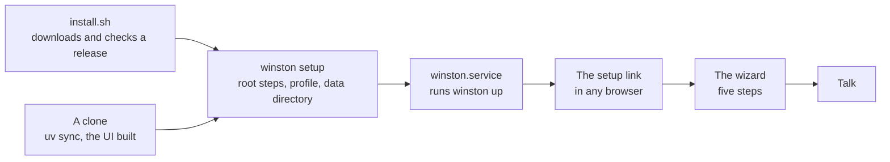
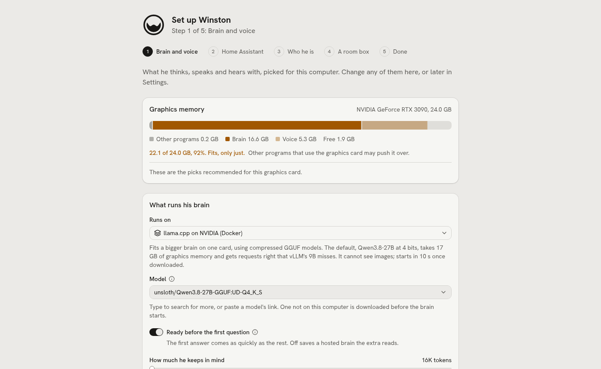
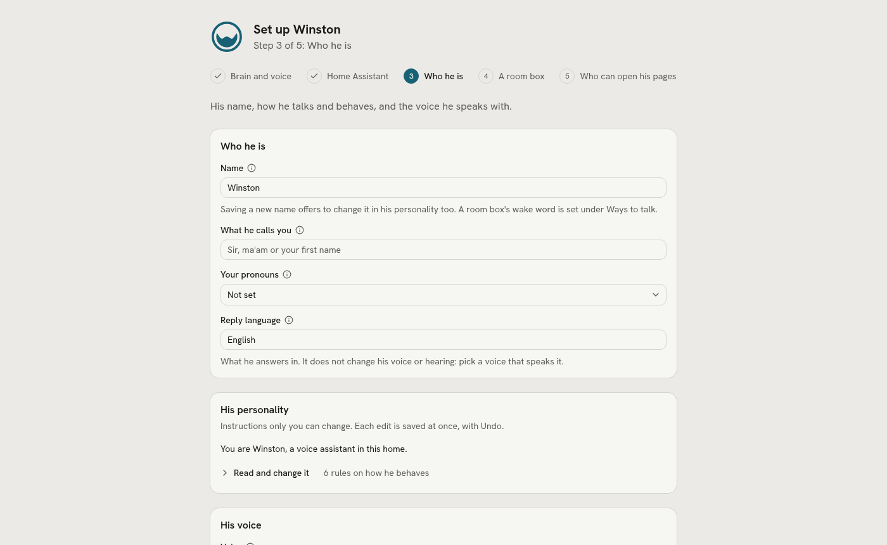
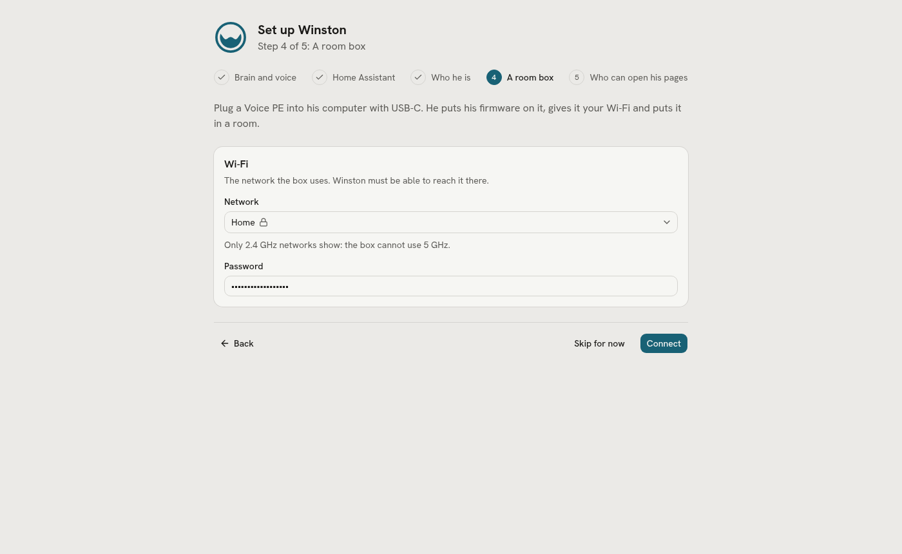
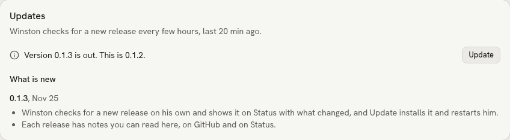

# Setup

One command installs Winston on a Linux computer, and a wizard on his page does the rest the first
time it opens: the brain and voice for your hardware, Home Assistant, who he is, and a room box.

To develop on Winston, install [from a clone](#from-a-clone) instead. Where the track stands is in
the [plan](plan.md) (Setup track).



## Install

### With the install script

1. Run the script:

   ```sh
   curl -fsSL https://github.com/aldinsmajlovic/winston/releases/latest/download/install.sh | sh
   ```

   Or download it and read it first:

   ```sh
   curl -fsSLO https://github.com/aldinsmajlovic/winston/releases/latest/download/install.sh
   less install.sh && sh install.sh
   ```

2. The script does only what has to happen before Python is there:
   1. Downloads the release's `SHA256SUMS` and its tarball, checks the tarball and unpacks it into
      `~/.local/share/winston-app/<version>`. A tarball that does not match stops the install with
      nothing unpacked.
   2. Installs uv into `~/.local/bin` if it is missing, through uv's own installer at a pinned version
      (0.10.6).
   3. Runs `uv sync` there, points `~/.local/share/winston-app/current` at it and links `winston` into
      `~/.local/bin`.
3. It then starts [`winston setup`](#what-winston-setup-does), which carries on from there.

| Option | What it does |
| --- | --- |
| Arguments after `sh -s --` | Passed on to `winston setup`, as in `curl ... \| sh -s -- --yes --profile hosted` |
| `WINSTON_VERSION=0.2.0` | Installs that release instead of the latest |
| `WINSTON_RELEASES` | Downloads from somewhere other than GitHub (the checks use it) |

- The code stays out of the data directory, so a backup of `~/.local/share/winston` holds only what
  is yours.
- The script's body is one function, called on its last line, so a download cut short runs nothing.

### From a clone

```sh
git clone https://github.com/aldinsmajlovic/winston && cd winston
uv sync
(cd web && pnpm install && pnpm build)
uv run winston setup
```

From a clone, setup uses `./data` as the data directory. Developing stays the same: `uv sync`,
`pnpm build`, `uv run winston up`.

### On Unraid or Proxmox

Make a Linux virtual machine (Debian 13 or Ubuntu 24.04) and run the install script in it, as on any
other computer.

| Where | Use it? |
| --- | --- |
| A virtual machine | Yes |
| The Unraid host | No: it has no systemd for the service, and its root filesystem lives in memory, so the install under `~/.local` is gone after a restart |
| A Docker app (Unraid's Apps, Compose) | No: Winston is not an image. He starts his own containers and voice environments, so he would need Docker's socket and the graphics card passed in |
| A Proxmox LXC container | Not yet tried. Setup finds systemd there, but Docker inside needs nesting, and a graphics card its device files and the host's driver |

Give the virtual machine:

- **A bridged network** (`br0` on Unraid, `vmbr0` on Proxmox), not NAT, so Home Assistant and the
  room boxes reach him and he reaches them.
- **The processor's own features.** Proxmox's default processor type, `x86-64-v2-AES`, hides AVX2,
  which a brain on the processor relies on: set it to `host`. Unraid passes them through by default.
- **Memory.** Setup sizes the brain and its context to what the virtual machine has: 16 GB runs
  Granite 8B on the processor, 8 GB a 4B model.
- **The graphics card, passed through whole** (IOMMU switched on in the BIOS), with its driver
  installed in the virtual machine, since setup never installs one. The card is then the virtual
  machine's alone: a media server on the host can no longer transcode on it. Without a card to spare,
  the `ollama` or `hosted` [profile](#picking-for-your-hardware) needs none.
- **The Voice PE's USB device** (Espressif's `303a:1001`) for the wizard's [room box](#4-a-room-box)
  step, or set the box up [through Home Assistant](voice-pe.md#with-home-assistant) instead.

### What `winston setup` does

It reads the computer and says what it found: the distribution, the graphics card and its driver,
Docker and its runtimes, Ollama, free disk where the downloads land, the serial group, lingering and
IPv6. Then:

1. Creates the data directory, `~/.local/share/winston`, starting from the profile that suits the
   hardware ([below](#picking-for-your-hardware)), as `winston init` does. It asks nothing here: the
   brain, voice and hearing are picked in the wizard's first step. An existing data directory is kept
   with its config, and with it no wizard: to start over, `winston uninstall --data`, then install
   again.
2. Runs what needs root for that config, each command shown first and run only on yes
   ([below](#what-needs-root)).
3. Installs a systemd user service, `winston.service`, that runs `winston up`, and starts it. Without
   systemd (a container, say) there is no service, and it says to run `winston up`.
4. Says where to open him: the [setup link](#the-setup-link) for a new data directory, else this
   computer's address, and the network's when Who can open this page allows it.

Run it again and it does only what is still missing: a step skipped, or the `docker` group after
logging in again. Until the wizard is done, each run prints a new setup link.

Setup does not install the engines (brain, voice, hearing). The wizard does, with sizes and progress
([Winston installs his engines](#winston-installs-his-engines)).

| Flag | What it does |
| --- | --- |
| `--yes` | Answers yes to everything, the root steps too, for scripts and tests |
| `--profile NAME` | Starts from that profile instead of the one that suits the hardware (`winston init --list` names them) |

The output is grouped under headings (This computer, Your settings, each root step, Running him,
Next), with a tick for what is in place and a "!" for what is missing. It is in colour on a terminal,
and plain when piped or with `NO_COLOR` set.

#### After a pick that needs root

A page cannot run anything as root, so setup installs as root only what its starting profile needs. A
pick in the wizard or on the Brain and Voice pages that needs more (Ollama on a computer set up for
NVIDIA, or llama.cpp where Docker is missing) says so on its card: "Ollama is not on his computer
yet, and installing it needs root. Save, then in a terminal on it run: winston setup system".
`winston setup system` runs only the root steps for the saved brain, voice and hearing (Docker, its
group, NVIDIA's container toolkit, Ollama), each shown first and run on yes, and leaves the settings
alone. Then start the engine again on Status. A card that needs an NVIDIA graphics card without one
answering says that instead, since setup never installs drivers.

## What needs root

Each part is shown with the exact commands for the distribution, run with `sudo` on yes, and skipped
on no with what then will not work.

| Part | When | What it runs |
| --- | --- | --- |
| Docker | The brain runs in Docker (the NVIDIA profile), and Docker is missing | The distribution's own package (`docker.io` on Debian and Ubuntu, `moby-engine` on Fedora, `docker` on openSUSE and Arch), enabled and started |
| Docker started | Docker is there but not running | `systemctl enable --now docker` |
| Your user in the `docker` group | Docker is there and you cannot reach it | `usermod -aG docker`. It takes effect at your next login, so setup asks you to log out and in and run it again, and carries on where it stopped |
| NVIDIA container toolkit | The brain runs in Docker on the GPU, and `docker info` lists no `nvidia` runtime | NVIDIA's package (from NVIDIA's repository; Arch has its own), `nvidia-ctk runtime configure --runtime=docker`, Docker restarted |
| Ollama | The brain runs on Ollama, and Ollama is missing | Ollama's own install script |
| Your user in the serial group | Not in it yet | `usermod -aG dialout` (`uucp` on Arch, the group made if missing), so a Voice PE on USB can be set up. The service has it after a restart of the computer |
| Lingering | With systemd | `loginctl enable-linger`, so the service runs without you logged in |
| IPv4 first | IPv6 addresses sort first and never connect, as behind a VPN that drops IPv6 | `precedence ::ffff:0:0/96 100` in `/etc/gai.conf`, so nothing waits out an IPv6 address before trying IPv4 |

Graphics drivers are never installed. Without `nvidia-smi` on an NVIDIA card, setup says so, links
the distribution's guide and starts from the Ollama profile.

## Picking for your hardware

| Found | Profile |
| --- | --- |
| NVIDIA with 24 GB or more | `nvidia-24gb` |
| NVIDIA with 14 GB or more (16 and 20 GB cards) | `nvidia-16gb` |
| NVIDIA with 12 GB | `nvidia-12gb` |
| NVIDIA with 10 or 11 GB, another GPU, or none | `ollama` |
| NVIDIA with 8 GB or less | `nvidia-8gb` |
| No usable local model, or your choice | `hosted` |

The largest NVIDIA card decides. Why each size gets what it does: [sizing by the
card](hardware.md#sizing-by-the-card).

Free disk is read where the downloads land (the Hugging Face cache and Docker's root) and shown
against what the pick needs. Every pick can be changed in the wizard, and on the settings pages later.
[Hardware](hardware.md) says what each profile runs.

## Winston installs his engines

What an engine needs is read from its config:

- A Docker engine: its image.
- A `services/` command: its venv.
- The brain: its model. That is the quant's GGUF files for llama.cpp, the safetensors and the small
  files beside them for vLLM, or an Ollama model.

Sizes come before the first byte: from the registry's manifest, the Hub's file list or Ollama's
registry. A venv's size is measured once and kept beside its lock (`tool.winston.installed-gb` in the
service's `pyproject.toml`).

Picking something not installed, on the Brain and Voice pages or in the wizard, shows what it needs:
"Still to download: the model (16.4 GB). 210 GB free." with Download. An Ollama model already pulled
needs only his copy at the context, made in seconds with nothing to get: "Still to prepare: his 16K copy
of the model." with Prepare, which asks nothing first. Then
each part gets a bar, updated every second ("Downloading its Docker image, 6.2 GB of 8.7 GB."), or
why it failed with Try again.

- A Docker image is then unpacked, which can take minutes after the last byte: its line says Unpacking
  and the bar counts again. On Docker's containerd image store (the default since Docker 29) it moves
  a layer at a time and pulses in between, since Docker reports unpacking there in seconds, not bytes.
- A model from the Hub's Xet storage is written to disk in batches of a GB or more. The bar follows
  the bytes on the wire between batches, so it keeps moving rather than sitting still and jumping.

- It downloads in winstond, so it carries on with the page closed, and the engine that runs now keeps
  running.
- A cut download picks up where it was.
- A saved engine that still lacks something gets it when it starts, and says Installing on Status,
  not Failed. One that does not fit is not started. Every page but the wall display shows it as a
  notice with its bar until it runs ([notices](web-ui.md#notices)), so Download and continue in the
  wizard can be followed through the next steps.

A voice's own weights are not sized first, since its library chooses the files (Pocket loads a 0.2 GB
model from an 18 GB repo). The server fetches them on its first start, and the supervisor waits while
the cache grows, saying "downloading, 1.2 GB so far".

## The first run

### The setup link

When `winston setup` makes a new data directory, Winston starts in setup mode. Until the wizard is
done, winstond listens on the network and serves the wizard to anyone with the setup link, and to this
computer without it:

```
Open http://192.168.1.20:8700/setup?key=7f3k-q9xm-2bvd from any device here,
or http://localhost:8700/setup on this computer.
```

- Without the key, a request from another address is refused, page or API, with a line saying to open
  the setup link.
- Opening the link sets a cookie with the key, so the rest of the wizard needs nothing in the address,
  and the page takes the key out of the address bar.
- The key is twelve letters and digits (no 0, 1, i, l or o). Only its hash is kept, in
  `data/state/setup.json`, and it works until setup ends.
- `winston setup link`, or running `winston setup` again, makes a new key, and the old one stops
  working.
- A device holding the key counts as this computer for pasting keys (a hosted brain's), which is
  otherwise refused from another address.

winstond opens itself to the network for setup only when Who can open this page (`control.host`) is
this computer and no `--host` was given. When the wizard ends, the page follows Who can open this page
again. Its last step asks, and the answer applies at once: with Only his computer, another address is
refused from Finish on, and from Winston's next start he listens on this computer alone.

### While setup is under way

Until Brain and voice is done, winstond starts none of his engines, since starting one downloads what
it lacks. Nothing is downloaded before you have seen the picks and their sizes. When Brain and voice is
skipped, Finish starts them, as winstond's next start would.

Opening his address, http://localhost:8700, opens the wizard, so the setup link need not be typed
exactly. Other pages open as they are: Status says "Setup is not finished." with Continue setup, and
Talk, reached from the wizard, says his brain is stopped.

### The steps

The wizard is its own page, `/setup`: his logo, "Set up" and his name, "Step 1 of 5: Brain and voice",
and the steps, with a check in the circle for each one done and a dash for each one skipped. Under
them is the step, with Back (from the second step on), Skip for now and its own button at the bottom.
The next step opens at its top, where the mark of the one just left grows in.

Each step saves without asking, and nothing restarts while you go through them: what a step changed
in a running engine (a new voice, say) waits, and Finish restarts it. One still installing is left
alone, since it reads the saved settings when it starts.

Each step can be skipped and picked up later. A skipped one stays in Set up next on Status ("Brain
and voice: skipped during setup." with Set it up) after the wizard ends.

| Step | What it asks | What it does |
| --- | --- | --- |
| [1. Brain and voice](#1-brain-and-voice) | The brain and the voice engines, preselected for your hardware | Saves a changed pick and starts the engines, which download what they lack |
| [2. Home Assistant](#2-home-assistant) | Sign in to Home Assistant or paste a token, then the devices he may use and whether Assist may use him | Makes him his own token there, switches its MCP server on for an administrator, saves the device list |
| [3. Who he is](#3-who-he-is) | His name, reply language, personality (folded under its first rule) and voice | Saves them, and his new name in his personality too |
| [4. A room box](#4-a-room-box) | A Voice PE on USB-C, its Wi-Fi and its room | Flashes Winston's firmware, gives it Wi-Fi, adds it as a room box |
| [5. Who can open his pages](#5-who-can-open-his-pages) | Who can open this page from now on, and the address a phone opens | Ends setup mode and opens Talk |

#### 1. Brain and voice

<picture>
  <source media="(prefers-color-scheme: dark)" srcset="images/setup-dark.png">
  
</picture>

The profile's picks, preselected, in one card, **Picked for his computer**: what runs his brain,
speaking and hearing, each with what it still downloads and **Change**, then what is downloaded in all
against the free space ("24.2 GB to download in all, 312 GB free."), and a warning when it does not fit.
Change opens that pick's card from the Brain and Voice pages under it (Runs on, the brain's model and
its own settings), and Done closes it. How it runs is left out: every pick here is a preset, and the
Brain and Voice pages keep it for later.

A **Graphics memory** bar (**Computer memory** without a graphics card) sits on top and stays
in view ([web UI](web-ui.md#graphics-memory)). Here it also says whether the picks are the ones
recommended for his computer, with **Use the recommendation** once you have changed one. The recommendation is the
profile setup picked, with the context filled last ([hardware](hardware.md#context-filled-last)).

- **Download and continue** saves a changed pick, without a confirm: the card above it already says
  what it downloads.
- It then starts the engines. Each downloads what it lacks and then runs, with its progress on its
  card and on Status, while you go on with the next steps.
- With nothing to download, the button is Continue.

The voice itself is picked in [Who he is](#3-who-he-is).

#### 2. Home Assistant

<picture>
  <source media="(prefers-color-scheme: dark)" srcset="images/setup-home-assistant-dark.png">
  
</picture>

The step draws the [Home Assistant page](home-assistant.md)'s own cards. Until it is connected, the
only button is Skip for now, and Connect Home Assistant offers:

- Each Home Assistant found on the network, with Sign in ("Found Home, Home Assistant 2026.9.3, at
  http://192.168.1.5:8123"). It is found from its `_home-assistant._tcp` announcement and the address
  it gives there, else at `homeassistant.local` where the system resolves it. mDNS does not cross from
  one network to another, so for a Home Assistant on another subnet you type the address.
- The address, with Sign in to Home Assistant under it, which makes his own token: nothing to paste.
- "Or, instead of signing in, paste a token", with the access token field.

Signing in:

1. Sign in first checks that Home Assistant answers at the address. A dead address, or one where
   something else answers, is said on the page ("Nothing answers at ...") and nothing opens.
2. Sign in opens Home Assistant's own login in a new tab. This page's address is the client id it
   sends that tab back to.
3. Back from it, winstond trades the code for a session and makes a long-lived token named Winston on
   that account, for ten years, as Home Assistant's own page does. A token made by an earlier sign-in
   is replaced, since Home Assistant takes a name once.
4. When the account is an administrator's, it switches on Home Assistant's Model Context Protocol
   Server with Assist if it is off.
5. It drops the sign-in's own session, and saves the token in `data/.env` and the address in the
   config, without applying the device list, as a first connect does. The token is in no log, page or
   API answer.
6. The tab hands the result to the page that opened it and closes. With that page gone, the tab shows
   the result itself.

The step then says "Signed in as Sam. He has his own token there now, named Winston." and that it
switched the MCP server on. For an account that is not an administrator's, it says what will not work:
rooms and names, the device list, switching the MCP server on. A sign-in that does not finish says
why.

Then come the devices he can use, as on the Home Assistant page, and the two ways Home Assistant talks to
him, Ways to talk's From Home Assistant card, both off by default: Winston's integration, with Download in Home Assistant and Add
to Home Assistant ([Home Assistant integration](ha-integration.md#adding-him)), and the Assist switch
([Home Assistant Assist](assist.md)). Continue saves them all (the list is applied in Home Assistant) and
goes on.

#### 3. Who he is

<picture>
  <source media="(prefers-color-scheme: dark)" srcset="images/setup-who-dark.png">
  
</picture>

- **His name and reply language**, as on the Assistant page. The reply language only changes what he
  answers in, not his voice or hearing, and the field says so: an English-only voice reads other
  languages badly.
- **His personality**: its first rule, with the whole document folded under it (Read and change it,
  with how many rules it has). It is the document from its own page: each rule edited, deleted or added
  saves at once, with Undo.
- **His voice**, as on the Voice page, with Hear this voice beside it and Your voices under it. The
  voices are the bundled clips, the speech server's own, and those he cloned when asked. Your voices
  says how: tell him "clone my voice" on the Talk page, and the person agrees out loud first.

Until speaking runs, the step says why a voice cannot be heard yet: "Speaking is still installing (its
Python packages, 0.4 of 1.0 GB). You can hear a voice once it runs.", "Speaking is starting.", or that
speaking is off or not running.

Its button saves. A new name is changed in his personality too, as the Assistant page's confirm does
by default, without asking.

#### 4. A room box

<picture>
  <source media="(prefers-color-scheme: dark)" srcset="images/setup-box-dark.png">
  
</picture>

1. **Plug a Voice PE into his computer with USB-C.** Until one is there the step says "Waiting for a
   Voice PE on USB-C." and looks again every 2 s. Winston finds it by its USB id (Espressif's
   303a:1001, read from sysfs) and asks it over Improv Serial what it runs ("Found a Voice PE on
   /dev/ttyACM0, running Home Assistant Voice PE 25.10.0.").
2. **Put Winston's firmware on it.** Winston downloads the firmware of the release he came from
   ("Okay Winston", see [Voice PE](voice-pe.md#winstons-firmware-okay-winston)) and checks it against
   the release's `SHA256SUMS`: a file that does not match is refused before anything is written. He
   writes it with esptool through `uvx`, erasing the whole flash, and shows the progress ("Writing the
   firmware, 42%"). A box already on Winston's firmware offers Continue, or Flash again.
3. **Pick its Wi-Fi.** The networks the box sees, strongest first, or Another network by name, and its
   password. Only 2.4 GHz networks show, which the step says. A box just flashed finishes its first scan
   about 8 s after it starts, so the step asks again for up to 15 s while it sees none. The password
   goes to the box over the cable and nowhere else: it is not kept, logged or sent back. A wrong one
   says "The box could not join Home. Check the password." and is tried again without a new flash.
4. **Winston reaches it and gives it his key.** The box prints its address in its log once it has
   joined, and Winston reaches its ESPHome API there (port 6053). When he cannot, as from another
   network, the step says so ("The box joined Home at 192.168.1.50, but his computer cannot reach it
   there (port 6053).") and nothing is saved. A box without a key gets a new one, sent over an
   encrypted connection and kept in `data/.env` first. A box with a key keeps it when it is the one
   Winston saved for it; with any other (Home Assistant's, from before a flash) the step says "The box
   has a key Winston does not know. Flash it again, which erases it."
5. **Choose its room** and Home Assistant area. When his name is not Winston, also pick a stock wake
   word (Okay Nabu, Hey Jarvis or Hey Mycroft), since the box knows Okay Winston and those three.
6. **Use it in Home Assistant too**, on by default when Home Assistant is connected: Home Assistant
   gets the box's key and can play sound on it, and its voice assistant and firmware update for the
   box are switched off, so Winston keeps the microphone
   ([Voice PE](voice-pe.md#sharing-it-with-home-assistant)). Off, Home Assistant's old entry for the
   box is disabled, or it would come back there as a new device.
7. **Add the box and continue** saves it as a room box, switches the room boxes on, then does what
   step 6 says. When Home Assistant does not take the key or disable the entry, the step says why, and
   Continue goes on with the box saved.

When something is in the way:

- **The user he runs as may not open the port yet** (not in the serial group). The step says so
  before anything is downloaded: run `winston setup` again, then restart this computer. Logging out
  and in is not enough, since the service runs under systemd's user manager, which lingers past a
  logout with the groups it started with.
- **The box is unplugged midway.** The step says the box does not answer.
- **One talk with the port at a time.** The page's look at the box waits while esptool writes.

#### 5. Who can open his pages

- It opens with what Finish does: "Last, who can open his pages from now on. Finish ends setup and
  takes you to Talk, where you talk to him."
- Who can open this page from now on, as on Status, with the same warning when it is the whole network.
  Open to the network, it also gives the address to type on a phone ("From a phone or another device
  here, open http://192.168.1.20:8700."), his computer's address there.
- What was skipped.
- **Finish and go to Talk** saves, ends setup mode, restarts what waits for a restart, starts the engines
  setup held back when Brain and voice was skipped, and opens Talk.

From another device that only this computer may open afterwards, the step says so before Finish (its
button is then Finish), and after it gives the address to open there: "Setup is done. From now on, open
http://localhost:8700 on the computer he runs on."

## Updating and removing

### Updating

Winston checks for a new release when he starts and every six hours, by reading the latest release's
`SHA256SUMS` and `CHANGELOG.md` on GitHub. When one is out, the Settings sidebar says "Version 0.2.0 is
out", and Status shows an Updates card with what is new since yours and an Update button. Check now
on the card checks at once.

<picture>
  <source media="(prefers-color-scheme: dark)" srcset="images/status-update-dark.png">
  
</picture>

Update asks first, then installs the release and restarts the service. The page says how far it got,
and reloads on the new version once Winston answers again. From a terminal:

```sh
winston update          # the latest release
winston update 0.2.0    # that release
```

Both do the same steps:

1. Read the release's `SHA256SUMS`, download its tarball and check it.
2. Unpack it beside the current one and run `uv sync` there (quick, from uv's cache).
3. Move `current` to it in one step and restart the service if it is running. Without the service,
   the page says to restart Winston, and `winston update` prints what is new.

The data directory is never touched. The release before stays for going back, `winston update 0.1.0`,
with nothing downloaded; older ones are removed.

In a clone, Status shows the version git describes and the latest release, and both the page and
`winston update` leave updating to `git pull`, `uv sync` and `pnpm build`.

### Removing

```sh
winston uninstall          # the service and the code
winston uninstall --data   # the data directory too
```

It names what it removes and asks first (`--yes` does not): the service (stopped and disabled), the
code and the `winston` link, and with `--data` the data directory. It stops if Winston still answers
outside the service. In a clone only the service goes.

Then it lists what it leaves, with sizes and how to remove each:

- the data directory
- the engines' Docker images
- the brain's Ollama model
- the Hugging Face cache (his models and any other program's)
- uv's cache and its Python
- what setup ran as root

## Releases

A tag `v*` makes CI (`.github/workflows/release.yml`) build the release:

| File | What it is |
| --- | --- |
| `winston-<version>.tar.gz` | The files git tracks, the UI already built, the tag's version stamped in |
| `voice-pe-winston-<version>.factory.bin` | Winston's Voice PE firmware, built with ESPHome 2026.9.1, the version `services/voice-pe` pins |
| `install.sh` | The [install script](#with-the-install-script) |
| `CHANGELOG.md` | What each release brings, for Status and `winston update` |
| `SHA256SUMS` | The checksums the script, `winston update` and the wizard check against |

So installing needs neither Node nor a 30 minute firmware compile. A release whose firmware inputs
(`voice-pe-winston.yaml`, `services/voice-pe/components`, `assets/wake` and `release.yml`, which pins ESPHome)
are unchanged since the tag before it reuses that release's firmware instead of compiling it again: about a
minute in all instead of seven. Scripts beside the firmware, such as `wake.py`, do not count.

Each file has GitHub's build attestation:

```sh
gh attestation verify winston-0.2.0.tar.gz --repo aldinsmajlovic/winston
```

The tag is the version. One with a hyphen (`v0.2.0-rc.1`) is a pre-release, which `latest` skips.

### Making one

1. Write what it brings in [`CHANGELOG.md`](../CHANGELOG.md) as you go, under `## 0.2.0 (unreleased)`
   at the top. Each line says what someone using Winston gets, in a sentence or two, not how.
2. Run:

   ```sh
   just release 0.2.0
   ```

   It checks you are on `main`, with nothing uncommitted and nothing on `origin` you lack; dates the
   entry and commits it ("Release 0.2.0"); then pushes `main` and the tag `v0.2.0`.
3. CI builds the release. Its notes on GitHub are that entry, and Winstons installed from a release
   see it on Status within six hours.

A release without a dated entry fails in CI before anything is published. A pre-release
(`just release 0.2.0-rc.1`) needs no entry.

To build the same files here (the firmware only when `--firmware` names ESPHome's
`firmware.factory.bin`):

```sh
python3 scripts/release.py 0.2.0 dist
```
