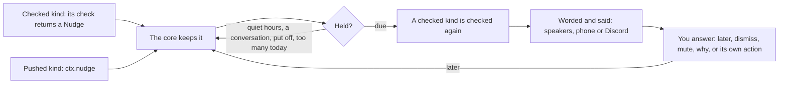
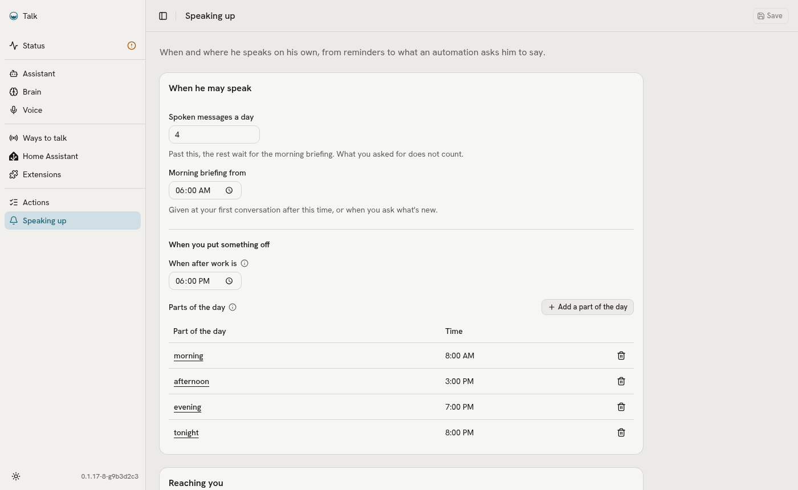

# Speaking up

How Winston brings something up on his own: a reminder, a plant that needs water, a story that broke.
Extensions declare what there is to say as nudges; the core decides when and where he says it, words
it, and handles your answer. Writing an extension is on [extensions](extensions.md), and announcements
from automations are on [announcements](announcements.md).

## How a nudge travels

A nudge reaches the core one of two ways. From there every nudge follows the same rules and takes the
same follow-ups.

- **Checked**, for conditions: "no workout for three days", "the soil is dry". A kind declared with
  `@ext.nudge` has a check that returns what should be said now, or nothing. A nudge lasts as long as
  its check returns it, so one put off is checked again before he says it, and one whose condition has
  cleared is never said.
- **Pushed**, for things that happen or that you ask for: a reminder, a breaking story, a parcel at
  the door. A kind declared with `ext.kind` takes nudges from `await ctx.nudge(kind, Nudge(...))`.
  The core keeps each one until it is said (and not put off), dismissed, expired, or withdrawn with
  `await ctx.withdraw(kind, about)`.

The core runs a checked kind's check:

- on the kind's triggers
- after every other handler of the extension (a job, hook, tool, action or entity change may have
  changed what there is to say)
- on `ctx.poke`
- right before a held nudge is said

A check gets 5 s. Read the store, Home Assistant and presence there, and leave the internet and the
model to jobs. A check that raises or runs out of time counts as no answer: nothing changes, and the
error shows on its page.

The core keeps every nudge's state in `data/state/nudges.json`, so a restart loses nothing and
nothing is said twice.

## Writing a nudge

`Nudge(about, say, facts={}, level=1, urgent=False, not_before=None, expires=None, actions=None,
links=[])`:

| Field | What it is |
| --- | --- |
| `about` | What it is about, unique within its kind. Everything the core remembers about a nudge (said, put off, dismissed) belongs to its kind and `about` |
| `say` | A plain line, said as is when his wording fails |
| `facts` | What he words it from and answers follow-ups from. They reach the brain as outside information, like tool results, unless the kind says `outside=False` |
| `level` | 1, or higher as it grows more pressing. A kind can deliver each level differently |
| `urgent` | May be spoken in quiet hours, only if the kind was declared `may_be_urgent=True` |
| `not_before` | A `datetime` before which it is held (a reminder's time, 15 minutes before a meeting) |
| `expires` | A `datetime`, or a `timedelta` from when it is first due, for what goes stale (a news story). Default: none |
| `actions` | Names of its extension's actions that apply; `None` for all its kind's, `[]` for none |
| `links` | Up to three `Link(title, url)`: buttons on the phone (a tap opens the first), text on Discord, links on the Talk page; never spoken. "Send me the links" is a nudge of a kind with `where="phone"` that carries them |

**`about` names one occurrence of the thing, and stays the same while it is that occurrence**: a
workout gap by the workout's start time, a plant by its sensor, a story by its link, one time of a
recurring reminder by the reminder's id and that time. Never build it from the current date or from
words like "tomorrow", or the core sees a new nudge each day and forgets what you said about the old
one.

## Kinds and their options

A kind's options are given to `@ext.nudge` or `ext.kind`. You change When (`deliver`) and Where
(`where`) on the extension's page and on the Speaking up page.

| Option | What it does |
| --- | --- |
| `title` | Its name on its page and in "why" |
| `description` | One sentence for people on what he will say and when ("Says so when you have not trained for the days you set"), under its title |
| `deliver` | When (below): one value, or one per level (`{1: "next_talk", 2: "when_home"}`). Default `now` |
| `where` | Where (below): one value, or one per level. Default `auto` |
| `repeat` | Checked kinds: say it again after this long (`"1d"`) while the check still returns it |
| `may_be_urgent` | Its nudges may be urgent |
| `requested` | Its nudges are things you asked for (reminders, alarms): see [when he holds a nudge](#when-he-holds-a-nudge) |
| `outside` | `False` when its facts hold only what the extension works out itself or you told it |

### When

| `deliver` | On its page | It is said |
| --- | --- | --- |
| `now` | Right away, outside quiet hours (a `requested` kind: even in quiet hours) | As soon as the rules allow |
| `when_home` | When you get home | At once if you are home, otherwise when you get home (your person in Home Assistant, on Speaking up) |
| `when_leaving` | As you leave | As you leave |
| `next_talk` | Next time you talk to him | The next time you talk to him; he mentions it after answering |
| `briefing` | In the morning briefing | The first conversation after Morning briefing from, or "what's new?" ("vad är nytt?", "was gibt's Neues?") |
| `silent` | Only show it on Talk | Never: only its page, the Talk page and the Home Assistant event |

The When choice ends with Off, which keeps him quiet about that kind (`enabled: false`). A kind that
delivers per level shows "Depends on how urgent".

### Where

| `where` | On its page | It goes to |
| --- | --- | --- |
| `auto` | Where you are | The speakers while you are home, your phone while you are away |
| `speakers` | Speakers at home | The speakers in the room you are in (the room last talked in, within 30 minutes: its box, and browser sessions set to it or to no room), else that room's Home Assistant satellites while [Assist](assist.md) is on, else every connected speaker and satellite. With none, the phone |
| `phone` | Your phone | The notify service picked on Speaking up (the Home Assistant companion app), with Done and Later buttons; Discord when none is set. It cannot be picked until one of them is |

## When he holds a nudge

Each step is logged to `logs/nudges.jsonl`.

- **Not said again** once said, unless `repeat` has passed or its level has risen. A nudge put off
  with `later` is said at that time all the same.
- **Not said again after a dismissal**, until it ends and comes back, or its level rises.
- **Held** when any of these holds:
  - its kind is muted, or the nudge is put off
  - it is before `not_before`, or its delivery waits
  - it is quiet hours (the same Quiet hours as announcements), unless it is urgent
  - a conversation is running, on any channel, until 30 s of quiet
  - nothing can deliver it (no speaker connected, no phone, no Discord); its page says so
- **Moved to the briefing** once Spoken messages a day (4) have been spoken today.
- **What you asked for comes when you asked.** Nudges of a `requested` kind, and any nudge at a time
  you gave with `later`, come at that time through quiet hours, the daily limit and their delivery's
  wait. They still wait out a running conversation.
- **Checked again** when a held nudge of a checked kind comes due: said only if the check still
  returns its kind and `about`, with its newest level and facts.

What happens to a nudge runs the extension's `@ext.on_nudge`: said (and where), dismissed, put off
(and until), muted, ended. So an extension keeps its own lists and entities current without polling
`ctx.nudges()`.

## How he says it

The channel that speaks a nudge words it with its own brain inside the conversation, from `facts`
and the persona, so it sounds like him and a follow-up has the context. The nudge's kind, `about` and
actions go into the conversation with it, and into the Talk page's typed conversation.

1. The chime plays.
2. He says it in his own words. When no wording has started within 12 s, the plain `say` line is
   spoken instead.
3. The box listens as it does after a reply (ESPHome's announcement with `start_conversation`), so an
   answer needs no wake word. The browser's mic is always open.

Next-talk nudges and the briefing are added to your message at your next turn, on any channel, and he
mentions them after answering. Every delivered nudge shows on the Talk page with where it went.

## Answering a nudge

Every nudge takes the same follow-ups through one fixed core tool, `follow_up(nudge, action, when,
reason)`, so extensions write none of it:

| Action | Said as | Does |
| --- | --- | --- |
| `later` | "Remind me after work", "snooze ten minutes" | Held until `when`, checked again if it is a checked kind, then said; `reason` goes with it ("You said you'd train today, sir."). Works on a nudge already said, and holds even if its level rises meanwhile |
| `dismiss` | "I know", "done", "thanks" | A pushed nudge ends; a checked one is not said again until it ends and comes back, or its level rises |
| `mute` | "Stop telling me about the plants until Monday" | The whole kind is held until `when`, or until switched back on |
| `why` | "Why are you telling me this?" | The extension, the kind and the facts it came from |
| its own | "Turn off the heater", "send me the links" | The extension's `@ext.action` handler |

Ending, putting off and silencing belong to the core, so an extension's actions do what those
cannot.

### How "when" is read

`when` takes what code can read: "tomorrow 17:30", "in two hours", "Monday", "when I'm home", and the
parts of the day (Parts of the day on Speaking up). He fills in times he knows from memory, such as
when you finish work.

A phrase with a day that code still cannot read ("tomorrow after work" with nothing in memory)
becomes "when home" on that day, or When after work is (18:00) if you are already home. The tool
answers with what it set, so he says the real time. Extensions read times the same way through a
`When` argument or `ctx.parse_when`.

### When follow_up is there

The brain has `follow_up` whenever an extension that is switched on declares a kind. A conversation
keeps the tools it started with, so one started before such an extension was switched on gets its
nudges without it, and he says that they can be put off in a new conversation.

### From your phone

Your phone's buttons are follow-ups too: Done dismisses, Later puts it off until you are home (two
hours when no person entity is set). A restricted call waiting for you (a tool or an action) is also
sent to the phone, with Confirm and Decline.

## The Speaking up page

<picture>
  <source media="(prefers-color-scheme: dark)" srcset="images/speaking-up-dark.png">
  
</picture>

The Speaking up page (`/speaking-up`, in the settings sidebar) holds what every extension's messages
and announcements share.

**When he may speak**, then under When you put something off, the last two:

| On the page | Key | Default | What it does |
| --- | --- | --- | --- |
| Quiet hours | `announce.quiet_hours` | 22:00-07:00 | Nothing is spoken then, except what you asked for and urgent nudges |
| Spoken messages a day | `speak_up.max_per_day` | 4 | Past it, the rest wait for the morning briefing. What you asked for does not count |
| Morning briefing from | `speak_up.briefing_from` | 06:00 | The briefing comes at your first conversation after this, or when you ask what's new |
| When after work is | `speak_up.fallback_time` | 18:00 | "After work" when he does not know when you finish: when you get home that day, or at this time if you are home already |
| Parts of the day | `speak_up.day_parts` | morning 08:00, afternoon 15:00, evening 19:00, tonight 20:00 | What "tomorrow morning" and "this evening" mean, as 24-hour times |

**Reaching you**:

| On the page | Key | What it does |
| --- | --- | --- |
| Your person in Home Assistant | `speak_up.home` | So he knows whether you are home |
| Your phone | `speak_up.phone` | A notify service. Gets messages while you are away, and asks you to confirm actions that need your OK. Empty: Discord, when it is set up |
| Also send to Discord | `announce.discord` | Whether announcements also go to Discord: Always, When it cannot be spoken (the default) or Never |

Under these, one line on where he reaches you at home and away, or a warning when nothing reaches
you away from home.

The rest of the page:

- **From automations and apps**: [announcements](announcements.md), with an example to copy into an
  automation.
- **What extensions may bring up**: every extension's messages, folded by extension ("Later, 2
  messages"), each with its [When](#when) and [Where](#where), the extension's own choice marked
  "(default)". A message muted by asking ("stop telling me about the plants until Monday") says until
  when, with Unmute.
- **Recently**: the last ten messages, newest first. Each has its day (when it was said, else when it
  came up), which extension it came from and where it stands: how it was said ("Said on the
  speakers"), "Not said: quiet hours" for one that ended unsaid, "Held: quiet hours" or "Put off
  until ...".

`winston ext check ID KIND` shows what a check would say now without saying it, and
`winston ext nudges [ID]` where each nudge stands and why it waits.
