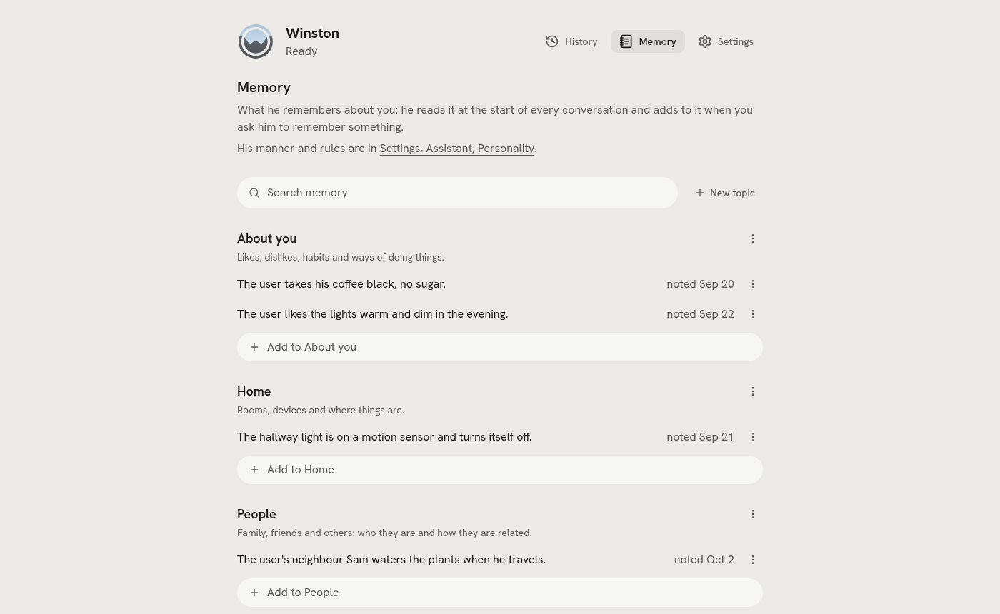

# Tools

Besides Home Assistant's own tools (over its MCP server) and the tools of extensions you switch on
([extensions](extensions.md)), Winston has these. All are logged to
`data/logs/tool_calls.jsonl`; settings are in the web UI under Tools.

Switching Home Assistant off (`providers.home_assistant.enabled: false`) keeps its settings but drops
its tools and `get_sensor_readings`, stops announcement events from it, and makes region "auto" fall
back to metric and a 24-hour clock.

| Tool | What it does | Needs | Limits |
| --- | --- | --- | --- |
| `get_sensor_readings` | Watched sensors with the age of each reading | `tools.sensors` | Read only |
| `remember` | Stores one fact in `data/memory/*.md`, or corrects one (`replaces`), optionally until a day; committed to git there | Nothing | 300 characters; secrets refused; `replaces` must match a stored fact exactly |
| `forget` | Removes one fact and says which ("Forgotten: ..."); committed to git there | Nothing | Exact match only |
| `web_search` | Current facts via Gemini with Google Search grounding | `GEMINI_API_KEY`, billing on the key | `tools.web_search.max_per_day` (100) |
| `ask_claude` | Hard questions to Claude through the Agent SDK | `ANTHROPIC_API_KEY`, `CLAUDE_CODE_OAUTH_TOKEN` or a Claude Code login | `tools.ask_claude.max_usd_per_day` (3 USD) |
| `send_message` | A Discord DM to a listed contact or you | `DISCORD_BOT_TOKEN`, `channels.discord.contacts` | Listed names only |
| `clone_voice` | Records a friend who agrees out loud and speaks in their voice ([voices](voices.md#cloned-voices)) | The voice channel | Spoken consent, checked for the words and for the same voice as the sample; typed channels only say to ask by voice |
| `use_voice` | Switches to a cloned voice or back to his own, optionally kept in config | The voice channel or a Voice PE box | Cloned voices only |
| `mark_mistake` | Marks his previous turn as a mistake when you say so ("that's not what I said", "I wasn't talking to you", "that was the wrong thing", "too slow"), with what you actually said or wanted if you say it ([understanding](understanding.md#1-turn-record-and-marks)) | `logging.turns.enabled`, a spoken channel | The turn before the one that asks |
| `follow_up` | Answers a nudge he spoke up with: later (with when and your reason), dismiss, mute its kind, why, or the extension's own action ([speaking up](extensions.md#speaking-up)) | An extension switched on that declares a kind | Times are read by code and said back as set; a restricted action waits for your confirmation |

Only the question text leaves the house for `web_search` and `ask_claude`: no home state, no memory.
Answers come back marked as information, never instructions.

One request gets at most eight rounds of tool calls; the ninth is asked without tools, so he answers
with what he has. On 2026-09-29 the 27B once called `GetLiveContext` and `GetDateTime` about 80 times in
a row for one request.

Keys are pasted into the settings page that uses them (the Gemini key under Tools, Web search, the
Claude key under Ask Claude, the Home Assistant token on its page, a hosted brain's or voice's API key
on Brain or Voice, the Discord bot token under Channels) and
stored in `data/.env` through `PUT /api/secrets/{name}`; the page only ever learns whether a key is
set, never its value. The variable a key is stored under is an Advanced setting. Saving a key marks
the channels that read it for a restart, as a settings change does.

## Region

`region` in config (the Assistant page) sets the units and formats he speaks in: temperature, metric
or imperial, the clock, dates, and the home's currency. Each defaults to "same as Home Assistant",
read from its unit system, country and currency. It goes into the system prompt when a conversation
starts, and he converts what tools and web searches return. Prices in another currency are said as
they are, never with a guessed exchange rate.

## Memory

Each topic is a file in `data/memory/`: `about-you.md`, `home.md`, `plans.md` and `people.md` to start
with (from `examples/memory/`), and any other `.md` there is a topic too. A file is a `# Title`
heading, one plain line saying what belongs there (the description; a leading `> ` is allowed), then
the facts as `- ` lines:

```markdown
# Plans

Appointments, visits and other dated plans; each leaves memory after its day.

- The user has the dentist on Tuesday 29 September 2026 at ten. (noted 2026-09-24, until 2026-09-29)
- The user renews the car insurance in October. (noted 2026-09-20)
```

The facts load into the system prompt when a conversation starts, so a new session knows them
without a restart. Relative dates are made absolute when stored ("tomorrow evening" becomes "on
Thursday 24 September 2026 evening") and each fact carries the date it was noted. `winston memory`
prints what the model sees.

A fact can end on a day: the stamp then reads `(noted ..., until YYYY-MM-DD)`. A relative date still
to come sets it ("the dentist on Tuesday" lasts until that Tuesday; "yesterday", "today" and "tonight"
set nothing), and `remember` takes `until` for the rest ("until Friday", "this week", a date; for a
fact he already knows it sets the day on that fact). After that day the fact stays in its file and
on the Memory page, but leaves the prompt and the size count. Nothing deletes it by itself.

He changes and forgets facts by voice. "The dentist moved to Friday" is `remember` with `replaces` set
to the old fact as he sees it in his prompt; "forget that Omar visits" is `forget`, which answers
"Forgotten: ..." so he says what went, with no question first (every change is a commit, and the
page has Undo). Both match the stored fact exactly (case, a trailing full stop and a quoted stamp
aside), never the closest one: on no match the tool answers with the topic's facts and he calls again
with one of them. The claim guard counts "I've forgotten that" or "noted" as a memory claim, backed
only by `remember` or `forget` in that turn or the one before.

The tools list the topics with their descriptions, read when a conversation starts, so a topic added
or described on the page is offered from the next conversation without a restart.

The Memory page (`/memory`, next to Talk) shows every topic and fact as stored, with search, and adds,
edits and forgets them in place, with Undo. A topic's (i) shows its description; Rename edits the name
and the description. A fact with an until shows it ("Until 29 Sep"), and editing a fact has a date
field to set or clear it. Facts past their day fold, greyed, under Expired at the bottom, with Clear
expired (asked once, with Undo). Topics can be renamed and deleted (Undo brings a deleted
one back), and Edit all opens a topic as one box, one fact per line, for pasting or rewriting many;
pasting several lines into an add field adds each. It uses the same checks as `remember` (no secrets, one
line, dates made absolute) and commits each change to the vault's git. Changes reach him in his next
conversation. New topic makes a new `.md` file. The line at the bottom counts what memory adds to
every prompt; past 6,000 characters it starts to cost time on every turn.

At the top, "How he behaves" shows his persona (`data/persona.md`): a few short rules for his manner,
edited like facts, and the technical instructions folded under them. The file has two sections,
`## How you behave` and `## Instructions`; the model reads them as one flat list. Only you write it,
from the page or an editor: the remember tool never can, which is why rules for him belong here and
facts about you in memory. The previous version is kept as `persona.md.bak`. His name is not taken
from this file: the prompt opens with `assistant.name` (see [Identity](identity.md#his-name)).

<picture>
  <source media="(prefers-color-scheme: dark)" srcset="images/memory-dark.png">
  
</picture>

## Web search

`gemini-3.5-flash-lite` at minimal thinking answers in about 1.4 s at the search model (Flash: 2.3 s,
same answers in our test). Grounding needs billing enabled on the key; Google's paid tier includes a
monthly grounding quota and does not train on the prompts. Over voice Winston says "Let me look that
up." while it runs.

## ask_claude

Runs the bundled Claude Code CLI with no tools, no settings and an empty working directory, one turn.
It signs in with the first of: `ANTHROPIC_API_KEY` (billed per question), `CLAUDE_CODE_OAUTH_TOKEN`
(from `claude setup-token`, uses your plan), then this machine's Claude Code login
(`~/.claude/.credentials.json`). An empty variable counts as unset. On the Tools page, the Ask Claude
card's "Signs in with" row names the one it will use (`GET /api/tools/ask_claude/auth`), with a check
or, for nothing, an error icon; hover it for the source. Its Key field takes either kind: a key
starting `sk-ant-oat` is stored as `CLAUDE_CODE_OAUTH_TOKEN`, `sk-ant-api` as `ANTHROPIC_API_KEY`, on
Save. The icon beside it says whether either is set, and its x removes the stored one.
On a Claude Pro or Max plan it draws on the plan's monthly Agent SDK credit (opt in once in your Claude
account); `claude setup-token` makes a token for a machine without a browser login. Claude Opus 5 at
low effort: about 6 s and 0.05 USD a question. Over voice Winston says "Let me think about that."
