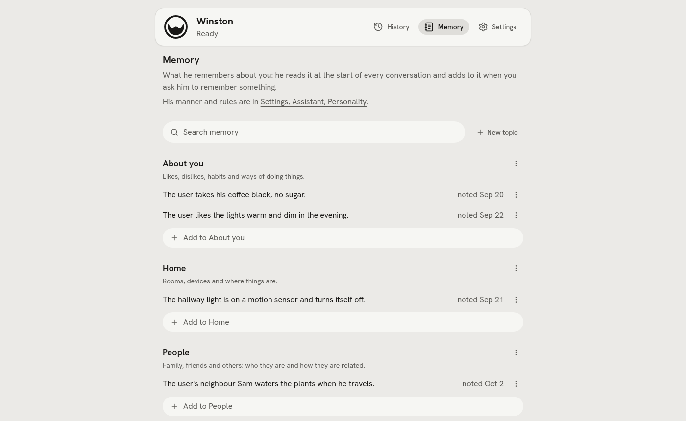

# Tools

Winston's own tools, the rules every tool call follows, where keys go, and his memory. Besides these he
has Home Assistant's tools ([Home Assistant](home-assistant.md)) and the tools of extensions you switch
on ([extensions](extensions.md); web search, Ask Claude and watched sensors are
[built-in extensions](built-in-extensions.md)).

## His own tools

| Tool | What it does | Needs | Limits |
| --- | --- | --- | --- |
| `remember` | Stores one fact in `data/memory/*.md`, or corrects one (`replaces`), optionally until a day; committed to git there | Memory on (Remember what you tell him) | 300 characters; secrets refused ([in other languages too](languages.md#secrets-in-memory)); `replaces` must match a stored fact exactly |
| `forget` | Removes one fact and says which ("Forgotten: ..."); committed to git there | Memory on | Exact match only |
| `send_message` | A Discord DM to a listed contact or you | `DISCORD_BOT_TOKEN`, `channels.discord.contacts` | Listed names only |
| `clone_voice` | Records a friend who agrees out loud and speaks in their voice ([voices](voices.md#cloned-voices)) | The voice channel | Spoken consent, checked for the words and for the same voice as the sample; typed channels only say to ask by voice |
| `use_voice` | Switches to a cloned voice or back to his own, optionally kept in config | The voice channel or a Voice PE box | Cloned voices only |
| `mark_mistake` | Marks his previous turn as a mistake when you say so ("that's not what I said", "I wasn't talking to you"), with what you said or wanted if you say it ([marking a mistake](understanding.md#marking-a-mistake)) | `logging.turns.enabled`, a spoken channel | The turn before the one that asks |
| `start_over` | Starts a new conversation when you ask ("start over", "new conversation", "forget this conversation"): in a room for its box and every screen, otherwise this one ([rooms](rooms.md#what-a-room-does)) | Nothing | The request that asked stays, so he can answer it; remembered facts stay |
| `follow_up` | Answers a nudge he spoke up with: later (with when and your reason), dismiss, mute its kind, why, or the extension's own action ([speaking up](speaking-up.md)) | An extension switched on that declares a kind | Times are read by code and said back as set; a restricted action waits for your confirmation |

## How his tools behave

- **No Permission of their own.** The tools above are there while what they need is set up. They are
  not on the Actions page in settings, which lists the extensions' actions, each with its Permission
  (On its own, Asks you first or Off), and Home Assistant's, which run on their own
  ([extensions](extensions.md#tools)).
- **Looking or changing.** A tool here or from Home Assistant whose name starts with "get" only looks
  (`GetLiveContext`); the rest change things. When you talk over his reply, a change under way
  finishes and a look is cut short.
- **At most eight rounds of tool calls** per request. The ninth is asked without tools, so he answers
  with what he has.
- **A failed call is not repeated** with the same arguments in the same request. It answers with the
  same error and that it would fail again.
- **Only words are spoken.** A copied clock stamp or a tool call written out as text never reaches the
  voice.
- **A conversation that outgrows the model's context** starts afresh from your newest request, with a
  line saying so, instead of falling silent.
- **Every call is logged** to `data/logs/tool_calls.jsonl`.

## Without Home Assistant

Switching Home Assistant off (Use Home Assistant on its page, `providers.home_assistant.enabled`) keeps
its settings but drops its tools, stops announcement events from it, and makes region "auto" fall back
to metric and a 24-hour clock.

## Keys

A key is pasted into the settings page that uses it and stored in `data/.env` through
`PUT /api/secrets/{name}`. The page only ever learns whether a key is set, never its value.

| Key | Pasted on |
| --- | --- |
| An extension's key | That extension's page |
| The Home Assistant token | Home Assistant |
| A hosted brain's or voice's API key | Brain or Voice |
| The Discord bot token | Ways to talk |

The variable a key is stored under is config.yaml only
([running](running.md#settings-only-in-configyaml)); pasting the key writes it. Saving a key marks
the channels that read it for a restart, as a settings change does.

## Region

The units and formats he speaks in, on the Assistant page. Each defaults to Same as Home Assistant,
read from its unit system, country and currency.

| On the page | Key | Choices |
| --- | --- | --- |
| Temperature unit | `region.temperature` | Celsius or Fahrenheit |
| Units | `region.distance` | Metric (km, kg, litres) or imperial (miles, pounds, gallons) |
| Clock | `region.time_format` | 24-hour or 12-hour |
| Dates | `region.date_format` | Day or month first |
| Currency | `region.currency` | A currency code, like EUR or USD |

The region goes into the system prompt when a conversation starts, and he converts what tools and web
searches return. Prices in another currency are said as they are, never with a guessed exchange rate.

## Memory

### Settings

On the Assistant page, under What he remembers:

| On the page | Key | Default | What it does |
| --- | --- | --- | --- |
| Remember what you tell him | `memory.enabled` | On | He reads it at the start of every conversation and can remember something new. Off keeps it all but stops using it |
| Keep a history of every change | `memory.commit_on_write` | On | Every change, the diary's too, is a git commit in the memory folder, so a fact you made him forget stays in that history. The Memory page's Undo works without it |
| (config.yaml only) | `memory.dir` | `memory` | The folder, in the data directory |

### How facts are kept

Each topic is a file in `data/memory/`: `about-you.md`, `home.md`, `plans.md` and `people.md` to start
with (from `examples/memory/`), and any other `.md` there is a topic too. A file is a `# Title`
heading, one plain line saying what belongs there (the description; a leading `> ` is allowed), then
the facts as `- ` lines:

```markdown
# Plans

Appointments, visits and other dated plans; each leaves memory after its day.

- The user has the dentist on Tuesday 29 September 2026 at ten. (noted 2026-09-24, until 2026-09-29)
- The user renews the car insurance in October. (noted 2026-09-20)
```

- The facts load into the system prompt when a conversation starts, so a new session knows them
  without a restart. `winston memory` prints what the model sees.
- Relative dates are made absolute when stored ("tomorrow evening" becomes "on Thursday 24 September
  2026 evening"), and each fact carries the date it was noted.
- The tools list the topics with their descriptions, read when a conversation starts, so a topic
  added or described on the page is offered from the next conversation without a restart.

### Facts that end on a day

A fact can end on a day: its stamp then reads `(noted ..., until YYYY-MM-DD)`.

- A relative date still to come sets it: "the dentist on Tuesday" lasts until that Tuesday.
  "Yesterday", "today" and "tonight" set nothing.
- `remember` takes `until` for the rest ("until Friday", "this week", a date). For a fact he already
  knows, it sets the day on that fact.
- After that day the fact stays in its file and on the Memory page, but leaves the prompt and the size
  count. Nothing deletes it by itself.

### Changing and forgetting by voice

- "The dentist moved to Friday" is `remember` with `replaces` set to the old fact as he sees it in his
  prompt.
- "Forget that the neighbour waters the plants" is `forget`, which answers "Forgotten: ..." so he says
  what went, with no question first (every change is a commit, and the page has Undo).
- Both match the stored fact exactly (case, a trailing full stop and a quoted stamp aside), never the
  closest one. On no match the tool answers with the topic's facts and he calls again with one of them.

### The Memory page

<picture>
  <source media="(prefers-color-scheme: dark)" srcset="images/memory-dark.png">
  
</picture>

The Memory page (`/memory`, beside Talk and History) shows every topic and fact as stored, with
search, and adds, edits and forgets them in place, with Undo. Changes reach him in his next
conversation.

- **A topic** shows its description as a muted line under its heading. Its menu has Edit all as text,
  Rename and describe, and Delete topic (Undo brings a deleted one back).
- **A fact** shows when it was noted ("noted 23 Sep") and, when it ends, an "Until 29 Sep" badge. Its
  menu has Edit, with a date field to set or clear the until, and Forget.
- **Expired** facts fold, greyed, at the bottom, with Clear expired (asked once, with Undo).
- **Edit all as text** opens a topic as one box, one fact per line, for pasting or rewriting many.
  Pasting several lines into an add field adds each. It uses the same checks as `remember` (no
  secrets, one line, dates made absolute) and commits each change to the vault's git.
- **New topic** asks for its name and what belongs there (he reads that to choose where a new fact
  goes) and makes a new `.md` file.
- **The line at the bottom** says how many characters memory adds to every conversation. Past about
  6,000 his replies get slower.

### What does not go in memory

His personality is not in memory: it is on Assistant, Personality, and only you write it
([identity](identity.md#his-personality)). A rule about one tool belongs in that tool's description,
which comes and goes with the tool, not in the personality.

`tests/prompt_phrases.yaml` (`winston check turns --phrases`) has the requests whose answer depends on
the prompt's own rules, so a rule that contradicts another shows as a wrong call.
