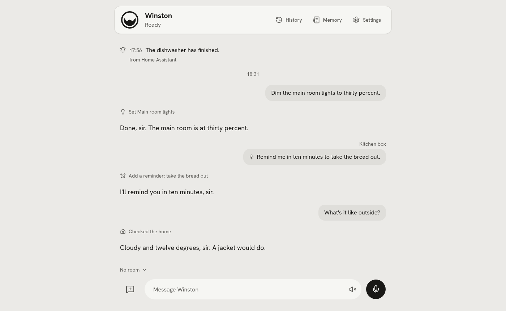
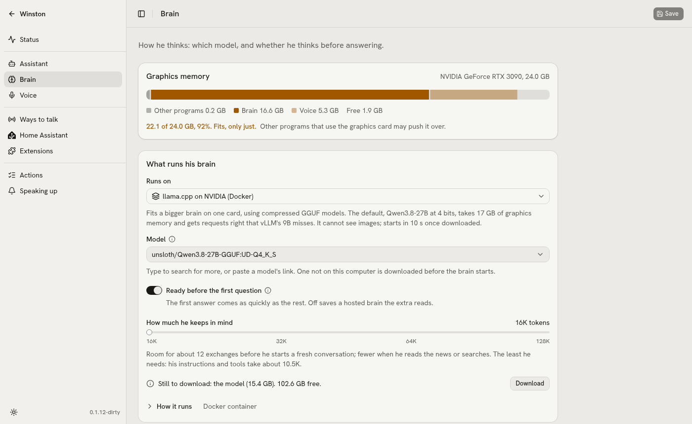
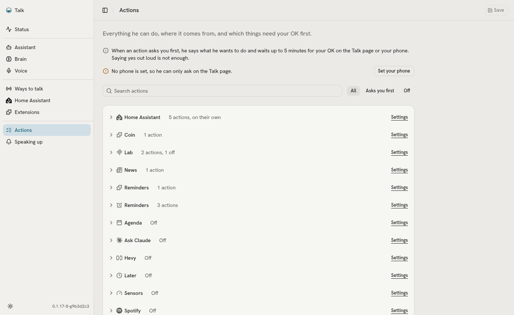

# UI guide

The rules every page of the web UI follows, the words it uses and the components that draw it. Read it
before changing a page.

The web UI has two areas. Both use one component library and no hand-written CSS beyond theme tokens.

- **Winston** is the front: Talk, History, Memory and the wall display. It is where you talk to him and
  see what he did.
- **Settings** is behind it: Status first, then who he is, how he thinks, sounds and hears, the ways
  to talk to him, Home Assistant, extensions, his actions and when he speaks up.

## Stack

| Part | What it is |
| --- | --- |
| App | React, Vite, TypeScript |
| Components | shadcn/ui on Tailwind, lucide icons |
| Data | TanStack Query, over an OpenAPI-generated client for `winstond` |
| Settings forms | JSON-Schema forms with a shadcn theme |
| Voice button | Pipecat's browser client (`@pipecat-ai/client-js` with the small WebRTC transport), connecting through winstond to the voice channel |

## Rules for both areas

### Look

Do:

- One typeface, Hanken Grotesk, in sentence case everywhere.
- One accent colour, petrol (`--primary`): filled buttons, a switch that is on, sliders, focus rings,
  the selected page in the sidebar, setup's step number and his mark. Text, links and the semantic
  colours (ok, warning, error) are not the accent, and a chart's parts are steps of ink, never a
  semantic colour, which belongs to the sentence saying the verdict.
- **Links and commands look different.** A link is underlined text in the text colour, always, not
  only on hover. A command is a button, never bare text ("Copy it", "Remove").
  - A link to one setting carries its id (`/assistant#cfg_logging_turns`): the page scrolls it to the
    middle and rings its card for a moment (`useHashTarget` in `page.tsx`).
- **Save is an outline, greyed, until the draft has changes**; then it fills with the accent.
- **Every field has an edge**, the front's composer and search fields too, and every dropdown, searchable
  or not, is the same outlined field. An off switch has a mid-grey track, so it reads as a control.
- **Four steps of heading**: the page title; a card's title, semibold; a heading inside a card, with a
  rule above it so its fields read as their own part; then a field's label, the lightest.
- Light and dark come from the theme tokens.

Don't:

- No monospace, no small spaced-out capitals as labels, no second font for titles. Mixed type is what
  makes a page read as machine-made. One exception: text you paste elsewhere exactly (`CopyText`: a
  YAML example, an address) is monospace, since its spaces and indents matter. Never a label or a value.
- No glows, gradients or decorative shadows, and nothing hand-tuned per theme.
- No inline styles, no custom CSS classes, no em dashes. The build fails on all three.

Winston's mark is drawn in the accent ([identity](identity.md#the-mark)). Other logos stay one colour.

### What the UI shows

- **Winston only**: what he heard, said, did and remembers, and his own parts and settings.
- **Never the house's controls.** Switches and room dashboards belong to Home Assistant. "Turned on
  Kitchen lights" is a record of something he did, not a control.
- **No marketing and no welcome screens.** Every settings page, and Memory, opens with one sentence on
  what it is for. Talk, History and the wall display open on their content. Anything a label cannot
  say is said in a short line where it applies (see [Copy](#copy)).
- **Two voices.** The screens speak plainly, neutral and in the second person. The butler character
  lives only in what he says, since personality in a label gets in the way of its meaning.

### Touch and narrow screens

- **Nothing is hover-only**, because the wall panel and a phone have no hover. Every fact and action
  can be reached by tap and by keyboard:
  - row actions sit in a visible menu;
  - the (i) and a state's detail are popovers that open on tap (`InfoTip`, `StatusTip`);
  - a tooltip only names an icon button.

  Two gaps are still open: the mark's words on Talk and a blocked preview's reason sit in tooltips.
- **Below `sm` a control is a finger's size**: every button, field and dropdown is at least 40 px tall,
  and an (i), a state's word and a switch have a tap area about that size around them.
- **Pages work at 360 px wide** with a 16 px gutter and no sideways scroll. The smoke test checks every
  page at 390 px.
- **The header follows its own width** (the sidebar shares the window). Two or more commands fold into
  one More menu (one stays a button), and the breadcrumb gives way when it is narrow, so the title
  keeps its room.
- **Tables stack below `sm`**, and Save moves to a bar along the bottom. On Status a stacked row's state
  and buttons line up under its name, past the icon.
- **A dropdown's value wraps** onto a second line in a narrow field rather than being cut mid-word.
- **A status line's buttons wrap together**, below its sentence, never one by one.
- **Menus**: a menu is as wide as its longest item, so no item wraps. Menu items are words without
  icons.

### Settings, commands and documents

The three look different, so nobody flips a switch, leaves, and believes it acted.

| Kind | Drawn as | When it acts |
| --- | --- | --- |
| Setting | Switch, select or field | Changes the draft and waits for Save |
| Command: Start, Restart, Apply now, Remove a saved key | Labelled button or menu item, never a switch | Now. Those that stop something or reach outside (Stop, an engine's Restart, Apply now, Remove) confirm their cost; Start runs at once |
| Document: Memory, Personality | The document | Saves each edit, with Undo in its toast |

Off means off: switching a part off and saving stops it, as switching it on and saving starts it, and
the Save confirm says which.

### Errors

Errors are never silent.

| What went wrong | What shows | Drawn by |
| --- | --- | --- |
| An action failed | Its reason in a toast | The query client, for every mutation that does not show its own error. `meta: { showsErrors: true }` opts out |
| A page could not load | An error icon, the reason and Retry, in place of its skeleton | `LoadError`. `PageSkeleton` shows it by itself when a query the page waits on failed |
| A part fails or stops answering | A notice with why and Status, on every page but the wall display | `EngineToasts`, from the status stream ([notices](web-ui.md#notices)) |
| A page fails to draw | "This page hit a problem. Your unsaved changes are kept." and Try again, never a blank screen | `PageError` in `App.tsx` |

### Dates and times

Dates and times go through `useRegion()` (`hooks/use-region.ts`, over the formatters in
`lib/format.ts`), so every page follows the Region settings. Time-of-day inputs stay the browser's own
field, which cannot be forced.

## Vocabulary

One word per concept, used by every page, confirm, toast and doc, so people can build one picture of
him. The role names come from `partName` and `engineLabel` (`api/status.ts`) and `SLOT_TITLES`
(`lib/presets.ts`); schema titles use the same words.

| Concept | Say | Never show |
| --- | --- | --- |
| The language model slot and its server | Brain; the weights are the model | llm, model server |
| Text to speech | Speaking (the page is Voice; a voice is what he speaks with) | tts, TTS |
| Speech to text | Hearing | stt, STT, ASR |
| Preset picker | Runs on | Engine (as the picker's label) |
| Engine block (driver, image, arguments) | How it runs | Engine card |
| Driver | Runs as: Docker container, Process, External server | driver |
| Engine `enabled` | Start with Winston | Enabled |
| Browser voice channel | Talk page microphone | voice channel |
| Satellite | Room box (help may say once that Home Assistant calls it a voice satellite) | satellite, Voice PE as a generic word |
| Satellite map key | Room | device |
| Channels | Ways to talk | channel |
| A turn | Spoken request; what is kept of them is recordings; the page is History | turn, turn record |
| Session | Conversation | session |
| Tool | Action | tool (except "MCP server") |
| Declared tier read, act | Only looks, Changes things | read, act, tier |
| Tier restricted | Asks you first | restricted |
| Tool enabled | On its own, Off | Brain (as a column) |
| Tool offer | Shared, under Share with other AI apps | Other apps (as a column), offer |
| Nudge, kind | Speaking up; one item is a message | nudge, kind |
| Announcement | Announcement: something an automation or app asked him to say | |
| Extension permissions | What it can reach | May reach, permissions |
| Secret | Key, or the service's own word (Bot token, Access token) | secret, variable, data/.env |
| RAM | Computer memory, graphics memory; Memory alone is what he remembers | memory, RAM, VRAM |
| CPU, GPU | The processor, the graphics card ("NVIDIA card" when the make matters) | CPU, GPU |
| winstond, the data folder | Winston, his computer | winstond, data/.env, winston up |
| A switch | Its effect as a verb phrase | Enabled |
| Dashboard | Wall display | dashboard |
| Presence `idle` | Ready | Idle |

Two exceptions:

- **Another product's own words** stay where the user has to find them there: Assist, Long-lived
  access tokens, Developer Mode, Developer Portal, MCP.
- **How it runs** is the one place a process's own words appear: its command, arguments, environment
  and paths.

The pronoun is "he" (the butler persona). Copy that names him uses the configured name (`assistant`
from `/api/status`), never a hardcoded "Winston", so a renamed assistant reads right. "Winston" names
the program ("Start with Winston", "Takes effect when Winston restarts").

## Copy

| Element | Rule | Example |
| --- | --- | --- |
| Label | Names the effect in your words: a noun phrase for a value, a verb phrase for a switch, a verb for a button. An add button is "Add a" and what one entry is called. Never "Enabled", never the config key | "Delete recordings after", "Remember what you tell him", "Add a box" |
| Help (`help`) | One visible line under the control. One sentence of at most about 140 characters, and never repeats the label | |
| Description (`description`) | Behind the (i): background, trade-offs and examples. Does not repeat the help | |
| Unit | The schema's `unit`, drawn after the value, never part of a title | |
| Page intro (`intro`) | One sentence on what the page is for | |
| Card lead | A card that introduces a concept gets one lead line under its title: its section's `help`, or the page's own `CardDescription` | |
| Empty list | One sentence on what belongs there, and the action that fills it | "No room boxes yet." with Add a box |
| Search with no results | "Nothing matches." ("None yet." is only for simple maps: environment, volumes) | |
| Status line (`StatusLine`) | An icon for its tone and one sentence, with what to do as a labelled button. The reason is in the words, never only in a tooltip. A suggestion (Set up next on Status) is muted, not a warning | "Hevy needs a key." and Open Hevy |
| Confirm title | A question that names the action and the part by its role | "Stop the brain?", "Remove the saved bot token?" |
| Confirm lines | What stops working, for how long, and what changes outside Winston | "It is deleted from his computer now, without waiting for Save." |
| Confirm button | Repeats the verb, never OK | "Stop", "Run without asking" |
| Toast | What happened, in the confirm's words and the past tense, with Undo wherever it can be undone | "Forgot: ...", "Saved; added 1 name" |
| Error | What happened and what to do, in plain words. The exception goes to the log, never to the page | "Can't reach Home Assistant: nothing answered at that address" |
| Preset hint | Two parts: what you get, then what it needs. No model versions, sizes or timings: the memory bar and the download line say those | "Clones a voice from a short clip, in English only. Needs an NVIDIA card." |

When a field gets help:

- **Prefer a better label to a help line.** A field gets `help` only when the label cannot predict
  what it does or costs, or when it involves consent, privacy, money, data leaving the house, a format
  to learn or a setup step outside Winston.
- Keep it short, because walls of grey text fail as badly as no words.

Never:

- versions, measurement dates, file paths, CLI commands, variable names or internal names in a label
  or help. `description` names them only when they are the choice itself; measurements go to
  `docs/decisions.md`;
- a welcome, marketing, or an intro or card lead that repeats the title;
- `data/.env` or winstond: say "his computer", or "the computer he runs on" in a sentence. Never "this
  computer": read on a phone or a wall panel, it means that device;
- secret: say "key".

`tests/schema_copy_cases.py` holds the config schema to these rules. It fails on:

- `data/.env`, winstond, `winston up`, backticks, ISO dates or an em dash in a title or help;
- help over 140 characters;
- a bare title ("Enabled") or a unit in a title;
- a switch or a key without help.

## Winston

### Talk

<picture>
  <source media="(prefers-color-scheme: dark)" srcset="images/talk-dark.png">
  
</picture>

The conversation is the page.

| Line | How it is drawn |
| --- | --- |
| You | On the right in a soft bubble |
| Him | On the left as plain text |
| An action | One muted line with its icon, worded from the action's title, in the past tense once done ("Turned on Kitchen lights", "Searched the web: opening hours"). A title led by a word that is not a known verb stays as it is |
| A new conversation | A divider that says why it started |
| Lines from another place | Where, on the first line of a run ("Kitchen box", "Discord") |
| What he brings up on his own | One line with a bell: the time, what he said, from whom and where it went |
| An error | The server's sentence and a Status link |
| A restricted action waiting for you | A line with Confirm and Decline, replaced by its outcome |
| While he thinks | A small `Presence` and Thinking where his reply will appear, until his words or a running action take over |

- **Scrolling**: the view follows new lines only while it is at the bottom; otherwise New messages
  jumps down.
- **Voice and typing sit side by side at the bottom**: New conversation as a quiet round icon button
  (it asks first), the text field with Read typed replies aloud at its end, and one round talk button
  that becomes Send once something is typed.
- **Toggles** keep their icon and show their state with a pressed style (`aria-pressed`). Read aloud
  also crosses its speaker out while off.
- **The line above the field** is one muted line. At its left, the room picker once a room exists:
  each option says what choosing it does, and it is locked while you talk. At its right, the one fact
  that matters now: the Talk page microphone is off, a box holds the microphone, "Listening. He hears
  everything until you press the microphone again.", or read aloud is on.
- **An empty conversation** says how to start and what he can use, from what is set up and running.
  With nothing connected it says so and links to Status. No example phrases, no chips.

### His presence

His presence is his logo, one component, `Presence`, driven by his state; see [identity](identity.md).
Pages never draw their own version of it.

The line under his name says whether he can answer (`notReady` in `api/live.ts`): Ready, Listening,
Thinking, Speaking, "Starting: his brain is loading (about 2 min)", or "Can't answer: his brain is
stopped" (or "Can't reach Winston") with a Status link.

### The header

The top of every page on Winston's side is one card.

- His logo, name and readiness at its left lead back to Talk.
- History, Memory and Settings are links at its right, each an icon and its name (below `sm` the name
  stacks under the icon). The current one sits on a quiet rounded background.
- Settings opens Status, and carries a warning mark while something needs you.
- Each page sets its tab title with `useTitle`: "History · <name>", and Talk the name alone.

Drawn by: `WinstonHeader`.

### Marks on spoken lines

A line you said aloud gets a flag once its recording is kept, on Talk and History alike. The flag is
always visible on touch, and on hover or focus otherwise. A marked line keeps a filled flag in the text
colour, and the toast offers Undo. The menu and its marks are in
[understanding](understanding.md#1-turn-record-and-marks).

Drawn by: `TurnMarkControl`.

### History

- One day at a time under his diary entry for that day, or Marked. The two are pressed-style buttons,
  and `?view=marked` opens the second.
- Each spoken request has a muted header in words ("14:25, Kitchen, after the wake word, answered in
  1.5 s"), Play what he heard inside your bubble, and the rest as on Talk.
- With recordings off and none kept, one sentence centred, as Talk's empty conversation is, with Turn on
  recordings; with some kept, a muted line says new ones are not, with the same button.

### Memory

Memory is a document of what he remembers, nothing else. His manner is under Assistant, Personality,
and a line links there.

- A topic is a heading with its description as a muted line under it.
- A fact is a row with when it was noted; each row's actions sit in its menu.
- A rounded field under each topic adds.
- Every edit, forget and delete offers Undo.

The labels are in [tools](tools.md#memory).

### Wall display

The wall display (`/wall?room=`) is set up from Ways to talk, on the Talk page card. It shows:

- the logo large, as the talk button;
- its room quietly at the top left;
- one line for his state ("Tap to talk", "Microphone paused while the box has it", or why he cannot
  answer), in full-strength text at about the reply's size, so it reads across a room;
- the last exchange in large type;
- what he says on his own, across the screen until it is tapped away;
- a plain Close link at the top right, its only other control.

## Settings

<picture>
  <source media="(prefers-color-scheme: dark)" srcset="images/brain-dark.png">
  
</picture>

### Page layout

- **Only shadcn components** (`components/ui`) and the app's own components and templates, so a new
  page looks like the others without new CSS.
- **Settings open on Status.** The sidebar has four groups split by separators without labels:
  - Status;
  - Assistant, Brain, Voice;
  - Ways to talk, Home Assistant, Extensions;
  - Actions, Speaking up.

  Talk, with his mark, is above them, drawn like any page, the way back to him; the theme menu and the version sit in its footer. On a phone
  it is a sheet that closes when you pick a page.
- **A page's header**, in order: on a sub-page the parent as a breadcrumb ("Extensions / Spotify",
  `back`), the title, page commands as outline text buttons (`commands`), what waits for a restart,
  how many changes are unsaved (in a wide header), Discard and Save. In a narrow header two or more commands fold into one More menu and the breadcrumb
  gives way. Below `sm`, Discard and Save are a bar along the bottom ("2 unsaved changes") while there
  is something to save.
- **No view modes**: a field is drawn or it is `hidden`.
- **Makers' logos** (Simple Icons) mark engines, services and extensions of a maker's service (Claude,
  Hevy, Spotify, Gemini for web search, MCP for an MCP server), drawn in the text colour like any icon.
  Home Assistant entities get a lucide icon for their domain.

### Fields

A field is, top to bottom: its label, the (i) for its `description`, the control, its `help` line (see
[Copy](#copy)), then what a refused save said. A switch has its label, (i) and help beside it. No
required asterisk.

- **Order**: fields follow the schema's order. Fields that share a `group` follow one heading, after
  the fields without one, and the section's own rows come last.
- **One editor per setting**, on the page `settingsPages` (`hooks/use-settings.ts`) names for its path,
  because a setting in two places gets changed in one and ignored in the other.
  - The page with the longest matching section owns a path (`pagesOf`).
  - Another page may show the same editor filtered to one source as a `view` (an extension's actions
    and messages on its own page).
  - One config object is never split across two pages.
  - Where something is edited on another page, a row shows what it holds and links there
    (Personality on Assistant).
- **A field that does not apply is not there.** The schema says when it applies (`when`: the engine's
  driver, the engine command, another field; `drivers`; `hidden`), and the form leaves it out
  otherwise.
- **A section whose switch is off** (`enabled_by`) shows only its switch, whose help says "Off. Switch it
  on to set it up." unless it has its own (prune marks it `section_switch` and leaves the rest out).
  Switching it on shows the rest at once, before Save, so a key can be pasted before anything starts.
  An extension that is off keeps its settings in view, marked `waits`, and its keys do not warn.
- **A cleared field** saves what it shows where empty means something. A field marked
  `empty_means_off` (quiet hours, chime, health path, quantization) saves `''` when cleared, so the
  default does not quietly come back. Any other cleared field falls back to its default.

#### Never ask what a machine knows

- A field whose answers can be listed (models, voices, entities) names its list in the schema
  (`options`), or for an extension its own list (`Field(choices=...)`). It renders as a searchable
  dropdown (`Combobox`) that still takes a typed value, and `placeholder` says what empty means ("Not
  set", "Same as Home Assistant").
- A list that cannot be fetched (no token yet, the server down) leaves a plain text box with the
  reason as a visible line under it. A value the list does not hold is looked up by itself and marked
  when it is not found.
- Never show what the machine says to itself. Ids, file paths and variable names are never drawn
  outside How it runs (`hidden`, config.yaml only). What the model is told shows only for an action
  from an MCP server, a package or Home Assistant, inside its closed Details.

#### Which control

| Value | Control |
| --- | --- |
| An enum | Options with `labels`. A choice with a trade-off says its cost in its option ("Always think (a few seconds slower)") |
| A number | An input with its `unit` after the value. `labels` on a number names a special value (`{"0": "Off"}`) |
| A value felt rather than typed | `widget: slider`, opt-in |
| A value copied from elsewhere (a model page's sampling values) | An input, not a slider |
| A port or an id | Always an input |
| A time of day | `widget: time`, the browser's time field |
| A command line (engine arguments, a start command) | One text area, one argument per line (`widget: args`), with a warning when a flag is given twice and "Reset to the preset" where a preset owns it |
| Any other plain list | One box per entry, Add beside the list's label and Remove always visible. They have no order |
| A map (contacts, engine environment, volumes) | A table, see [Maps](#maps) |
| A key | `SecretField`, see [Keys and accounts](#keys-and-accounts) |

Every text box is the app's own `Input`, never the form library's.

#### Maps

A map in a form is a table with Add, an entry dialog, and trash with Undo in its toast. Pairs are never
a text syntax.

- Column titles come from the schema (`key_title`, `value_title`).
- A key picked from a list (`key_options`) shows its cover or icon, as every picker does (never an
  empty box), and its hint ("34 songs").
- A name made only of emoji is drawn larger.
- When the list cannot be fetched, the key is a text box with the reason under it.
- A key already in the list keeps Add or Done off and says "Already in the list".
- A page keeps its own table only where it adds what the generic one cannot: Home Assistant's devices,
  the room boxes (live state).

Drawn by: `KeyedMapField`, `ChoicePicture`, `ChoiceName`.

#### Keys and accounts

Keys are pasted, never shown.

- Beside the field a word says where it stands: "Saved", or "Not set" for a required key whose section
  is on. An optional key (`Secret(optional=True)`) never warns.
- Its placeholder reads "Paste the bot token", "Paste to replace it" or "Optional", and its help says
  where to get it (`secret.help`).
- Remove is a labelled command that deletes the key at once and says so.
- A pasted key waits with the draft, and Save writes it to `data/.env`. The variable name is
  config.yaml only, and a key write refused while the page is open to the network names it.

An account an extension signs in to is Connect, or "Connected" with Disconnect, both acting at once
like Remove. Connect opens the service's sign-in in a new tab; under it a line gives the address the
service's app must list, with Copy it. Back on the page, it reads again.

Drawn by: `SecretField`, `AccountField`.

#### Things beside the fields

- **Not a config field** (a connection check, a link row): something a section needs that is not a
  field is a child of its `SectionForm`, drawn after its fields.
- **An adornment** is a control that acts on a field without being one (Play beside Voice, Reset to the
  preset). It goes in `SectionForm`'s `adornments`, keyed by the dotted path from the section, and
  shows only while the form shows that field. It reaches the form through a React context
  (`lib/adornments.ts`), not rjsf's `formContext`, so it follows the page's state.
- **A preview** of unsaved settings plays through `usePreview`, the same streamed playback as Talk's
  read aloud. Play turns into Stop while it plays, and one preview plays at a time (`takePlayback`). A
  preview the running server cannot give is disabled with the reason in its tooltip
  (`PreviewButton`).

### State and problems

Quiet when fine, words when not, since nineteen green checks say nothing.

- **Running** may be an icon alone in a long list. Every other state is an icon plus a word from the
  one state map, `STATE_WORDS`: Running, Starting, Not responding, Stopped, Failed; extensions add
  Needs a key and Not running.
- **The reason** is a visible line (`StatusLine`). The popover may add detail but never holds the only
  reason.
- **A problem shows** at the thing, under Needs you on Status, and as a warning mark on Status in the
  sidebar and on his Settings link (`needsAttention`).
- **A card about something that runs** carries its state in its title only when it is not Running
  (`SectionForm`'s `status`).

Drawn by: `StateIcon` (`words`: `problems` by default, `always` on Status), `StatusLine`.

### How it runs

How a process runs (runs as, image, arguments, environment, ports, paths) lives in one closed How it
runs fold at the bottom of its slot card, its driver beside the title.

- The fold starts closed on every load and is never remembered.
- A custom engine's page is itself its How it runs and draws it open.
- The setup wizard leaves it out: every pick there is a preset. Its state line stays.
- A server on your network (an external engine with no address of its own) keeps its server fields,
  How thinking is switched, on the card: only you know that server.
- Nothing else is folded to hide settings; a fold elsewhere only shortens a long list.

Above the fold, so a problem is never folded away, the card keeps:

- Runs on, with the preset's line;
- the slot's own fields;
- "Off, so he cannot answer." with Turn on;
- what the pick still needs downloaded, with its size against the free space and Download (then its
  progress, or why it failed with Try again). Installing is said once, by this line;
- while the engine is on but not Running, its state with Log and Restart or Start.

Drawn by: `SlotCard`, `HowItRuns`, `Fold`.

### Confirms, saving and restarts

- **Destructive, slow or outside-reaching actions confirm once** (`useConfirm`, worded as in
  [Copy](#copy)).
- **The Save confirm** also lists what starts, restarts and stops ("Discord: stops now"), a model
  download, and Home Assistant's exposure plan, with Save only beside Save and restart.
- **Unsaved edits**: "Not saved yet: still 512 tokens" under each edited field, naming what is in
  effect until Save; "1 unsaved change" beside Save; a dot in the sidebar, and on a store tile. The
  wizard, which saves on Next, shows none of these on its fields.
- **A saved change that waits for a restart** is a few words beside Save ("Waiting for a restart: the
  brain", or "2 parts") with one Restart whose confirm names each part and its cost; the icon opens the
  details.
  - The words shorten before the title loses a letter. Only in a phone's width does the icon alone
    stand for them, as the Restart button while something can restart.
  - On Status the waiting part's state also says it ("Running, up 9 min, waits for a restart"), not
    Needs you.
  - What only Winston's own restart applies says "Takes effect when Winston restarts".

#### When a save is refused

- Each error sits beside its field (a section's own beside its title). The page opens the How it runs
  that holds the field and scrolls to it; that fold stays open until the error is fixed or the draft
  discarded.
- A key refused by its check (an extension's) shows under the field it was pasted into.
- Any other hidden field is on no page, so its error is only in the "Not saved" toast, marked "(in
  config.yaml)".
- A conflict reloads the config, keeps your edits on top and names the fields that changed.
- A save that fails outright says "Not saved" and why.

### Tables and rows

- A row that opens something is a real link with a chevron (`DataTable`'s `rowLink`).
- Row actions live in an always-visible quiet menu with worded items (`RowMenu`).
- Below `sm` a table stacks: each row a block, its other columns led by their titles.
- An empty table shows the page's `empty` sentence.

### Actions and messages

<picture>
  <source media="(prefers-color-scheme: dark)" srcset="images/actions-dark.png">
  
</picture>

Actions from every source are drawn by `ActionList`. Each row has:

- the title and the summary;
- under the summary, apart from the Permission choice: "Only looks" or "Changes things". For an MCP
  server or a package, what it says about itself: "Says it only looks", "Says it changes things" or
  "Not marked safe". An extension that reaches the internet adds "uses the internet" ("Only looks,
  uses the internet"): what he sends it leaves the house, and it may cost money;
- one Permission: On its own, Asks you first, Off.

Rules for the list:

- Read is never a choice, so a destructive action cannot be lowered quietly.
- Choosing On its own for one its source marked as needing your OK confirms.
- A row from an MCP server, a package or Home Assistant has a closed Details under its summary: Name
  he sees and What he is told.
- Home Assistant's actions are listed without a Permission choice, since one of its actions covers
  lamps and locks alike.

Messages an extension may bring up are drawn by `KindList` (When and Where; Off is the last When).
Both lists take the titles, summaries and descriptions the SDK, MCP and Home Assistant provide, never
the model's prompt.

### Home Assistant page

The page shows the path from Home Assistant to him as data, because saving it changes Home Assistant
too. The labels are in [Home Assistant](home-assistant.md#the-page).

- **Not set up**, it is one card: those found on the network with Sign in, the address with Sign in to
  Home Assistant under it, and a token to paste instead, whose checks run against the draft address and
  the pasted token.
- **Set up**, it is the connection, the devices he can use grouped by Home Assistant's areas with
  summary lines only for exceptions, and his actions there, listed without a Permission choice.
- **Saving**: the Save confirm lists the exposure plan, and the toast says what Home Assistant got.

Drawn by: `HomeAssistantSections`, which the setup wizard's step draws too.

### Extensions

The Extensions page is a store, so it does not grow into one long page.

- A search over names, descriptions and action titles, then tiles under Needs you, On and Off with
  their counts.
- A tile is the extension's icon and name with where it comes from beside it ("MCP server"), two lines
  of description, and a word only when something needs saying ("Needs a key", "Not running", "Slows his
  first word a little").
- Tiles side by side keep one height, and the whole tile links to its page.
- The store has no fields of its own, so it is a `Page` with Save. Add an MCP server is its command,
  and its last line says what the extensions that are on add to every request.

An extension's page (`/extensions/:id`):

- the breadcrumb, its description as the intro, and Log and "Restart <its name>" ("Start <its name>"
  while stopped) as commands;
- the same sections in the same order on every one, empty ones left out
  ([extensions](extensions.md#the-extensions-and-actions-pages) lists them);
- its own icon is a lucide name, loaded by `DynamicIcon`, or a logo as `simple-icons:<slug>`, loaded
  on first use with the logos' map in its own chunk (`lib/logos.ts`), so the main bundle does not
  carry Simple Icons.

## Build

| Command | What it checks |
| --- | --- |
| `pnpm build` | The guardrails (`scripts/check.mjs`: em dashes in any file, CSS outside `src/index.css`, class selectors in it, inline styles in HTML), ESLint (`style` prop, classes Tailwind does not know, em dashes written as escapes), the type check and Vite |
| `pnpm smoke` | Drives the built pages in Playwright against a throwaway winstond (see [web UI](web-ui.md#building-and-testing-it)). See below |
| `winston check unit` | Runs `tests/schema_copy_cases.py`, which checks the schema's copy |

shadcn's generated `src/components/ui` is the library and is exempt from the guardrails. `pnpm api`
regenerates the client from `winston api schema`.

`pnpm smoke` checks that:

- every settings page opens with nothing to save;
- a phone pass opens every settings and Winston page at 390 px wide, with every How it runs fold open,
  and fails on any sideways scroll, a card's content wider than the card, a title cut short or a More
  menu item on two lines;
- extension pages, Home Assistant and Status also pass at 1280 px beside the sidebar.

## Templates

| Page | File and route | Built from |
| --- | --- | --- |
| Talk | `pages/talk.tsx` | `useLive` (the `/api/live` stream), with `Presence` in `WinstonHeader` |
| History | `pages/turns.tsx` at `/history` | `WinstonHeader` |
| Memory | `pages/memory.tsx` at `/memory` | `WinstonHeader` |
| Wall display | `pages/dashboard.tsx` at `/wall` | Its own layout, no `WinstonHeader` |
| A settings page | | `SettingsPage` with one `SectionForm` per config section, below |
| A page without fields of its own (the Extensions store) | | `Page` directly |
| A document: Personality | `pages/personality.tsx` at `/assistant/personality`, saving each edit | `Page` directly |
| Status | `pages/status.tsx` at `/status`, the landing | Below |
| A custom engine | `pages/engine.tsx` at `/status/engines/:name`, for custom engines only | |
| Brain and Voice | | `SlotCard`, below |
| A list | | `DataTable` (rows as links, stacking below `sm`) plus `ItemDialog` for an entry |
| Setup wizard | `pages/setup.tsx` at `/setup/:step`, outside the sidebar | Below |
| A room box's setup step | `pages/setup-box.tsx` | Below |

Shared pieces: `RowMenu`, `StatusLine`, `StateIcon`, `LogDialog`, `SearchField`, `ActionList`,
`KindList`, `PreviewButton`.

### Settings page

`SettingsPage` takes `intro`, `back`, `commands` and Save. Each `SectionForm` is a form from the schema
pruned against the whole draft (`when`, `hidden`, `drivers`, `enabled_by`, `secret`), so pages do not
filter fields themselves. Maps inside a form are drawn by `KeyedMapField` from the schema, not by the
page.

`useSettings` holds the draft, the changed paths over the saved config (shared across pages), and the
save flow:

1. a dry-run patch;
2. the confirm by page, with restarts and their cost;
3. `PATCH /api/config` with If-Match;
4. the pasted keys (`useSecretsDraft`);
5. the restart.

### Status

The landing page shows, in order:

- Needs you and Set up next, while they apply;
- Updates, while a new release is out or an update is under way (else after custom engines);
- his parts by role, each a row linking to its page, with one text command and a `RowMenu`;
- graphics memory (computer memory, without a graphics card);
- custom engines, once there is one;
- the web address with its warning.

Its commands are Restart everything (all of him, Winston included), Start all and Stop all, each only
while it applies. Add a custom engine is under the list it adds to: His parts, or Custom engines once
there is one.

### Brain and Voice

`SlotCard` (`components/slot-card.tsx`, over `Fold` in `components/fold.tsx`): Runs on, the slot's
fields and, last, its closed `HowItRuns` with the state with Log and Restart, the engine block and the
slot's server fields.

### Setup wizard

The wizard shows his logo, "Set up <name>" and the step it is on, the steps with their marks, then the
step with Back (from the second step on), Skip for now and its own button ([setup](setup.md#the-steps)).
A step opens on what it asks, short: Brain and voice is one card of picks, each with Change, and the
personality folds under its first rule.

- A step draws the owning pages' own cards and forms on the same draft (`SlotCard`, `SectionForm`,
  `HomeAssistantSections`, `PersonalityDocument`, `ClonedVoices`), so nothing is edited in two ways.
  Its button saves through the same confirm.
- `SlotCard`'s `quietWhenStopped` leaves out the stopped line there, since the wizard starts them.
- The step names are in `lib/setup.ts`. Back, Skip for now and the step's button are `StepActions`,
  and `useBusy` keeps them off while one runs. Back shows only while setup is under way: a step picked
  up later from Status has no step before it.
- A room box's step is its own, `pages/setup-box.tsx`, not Ways to talk's Add a box. Its address comes
  from the join and its wake word is narrowed to what the box knows. It saves the box into Room boxes
  on the same draft and through the same confirm.
