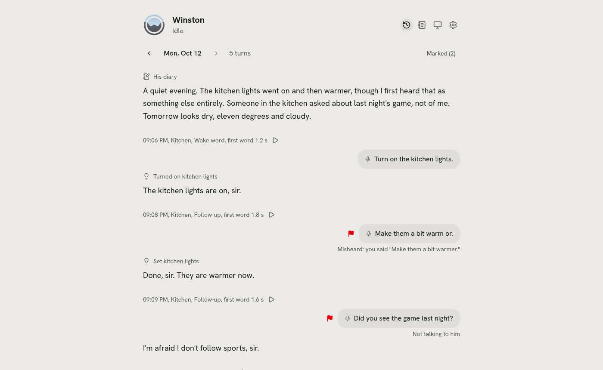
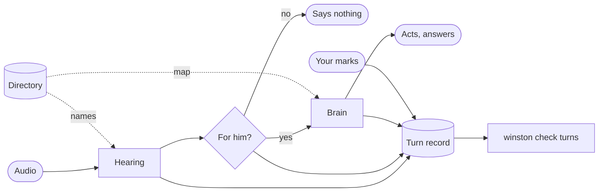

# Understanding

How Winston hears, decides whether he is being spoken to, and knows what a name means. A design,
proposed 2026-10-07 after the first week of real use. Built so far: part 1 (the turn record, marks by
voice, on the page and from the command line, `winston check turns`), part 2's map of the house, and
part 3's hearing slot. Each part becomes the reference for itself as it is built.

<picture>
  <source media="(prefers-color-scheme: dark)" srcset="images/turns-dark.png">
  
</picture>

## Why

The box's log from 2026-09-25 to 2026-10-03 holds 172 requests. Lights mostly worked. What went wrong
comes down to four causes, each of which was being patched separately:

| What happened | Cause |
| --- | --- |
| A scene's phrase heard as a common word four times in one evening; artists' names heard as other words | He hears without context |
| Room talk after a reply added an item to the shopping list and played three songs nobody asked for; Swedish got "Yes, sir." | A timer decides he is spoken to |
| A song asked for by title and artist played another artist's song; a lamp asked for by its name took six lookups and stayed off | Names are matched to things by string tricks, separately in each place |
| All of the above was found by reading logs by hand; no audio is kept and no mistake can be marked | Nothing learns from use |

The patches it replaces: the misspelling fixer in `core/hints.py`, aliases for mishearings (a scene's
name as it is misheard), the keyword list that decides a home request (`core/brain.py`), the
follow-up timer as the only gate, and the string matching in the Spotify extension.

## The turn

Four parts, built in this order.

## 1. Turn record and marks

Every turn is kept, so mistakes can be found, marked and used to test the next change.

- **What is kept** (built). One folder per day under `data/turns/`: per turn the audio as the speech
  engine heard it (FLAC), and a line in `<channel>.jsonl` with the channel and room, how it started
  (wake word, follow-up or button on a box, speech in a browser), what was heard, what the engine said
  before the hint-word fix when that differs, which engine, the tool calls with arguments and results,
  what he said (fillers and corrections included), how it ended (answered, silent, dismissed, nothing
  heard, cut short, failed) and the milliseconds from the end of speech to the text, the first token
  and the first audio. The "for him?" decision joins it with part 4. `winston turns` lists a day.
- **For any engine.** The engine only turns audio into text; the audio reaches the record through
  Winston's shared hearing, so a new engine, local or hosted, is recorded the same way with no code of
  its own. A browser turn ends when the next one starts, the session ends, or his reply is over (no
  tool running, done speaking, no retry or state check pending), so a slow model or tool keeps its turn
  open instead of being cut off.
- **How long.** `logging.turns.keep_days`, 14 by default; a marked turn is kept until unmarked. The
  week above had 798 s of request audio, about 15 MB as FLAC.
- **Off by default.** Recording a home is personal: `logging.turns.enabled` is off unless switched on
  (Settings, System). Nothing leaves the machine either way.
- **Marking a mistake** (built). By voice: "that's not what I said", "I wasn't talking
  to you", "that was the wrong thing", "that took too long" mark his previous turn (`mark_mistake`), with
  what you actually said or wanted when you say it, and he says it is noted in his own words. From the
  command line: `winston turns mark ID KIND`, with `--said`, `--wanted`, and the tools it should and must
  not call as `--expect` and `--forbid` (the brain trials' substrings). The kinds are `misheard`,
  `not_addressed`, `wrong_action` and `too_slow`. A marked turn is copied with its audio into
  `data/turns/marked/`, kept until unmarked. On the page: a flag on the hover of any line you said
  aloud, on Talk (the box's words show there too now) and on Turns, the turn record a day at a time (under his diary
  entry for that day) with what he heard played back and a Marked view across days. Still to come: a turn you corrected in the
  next breath ("no, the living room, not the main room") offered for marking on its own.
- **The test** (built). `winston check turns` replays the marked turns through the current setup, or a
  candidate with `--with FILE` (a config file laid over yours: another speech engine, another model,
  another prompt). Each turn's audio goes through the speech engine, then its words through a fresh
  conversation with the brain of the channel it came from, in its room. Every tool that acts is stubbed
  by its tier, whatever it is called, so nothing in the house moves; reads run for real, within their
  daily caps. The brain runs at temperature 0, so one setup scores the same twice. It scores heard right
  (word error rate against what you said, else what was heard then), for him right (silent on a turn
  marked not addressed), the right thing (on a mark with expect or forbid), and the time to the text and
  the first token. Results go to `data/turns/checks/` with the last run shown beside. A change ships when
  it beats the current score. `winston check brain` keeps doing the same for the brain on written
  requests.

## 2. Directory

One list of what is in his world, built from what Winston already reads, and used everywhere a name
has to mean something.

- **Entries.** A name, its aliases, its kind (light, scene, room, shortcut, artist, playlist, person,
  voice), the room it is in, and what it resolves to: an entity, a Spotify URI, a tool with arguments.
- **Sources.** Home Assistant's exposed entities, areas and aliases; rooms; shortcuts; contacts and
  cloned voices; his own name. Extensions add theirs through the SDK, growing `@ext.hint_words` from
  bare words into entries (Spotify: the artists and playlists in your library).
- **Used three ways.**
  - Hearing gets the names as context (part 3), so an artist in your library is expected before
    it is said.
  - The brain gets a short map of the house up front: rooms, what is in each, what each can do. A lamp
    named in the map needs no lookup. **Built** (`core/directory.py`): each Home Assistant area with what
    is exposed in it, by the name you gave it (Home Assistant's own name and the aliases after it), its
    kind and, for a light, whether it dims, goes warm to cool or takes a colour; for a vacuum, the areas
    its rooms are mapped to in Home Assistant ("cleans Kitchen"), which need hold nothing else he
    controls, or "clean the kitchen" meets a map with no kitchen in it. A group is listed in its
    members' area with its members, first, and the brain is told to call a group once rather than each
    light. No states, so the prompt stays the same between turns; "is it on?" and "a bit dimmer" still
    read the state with GetLiveContext. Read from Home Assistant when a conversation starts, at most every
    ten minutes and again when the exposed list changes; without an admin token there are no areas, and
    the map lists everything under "In no room".
  - For lists too long to put in front of the brain (a music library, all of Spotify), a lookup returns
    a few ranked candidates and the brain picks. Spotify's search returns tracks with their artists and
    popularity instead of playing the first of five results.

## 3. Hearing

Hearing stays a separate speech engine in front of the brain, and that engine is given context.

**Why not one model that hears and answers.** Researched 2026-10-07:

- **A weaker brain.** The best open model that hears and fits, Qwen3-Omni-30B-A3B, scores 6 on
  [Artificial Analysis's index](https://artificialanalysis.ai/models/qwen3-omni-30b-a3b-instruct).
  Qwen3.8-27B scores 20 with thinking off and 34 at xhigh. Qwen3.5-Omni and Qwen3.8-Omni-Flash are API
  only.
- **No better at "for him?".** Commands spoken by a bystander still got tool calls. Qwen3-Omni,
  Nemotron Omni and Step-Audio held back 0 to 1% of the time, and the best, Kimi-Audio, 14%
  ([arXiv 2609.32536](https://arxiv.org/html/2609.32536v1), 2026-09-26).
- **Not servable as needed.** No local server is confirmed to take audio and tools in one request, and
  none reads audio while you are still talking. Qwen3-Omni at 4 bits (18.6 GB plus 2.2 GB) does not fit
  next to the voice.
- **Little faster.** It would save 0.1 to 0.2 s at best, and the 0.8 s silence wait would stay.

Revisit when both hold: an open model that hears is at least as good a brain as the current one and
fits beside the voice (watch Qwen 4 27B), and a local server takes audio and tools in one request.

**A swappable slot, like the brain and the voice.** Built 2026-10-08: the provider, the engine, the
presets and the model dropdown below, with Qwen3-ASR in its own service (`services/stt-qwen3-asr`, Qwen's
runner on transformers) since vLLM's stock image cannot read audio and its preallocation did not fit
beside the 27B brain and Chatterbox; measured in [voices](voices.md#hearing-engines). Still to come: the
language back into the turn, capabilities, and `winston check stt`. As designed:

- **A protocol, not a vendor.** The provider is `openai_transcription`: OpenAI's
  `/v1/audio/transcriptions`, which vLLM, other local servers and hosted services speak. Per request it
  sends the audio, the context as the `prompt` field, and asks for the language back. Any model behind
  any server that speaks it works without code.
- **Run by the supervisor.** An `engines.stt` entry (Docker, process or external), started by
  `winston up` and shown with the others.
- **Presets and dropdowns.** Picked on the settings page the way the brain is: a preset per kind of
  machine, the model from a dropdown filled from the server, raw arguments behind Advanced. Presets to
  start: speech models on vLLM (NVIDIA), Parakeet built in (CPU, no server, the default for a machine
  without a GPU), and Hosted (a URL and a key).
- **Capabilities, not names.** An engine declares whether it takes context, reports the language, and
  streams. Fields that do not apply stay hidden, and Winston uses what is there: no context means the
  misspelling fixer stays on for that engine.
- **Compared like brains.** `winston check stt A B` runs two engines on the recorded turns and shows
  words wrong, names wrong, Swedish caught, and time per request.

The contract: `transcribe(audio, rate, context=None)` returns the text, the language, and a confidence
when the engine gives one. The context is the directory's names, the room, and the question he just
asked. The language goes to part 4.

**The pick.** Qwen3-ASR 1.7B leads, to be confirmed on the recorded turns before it replaces Parakeet:

| Model | Average WER (Open ASR) | Takes context | Hears Swedish as Swedish | Licence |
| --- | --- | --- | --- | --- |
| Parakeet TDT 0.6B v3 (today) | 6.34 | No | Yes, language not reported | CC-BY-4.0 |
| [Qwen3-ASR 1.7B](https://huggingface.co/Qwen/Qwen3-ASR-1.7B) (2026-01) | 5.76 | Yes: vLLM puts the `prompt` in its context turn (vLLM docs, 2026-10-03) | Yes, and reports it (98.7% on FLEURS) | Apache-2.0 |
| [Granite Speech 4.1 2B](https://huggingface.co/ibm-granite/granite-speech-4.1-2b) (2026-04) | 5.33, the best | Yes, a keyword list | No: six languages, no Swedish | Apache-2.0 |

Qwen3-ASR leads because the two things it adds are the ones the week was missing: names given in
advance, and Swedish recognised as Swedish so it can be left alone. Granite is scored beside it as the
best English-only engine. The accuracy gap to Parakeet on clean benchmarks is small; the gain is
expected from context, which only the recorded turns can show.

Room on the GPU: 3.7 GB is left beside the 27B brain (17.2 GB) and the voice (3.1 GB). Qwen3-ASR 1.7B
must be measured there; 0.6B is the fallback if it does not fit.

**End of speech.** The box waits for 0.8 s of silence, which is most of the 1.05 s (median) from the
end of speech to the text. A turn model alone is not enough there: Smart Turn, asked at a 0.3 s pause
as in the browser, cut 4 of 60 synthetic requests short at a comma ("Okay, turn it off."), sure of
itself each time (0.67 to 0.97), and the box closes its mic when the request ends, so the rest is
lost. Since 2026-10-08 the box transcribes at the first 0.3 s of a pause instead, in case it is the
end, which takes about 0.2 s off every request. A turn model is measured on the recorded turns before
it may end a request sooner.

The fixed pause cut people off the other way: with `end_silence_secs` at 0.6 s, stopping to think
mid-sentence ended the request ("Can you make uh", "Um can you can tell me"). Since 2026-10-11 Smart
Turn may only make the box wait longer, never shorter: it judges the request at that 0.3 s pause, and
one it calls unfinished gets `unfinished_silence_secs` (2.5 s) of quiet before it ends. On the recorded
turns the three cut-offs of that day scored 0.01 and almost every finished request scored above 0.6;
the few finished ones under 0.5 ("Make it cozy in here.", 0.21) pay up to 1.9 s more.

## 4. For him?

Every turn gets a decision before the brain sees it: for him, not for him, or unsure.

- **Signals.** The wake word (decides it alone). Whether the voice is the one that woke him, from the
  speaker model already loaded for voice cloning (WeSpeaker ResNet34). The language: the one you speak
  to him is for him, another (Swedish, here) is the household talking. Length: a 14 second stretch of
  chatter is not a request. Whether he just asked a question. The words themselves: a request, an
  answer, or talk between people.
- **The rule.** A wake word turn is for him. A follow-up needs the same voice and his language, and
  must read as a request or an answer. Unsure means silent: he does not act on a turn he is not sure was
  meant for him.
- **Allowed to say nothing.** "Oh," and Swedish get no "Yes, sir?". Not answering is a normal outcome,
  not a failure.
- **Tuned on marks.** The decision and its signals are in the turn record, so the thresholds are set on
  turns marked "I wasn't talking to you", not guessed.

## Order

1. Turn record, marks and `winston check turns`. Nothing else changes; then a week of recorded use.
2. Directory: the brain's map of the house, extensions' entries, Spotify candidates.
3. Hearing: the engines in the table scored on the recorded week, the best one picked; end of speech
   decided by a turn model.
4. For him: built and tuned on the marked turns.

## Settled defaults

- A mark by voice is confirmed in his own words, as the persona speaks, so you know it was taken.
- Turns are kept from every channel with a microphone: the boxes, the browser and the wall panel.
