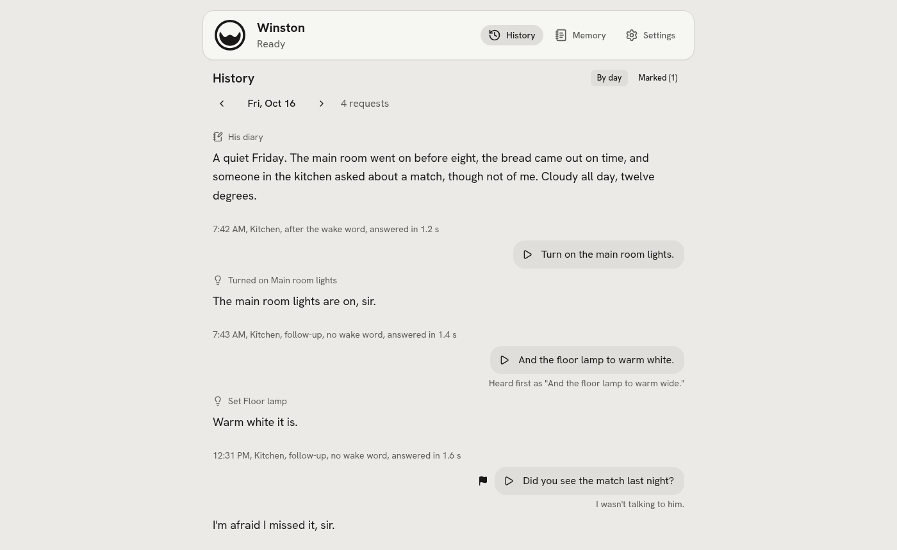
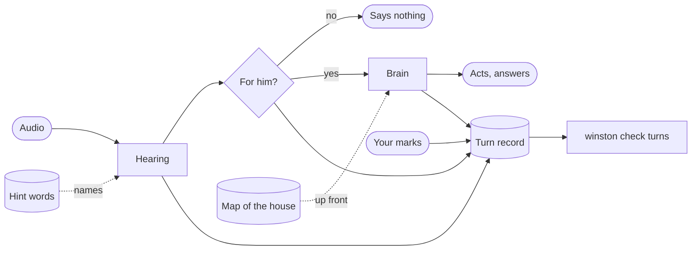

# Understanding

How Winston hears you, decides you are talking to him, and knows what a name means, and how his
mistakes are kept and marked so the next change can be tested on them.

The design came from the first week of real use, when most mistakes had four causes: he heard without
context, a timer decided he was spoken to, names were matched to things by string tricks in each
place, and nothing learned from use. Its four parts are numbered in the order they are built; the Understanding track in
[the plan](plan.md) holds their status.

<picture>
  <source media="(prefers-color-scheme: dark)" srcset="images/history-dark.png">
  
</picture>

## A spoken request, from sound to action

- **Hearing** turns the audio into text with a swappable speech engine, told the names it should
  hear right ([3. Hearing](#3-hearing)).
- **For him?** Today the wake word, a box's listening window after a reply, or speech in a browser
  decides it. The decision of its own is still to be built ([4. For him?](#4-for-him)).
- **The brain** gets a map of the house up front, so a device you name needs no lookup
  ([2. Directory](#2-directory)).
- **The turn record** keeps every step, and your marks on it are the test for the next change
  ([1. Turn record and marks](#1-turn-record-and-marks)).

## 1. Turn record and marks

Every turn is kept, so mistakes can be found, marked and used to test the next change.

### What is kept

One folder per day under `data/turns/`, from every channel with a microphone (the boxes, the browser
and the wall panel). Per turn, the audio as the speech engine heard it (FLAC), and a line in
`<channel>.jsonl` with:

- the channel and room, and how it started: wake word, follow-up or button on a box, speech in a
  browser;
- what was heard, which engine heard it, and what the engine said before the hint-word fix when that
  differs;
- the tool calls with their arguments and results, and what he said (fillers and corrections
  included);
- how it ended: answered, silent, dismissed, nothing heard, cut short or failed;
- the milliseconds from the end of speech to the text, the first token and the first audio.

`winston turns` lists a day. The engine only turns audio into text and the audio reaches the record
through Winston's shared hearing, so any engine, local or hosted, is recorded the same way with no
code of its own. A browser turn ends when the next one starts, the session ends, or his reply is over
(no tool running, done speaking, no retry or state check pending), so a slow model or tool keeps its
turn open instead of being cut off.

### Settings

Recording a home is personal, so it is off until you switch it on. Nothing leaves the machine either
way. The settings are under Recordings on the Assistant page:

| On the page | Key | Default | What it does |
| --- | --- | --- | --- |
| Keep recordings of what you say | `logging.turns.enabled` | Off | Keeps the record. History's details, the diary and marking mistakes need it; while it is off, History says what recordings would keep and links here |
| Delete recordings after | `logging.turns.keep_days` | 14 days | A marked turn is kept until it is unmarked |

A week of one box's requests, about 13 minutes of speech, is about 15 MB as FLAC.

### Marking a mistake

A marked turn is copied with its audio into `data/turns/marked/` and kept until it is unmarked. There
are four kinds:

| Kind | Say | On the page | From the command line |
| --- | --- | --- | --- |
| He misheard | "That's not what I said" | He misheard me (asks what you actually said) | `misheard` |
| Not for him | "I wasn't talking to you" | I wasn't talking to him | `not_addressed` |
| Wrong action | "That was the wrong thing" | He did the wrong thing | `wrong_action` |
| Too slow | "That took too long" | He was too slow | `too_slow` |

- **By voice**, the phrase marks his previous turn (`mark_mistake`), with what you actually said or
  wanted when you say it. He confirms it in his own words, so you know it was taken.
- **On the page**, a flag sits on any line you said aloud once its recording is kept, on hover and
  always on a touch screen, on Talk (the box's words show there too) and on History. Its menu, Mark a
  mistake, offers the four kinds, and Remove mark once it is marked; the toast has Undo.
- **A marked line** keeps a filled flag, with the mark in words ('He misheard you. You said "Warm,
  please."') in its tooltip and on History. What you wanted is quoted after Wanted:, or after He
  noted: when he made the mark by voice; he fills it in only with what you told him.
- **From the command line**, `winston turns mark ID KIND`, with `--said` and `--wanted`, and the
  tools it should and must not call as `--expect` and `--forbid` (substrings, as in the brain trials).

He does not learn from a mark by himself: it is kept so a later change can be tested on it.

### History

The History page (`/history`; `/turns` leads there) shows the record a day at a time under his diary
entry for that day, or Marked, the marked requests across days. Each spoken request has:

- a header in words ("14:25, Kitchen, after the wake word, answered in 1.5 s");
- Play, for what he heard on your line;
- "Heard first as ..." when the hint-word fix changed it;
- how it ended from your side ("You talked over him").

### Testing a change on the marked turns

`winston check turns` replays the marked turns through the current setup, or through a candidate.

1. Each turn's audio goes through the speech engine.
2. Its words go through a fresh conversation with the brain of the channel it came from, in its room,
   at temperature 0, so one setup scores the same twice.
3. Every tool that acts is stubbed by its tier, whatever it is called, so nothing in the house moves.
   Reads run for real, within their daily caps.
4. It scores heard right (word error rate against what you said, else what was heard then), for him
   right (silent on a turn marked not for him), the right thing (on a mark with expect or forbid),
   and the time to the text and the first token.

Results go to `data/turns/checks/`, with the last run shown beside. A change ships when it beats the
current score. Every run waits while anyone is talking to him and keeps to the model server's last
slot. `winston check brain` does the same for the brain on written requests.

| Option | What it does |
| --- | --- |
| `--with FILE` | Scores a candidate: a config file laid over yours (another speech engine, another model, another prompt) |
| `--phrases FILE` | Scores typed requests instead of marked turns, for a kind of request rather than one mistake. Each has `expect` and `forbid`, and `before` lines asked first in the same conversation (`tests/music_phrases.yaml`; your own phrasings belong in `data/`) |
| `--runs N` | With `--phrases`, runs each request N times at the live temperature, so one that fails one time in three shows as a rate |

## 2. Directory

One list of what is in his world, built from what Winston already reads, and used everywhere a name
has to mean something. What is built is Home Assistant's side: the map of the house (`core/directory.py`).

### The map of the house

Every brain gets a short map of the house in its prompt, so a lamp named in the map needs no lookup.
For each Home Assistant area it lists what is exposed there:

- by the name you gave it, with Home Assistant's own name and the aliases after it, and its kind;
- for a light, whether it dims, goes warm to cool or takes a colour;
- for a vacuum, the areas its rooms are mapped to in Home Assistant ("cleans Kitchen"). Those areas
  need hold nothing else he controls, or "clean the kitchen" would meet a map with no kitchen in it
  ([a vacuum](home-assistant.md#a-vacuum));
- a group in its members' area with its members, first. The brain is told to call a group once rather
  than each light.

The map has no states, so the prompt stays the same between turns; "is it on?" and "a bit dimmer"
still read the state with GetLiveContext. It is read from Home Assistant when a conversation starts,
at most every ten minutes and again when the exposed list changes. Without an admin token there are no
areas, and the map lists everything under "In no room".

### Still to build

- **More entries.** A name, its aliases, its kind (light, scene, room, shortcut, artist, playlist,
  person, voice), its room, and what it resolves to: an entity, a Spotify URI, a tool with arguments.
  From rooms, shortcuts, contacts, cloned voices and his own name, and from extensions through the
  SDK, growing `@ext.hint_words` from bare words into entries (Spotify: the artists and playlists in
  your library).
- **Names for hearing.** The directory's names given to hearing as context, so an artist in your
  library is expected before it is said. Today hearing gets the [hint words](voices.md#hint-words).
- **Ranked lookups.** For lists too long to put in front of the brain (a music library, all of
  Spotify), a lookup returns a few ranked candidates and the brain picks.

## 3. Hearing

Hearing is a separate speech engine in front of the brain, and that engine is given context. One
model that hears and answers was considered and set aside ([decisions](decisions.md)); look again
when an open model that hears is at least as good a brain as the current one, fits beside the voice,
and a local server takes audio and tools in one request.

### The hearing slot

Hearing is swappable, like the brain and the voice, and picked on the Voice page.

- **A protocol, not a vendor.** The `openai_transcription` provider speaks OpenAI's
  `/v1/audio/transcriptions`, which vLLM, other local servers and hosted services speak. Any model
  behind a server that speaks it works without code.
- **Run by the supervisor.** An `engines.stt` entry (Docker, process or external), started by
  `winston up` and shown with the others.
- **Presets and a dropdown.** Parakeet built in (CPU, no server), Qwen3-ASR 0.6B and 1.7B on the GPU
  in their own service, and Hosted (a URL and a key). The model comes from a dropdown filled from the
  server, raw arguments go in How it runs. Measured in [voices](voices.md#hearing-engines).
- **Context.** An engine that can be told words in advance gets the hint words (Qwen3-ASR as its
  `prompt`). One that cannot, like Parakeet, has close misspellings fixed afterwards
  ([hint words](voices.md#hint-words)). The adapter contract is in
  [architecture](architecture.md#plugin-contract).

### End of speech

On a box, a request ends after a stretch of silence. The box starts transcribing at the first 0.3 s
of a pause, so the text is ready when the silence is up. A turn model (Smart Turn) and the words
themselves can only make it wait longer: a request that does not sound finished, or whose transcript
does not end a sentence, gets more time, so a pause to think does not cut you off. The settings are in
[Voice PE](voice-pe.md).

### Still to build

- **The engine's language and confidence into the turn.** The contract becomes
  `transcribe(audio, rate, context=None)`, returning the text, the language and a confidence when the
  engine gives one. The context is the directory's names, the room, and the question he just asked.
  The language goes to [For him?](#4-for-him).
- **Capabilities, not names.** An engine declares whether it takes context, reports the language, and
  streams. Fields that do not apply stay hidden, and an engine without context keeps the misspelling
  fixer.
- **Compared like brains.** `winston check stt A B` runs two engines on the recorded turns and shows
  words wrong, names wrong, Swedish caught, and time per request.
- **The pick.** The candidates, to be scored on the recorded turns:

  | Model | Average WER (Open ASR) | Takes context | Hears Swedish as Swedish | Licence |
  | --- | --- | --- | --- | --- |
  | Parakeet TDT 0.6B v3 | 7.04 | No | Yes, language not reported | CC-BY-4.0 |
  | [Fluid Speech Pro](https://huggingface.co/FluidVoice-Labs/fluid-speech-pro), Parakeet retrained (the default since 24 November) | 6.06, the best of these | No | Yes, language not reported | CC-BY-4.0 |
  | [Qwen3-ASR 1.7B](https://huggingface.co/Qwen/Qwen3-ASR-1.7B) | 6.15 | Yes, as its `prompt` | Yes, and reports it (98.7% on FLEURS) | Apache-2.0 |
  | [Granite Speech 5.0 2B](https://huggingface.co/ibm-granite/granite-speech-5.0-2b) | 6.68 | Yes, a keyword list of up to 2,000 | No: six languages, no Swedish | Apache-2.0 |

  The leaderboard's results data is not public, so the scores are as quoted on
  [Fluid Speech Pro's card](https://huggingface.co/FluidVoice-Labs/fluid-speech-pro) in November.
  Since 2 November the average leaves out LibriSpeech, so older scores are not comparable: on the
  scale before, Qwen3-ASR had 5.40 and Granite Speech 5.0 5.68 (IBM's chart, 21 October).

  Qwen3-ASR leads: it adds names given in advance, and Swedish recognised as Swedish so it can be
  left alone. Granite is scored beside it for English. On the GPU, 3.7 GB is left
  beside the 27B brain (17.2 GB) and the voice (3.1 GB); 0.6B is the fallback if 1.7B does not fit.

## 4. For him?

Not built yet. Every turn is to get a decision before the brain sees it: for him, not for him, or
unsure.

- **Signals.** The wake word (decides it alone). Whether the voice is the one that woke him, from the
  speaker model already loaded for voice cloning (WeSpeaker ResNet34). The language: the one you speak
  to him is for him, another is the household talking. Length: a 14 second stretch of chatter is not
  a request. Whether he just asked a question. The words themselves: a request, an answer, or talk
  between people.
- **The rule.** A wake word turn is for him. A follow-up needs the same voice and his language, and
  must read as a request or an answer. Unsure means silent: he does not act on a turn he is not sure
  was meant for him.
- **Allowed to say nothing.** "Oh," and the household's own language get no "Yes, sir?". Not
  answering is a normal outcome, not a failure.
- **Tuned on marks.** The decision and its signals go in the turn record, so the thresholds are set on
  turns marked "I wasn't talking to you", not guessed.
