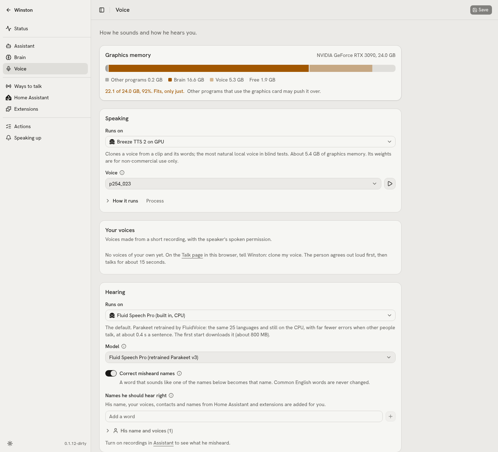
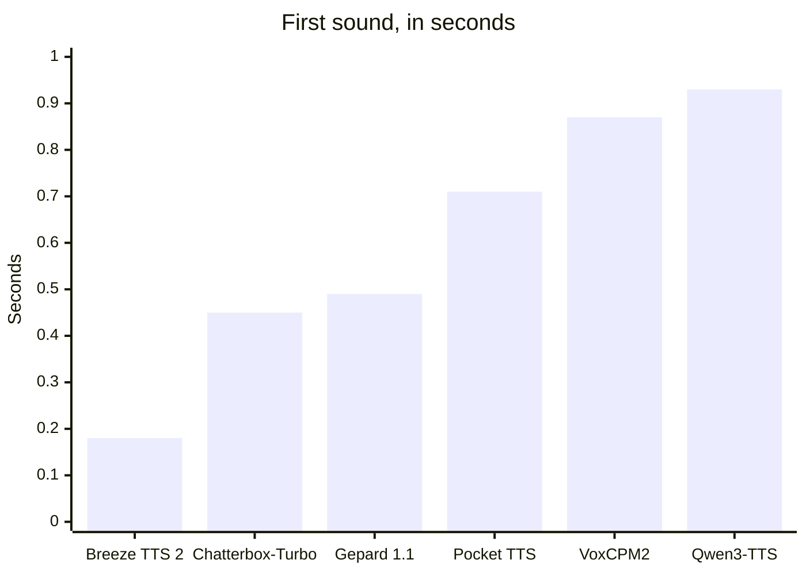

# Voices

How Winston speaks and hears: the voice engines you can pick, trying and cloning voices, the hearing
engines, and the names he should hear right. What was measured, run by run, is on
[Voice benchmarks](voice-benchmarks.md).

<picture>
  <source media="(prefers-color-scheme: dark)" srcset="images/voice-dark.png">
  
</picture>

## Picking a voice

Runs on, on the Speaking card of the Voice page, picks a preset. Every local one is a small engine on
the same speech server, in its own venv, on port 8880. The numbers are from the benchmark runs on an
RTX 3090 beside the 27B brain, on Winston's own lines in three voices.

| Preset | Runs on | Memory | Clones from | Out | First sound | Word errors | Notes |
| --- | --- | --- | --- | --- | --- | --- | --- |
| Breeze TTS 2 (`services/tts-breeze2`) | GPU | about 5.4 GB | a clip and its words | 24 kHz | 0.18 s | 3.5% | The most natural in blind pairs; beside the 27B brain only with Parakeet hearing; non-commercial weights |
| Chatterbox-Turbo, streamed (`services/tts-chatterbox`) | GPU | 4.2 GB | a clip | 24 kHz | 0.45 s | 3.4% | English only |
| Gepard 1.1 (`services/tts-gepard`) | GPU | 2.2 GB | a clip alone | 22.05 kHz | 0.49 s | 14.4% | Drops and garbles more words than the others |
| Pocket TTS (`services/tts-pocket`) | CPU | none | 26 built-in voices, a clip with Kyutai's gated weights, or a voice exported from one | 24 kHz | 0.71 s | 2.1% | No GPU at all; measured in its built-in voice george |
| VoxCPM2 (`services/tts-voxcpm2`) | GPU | 6.9 GB | a clip and its words | 48 kHz | 0.87 s | 3.6% | Nearly fills a 24 GB card beside the 27B brain |
| Qwen3-TTS 1.7B (`services/tts-qwen3`) | GPU | 6.5 GB | a clip and its words | 24 kHz | 0.93 s | 3.6% | Slower than real time beside the 27B brain |
| Hosted | a provider | none | the provider's voices | per model | not measured | not measured | [Hosted voice](#hosted-voice) |



- **One GPU voice at a time.** Only one fits beside the brain, so picking one stops the other.
- **Sample rate** (`tts.sample_rate`, in How it runs on the Speaking card) is set by each preset to
  what its server sends, the Out column. A server no preset knows needs it set by hand, or he sounds
  too fast or too slow.
- **A clip and its words.** Qwen3-TTS, VoxCPM2 and Breeze read a `.txt` beside the clip if there is
  one; otherwise Parakeet transcribes the clip once.
- **Languages.** Pocket TTS and Qwen3-TTS switch to the reply language when they speak it, and the
  Speaking card says when the voice picked does not ([languages](languages.md#his-voice)).

[Hardware](hardware.md) says what each pick needs and which profiles set them up.

## The speech server

`services/speech_server.py` holds what the local voices share: OpenAI's `/v1/audio/speech` on port
8880, 24 kHz mono PCM (or WAV) back, the voice cache and the warm-up. Each engine's server only adds
its engine. Chatterbox has its own Python 3.11 venv because it pins torch 2.6. To start one by hand:

```sh
cd services/tts-chatterbox
.venv/bin/python server.py --voice ../../data/voices/vctk/p254_023.wav --voices-dir ../../data/voices
```

Set the default clip in the `engines.tts` command in config. To try another voice without
restarting, name a clip relative to `--voices-dir` in the request, for example
`{"voice": "vctk/p226_023"}`. A name that would reach outside `--voices-dir` (`..`, an absolute
path, a backslash) is refused with a 400.

Preparing a clip the server has not used yet takes a moment on the GPU. It runs off the event loop,
so audio already being sent keeps flowing meanwhile.

### Streaming settings

A request to the Chatterbox server may carry its own streaming settings. They override the startup
flags for that request only; fields it leaves out keep the startup values.

| Field | Startup flag | Default | What it does |
| --- | --- | --- | --- |
| `stream` | `--stream` | true | Off renders whole sentences |
| `first_secs` | `--first-secs` | 0.96 s | Audio rendered before anything is sent; shorter starts sooner |
| `chunk_secs` | `--chunk-secs` | 1.6 s | Audio per later chunk; longer has fewer joins |
| `lookahead_secs` | `--lookahead-secs` | 0.32 s | Audio held back at the end of each chunk to smooth the join |

- A look-ahead not shorter than the first chunk is refused with a 422, at startup and per request.
- The server warms up the streaming path even with `--stream false`, so a streamed request is not
  slow the first time.
- The answer says which way it rendered in an `X-Streaming: on` or `off` header.
- The Pocket server takes `stream` too (false sends each sentence whole) and ignores the other three.

### Breeze TTS 2

Breeze's weights are for research and non-commercial use only, and its inference code is not a
package: installing the preset clones [breeze-tts](https://github.com/breezeblue-ai/breeze-tts) into
`services/tts-breeze2/upstream` at the commit its `pyproject.toml` pins (`[tool.winston] upstream`). The preset keeps the backbone and
depth decoder in bf16, puts the text encoder in 8 bits and captures the per-frame work as CUDA
graphs. Its codec encoder runs on the CPU and its decoder in fp16, which keeps it at about 5.4 GB.

| Argument | Default | What it does |
| --- | --- | --- |
| `--chain-secs` | 30 | A sentence this soon after the last one in its voice gets that sentence as part of its reference, so the voice carries on instead of shifting at a full stop; 0 turns it off |
| `--pause-secs` | 0.25 | Silence after each sentence, since Breeze stops about 0.04 s after its last sound |
| `--cfg` | 1.0 | Guidance scale; above 1 runs two branches, which upstream says makes tags come out more reliably |
| `--fast` | none | Stages to capture as CUDA graphs; the preset captures `backbone_decode depth_decoder codec` |
| `--backbone-bits`, `--text-encoder-bits` | 16 | Below 16 builds those parts in RAM and sends 8-bit or 4-bit weights to the card; a 4-bit backbone garbles words |

Change them in the engine's arguments under How it runs on the Speaking card.

**Sighs and laughs.** Breeze turns `[sigh]`, `[laugh]`, `[cough]` and `[clears throat]` into sounds
(the server rewrites them to its own "(sigh)"). With Breeze as the voice, spoken channels get a line
in the prompt saying when each fits, with two examples (`core/brain.py:_vocal_events`). At guidance
1.0 a tag often makes a line longer and does not always come out.

### VoxCPM2's denoise

VoxCPM2 takes `--denoise` (add it to the engine's command): each reference clip is cleaned once with
the package's ZipEnhancer before the voice is built, and the file on disk is left alone. It removes
a steady hum or hiss the voice would otherwise copy, garbles a clip with other voices in it, and
blurs a clean one a little, so the preset leaves it off. The
[measurement](voice-benchmarks.md#voxcpm2s-denoise-8-october) has the numbers.

## Hosted voice

The Hosted preset sends what he says to OpenRouter (`https://openrouter.ai/api/v1`), which speaks
OpenAI's speech API and reaches ElevenLabs, Gemini, Qwen, Fish Audio and others with one key. Put the
key in `TTS_API_KEY`. The preset picks ElevenLabs Flash v2.5 (Model `elevenlabs/eleven-flash-v2.5`,
voice `george`, 24 kHz), a first guess not yet tried through Winston ([plan](plan.md), M6).

Model (`tts.model`) is shown for a hosted voice only; local servers ignore it. Each model has its own
voices and rate, listed without a key at
`https://openrouter.ai/api/v1/audio/speech/models/<model>` (Gemini sends 24 kHz, HeyGen 44.1 kHz).
Set Sample rate to match, or he sounds too fast or too slow. Any other server speaking OpenAI's speech
API works the same way with its own address, model and voice.

OpenRouter's prices per million characters, which change: ElevenLabs Flash v2.5, v4 Turbo and Turbo
v2.5 40 USD, v4 80 USD, Qwen3-TTS 20 USD; Gemini 3.8 Flash TTS is priced by tokens. A household that
hears about 225,000 characters a month pays a few dollars at these rates.

## Trying a voice before saving

`POST /api/speak` on winstond speaks text through the configured speech server and streams 16-bit
mono PCM back. The Talk page uses it to read replies aloud. With `voice` and `streaming` it tries a
voice or streaming settings that are not saved yet, which is how the Voice page plays a sample:

```json
{"text": "Hello, I'm Winston.", "voice": "vctk/p226_023",
 "streaming": {"enabled": true, "chunk_secs": 2.4}}
```

- `voice` is any name the speech server knows. A name with `..`, a leading `/`, a backslash or a NUL
  is refused with a 422 before it reaches the server.
- `streaming` takes the fields of `tts.streaming` with the same limits; the ones left out are the
  saved values. The whole is checked as the config is (look-ahead shorter than the first chunk), with
  a 422 when it is not.
- `line: true` marks one of his own lines, as the Voice page's previews are: it is said in his reply
  language, translated once and kept ([languages](languages.md#lines-said-by-code)).
- `streaming` reaches the speech server only when the `engines.tts` command uses
  `{tts.streaming.*}`, as the Chatterbox preset does, since a hosted server could refuse fields it
  does not know.
- The answer carries `X-Voice` (the voice sent, percent-encoded) and `X-Streaming`: `on` or `off`
  when the engine takes streaming settings, `ignored` when `streaming` was sent and did not apply
  (another engine, or a Chatterbox server too old to take per-request settings).

It speaks with the engine that is running. A changed engine in unsaved settings needs saving and a
restart of speaking before it can be heard.

### On the Voice page

- **Hear this voice**, the play button beside Voice, says "Hello, I'm Winston. This is how I sound."
  (with his configured name, in his reply language) in the voice picked, saved or not.
- **Stream speech** and **Chunk length** are on the Speaking card for an engine whose command takes
  streaming (the Chatterbox preset). First chunk and Look-ahead are config.yaml only, or a value in
  place of their placeholder in the engine's arguments under How it runs.
- **Play a sample**, on the streaming heading, speaks one long sentence with the unsaved values, then
  shows the time from the click to the first sound until a streaming value changes. The sentence is
  long because chunks double from the first one and start over with each sentence, so a short line
  would never reach a long chunk. A warning icon beside the time means the running server did not use
  the settings (`X-Streaming: ignored`).

Both buttons are disabled while they cannot play, with the reason in the tooltip:

| Tooltip | When |
| --- | --- |
| Save and restart speaking to hear this engine | The unsaved engine or server address differs from the saved one, or speaking waits for a restart |
| Speaking is still installing | It is downloading what it needs |
| Speaking is not running yet | It has not started |
| Turn on speaking to hear a voice | Speaking is off |

The sample is also disabled while look-ahead is not shorter than the first chunk. The setup wizard's
Who he is says the same in a line under the voice, with how far an install is.

`uv run python tests/preview_check.py` checks the same on the running Winston without a browser. It
asks for a voice other than the saved one, twice, and for the sample unstreamed and streamed with
2.4 s chunks, and prints the time to the first audio byte and to the end of each. It only listens;
nothing is saved.

## Voice dropdown

For a local server, the voice dropdown on the Voice page lists, in order:

1. "Server default" with the clip the server started with (for instance "Server default:
   minter_card2_aged"), that clip marked "server default" below it.
2. Your clips under `data/voices/` by file name, grouped by their folder ("Your clips" for the top
   level).
3. Your voices: the cloned ones, by the friend's name.
4. The server's built-in voices.

Consent recordings are never offered as a voice. A hosted server lists only your clips, cloned voices
and its built-in voices.

## Reference voices

`assets/voices/` is copied into `data/voices/` by `winston init`, and any file missing there is
copied again at each `winston up`.

| Clip | What it is | Default for |
| --- | --- | --- |
| `librivox/minter_card2_aged` | About 19 s of a LibriVox reading of Arnold Bennett's *The Card* (public domain), cut from the 128 kbps MP3 and aged | Breeze TTS 2 and Pocket TTS |
| `vctk/p254_023` | A VCTK speaker, below | Chatterbox, Qwen3-TTS, VoxCPM2, Gepard |

**Pocket without the gated weights.** Pocket clones from a `.wav` only with Kyutai's gated weights,
which a fresh install does not have. A `.safetensors` beside the clip, made with
`pocket-tts export-voice`, loads without them: Pocket tries the clip first and falls back to it. An
export fits only the model it was made from, so the bundled one is from the English model; with
another reply language and no gated weights, Pocket speaks in george instead. To make
one for your own clip, on a computer with the terms accepted:

```sh
services/tts-pocket/.venv/bin/pocket-tts export-voice --language english data/voices/me.wav data/voices/me.safetensors
```

`assets/voices/vctk/*.wav` are sentence 23 from the
CSTR VCTK Corpus (University of Edinburgh), via Kyutai's `kyutai/tts-voices` mirror, licensed
**CC BY 4.0**. Attribution: Yamagishi, J., Veaux, C., MacDonald, K. (2019), "CSTR VCTK Corpus:
English Multi-speaker Corpus for CSTR Voice Cloning Toolkit (version 0.92)",
https://doi.org/10.7488/ds/2645.

The speakers are British male candidates: p226 (Surrey), p232 (Southern England), p243 (London),
p254 (Surrey, the default for the other GPU voices), p258 (Southern England) and p273 (Suffolk). Every one is clear in
quiet; with noise behind them they part, and p232 and p254 stay among the clearest
([by reference voice](voice-benchmarks.md#clarity-in-noise-by-reference-voice-8-october)).

Anything dropped into `data/voices/` (a personal clip, for instance) stays out of git. Clone only from
a permissively licensed clip or from someone who agreed to it, as below; never an actor.

A voice clones the clip's sound along with the speaker, so cut a clip from the best copy of a
recording. On archive.org a LibriVox book has the reader's 128 kbps MP3 beside a 64 kbps copy; the
copy has nothing above about 11 kHz and adds its own artifacts, and the same seconds from the 128 kbps
file sound clearly better. A noise reduction pass on a hissy clip makes it worse, not better.

## Cloned voices

Ask with the friend in the room: "Winston, clone my friend Maria's voice", or "clone my voice" for
your own. Winston then:

1. Asks Maria to say "I'm Maria, and I agree that Winston can copy my voice.", with his name from
   `assistant.name`. Speech to text checks the words; without "agree" (or with "don't agree")
   nothing is recorded. In another reply language he says the line in that language
   ([languages](languages.md#cloning-a-voice)), and it counts when most of its words are heard back
   with no "not" added.
2. Asks her to talk about anything for about fifteen seconds, and stops at 15 s of speech, or at a
   2.5 s pause after 10 s.
3. Checks that the voice that agreed is the voice she talked in ([below](#the-consent-record)). When
   they differ he says "That doesn't sound like the person who agreed, so I won't keep it." and keeps
   nothing, not even the consent recording.
4. Keeps only the speech, levels it and switches to it: "Got it. This is me as Maria now." That
   sentence starts about 0.4 s after she stops.

While he records, and until she stops after his "Got it", the mic goes to the recording only, so
nothing Maria says counts as a turn or cuts him off. Under 6 s of speech is too little, and nothing
is stored. Asking again for the same name records over the old clone.

- **Switching** to a voice already cloned is by name ("use Maria's voice"), without recording again.
  "Back to your own voice" reverts.
- **Keeping it.** The clone lasts the conversation unless you say to keep it, which saves it as
  `tts.voice`.
- **Where it works.** Recording needs the browser (the Talk page's microphone or the wall display's
  talk button). Switching does not: a Voice PE box takes "Okay Winston, talk like Maria" and "your
  own voice again" too, for its conversation. Recording from a satellite's far-field mic waits for M3.

Each clone is `data/voices/friends/<name>.wav`, with the consent recording (`<name>.consent.wav`)
and its record (`<name>.json`) beside it. Your voices on the Voice page lists them with when each was
recorded, its length and its voice match: Play, Use (picks it as his voice in the draft; the one in
use says In use), and a menu with Play their permission and Delete, which removes both recordings.
With none yet, it says how to make one.

### The consent record

The consent is a record of who agreed, when, and in which voice. `<name>.json` holds the name, the
time, what speech to text heard (`consent_text`), and the same-voice check: `consent_score`,
`consent_checked_at` and `consent_model`. The consent line has no date or weekday in it.

The check compares the consent recording with the voice sample before anything is stored. A
speaker-embedding model turns each into a vector of how the voice sounds, whatever the words, and
the score is the cosine similarity of the two. At 0.55 or more the clone is kept with its score;
below, nothing is kept and the tool call's log line carries the score (`tool_calls.jsonl`).

What it does and does not prevent:

- It stops keeping a voice when the one agreeing is not the one recorded: a friend says yes and
  someone else talks, or a clip of someone is played after a real person agreed.
- It does not stop a recording of the same person saying the line and then talking, played from a
  speaker; a replay of a real recording scores as the same voice.
- It cannot stop a clip added to `data/voices/` by hand. Such a clip is in the voice dropdown and
  never in Your voices, since there is no record for it.

The Voice match column on the Voice page shows the check in a word with its icon: Checked, or Not
checked. The icon opens the score and the one needed, when it was checked and what speech to text
heard. A mismatch is not kept, so Below the threshold shows only for a score under a threshold raised
since. A clone made while the model could not load reads Not checked: the check is optional and never
makes a clone fail.

The model is WeSpeaker's ResNet34 trained on VoxCeleb2
([Wespeaker/wespeaker-voxceleb-resnet34](https://huggingface.co/Wespeaker/wespeaker-voxceleb-resnet34),
a 26.5 MB ONNX file), run on the CPU through onnx-asr, which the speech to text already uses. It loads
when the first clone of a session starts, while the friend is talking: the very first time it
downloads to the Hugging Face cache (about 2 s), after that it loads in about 0.2 s. A check of a 5 s
consent against a 17 s sample takes about 0.3 s on the CPU.

Its model card says Apache-2.0; WeSpeaker says its VoxCeleb models follow the dataset's licence, CC BY
4.0, so credit: Wang et al., "WeSpeaker: A Research and Production oriented Speaker Embedding Learning
Toolkit" (ICASSP 2023), trained on VoxCeleb2 (Chung, Nagrani, Zisserman, 2018).

### How the threshold was set

On the clips in `data/voices/`: the first 3 or 5 s of one recording against a different recording of
the same reader, and against every other speaker.

| Pairs | Count | Scores |
| --- | --- | --- |
| Same speaker, other words | 52 | 0.61 to 0.91, median 0.77 |
| Of those, a real consent and sample on a room mic | 1 | 0.79 |
| Same reader, one side processed to sound older | 50 | 0.38 to 0.68 |
| Different speakers | 370 | -0.09 to 0.54, 95% under 0.39 |

0.55 sits between the highest different pair (two older English audiobook readers, 0.54) and the
lowest same pair (0.61). These are studio and audiobook voices plus one real home recording; a
one-person home cannot measure how close a real second voice in the same room comes, so the numbers
are a starting point, not a guarantee.

`tests/consent_cases.py` (in `winston check unit`) checks that each VCTK speaker matches itself and
none of the others, that a mismatch keeps nothing, and that a missing model stores the clone as not
checked. `winston check clone` runs the whole exchange headless with two VCTK voices as the user and
the friend.

## Hearing engines

Speech to text is a slot like the brain and the voice: Runs on, in the Hearing card on the Voice
page, picks a preset. The word errors are on Winston's lines in three voices, quiet and with four
other men talking 10 dB under the voice
([measurement](voice-benchmarks.md#parakeet-against-qwen3-asr-06b-8-october)).

| Preset | Runs on | Memory | Takes hint words | Word errors, quiet / with talkers | Notes |
| --- | --- | --- | --- | --- | --- |
| Fluid Speech Pro on the processor (built in) | the same, from Hugging Face | none | no, fixed afterwards | 5.2% / 6.7% (FLEURS, [25 November](voice-benchmarks.md#fluid-speech-pro-against-qwen3-asr-25-november)) | The default since 24 November; Parakeet retrained, a quarter of its errors with talkers on FLEURS; about 0.4 s a request |
| Parakeet on the processor (built in) | inside the voice process, onnx-asr | none | no, fixed afterwards | 1.6% / 15.5% | About 0.2 s a request |
| Qwen3-ASR 0.6B on the graphics card | `services/stt-qwen3-asr` on port 8001 | 2.3 GB | yes, as its context | 2.2% / 6.3% on his lines; 5.1% / 7.9% (FLEURS, 25 November) | Fits beside the 27B brain and Chatterbox; about 0.29 s a request |
| Qwen3-ASR 1.7B on the graphics card | the same service | 4.8 GB | yes | 3.8% / 5.7% (FLEURS, 25 November) | Beside the 27B brain it needs Pocket TTS instead of Chatterbox |
| Hosted | any server speaking OpenAI's transcription API | none | as its prompt | not measured | `STT_API_KEY` in `.env`; your speech leaves the LAN |

- **Parakeet** runs in int8 (`stt.quantization`, config.yaml only), faster on the CPU at no audible
  accuracy cost; empty is full precision. Its Hearing card has no How it runs, since it runs inside
  Winston.
- **Fluid Speech Pro** is [FluidVoice's retrain of Parakeet v3](https://huggingface.co/FluidVoice-Labs/fluid-speech-pro-onnx)
  (CC-BY-4.0, the same 25 languages), run by the same adapter. `stt.model` can be any Hugging Face repo
  in onnx-asr's layout: the adapter downloads it once as plain files to `~/.cache/huggingface/onnx-asr/`,
  since onnxruntime refuses weights reached through the Hub cache's links. Delete that folder to fetch a
  newer version ([measurement](voice-benchmarks.md#parakeet-against-fluid-speech-pro-24-november)).
- **Qwen3-ASR and hosted servers** get a How it runs, holding the API address while Winston runs the
  engine. The Qwen3-ASR service has its own venv, which Winston installs the first time it is
  picked; the model downloads on its first start.
- **The protocol.** The presets after Parakeet use the `openai_transcription` adapter, which sends
  each utterance to `stt.base_url` with the hint words as the request's `prompt`. Any server that
  speaks the protocol works without code; vLLM's stock image lacks the audio libraries it needs.

The box transcribes during the pause that ends a request, so Qwen3-ASR's extra 0.09 s is not heard
there. On published benchmarks the 0.6B matches Parakeet on English overall and is weaker on Swedish
(FLEURS); the 1.7B is ahead on both.

## Hint words

Speech to text gets names wrong: Parakeet wrote "Hey Winson.", "Windsun" and "They win some." for
"Hey Winston" on a real mic, and "Vardag's Rummet" for Vardagsrummet. Hint words are the names it
should hear right.

Winston adds some by himself:

- his name (`assistant.name`) and the cloned voices;
- Discord contacts while Discord is on;
- words running extensions ask for;
- the proper nouns among the names and aliases in the Home Assistant list, one word at a time
  ("hektar lamp" gives Hektar; "the lights", "battery" and "phone" give nothing);
- while a voice is being cloned, the friend's name, for the consent recording.

`stt.hint_words` adds the rest, such as room names in Swedish.

### How the words are used

An engine that can be told words in advance (`supports_hints` in the adapter contract) gets the list:
Qwen3-ASR as its context, a Whisper-style server as its prompt. Parakeet cannot, so with
`stt.fix_misspellings` on (the default) Winston corrects close misspellings afterwards, in
`core/hints.py`, for the voice channel, the satellites and the clone consent alike:

- A word, or two words run together, that sounds like a hint word (a phonetic key where d and t, b
  and p, g and k, v and f, s and z are one sound) and is spelled close to it (difflib ratio 0.7, 0.85
  for words of five letters or fewer) becomes that word. "Winson", "Windsun" and "Winsten" become
  Winston, "Vardag's Rummet" becomes Vardagsrummet.
- A common English, Swedish or German word is never changed (a built-in list, `core/common_words.txt`;
  [languages](languages.md#names-he-should-hear-right)). Two words run
  together only when neither is common, or when together they spell the hint word exactly. So
  "wind", "win some", "Wind sun" and "one plus" stay. So do other names that are not close enough
  (Wilson, Eric, Marie, Alden) and a hint word with more after it (Erika, Winstons).
- Punctuation, a possessive 's and all capitals are kept.

Every change is in the STT log line, before and after:

```
STT 1.20s audio -> 'Hey Winson.' -> 'Hey Winston.' (Winson -> Winston) in 180 ms
```

`tests/hints_cases.py` (in `winston check unit`) checks the list, the corrections and 200 ordinary
English sentences that must come through unchanged. "I modeled in" for "I'm" and a name is out of
reach: every word in it is a common one.

### On the Voice page

The Hearing card has:

- **Correct misheard names** (`stt.fix_misspellings`), the switch for all of this.
- **Your words**, first under Names he should hear right: chips with a box to add more. A pasted list
  adds each word and says how many it skipped for having spaces.
- **His words**, folded by where they come from, with a count and the source's icon: His name and
  voices, Home Assistant, Discord contacts and each extension by its name. Common words, which the
  correction never changes, are left out. Removing one crosses it out with Add back and stores it in
  `stt.hint_words_removed`, so it stays out when its source lists it again (a lamp alias that keeps
  getting misheard into other words, say).
- **A line under them** saying what the picked engine does with the words, following an unsaved pick
  of the engine or of Correct misheard names, with a link to History, Marked to see what he misheard
  (with recordings off, to Assistant to turn them on).
