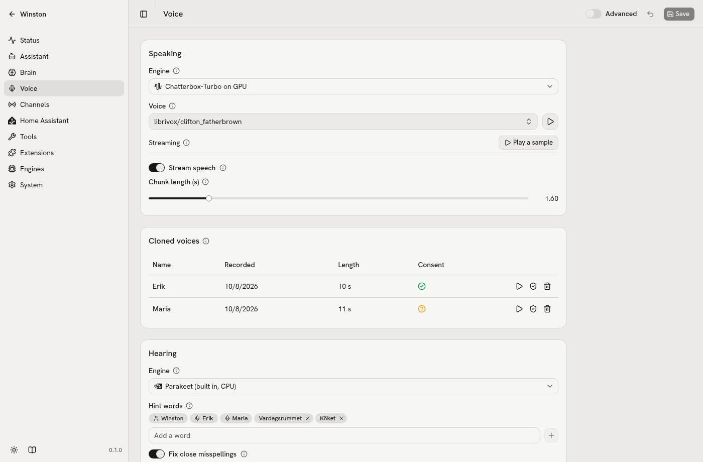

# Voices

## Chatterbox-Turbo server

`services/tts-chatterbox/` is a small FastAPI app exposing OpenAI's `/v1/audio/speech` on port 8880,
returning 24 kHz mono PCM (or WAV). It has its own Python 3.11 venv because Chatterbox pins
torch 2.6. The protocol, the voice cache and the warm-up are `services/speech_server.py`, which the
Pocket server (`services/tts-pocket/`) shares; each server only adds its engine. Start it from this
directory:

```sh
cd services/tts-chatterbox
.venv/bin/python server.py --voice ../../data/voices/vctk/p254_023.wav --voices-dir ../../data/voices
```

Try another voice without restarting by naming a clip relative to `--voices-dir`, e.g.
`{"voice": "vctk/p226_023"}`; set the default clip in the `engines.tts` command in config. A name
that would reach outside `--voices-dir` (`..`, an absolute path, a backslash) is refused with a 400,
here and in the Pocket server.

A request may also carry its own streaming settings, which override the startup flags for that
request only: `stream` (true or false), `first_secs`, `chunk_secs` and `lookahead_secs`. Fields it
leaves out keep the startup values, and a look-ahead not shorter than the first chunk is refused
with a 422, as it is at startup. The server warms up the streaming path at startup even with
`--stream false`, so a streamed request to it is not slow the first time. Its answer says which way
it rendered in an `X-Streaming: on` or `off` header. The Pocket server takes `stream` too (false
sends each sentence whole) and ignores the other three.

Preparing a clip the server has not used yet takes a moment on the GPU. It runs off the event loop,
so audio already being sent keeps flowing meanwhile.

## Other engines

Each is a preset on the Voice page, a small engine on the same shared server in its own venv, on
port 8880 in Chatterbox's place:

| Preset | Where | Clones from | Out | Notes |
| --- | --- | --- | --- | --- |
| Pocket TTS (`services/tts-pocket`) | CPU | 26 built-in voices, or a clip with Kyutai's gated weights | 24 kHz | No GPU at all |
| Qwen3-TTS 1.7B (`services/tts-qwen3`) | GPU, about 6.5 GB | a clip and its words | 24 kHz | Slower than real time on a 3090 beside the 27B brain |
| VoxCPM2 (`services/tts-voxcpm2`) | GPU, about 6.9 GB | a clip and its words | 48 kHz | Nearly fills a 24 GB card beside the 27B brain |
| Gepard 1.1 (`services/tts-gepard`) | GPU, about 2.2 GB | a clip alone | 22.05 kHz | Fastest to start, but drops and garbles more words |

Only one GPU voice fits beside the brain, so picking one stops the other. Qwen3-TTS and VoxCPM2 clone
from the clip's words as well: a `.txt` beside the clip if there is one, otherwise Parakeet
transcribes it once. How they compare is under [Benchmark](#benchmark).

VoxCPM2 takes `--denoise` (add it to the engine's command): each reference clip is cleaned once with
the package's ZipEnhancer before the voice is built, and the file on disk is left alone. It is for a
clip with steady noise in it. Measured 2026-10-08 on `vctk/p254_023`, five lines each:

| Reference clip | Without | With `--denoise` |
| --- | --- | --- |
| Clean | voice match 0.87, 3% word errors | 0.82, 0% |
| A fan-like hum 10 dB under the voice | 0.73, 0%, the hum copied into his voice | 0.73, 0%, no hum |
| Four other men talking 10 dB under it, and the hum | 0.63, 8%, the room copied in | 0.62, 41% |

So it removes a hum or a hiss, garbles a clip with other voices in it, and blurs a clean one a
little; the preset leaves it off.

## Trying a voice before saving

`POST /api/speak` on winstond speaks text through the configured speech server and streams 16-bit
mono PCM back. The Talk page uses it to read replies aloud. With `voice` and `streaming` it tries a
voice or streaming settings that are not saved yet, which is how the Voice page plays a sample:

```json
{"text": "Hello, I'm Winston.", "voice": "vctk/p226_023",
 "streaming": {"enabled": true, "chunk_secs": 2.4}}
```

- `voice` is any name the speech server knows. A name with `..`, a leading `/`, a backslash or a NUL
  is refused with a 422 before it reaches the server.
- `streaming` takes the fields of `tts.streaming` with the same limits; the ones left out are the
  saved values, and the whole is checked as the config is (look-ahead shorter than the first
  chunk), with a 422 when it is not. It reaches the speech server only when the `engines.tts`
  command uses `{tts.streaming.*}`, as the Chatterbox preset does, since a hosted server could refuse
  fields it does not know.
- The answer carries `X-Voice` (the voice sent, percent-encoded) and `X-Streaming`: `on` or `off`
  when the engine takes streaming settings, `ignored` when `streaming` was sent and did not apply
  (another engine, or a Chatterbox server started before it took per-request settings).

It speaks with the engine that is running. A changed engine in unsaved settings needs saving and a
restart of speaking before it can be heard.

On the Voice page, the play button beside Voice says "Hello, I'm Winston. This is how I sound." in
the voice picked, saved or not. When the Streaming settings show (the Chatterbox preset), "Play a
sample" on their heading speaks one long sentence with the unsaved switch, chunk length and, under
Advanced, first chunk and look-ahead, then shows the time from the click to the first sound beside
it until a streaming value changes. The sentence runs several seconds because chunks double from the
first one and start over with each sentence: a short line never reaches a long chunk length, so its
joins would not be heard. A warning icon beside the time means the running server did not use the
settings (`X-Streaming: ignored`). Both buttons are disabled, with "Save and restart speaking to hear
this engine", while the unsaved engine or server address differs from the saved one or speaking
waits for a restart; the sample also while look-ahead is not shorter than the first chunk.

`uv run python tests/preview_check.py` checks the same on the running Winston without a browser: it
asks for a voice other than the saved one, twice, and the sample unstreamed and streamed with 2.4 s
chunks, and prints the time to the first audio byte and to the end of each. It only listens; nothing
is saved.

## Voice dropdown

The voice dropdown on the Voice page lists, for a local server, "Server default" with the clip the
server started with (for instance "Server default: vctk/p254_023"; that clip is marked "server
default" below it), then your clips under `data/voices/`, then cloned voices by the friend's name,
marked "cloned". Consent recordings are never offered as a voice. A hosted server lists only your
clips, cloned voices and its built-in voices.

## Reference voices

`assets/voices/vctk/*.wav` (copied into `data/voices/vctk` by `winston init`) are sentence 23 from the CSTR VCTK Corpus (University of Edinburgh),
via Kyutai's `kyutai/tts-voices` mirror, licensed **CC BY 4.0**. Attribution: Yamagishi, J.,
Veaux, C., MacDonald, K. (2019), "CSTR VCTK Corpus: English Multi-speaker Corpus for CSTR
Voice Cloning Toolkit (version 0.92)", https://doi.org/10.7488/ds/2645. Speakers pulled as
British male candidates: p226 (Surrey), p232 (Southern England), p243 (London),
p254 (Surrey, **default**, chosen by Aldin 2026-09-22), p258 (Southern England), p273 (Suffolk).

Anything dropped into `data/voices/` (a personal clip, for instance) stays out of git.
Clone only from a permissively licensed clip or from someone who agreed to it, as below; never an actor.

## Cloned voices

Ask with the friend in the room: "Winston, clone my friend Maria's voice", or "clone my voice" for
your own. Winston then:

1. asks Maria to say "I'm Maria, and I agree that Winston can copy my voice.", with his name from
   `assistant.name`. Speech-to-text checks
   the words; without "agree" (or with "don't agree") nothing is recorded.
2. asks her to talk about anything for about fifteen seconds, and stops at 15 s of speech, or at a
   2.5 s pause after 10 s.
3. checks that the voice that agreed is the voice she talked in (below). When they differ he says
   "That doesn't sound like the person who agreed, so I won't keep it." and keeps nothing, not
   even the consent recording.
4. keeps only the speech, levels it and switches to it: "Got it. This is me as Maria now." That
   sentence starts about 0.4 s after she stops (measured headless).

While he records, and until she stops after his "Got it", the mic goes to the recording only, so
nothing Maria says counts as a turn or cuts him off; Winston stays quiet while she talks. A voice
already cloned is switched to by name ("use Maria's voice") without recording again. Under 6 s of speech is too little and nothing is stored. "Back to your own
voice" reverts; the clone lasts the conversation unless you say to keep it, which saves it as
`tts.voice`. Asking again for the same name records over the old clone.

Recording needs the browser (the Talk page or the dashboard's talk button). Switching does not: a
Voice PE box takes "Okay Winston, talk like Maria" and "your own voice again" too, for its conversation.

Each clone is `data/voices/friends/<name>.wav`, with the consent recording (`<name>.consent.wav`)
and its record (`<name>.json`) beside it. The Voice page lists them, plays both recordings and
deletes them.

<picture>
  <source media="(prefers-color-scheme: dark)" srcset="images/voice-dark.png">
  
</picture>

### The consent record

The consent is a record of who agreed, when, and in which voice. `<name>.json` holds the name, the
time, what speech to text heard (`consent_text`), and the same-voice check: `consent_score`,
`consent_checked_at` and `consent_model`.

The check compares the consent recording with the voice sample before anything is stored. A
speaker-embedding model turns each into a vector of how the voice sounds, whatever the words, and
the score is the cosine similarity of the two. At 0.55 or more the clone is kept with its score;
below, nothing is kept and the tool call's log line carries the score (`tool_calls.jsonl`). The
consent line has no date or weekday in it.

What it does and does not prevent:

- It stops keeping a voice when the one agreeing is not the one recorded: a friend says yes and
  someone else talks, or a clip of someone is played after a real person agreed.
- It does not stop a recording of the same person saying the line and then talking, played from a
  speaker; a replay of a real recording scores as the same voice.
- It cannot stop a clip added to `data/voices/` by hand. Such a clip is in the voice dropdown and
  never in Cloned voices, since there is no record for it.

The Consent column on the Voice page shows the check as an icon: a check for the same voice, a
question mark for Not checked, with the score, the time and what speech to text heard in the
tooltip. A mismatch never shows, since it is not kept. Clones made before the check have no score
and read Not checked, and so does a clone made while the model could not load: the check is
optional and never makes a clone fail.

The model is WeSpeaker's ResNet34 trained on VoxCeleb2
([Wespeaker/wespeaker-voxceleb-resnet34](https://huggingface.co/Wespeaker/wespeaker-voxceleb-resnet34),
a 26.5 MB ONNX file), run on the CPU through onnx-asr, which the speech to text already uses. Its
model card says Apache-2.0; WeSpeaker says its VoxCeleb models follow the dataset's licence, CC BY
4.0, so credit: Wang et al., "WeSpeaker: A Research and Production oriented Speaker Embedding
Learning Toolkit" (ICASSP 2023), trained on VoxCeleb2 (Chung, Nagrani, Zisserman, 2018). It loads
when the first clone of a session starts, while the friend is talking; the very first time it
downloads to the Hugging Face cache (about 2 s here), after that it loads in about 0.2 s.
A check of a 5 s consent against a 17 s sample takes about 0.3 s on the CPU.

The threshold was set on the clips in `data/voices/`: the first 3 or 5 s of one recording against a
different recording of the same reader, and against every other speaker.

| Pairs | Count | Scores |
| --- | --- | --- |
| Same speaker, other words | 52 | 0.61 to 0.91, median 0.77 |
| Of those, Aldin's real consent and sample, room mic | 1 | 0.79 |
| Same reader, one side processed to sound older | 50 | 0.38 to 0.68 |
| Different speakers | 370 | -0.09 to 0.54, 95% under 0.39 |

0.55 sits between the highest different pair (two older English audiobook readers, 0.54) and the
lowest same pair (0.61). These are studio and audiobook voices plus one real home recording; a
one-person home cannot measure how close a real second voice in the same room comes, so the numbers
are a starting point, not a guarantee. `tests/consent_cases.py` (in `winston check unit`) checks
that each VCTK speaker matches itself and none of the others, that a mismatch keeps nothing, and
that a missing model stores the clone as not checked.

`winston check clone` runs the whole exchange headless with two VCTK voices as the user and the
friend. Recording from a satellite's far-field mic waits for M3.

## Hearing engines

Speech to text is a slot like the brain and the voice: the Hearing card on the Voice page picks a preset.

| Preset | Where it runs | Takes hint words | Notes |
| --- | --- | --- | --- |
| Parakeet (built in, CPU) | inside the voice process, onnx-asr | no, fixed afterwards | The default; no GPU |
| Qwen3-ASR 0.6B on GPU | `services/stt-qwen3-asr` on port 8001 | yes, as its context | About 2.2 GB of VRAM; fits beside the 27B brain and Chatterbox |
| Qwen3-ASR 1.7B on GPU | the same service | yes | About 5 GB: beside the 27B brain it needs Pocket TTS instead of Chatterbox |
| Hosted | any server speaking OpenAI's transcription API | as its prompt | `STT_API_KEY` in `.env`; your speech leaves the LAN |

The Qwen3-ASR service has its own venv: run `uv sync` in `services/stt-qwen3-asr` once; the model
downloads on its first start. The presets after Parakeet use the `openai_transcription` adapter, which
sends each utterance to `stt.base_url` with the hint words as the request's `prompt`. Any server that
speaks the protocol works without code; vLLM's stock image lacks the audio libraries it needs for it.

Measured 2026-10-08 on six requests in three VCTK voices, the brain and Chatterbox running, with a
made-up scene name ("Zephyrine") as a hint word:

| | Parakeet | Qwen3-ASR 0.6B |
| --- | --- | --- |
| Clean | 3.0% word errors (1.6% after the misspelling fix) | 2.2% |
| Four other men talking 10 dB under the voice | 18.3% (15.5%) | 6.3% |
| A fan-like hum 5 dB under it | 13.8% (12.4%) | 4.5% |
| The hint word right | 6 of 9 | 9 of 9 |
| Time per request | about 0.2 s | about 0.29 s |

The box transcribes during the pause that ends a request, so the extra 0.09 s is not heard there. On
published benchmarks the 0.6B matches Parakeet on English overall and is weaker on Swedish (FLEURS);
the 1.7B is ahead on both.

## Hint words

Speech to text gets names wrong: Parakeet wrote "Hey Winson.", "Windsun" and "They win some." for
"Hey Winston" on a real mic, and "Vardag's Rummet" for Vardagsrummet. Hint words are the names it
should hear right. Winston adds some by himself: his name (`assistant.name`), the cloned voices,
Discord contacts while Discord is on, and the proper nouns among the names and aliases in the Home
Assistant list, one word at a time ("hektar lamp" gives Hektar; "the lights", "battery" and "phone"
give nothing). `stt.hint_words` adds the rest, such as room names in Swedish. While a voice is being
cloned, the friend's name is added for the consent recording.

An engine that can be told words in advance (`supports_hints` in the adapter contract) gets the list:
Qwen3-ASR as its context, a Whisper-style server as its prompt. Parakeet cannot, so with
`stt.fix_misspellings` on (the default) Winston corrects close misspellings afterwards, in
`core/hints.py`, for the voice channel, the satellites and the clone consent alike:

- A word, or two words run together, that sounds like a hint word (a phonetic key where d and t, b
  and p, g and k, v and f, s and z are one sound) and is spelled close to it (difflib ratio 0.7, 0.85
  for words of five letters or fewer) becomes that word. "Winson", "Windsun" and "Winsten" become
  Winston, "Vardag's Rummet" becomes Vardagsrummet.
- A common English word is never changed (a built-in list, `core/common_words.txt`), and two words
  run together only when neither is common, or when together they spell the hint word exactly. So
  "wind", "win some", "Wind sun" and "one plus" stay. So do other names that are not close enough
  (Wilson, Eric, Marie, Alden) and a hint word with more after it (Erika, Winstons).
- Punctuation, a possessive 's and all capitals are kept.

Every change is in the STT log line, before and after:

```
STT 1.20s audio -> 'Hey Winson.' -> 'Hey Winston.' (Winson -> Winston) in 180 ms
```

On the Voice page, Hearing shows the automatic words with their source's icon (the source in the
tooltip), yours with a Remove x, and a box to add more; the (i) on Hint words says what the current
engine does with them. `tests/hints_cases.py` (in `winston check unit`) checks the list, the
corrections and 200 ordinary English sentences that must come through unchanged. "I modeled in" for
"I'm" and a name is out of reach: every word in it is a common one.

## Benchmark

A voice to replace or sit beside Chatterbox-Turbo has to sound more human, start talking as soon,
and fit on the card next to the 27B brain: about 6.3 GB once Chatterbox (3.6 GB) is stopped, since
the brain keeps 16.9 GB and 2.8 GB is free while both run. `tests/tts_bench/` measures any speech
server on Winston's own lines in the same three voices and builds a blind A/B listening page against
Turbo; [its README](../tests/tts_bench/README.md) is the run procedure.

The candidates, checked on 2026-09-24:

| Candidate | Licence | Weights | Clones from | Streams | Out |
| --- | --- | --- | --- | --- | --- |
| Qwen3-TTS 1.7B Base (`qwen-tts` 0.1.1) | Apache-2.0 | 4.3 GB | a clip and its words | frame by frame, hooked in the server | 24 kHz |
| VoxCPM2 (`voxcpm` 2.0.3) | Apache-2.0 | 4.7 GB | a clip and its words | yes, the package's own | 48 kHz |
| Gepard 1.1 and 1.0 (nineninesix) | Apache-2.0, codec under NVIDIA's Open Model License | 1.1 GB each, codec 0.4 GB | a clip alone | frame by frame, hooked in the server | 22.05 kHz |
| Pocket TTS (`services/tts-pocket`) | MIT code, CC BY 4.0 weights | 0.4 GB | a clip, with Kyutai's gated weights | yes | 24 kHz, CPU |

Each new candidate runs in its own venv as a small engine on the shared speech server
(`services/speech_server.py`), and is a Voice preset as well ([other engines](#other-engines));
`tests/tts_bench/candidate.sh` runs one at a time for the benchmark.

- Qwen3-TTS's package returns audio only at the end; the server takes each 80 ms frame from the
  model as it is made and decodes as it goes, with the clip's own frames as left context. It has no
  tags; its 0.6B sibling was left out for quality. The package was last released in February.
- VoxCPM2 is the largest; upstream lists about 8 GB of VRAM, so it may not fit, and the benchmark
  measures it. It has no bracket tags either, but takes a style in parentheses.
- Gepard leads its own naturalness table (NISQA 4.25 against Chatterbox 4.19 on Seed-TTS-eval) but
  trails on speaker similarity (0.59 against 0.80), so it may sound natural and less like the clip.
  1.1 drops and invents fewer words than 1.0 at the same quality. Upstream serves it with vLLM; the
  server runs the plain transformers loop, so its speed here is a floor.
- Chatterbox-Flash (on Hugging Face since May) was left out: by Resemble's own numbers it is faster
  than Turbo, not more natural.

On the CPU (a 5800X, while the live engines held the GPU) all three new servers loaded, cloned
`vctk/p254_023` and spoke streamed and whole, and Parakeet heard the words back: Gepard at a
real-time factor of about 1.1 with the first audio after 0.75 s, Qwen3-TTS at about 6 and VoxCPM2 at
about 20. These prove the servers, not the GPU speed the benchmark is for.

### Clarity in noise, by reference voice

Measured 2026-10-08 with Chatterbox-Turbo streamed: ten of Winston's lines in each clip in
`vctk/` and `librivox/`, then mixed with four other men talking (10 and 5 dB under the voice) and a
fan-like hum (5 and 0 dB), with Parakeet as the listener. Word errors averaged over the four mixes,
21 voices:

| Voice | In noise | Clean |
| --- | --- | --- |
| `vctk/p232_023` | 16.6% | 3.3% |
| `librivox/barnes_jekyll` | 18.6% | 4.2% |
| `librivox/yearsley_sussex` | 19.4% | 2.5% |
| `vctk/p254_023` (the presets' default) | 19.6% | 2.5% |
| `librivox/clifton_fatherbrown` | 27.9% (ninth) | 2.6% |
| `librivox/yearsley_ghost` (last) | 52.1% | 0.0% |

Every voice is clear in quiet; noise is where they part. Ten lines per voice is a leaning: a gap under
about five points is noise.

### Results, 24 September

Run on the RTX 3090 next to the 27B brain (the live Chatterbox stopped for the GPU candidates), 20 of
Winston's lines in three voices; first sound is when a listener would hear him start. Then 36 blind
A/B pairs against Turbo as it ran (unstreamed), judged by Aldin.

| Engine | First sound | Word errors | GPU memory | Preferred over Turbo |
| --- | --- | --- | --- | --- |
| Chatterbox-Turbo, unstreamed | 0.96 s | 3.1% | 4.0 GB | (the baseline) |
| Chatterbox-Turbo, streamed | 0.45 s | 3.4% | 4.2 GB | 4 of 6 |
| Pocket TTS, built-in voice george | 0.71 s | 2.1% | none (CPU) | 4 of 6 |
| VoxCPM2 | 0.87 s | 3.6% | 6.9 GB | 3 of 6 (1 same) |
| Qwen3-TTS 1.7B | 0.93 s | 3.6% | 6.5 GB | 2 of 6 |
| Gepard 1.0 | 0.46 s | 9.4% | 2.2 GB | 1 of 6 (1 same) |
| Gepard 1.1 | 0.49 s | 14.4% | 2.2 GB | 0 of 6 |

Turbo stays. Streamed, it halves the wait and was preferred over its unstreamed self, so the joins
are not a problem. No candidate is clearly more human: VoxCPM2 edges it but leaves the card at 24.0 of
24.6 GB, Qwen3-TTS runs slower than real time (RTF 1.25), and Gepard drops and garbles words. Pocket
won with a different voice, so its pairs compare voices more than engines; they suggest the voice
Winston speaks in matters more than the engine. Six pairs per engine is a leaning, not proof.
