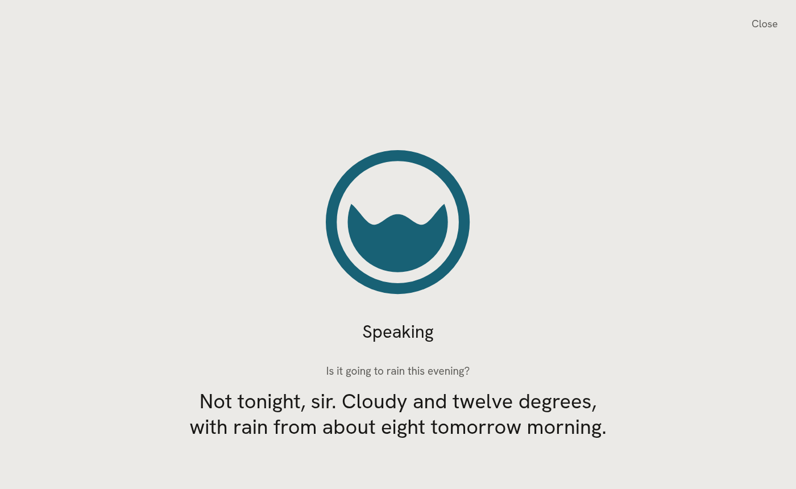
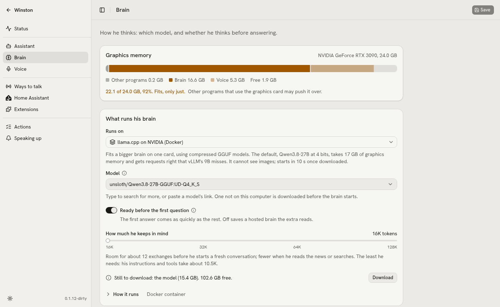
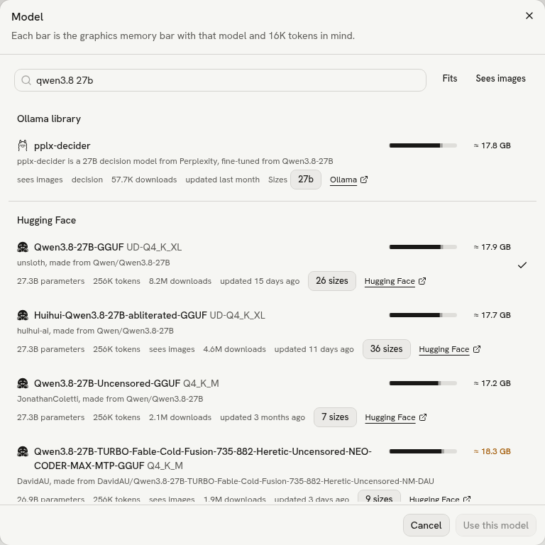
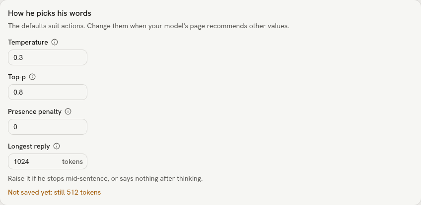

# Web UI

`winston up` serves the web UI at http://localhost:8700: the Talk page, History, Memory, the wall
display and the settings pages. This page goes through each one and how settings are saved. How the UI
looks and reads is in the [UI guide](ui-guide.md).

Browsers only give the microphone, and keep a screen on, for `localhost` or HTTPS, so talking from
another device needs HTTPS on the LAN. Who may open the pages at all is the Web address on
[Status](#status).

## Talk page

<picture>
  <source media="(prefers-color-scheme: dark)" srcset="images/talk-dark.png">
  
</picture>

The home page shows everything Winston hears, says and does, on any channel:

- each action as one line;
- a divider for each new conversation, and why it started;
- what he brought up on his own, as one line with the time, what he said and from whom;
- where a line came from, when it is another place ("Kitchen box", "Discord").

Under his name a line says whether he can answer: Ready, Listening, Thinking, Speaking, Starting, or
Can't answer with a link to Status. History, Memory and Settings are at the top right; Settings carries
a warning mark while something needs you.

- **Talk and type.** Type and press Enter, or press the round button to talk: it connects the
  browser's mic to the voice channel through winstond, with no wake word, so he hears everything until
  you press it again.
- **Read aloud.** The speaker icon in the message field reads typed replies aloud in Winston's voice,
  a sentence at a time as the reply streams in. It is off by default and remembered per browser; spoken
  turns are always read aloud.
- **New conversation** is the round button left of the field. Typed messages form one conversation,
  which starts fresh after New conversation after (30 min of quiet) and after a settings save.
- **The line above the field** holds the room picker, which puts this browser in a room with a Voice
  PE box: one conversation and one mic for both ([rooms](rooms.md)). At its right it says what matters
  now, such as "Microphone paused while the Kitchen box has it".
- **Not an archive.** The page keeps the last few hundred events while winstond runs; the tool log is
  the record.

Its settings are on Ways to talk, in the Talk page card:

| Setting | Key | Default | What it does |
| --- | --- | --- | --- |
| Talk by voice | `channels.voice.enabled` | on | Off leaves typing, and the page says the microphone is off |
| Wall display | none, it makes a link | | Takes a room, then Open or Copy link for a [wall display](#wall-display) |
| New conversation after | `channels.web.session_idle_mins` | 30 min | Quiet after which typed messages start a new conversation |

How long he waits in silence before answering in the browser is config.yaml only: raise
`vad.unfinished_stop_secs` if he cuts you off mid-sentence
([settings only in config.yaml](running.md#settings-only-in-configyaml)).

## History

<picture>
  <source media="(prefers-color-scheme: dark)" srcset="images/history-dark.png">
  
</picture>

History, at `/history` (`/turns` and `/diary` lead there), shows the spoken requests kept while
recordings are on, one day at a time under his diary entry for that day, or only the ones marked as
mistakes. With recordings off and none kept it is one sentence with Turn on recordings, which opens
Assistant. Recordings and marks are in [understanding](understanding.md#1-turn-record-and-marks).

## Memory

Memory, beside History, shows what he remembers by topic, with a search and New topic. It is described
with his memory in [tools](tools.md#memory).

## Wall display

<picture>
  <source media="(prefers-color-scheme: dark)" srcset="images/wall-dark.png">
  
</picture>

The wall display, at http://localhost:8700/wall, is the same feed full screen for a wall tablet.
`/dashboard` leads there, keeping its room. To set one up:

1. In Settings, Ways to talk, give the Wall display row on the Talk page card a room: a box's room or a
   Home Assistant area ([rooms](rooms.md)).
2. Open or Copy link, once per tablet. The link carries the room, as in `/wall?room=main room`.
3. On the tablet, tap the logo to talk and again to hang up.

What it shows:

- its room at the top left and Close at the top right;
- under the logo, a line that follows his state ("Tap to talk", or why he cannot answer);
- what you said and his answer, while he is busy and for 20 seconds after;
- what he says aloud on his own (an announcement, a message on the speakers), for a minute, until you
  tap it or answer it.

The page asks the browser to keep the screen on, which, like the mic, works only on `localhost` or
HTTPS. To show it in Home Assistant, add a Webpage card pointing at the wall display's address. If Home
Assistant itself is on HTTPS, the browser blocks a plain `http://` page inside it, so Winston needs
HTTPS too.

## Notices

Every page but the wall display says what happens to his parts in a notice at the bottom right, one
per part, each replacing the last:

- an engine installing: "Installing the brain, 42%", what it is getting ("The model, 6.2 of 16.4 GB")
  and a bar, then "Installed the brain, starting it", then "The brain is running";
- an engine starting: "Starting the brain" with how long it takes, then that it runs;
- any part, engine or channel, that fails ("The speaking voice failed" and why) or stops answering,
  with Status.

Installing, starting and a failure stay until they change or you close them; a closed one comes back
only when the part's state changes. The state a page opens on is not a notice, except a part already
installing or starting: Status says the rest. They follow `/api/status` (`progress` is how far an
install is, 0 to 1, while the sizes are known).

## Settings

Settings opens on Status. The sidebar groups the pages under Talk, its first item, which leads back to
him; the theme and the version are at its foot.

| Page | What it sets | More in |
| --- | --- | --- |
| Status | Engines, logs and the web address | [below](#status) |
| Assistant | His personality, region, memory and recordings of what you say | [identity](identity.md#his-personality), [tools](tools.md), [understanding](understanding.md#1-turn-record-and-marks) |
| Brain | What runs his brain and how he thinks | [below](#brain) |
| Voice | Speaking and hearing | [voices](voices.md) |
| Ways to talk | The Talk page, the wall display, room boxes, Discord, and From Home Assistant (the integration and Assist) | [rooms](rooms.md), [Voice PE](voice-pe.md), [Discord](discord.md) |
| Home Assistant | The connection and the devices he may use | [Home Assistant](home-assistant.md#the-page) |
| Extensions | Each extension, its settings and actions | [extensions](extensions.md#the-extensions-and-actions-pages) |
| Actions | What each action may do on its own | [extensions](extensions.md#the-extensions-and-actions-pages) |
| Speaking up | Quiet hours, announcements and what extensions may bring up | [announcements](announcements.md#settings), [speaking up](speaking-up.md) |

### Status

<picture>
  <source media="(prefers-color-scheme: dark)" srcset="images/status-dark.png">
  
</picture>

From the top:

- **Needs you**, only when something does: an engine or channel that failed or stopped responding,
  with Log, Restart and a link to its page; an extension that needs a key or is on but not running,
  with a link to it; Home Assistant set up but out of reach. Saved settings that wait for a restart are
  said once, in the header, with one Restart.
- **Set up next**, only while one applies: connect Home Assistant, choose the devices he may use, add
  a room box.
- **Updates**, here while a new release is out or an update is under way, else after Custom engines:
  this version, the latest, what is new since yours (each release's changes from its `CHANGELOG.md`),
  and Update with a confirm. Check now looks at once; when it finds a release the card moves up here,
  and the page scrolls to it. While an update runs it says how far it got, and the page reloads on the
  new version. The sidebar's footer says "Version 0.2.0 is out" on every Settings page. See
  [updating](setup.md#updating).
- **His parts**: Brain, Speaking, Hearing, Talk page microphone, Room boxes, Discord, Home Assistant
  and Extensions, each only while it is on (Home Assistant once it is set up): its page turns it on.
  Each row is described below the list.
- **Graphics memory**: "23.4 of 24.0 GB in use" and the card's name, then which of his parts run on
  the card, from the saved picks ("The brain and the speaking voice run on it."): a voice or hearing on
  the processor is not named. A part that does not fit will not start; a brain on Ollama runs partly on
  the processor instead, about three times slower. Above 90% the bar is in the warning colour and the
  card says "Nearly full: a bigger model or voice will not fit."
- **Custom engines**, once there is one: servers Winston starts and keeps running, which nothing uses
  until a setting points at their address. Each row opens its page at `/status/engines/<name>`, which
  shows How it runs open.
- **Web address**: Who can open this page, Only his computer or Every device on your network
  (`control.host`). Open to the network, a warning says anyone on it can control him (and your home,
  once Home Assistant is set up), and a line says keys cannot be pasted on these pages then. It takes
  effect when Winston restarts. API reference opens `/docs`.

A row in His parts says:

- what runs it, such as "2 boxes, 1 connected", or the brain's model by its own name ("Qwen3.8-27B"),
  without its maker, file format or quantization, which the Brain page shows whole;
- its state in words with how long ("Running, up 15 min", "Starting, 40 s of about 2 min"), and the
  reason under it when it is not running.

Its command is Restart while it runs, Start while it does not, and Set up for a Home Assistant not
connected yet. Its menu has Stop and Log, and the row opens the page that
sets it up. Stop and Restart say what stops and for how long ("Stop the brain? He cannot answer
anywhere until it starts again, about 24 s.").

The header has Restart everything, Start all (while something is stopped) and Stop all (while something
runs, after asking). Restart everything, after asking with how long each part takes to come back, stops
everything and runs `winston up` again in the same process, so a service or a terminal keeps it: every
engine and channel starts fresh, and so do the settings only his own restart applies (Web address). It
works when he was started with `winston up`, as the service does. Add a custom engine, under His parts
(under Custom engines once there is one), asks a name and how it runs. Log is described with
[status and errors](running.md#status-and-errors).

### Brain

<picture>
  <source media="(prefers-color-scheme: dark)" srcset="images/brain-dark.png">
  
</picture>

#### Graphics memory

A bar on top of the Brain and Voice pages (and the wizard's first step) shows how full the NVIDIA or
AMD card would be with the picks on the page, before saving. Its title names the card and its size
("NVIDIA GeForce RTX 3090, 24.0 GB"). Without a card it is **Computer memory** with the computer's
size, since a brain on his computer then runs on the processor.

- **Without a card**: a brain on the processor gets "Fits, but too slow to talk to: over a minute to
  his first word. A hosted brain answers in seconds." ([hardware](hardware.md#speed-on-the-processor)).
  In the wizard, the recommended hosted brain says why it is recommended.
- **Parts**: other programs, the brain, More to keep in mind (what the context adds past 16K), the
  voice and hearing on the card, in steps of grey from the brain, darkest, to other programs, palest.
  Each part's size is in the legend, and Free has its own swatch while there is any.
- **Verdict**: one status line, its icon in the tone's colour (green under 80%, amber to 100%, red past
  it) and one short sentence, with no numbers, since the bar and Free say how full it is: "Fits
  easily.", "Fits, with little room left for other programs.", "Fits, only just: other programs may
  push it over." Past 100% on a card, "Does not fit: part of the brain runs on the processor, about
  three times slower." on Ollama, else "Does not fit, so it will not start."; in the computer's memory,
  "Does not fit: he slows to a crawl, or a program is stopped."

It moves as you change a pick or the context slider. Other programs are read again every 15 seconds.
The sizes are the measured ones in [hardware](hardware.md#context-filled-last); a brain not measured is
estimated from its weights, and the legend marks its size ≈. It stays pinned while you scroll, except on a phone.

The What runs his brain card has, from the top:

- **Runs on**: presets (vLLM, llama.cpp, Ollama, a server on your network, hosted, Claude), each with a line on what it is good at and
  what it needs where its name does not say. Picking one rewrites the engine block and the settings
  that go with it, and asks first when you had edited that block.
- **Model**, a dialog ([choosing a model](#choosing-a-model)) with three lists: Running, what the brain's server reports; Downloaded, what the chosen
  engine can load from the Hugging Face cache on this machine; and Suggested, the presets' models for
  that engine, not downloaded yet. Typing searches for more, and a pasted model link is read as its
  name ([finding a model](#finding-a-model)). A pick that is not on this computer says what it needs downloaded,
  its size and the free space, with Download, which gets it while the brain that runs now keeps
  answering ([setup](setup.md#winston-installs-his-engines)).
- **Ready before the first question** (`llm.warm_up`, on): the brain reads his instructions and tools
  before anyone asks. See [below](#ready-before-the-first-question).
- **How much he keeps in mind** (`llm.context`), for a brain on this computer: a slider from 16K to
  128K in 4K steps, with about how many exchanges that is and how much more memory it takes than 16K.
- **How it runs**, closed at the bottom: the engine block (Runs as, Start with Winston, port, image,
  arguments and the rest), its state with Log and Restart while it runs, Reset to the preset while the
  block differs from the preset, the API address while Winston runs the engine, and How thinking is
  switched. A problem with the engine shows above it, never folded away.

Think before answering and How he picks his words are cards of their own. The second holds temperature,
top-p, presence penalty and the longest reply, for when your model's page recommends other values.

#### Choosing a model

Model opens a dialog with search at the top, Fits and Sees images beside it to narrow the list, and a row
for each model. A row is only chosen, by a click or Enter; Use this model takes it, and Cancel leaves the
model as it was, since a new model costs a download and a restart. While the server searches, the search
field's icon turns and an empty list says Searching, not Nothing matches.

<picture>
  <source media="(prefers-color-scheme: dark)" srcset="images/brain-model-dark.png">
  
</picture>

| Part of the row | Where it comes from |
| --- | --- |
| Name, then its size in grey ("Qwen3.8-27B-GGUF UD-Q4_K_XL") | The model's name; for Ollama, a name without `hf.co/` |
| A small memory bar and the brain's memory ("≈ 17.9 GB") | The [graphics memory](#graphics-memory) bar as it would be with this model at How much he keeps in mind, in the same steps of ink, with a notch where the card ends when it does not fit. The number is in the text colour when it fits, amber when only just (80% or more), red when not. Measured for the brains in [hardware](hardware.md#context-filled-last), else estimated from the weights (≈) |
| Who made it and what it is | Hugging Face: the repo's owner and "made from" its base model. Ollama: the library's own description |
| Parameters, longest context, what it can do, downloads, last update | The Hub's model API (parameters and context from the GGUF header). Ollama's library gives downloads and the last update; a pulled model, its size and parameters from Ollama. What it can do in words: sees images, uses actions, can think first. The weights' size only where the row has no memory bar |
| Sizes | A GGUF repo: "26 sizes" searches that repo, listing each with its memory. Ollama: each size (`8b`) chooses `name:8b` |
| A link to its page | Hugging Face or Ollama, underlined |
| A note | Why it is greyed ("vLLM only"), "Not downloaded yet", "Ollama pulls its own copy" |

Fits keeps the models whose bar fits, only just included; Sees images keeps those tagged vision. Each is
offered only while some model in the list has what it asks for.

The memory is shown only for a brain Winston runs on this computer: not for a hosted brain, a server on
your network, or vLLM, which takes its share of the card whatever the model (a vLLM model too big for
it is greyed, see below). An Ollama library model's memory is for its `latest`. A fact the source does
not give is left out. The Hub is asked once per repo while winstond runs; offline the rows show only
what the disk says.

#### Which models are listed

Downloaded is read from the disk, never the Hub: the host side of the engine's huggingface volume,
else `HF_HOME`, else `~/.cache/huggingface`.

| Engine | What Downloaded lists |
| --- | --- |
| llama.cpp | Each GGUF quant as `repo:quant`; a split file is one quant, listed once every part is there |
| Ollama | The same quants as `hf.co/repo:quant`, as Ollama pulls its own copy |
| vLLM | Safetensors repos with a language model config |

A model the engine cannot load is greyed with the reason ("vLLM only"). Speech models (Chatterbox,
Parakeet, Pocket TTS, a model card tagged text-to-speech) are left out. When Save changes the brain's
model to one that is neither running nor downloaded, the confirm says the restart downloads it first,
size unknown, and may take many minutes; the brain is offline until the download ends.

#### Finding a model

Typing two or more letters in Model's search searches for models the engine can download, and the
box says so ("Search, or paste a link"). Anything typed can still be used as is ("Use ...").

| Engine | What typing finds |
| --- | --- |
| llama.cpp | The Hub's most downloaded GGUF repos matching every word, each at its 4-bit size (`Q4_K_M`, else the nearest), with downloads and how many sizes it has |
| Ollama | Ollama's library first (`granite4.2`), then the same Hub repos as `hf.co/repo:quant` |
| vLLM | The Hub's safetensors repos with the size of their weights; Apple's MLX repos are left out |

- **A repo named exactly** (`unsloth/Qwen3.5-9B-GGUF`) or pasted as a link (`huggingface.co/...`,
  `hf.co/...`, `ollama.com/library/...`) lists every size of it, smallest first, each with its size.
- **Other sizes of this model**: with nothing typed, the GGUF repo picked now lists its other sizes, so
  a search result's 4-bit size can be changed.
- Ollama's library has no search API, so its search page's links are read. If that page changes, it
  finds nothing there and the Hub still answers.
- **Too big for vLLM**: a vLLM model whose weights plus 2 GB (its context and working memory) are more
  than vLLM's share of the card (`--gpu-memory-utilization` in How it runs, else vLLM's 0.9, of the
  card's memory) is greyed: "17.6 GB, too big for the 18.0 GB of graphics memory vLLM may use, with its
  context". Raising the share in How it runs lists it again. Downloaded repos are greyed the same way.
  A long context can still not fit; then Status says so when the brain starts.
- Offline, typing finds nothing and says nothing; a typed name still works.
- **A brain he does not run** (hosted, or a server on your network not known to be Ollama) lists what
  its server serves, and nothing is searched or downloaded: the box says "Search, or type a name" and
  Model has no help line. Until the list for a new Runs on arrives, the old engine's list is not shown.
- What is typed goes to the Hub (and to ollama.com for Ollama), and nothing else does.

Checked by `tests/model_search_cases.py`, against a fake Hub and Ollama page.

#### Ready before the first question

Reading his prompt cold takes a large model seconds, so with this on the brain reads it ahead:

- typed conversations (the Talk page and Discord share one prompt) when the brain's server comes up;
- a box when it connects, and again a minute after a brain restart;
- the Talk page microphone when it opens.

Off, nothing is read ahead, which saves a hosted brain the extra requests.

### Voice

<picture>
  <source media="(prefers-color-scheme: dark)" srcset="images/voice-dark.png">
  
</picture>

Voice does for speaking and hearing what Brain does for the brain: the [graphics memory](#graphics-memory)
bar, what runs each, its model or voice, and How it runs. The voices, cloning and hearing engines are in [voices](voices.md).

## How settings pages work

### How a setting shows

The settings pages are drawn from the config schema: a label that says what the setting does, a line
under it where the label cannot say it all, and an (i) beside it for the background. There are no view
modes: a setting is on its page or, for what nobody sets by hand, only in config.yaml
([settings only in config.yaml](running.md#settings-only-in-configyaml)).

- **A field that does not apply is not shown**: an API key only for a hosted brain or voice (an engine
  Winston does not run, at an address off this computer, so not Ollama here), and marked Optional when
  no key variable is named (a server on your network), the voice's Model only for a hosted one, the Streaming settings only when the speech engine's command
  uses them, engine fields only for their driver.
- **A feature switched off** (a channel, memory, announcements) keeps its fields visible and editable
  at full contrast. Its switch's line says they wait until it is on, and its keys do not warn.
- **Keys are never shown.** A key field says Saved or Not set, takes a pasted key that Save writes to
  `data/.env`, and Remove deletes the stored one at once, after asking. The variable it is stored under
  is config.yaml only, and a key refused while the page is open to your network names it.
- **Maps** (Discord contacts, an engine's environment and volumes) are tables with Add, a dialog per
  entry and trash with Undo.
- **A card about something that runs** (the Talk page, Room boxes, Discord) shows its state in its
  title while it is not running.
- **The Home Assistant page** checks the address and token before anything is saved
  ([Home Assistant](home-assistant.md#the-page)).

### Choices filled for you

Anything a machine already knows is a searchable dropdown filled from `/api/options/{name}`, and a
typed value still works when the list is empty. A list that cannot be fetched (no token yet, the server
down) leaves a plain text box with the reason in a line under it.

| Field | Filled from |
| --- | --- |
| Brain model | Running: the brain's server (`/models`), following an unsaved base URL. Downloaded: the Hugging Face cache the engine reads, with each model's size on disk ([which models are listed](#which-models-are-listed)). Suggested: the presets' models for that engine. Typed: the Hub and Ollama's library ([finding a model](#finding-a-model)) |
| Voice | Clips in `data/voices/`, your cloned voices and the TTS server's built-in voices |
| Speech-to-text model | The models onnx-asr knows, downloaded ones marked |
| Home Assistant entities, sensors, domains | Home Assistant's states, with each entity's name, state and an icon for its type |
| Your Discord user ID, contacts | The members of the bot's servers, a pasted id looked up ([Discord](discord.md)) |
| Sound before an announcement | None, and the sounds in `assets/sounds/` and `data/sounds/` |
| Who can open this page | Only his computer, Every device on your network |

### Saving

Edits are one draft across all pages until saved or discarded. Each edited field says "Not saved yet"
under it, with the saved value still in effect ("still 512 tokens"). Beside Save the header counts them
("1 unsaved change"), and a dot in the sidebar marks each page with unsaved edits. Closing the tab asks
first. On a phone, Discard and Save sit in a bar along the bottom while there are unsaved changes. The
setup wizard saves each step on Next, so its fields never say it.

<picture>
  <source media="(prefers-color-scheme: dark)" srcset="images/unsaved-dark.png">
  
</picture>

Save sends only the changed fields (`PATCH /api/config` with the version the edits started from). It
asks first when something starts, stops or restarts, or when the edits reach past the current page. Its
confirm lists:

- the changes, by page, naming up to three entries of a list ("Devices he can use: Desk lamp, Porch
  light and 16 more");
- what the save starts, stops and restarts, with roughly how long each takes;
- a model download;
- what Home Assistant would change.

The confirm's title says it ("Save and start the room boxes and restart the brain?"). Pasted keys are
written after the config. A field the server refuses is marked where it is. Once saved, each changed
field's card rings for a moment, as where a link to a setting lands does.

If something else saved one of the same fields meanwhile (a voice switched by asking), nothing is
overwritten: the page reloads, keeps your edits on top, names the field in a message, and you save
again. Discard asks when edits reach past the current page, offering that page alone.

### Waiting for a restart

While a saved change waits for a restart, every settings page says so beside Save ("Waiting for a
restart: the brain, about 24 s"; the icon lists each part and its cost), with a Restart button that
restarts only those. What only winstond reads (the web address, announcements, Home Assistant) says it
takes effect when Winston restarts, the next `winston up`, and has no button.

## Building and testing it

Build it once (Node 22 or newer, pnpm); `winston up` serves it once `web/dist` exists.

```sh
cd web && pnpm install && pnpm build   # guardrails, lint, type check, bundle into web/dist
```

| Command | What it does |
| --- | --- |
| `pnpm dev` | Vite on :5173 with `/api` proxied to :8700 |
| `pnpm api` | Regenerates the typed client from `winston api schema` after the API changes |
| `pnpm smoke`, or `winston check ui` | Tests the built pages with Playwright |

The smoke test runs in the system Chromium, or Chrome where there is none (or set `CHROMIUM`). It
starts a throwaway `winston up --no-start` on a free port and deletes it all afterwards. Nothing it does
reaches the running brain, voice server, channels, MCP servers or Spotify receiver:

- it copies `config.yaml` and `persona.md` from the data directory Winston uses (or `WINSTON_SOURCE`)
  to a temp directory, with fake keys;
- every engine and channel is off, Home Assistant points at a fake one (`tests/fake_ha.py`), every
  other address points nowhere and every port is moved to a free one;
- the brain is llama.cpp in Docker whatever the copied one is, so the Brain page's tests that switch
  Runs on start from the same place on every computer.

It checks that:

- every settings page loads with nothing to save;
- every page fits a 390 px phone with every How it runs open, without sideways scroll or a card's
  content wider than the card;
- a rename survives a reload;
- a pasted key shows as Saved and never comes back from the server, and an MCP server's token lands
  in `data/.env` alone;
- a hosted-only field is left out for a local engine;
- a refused save opens the How it runs that holds the field;
- Status lists the custom engines and who can open the page;
- Save only leaves a Restart button;
- the Brain, Voice, Home Assistant, Memory, History and Talk pages' own cases pass.
