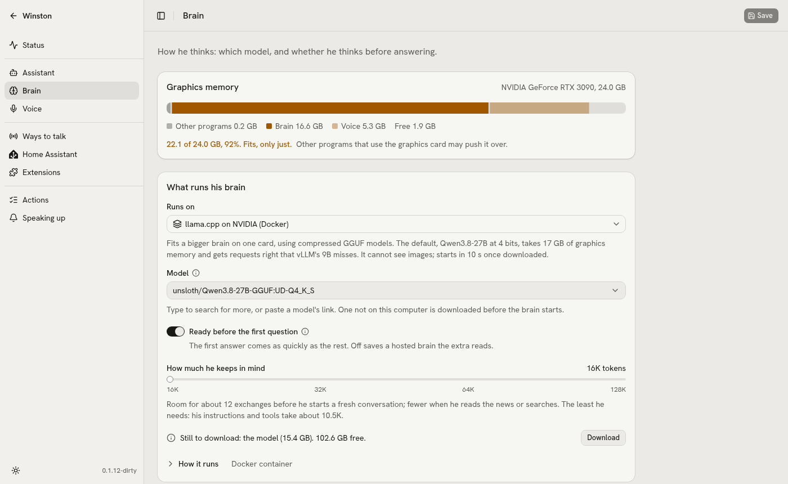

# Writing docs

How the docs are kept current and how they should read. Applies to people and to Claude.

## Docs ship with the change

A change is not done until the docs say it exists. In the same commit as the code:

- **README**: only when the change alters what Winston is at a glance: a new channel, a new
  requirement, a quickstart step. Most features belong on their topic page alone. It has no status:
  that is the plan's.
  The feature list stays at about eight short lines; a new feature is folded into an existing line or
  replaces a weaker one, never appended. Reread the whole README and rewrite it as one page, not as a
  log of what was added last.
- **The topic page**: the page that owns the subject gets the detail (see the map below). A topic
  page says what is true now. When a change touches a paragraph, rewrite the paragraph; do not add a
  dated sentence to it. "Since", "until" and "before" with a date belong in `decisions.md`.
- **`docs/decisions.md`**: one entry for any deviation from the plan: date, what, why, in at most two
  lines.
- **`docs/plan.md`**: the status, the trial results and what was measured, with their dates.

Before committing, read the README top to bottom once and ask: would someone cloning today be
surprised by anything? Remove what is no longer true; stale lines are worse than missing ones.

## Where things go

The README is the front page, not the manual. It answers what Winston is, what it looks like, how to
start it, and where to read more. Anything longer than a line or two goes to a page and the README
links to it.

| Page | Owns |
| --- | --- |
| `README.md` | Pitch, one screenshot, install, about eight features, links |
| `docs/running.md` | Commands, engines, logs, exposure |
| `docs/web-ui.md` | The web UI's pages and how settings pages work |
| `docs/setup.md` | Installing, what needs root, the first-run wizard, updating and removing, releases |
| `docs/architecture.md` | How the parts fit, the config API and its metadata, which settings page owns what, the repository, plugin contracts |
| `docs/ui-guide.md` | How the web UI looks and reads: its rules, words and templates |
| `docs/identity.md` | His name, his personality and his logo |
| `docs/hardware.md` | Profiles, GPUs, and what each pick needs |
| `docs/voices.md`, `docs/voice-pe.md`, `docs/rooms.md` | Their one subject |
| `docs/voice-benchmarks.md` | A dated record of the voice and hearing benchmarks |
| `docs/understanding.md` | How he hears, decides he is spoken to, and knows what a name means |
| `docs/tools.md` | Winston's own tools, their keys and limits, memory |
| `docs/computer.md` | The computer server: opening things, status, logs and updates on each computer |
| `docs/home-assistant.md`, `docs/assist.md`, `docs/ha-integration.md`, `docs/announcements.md`, `docs/discord.md` | Their one subject |
| `docs/extensions.md` | The extension standard: what one is, permissions, writing one |
| `docs/extension-sdk.md` | The SDK reference |
| `docs/speaking-up.md` | Nudges: how extensions speak up, the rules, the Speaking up page |
| `docs/built-in-extensions.md` | The extensions that come with Winston |
| `docs/spotify.md`, `docs/vulnerabilities.md` | Their one extension |
| `docs/direction.md` | Where Winston is going and why, from research across the alternatives (dated) |
| `docs/known-issues.md` | What does not work yet for a user, what to do instead, and a link to where it stands |
| `docs/plan.md` | Milestones, their status, and what was measured when |
| `docs/decisions.md` | What changed and why, one line each |

A subject that outgrows a section of its page (a new channel with setup steps, a tool with keys and
limits) gets its own page in `docs/`, linked from the README and from the page it left. Prefer several
short pages over one long one: a section over about 40 lines gets subheadings named for what the
reader wants to do, and a section over about 100 lines, or a page over about 300, becomes its own page.

## Style

- Short. Say what it does and how to use it; the why goes in `decisions.md`. No intros that restate
  the heading, no closing summaries, no "Overview" sections.
- Short paragraphs: one subject each, at most about six lines. Facts about several things side by side
  (engines, settings, options) go in a table or a list, not in one paragraph.
- Plain words, first-hand tone. Numbers that were measured, not adjectives. A number on a topic page is
  one the reader acts on (a size, a limit, a default, a wait) and carries no date; trial results and
  before and after go to `plan.md`.
- When a section names more than three settings, flags or parameters, use a table: its name on the
  page, its key, its default, what it does. Prose names a setting by its label. At most about two
  code spans in a sentence.
- No em dashes. No emoji in prose.
- Code blocks only for things someone types or pastes.

## Pictures

- **Screenshots over descriptions.** When the web UI changes visibly, retake the affected shot. Shots
  live in `docs/images/`, taken at 1400x860 in both themes and cropped to the content, and are shown with
  a `<picture>` element so GitHub picks light or dark. A shot of part of a page (an MCP server's actions)
  may be cut from a full-page capture at 1400 wide and shown at its own width. Paths are relative to the
  page: `images/...` from a page in `docs/`, `docs/images/...` from the README. The alt text says what
  the shot shows.
  ```html
  <picture>
    <source media="(prefers-color-scheme: dark)" srcset="images/brain-dark.png">
    
  </picture>
  ```

  A shot is named for its page in lower case with dashes (`status`, `ways-to-talk`, `wall`), and
  `extensions-news` for an extension's page.

  The README's first picture, `hero`, is History in a window with the wall display on a tablet in
  front, composed from their shots. After retaking either, run `uv run python scripts/hero.py`.

  Take them against a running `winstond` with Playwright and the system Chromium. Never capture
  anything from `data/` that is personal: entity names, phone numbers, memory facts, tokens.
  For the Home Assistant page, point a throwaway instance at `tests/fake_ha.py --seed home`, a made-up
  home with fake names and a fake token, never at the real Home Assistant.
- **Diagrams in Mermaid, never ASCII art.** GitHub renders a ```` ```mermaid ```` block as an image
  and it stays editable in the diff. Keep one diagram to one idea and under about a dozen nodes.
- **Icons and badges** come from real sources: shields.io badges in the README header, the project's
  own logo once it exists. Do not draw icons out of Unicode or emoji.
